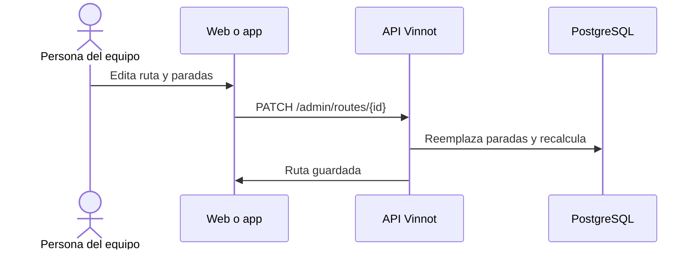

# UC-ADM-05 · Gestionar rutas del vino

| Campo | Valor |
|---|---|
| ID | `UC-ADM-05` |
| Módulo | [Administración y moderación](../README.md) |
| Plataformas | Web, APK |
| Actores | Equipo de moderación (administrador o moderador) |
| IDs en Lucidchart | [WEB UC-ADM-05](https://lucid.app/lucidchart/9f11a16b-bb5a-42fc-a9e8-0852b17bd241/edit), [APK UC-ADM-05](https://lucid.app/lucidchart/e095dd25-e8ac-41ba-bf5b-396e1055f217/edit) |
| Requisitos | [`RF-WEB-ADM-13`](../requirements.md), [`RF-WEB-ADM-14`](../requirements.md), [`RF-WEB-ADM-15`](../requirements.md), [`RF-APK-ADM-13`](../requirements.md), [`RF-APK-ADM-14`](../requirements.md), [`RF-APK-ADM-15`](../requirements.md) |
| Casos de prueba | [`CP-ADM-15`](../testing.md), [`CP-ADM-16`](../testing.md), [`CP-ADM-17`](../testing.md), [`CP-ADM-18`](../testing.md) |

## Precondiciones

- La persona es administradora o moderadora.

## Postcondiciones

- La ruta quedó guardada como borrador, publicada o archivada, con sus paradas en orden.

## Flujo principal

1. La persona abre «Rutas» y elige crear o editar.
2. Completa nombre, región, subregión, descripción, duración, distancia, portada y tipos de vino.
3. Agrega, edita, quita y ordena paradas, vinculadas a una bodega o con sus propias coordenadas.
4. Elige el estado: borrador, publicada o archivada.
5. El cliente envía `POST /admin/routes` o `PATCH /admin/routes/{id}` con la lista completa de paradas, y la API recalcula duración y distancia.

## Flujos alternativos

- 4a. Se pide publicar sin paradas: la API responde 400; como borrador sí se guarda.
- 3a. Buscar las coordenadas de una parada solo cambia el borrador de la parada, nunca la bodega vinculada.
- 1a. Un administrador elige borrar y confirma: la ruta se borra con sus paradas.

## Reglas de negocio

- Una ruta tiene hasta 100 paradas.
- Guardar las paradas reemplaza la lista entera.
- Solo las rutas publicadas se ven en [Rutas del vino](../../wine-routes/README.md).
- Un campo opcional vaciado se envía como borrado explícito; un campo que no se envía conserva su valor.
- Solo un administrador borra, con confirmación y con la identidad confirmada en los últimos 5 minutos ([UC-USR-12](../../users/use-cases/uc-usr-12-reauthenticate.md)).

## Diagrama

[Ver diagrama de «UC-ADM-05 · Gestionar rutas del vino» completo](https://images.vinnot.com/docs/diagrams/v1/es/modules-admin-use-cases-uc-adm-05-manage-routes-df7b82b608c5.svg)

Diagrama de componentes en Lucidchart: [WEB UC-ADM-05](https://lucid.app/lucidchart/9f11a16b-bb5a-42fc-a9e8-0852b17bd241/edit), [APK UC-ADM-05](https://lucid.app/lucidchart/e095dd25-e8ac-41ba-bf5b-396e1055f217/edit).

## Código

| Capa | Ubicación |
|---|---|
| Endpoints | `GET /admin/routes`, `GET /admin/routes/{id}`, `POST /admin/routes`, `PATCH /admin/routes/{id}`, `DELETE /admin/routes/{id}` |
| Backend | [`WineRouteAdminController.java`](../../../../../backend/src/main/java/com/vinnot/admin/infrastructure/web/controller/WineRouteAdminController.java), [`UpdateWineRouteCommandHandler.java`](../../../../../backend/src/main/java/com/vinnot/wineroute/application/command/handler/UpdateWineRouteCommandHandler.java), [`WineRoute.java`](../../../../../backend/src/main/java/com/vinnot/wineroute/domain/model/WineRoute.java) |
| Web | [`AdminRoutesPage.tsx`](../../../../../frontend-react/src/presentation/pages/admin/AdminRoutesPage.tsx), [`useAdminRoutesViewModel.ts`](../../../../../frontend-react/src/presentation/pages/admin/useAdminRoutesViewModel.ts), [`useAdminRouteMutations.ts`](../../../../../frontend-react/src/presentation/hooks/queries/admin/useAdminRouteMutations.ts), [`admin.service.ts`](../../../../../frontend-react/src/application/services/admin.service.ts), [`admin.client.ts`](../../../../../frontend-react/src/infrastructure/api/clients/admin.client.ts) |
| App | `frontend-mobile/app/(app)/admin/routes.tsx`, [`AdminRoutesScreen.tsx`](../../../../../frontend-mobile/src/presentation/features/admin/AdminRoutesScreen.tsx), [`AdminRouteSheet.tsx`](../../../../../frontend-mobile/src/presentation/features/admin/AdminRouteSheet.tsx), [`AdminRouteSheetStopsSection.tsx`](../../../../../frontend-mobile/src/presentation/features/admin/AdminRouteSheetStopsSection.tsx), [`admin.service.ts`](../../../../../frontend-mobile/src/application/services/admin.service.ts), [`admin.client.ts`](../../../../../frontend-mobile/src/infrastructure/api/clients/admin.client.ts) |

## Tests automáticos

- Backend: [`WineRouteMutationHandlersTest.java`](../../../../../backend/src/test/java/com/vinnot/wineroute/application/command/handler/WineRouteMutationHandlersTest.java), [`WineRouteTest.java`](../../../../../backend/src/test/java/com/vinnot/wineroute/domain/model/WineRouteTest.java)
- Web: [`useAdminRoutesViewModel.test.tsx`](../../../../../frontend-react/src/presentation/pages/admin/useAdminRoutesViewModel.test.tsx)
- App: [`routeShells.test.ts`](../../../../../frontend-mobile/src/presentation/features/admin/__tests__/routeShells.test.ts)
