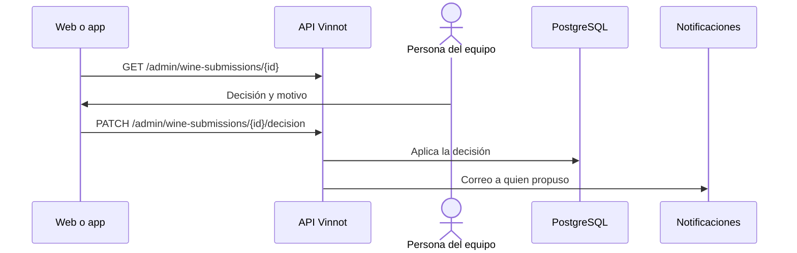

# UC-ADM-06 · Revisar vinos propuestos

| Campo | Valor |
|---|---|
| ID | `UC-ADM-06` |
| Módulo | [Administración y moderación](../README.md) |
| Plataformas | Web, APK |
| Actores | Equipo de moderación (administrador o moderador) |
| IDs en Lucidchart | [WEB UC-MOD-05](https://lucid.app/lucidchart/9f11a16b-bb5a-42fc-a9e8-0852b17bd241/edit), [APK UC-MOD-04](https://lucid.app/lucidchart/e095dd25-e8ac-41ba-bf5b-396e1055f217/edit) |
| Requisitos | [`RF-WEB-ADM-16`](../requirements.md), [`RF-WEB-ADM-17`](../requirements.md), [`RF-WEB-ADM-18`](../requirements.md), [`RF-WEB-ADM-19`](../requirements.md), [`RF-WEB-ADM-20`](../requirements.md), [`RF-APK-ADM-16`](../requirements.md), [`RF-APK-ADM-17`](../requirements.md), [`RF-APK-ADM-18`](../requirements.md), [`RF-APK-ADM-19`](../requirements.md), [`RF-APK-ADM-20`](../requirements.md) |
| Casos de prueba | [`CP-ADM-19`](../testing.md), [`CP-ADM-20`](../testing.md), [`CP-ADM-21`](../testing.md), [`CP-ADM-22`](../testing.md), [`CP-ADM-23`](../testing.md), [`CP-ADM-24`](../testing.md) |

## Precondiciones

- Hay vinos propuestos esperando revisión.

## Postcondiciones

- El vino propuesto quedó aprobado como nuevo, unido a uno existente, rechazado o devuelto para corregir.

## Flujo principal

1. La persona abre «Vinos propuestos»; la lista empieza en los que esperan revisión, de a 20.
2. Elige uno; el cliente carga el detalle y, si la tiene, la foto con la sesión.
3. El detalle muestra cada bodega, país, región y uva como dato existente del catálogo o como valor nuevo propuesto.
4. La persona elige aprobar como nuevo, unir a un vino existente, rechazar o pedir correcciones, y escribe el motivo.
5. El cliente envía `PATCH /admin/wine-submissions/{id}/decision` y la API aplica la decisión.

## Flujos alternativos

- 4a. Al aprobar como nuevo, la persona puede corregir los datos del catálogo antes de decidir.
- 4b. Unir pide el vino de destino.
- 5a. El envío ya se decidió: la API responde 409.
- 5b. Faltan datos del catálogo para crear el vino: la API responde 400.
- 2a. La foto no carga: se muestra un error con reintento, sin perder lo escrito.

## Reglas de negocio

- Solo se deciden envíos en revisión.
- Un envío sin foto (motivo `LABEL_PHOTO_MISSING`) se puede aprobar como nuevo y el vino se publica sin imagen.
- El motivo es obligatorio, de hasta 500 caracteres.
- Quien propuso recibe un correo con el resultado.
- El circuito completo del vino propuesto está en [Vinos propuestos](../../wines/submissions.md).

## Diagrama

[Ver diagrama de «UC-ADM-06 · Revisar vinos propuestos» completo](https://images.vinnot.com/docs/diagrams/v1/es/modules-admin-use-cases-uc-adm-06-review-wine-submissions-0e275f74881b.svg)

Diagrama de componentes en Lucidchart: [WEB UC-MOD-05](https://lucid.app/lucidchart/9f11a16b-bb5a-42fc-a9e8-0852b17bd241/edit), [APK UC-MOD-04](https://lucid.app/lucidchart/e095dd25-e8ac-41ba-bf5b-396e1055f217/edit).

## Código

| Capa | Ubicación |
|---|---|
| Endpoints | `GET /admin/wine-submissions`, `GET /admin/wine-submissions/{id}`, `GET /admin/wine-submissions/{id}/image`, `PATCH /admin/wine-submissions/{id}/decision` |
| Backend | [`WineSubmissionAdminController.java`](../../../../../backend/src/main/java/com/vinnot/wine/infrastructure/web/controller/WineSubmissionAdminController.java), [`ReviewWineSubmissionCommandHandler.java`](../../../../../backend/src/main/java/com/vinnot/wine/application/command/handler/ReviewWineSubmissionCommandHandler.java) |
| Web | [`AdminWineSubmissionsPage.tsx`](../../../../../frontend-react/src/presentation/pages/admin/AdminWineSubmissionsPage.tsx), [`useAdminWineSubmissionsViewModel.ts`](../../../../../frontend-react/src/presentation/pages/admin/useAdminWineSubmissionsViewModel.ts), [`useAdminWineSubmissionMutations.ts`](../../../../../frontend-react/src/presentation/hooks/queries/admin/useAdminWineSubmissionMutations.ts), [`useAdminSubmissionImage.ts`](../../../../../frontend-react/src/presentation/hooks/queries/admin/useAdminSubmissionImage.ts), [`admin.service.ts`](../../../../../frontend-react/src/application/services/admin.service.ts), [`admin.client.ts`](../../../../../frontend-react/src/infrastructure/api/clients/admin.client.ts) |
| App | `frontend-mobile/app/(app)/admin/submissions.tsx`, [`AdminSubmissionsScreen.tsx`](../../../../../frontend-mobile/src/presentation/features/admin/AdminSubmissionsScreen.tsx), [`useAdminSubmissionsViewModel.ts`](../../../../../frontend-mobile/src/presentation/features/admin/useAdminSubmissionsViewModel.ts), [`admin.service.ts`](../../../../../frontend-mobile/src/application/services/admin.service.ts), [`admin.client.ts`](../../../../../frontend-mobile/src/infrastructure/api/clients/admin.client.ts) |

## Tests automáticos

- Backend: [`ReviewWineSubmissionCommandHandlerTest.java`](../../../../../backend/src/test/java/com/vinnot/wine/application/command/handler/ReviewWineSubmissionCommandHandlerTest.java)
- Web: [`AdminWineSubmissionsPage.test.tsx`](../../../../../frontend-react/src/presentation/pages/admin/AdminWineSubmissionsPage.test.tsx), [`useAdminSubmissionImage.test.tsx`](../../../../../frontend-react/src/presentation/hooks/queries/admin/useAdminSubmissionImage.test.tsx)
- App: [`AdminSubmissionsScreen.test.tsx`](../../../../../frontend-mobile/src/presentation/features/admin/AdminSubmissionsScreen.test.tsx), [`useAdminSubmissionsViewModel.test.ts`](../../../../../frontend-mobile/src/presentation/features/admin/useAdminSubmissionsViewModel.test.ts)
