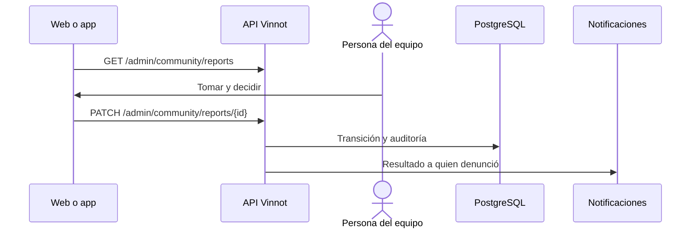

# UC-ADM-07 · Revisar denuncias y retirar contenido

| Campo | Valor |
|---|---|
| ID | `UC-ADM-07` |
| Módulo | [Administración y moderación](../README.md) |
| Plataformas | Web, APK |
| Actores | Equipo de moderación (administrador o moderador) |
| IDs en Lucidchart | [WEB UC-MOD-02](https://lucid.app/lucidchart/9f11a16b-bb5a-42fc-a9e8-0852b17bd241/edit), [WEB UC-MOD-03](https://lucid.app/lucidchart/9f11a16b-bb5a-42fc-a9e8-0852b17bd241/edit), [APK UC-MOD-01](https://lucid.app/lucidchart/e095dd25-e8ac-41ba-bf5b-396e1055f217/edit) |
| Requisitos | [`RF-WEB-ADM-21`](../requirements.md), [`RF-WEB-ADM-22`](../requirements.md), [`RF-WEB-ADM-34`](../requirements.md), [`RF-APK-ADM-21`](../requirements.md), [`RF-APK-ADM-22`](../requirements.md) |
| Casos de prueba | [`CP-ADM-25`](../testing.md), [`CP-ADM-26`](../testing.md), [`CP-ADM-27`](../testing.md), [`CP-ADM-28`](../testing.md), [`CP-ADM-29`](../testing.md), [`CP-ADM-64`](../testing.md) |

## Precondiciones

- Hay denuncias de la comunidad.

## Postcondiciones

- La denuncia quedó en revisión, resuelta o desestimada, y el contenido se retiró si correspondía.

## Flujo principal

1. La persona abre «Comunidad»; la lista muestra las denuncias abiertas.
2. Filtra por estado y abre una denuncia con su evidencia, su autor, a qué se refiere (el tipo y el vino, evento, ruta o nombre de usuario) y quién la revisa.
3. La toma para revisarla: pasa a en revisión y queda asignada a esa persona.
4. La resuelve o la desestima, escribiendo la decisión.
5. El cliente envía `PATCH /admin/community/reports/{id}` y la API aplica la transición.

## Flujos alternativos

- 2a. El autor, el contenido o quien revisa fue eliminado: ese dato se oculta; nunca se muestran identificadores en su lugar.
- 2b. La denuncia es de calidad de catálogo: en la web muestra «Vinnot (automático)» como denunciante, el vino reconocido, «Vino elegido por el miembro», una explicación del posible duplicado, bodega equivocada o imagen equivocada, y enlaces para abrir ambos vinos; la app muestra la misma explicación, el denunciante y el vino elegido, y «Revisar contenido» abre la administración de vinos. Solo se ofrece resolver o desestimar; si hace falta, la persona corrige el catálogo a mano en la administración de vinos.
- 4a. La denuncia es sobre una reseña o un comentario: la persona puede retirar el contenido con confirmación; la denuncia queda resuelta y el autor recibe el aviso con el motivo.
- 5a. Resolver o desestimar sin texto: la API responde 422.
- 5b. La denuncia ya la tomó otra persona: la API responde 422.
- 5c. La persona hizo la denuncia o es autora del contenido: la API responde 422.

## Reglas de negocio

- Quien revisa nunca ve las denuncias que hizo ni las de su propio contenido.
- Una denuncia cerrada no se reabre.
- Solo se retiran reseñas y comentarios; un vino del catálogo nunca se retira desde una denuncia y las denuncias de calidad de catálogo nunca editan el catálogo.
- Quien denunció recibe el resultado; las denuncias cerradas se borran a los 90 días ([Comunidad](../../community/README.md)).

## Diagrama

[Ver diagrama de «UC-ADM-07 · Revisar denuncias y retirar contenido» completo](https://images.vinnot.com/docs/diagrams/v1/es/modules-admin-use-cases-uc-adm-07-moderate-reports-d8531d0c44e6.svg)

Diagrama de componentes en Lucidchart: [WEB UC-MOD-02](https://lucid.app/lucidchart/9f11a16b-bb5a-42fc-a9e8-0852b17bd241/edit), [WEB UC-MOD-03](https://lucid.app/lucidchart/9f11a16b-bb5a-42fc-a9e8-0852b17bd241/edit), [APK UC-MOD-01](https://lucid.app/lucidchart/e095dd25-e8ac-41ba-bf5b-396e1055f217/edit).

## Código

| Capa | Ubicación |
|---|---|
| Endpoints | `GET /admin/community/reports`, `PATCH /admin/community/reports/{id}`, `POST /admin/community/reports/{id}/remove-content` |
| Backend | [`CommunityModerationController.java`](../../../../../backend/src/main/java/com/vinnot/community/infrastructure/web/CommunityModerationController.java), [`CommunityReport.java`](../../../../../backend/src/main/java/com/vinnot/community/domain/model/CommunityReport.java), [`RemoveReportedContentCommandHandler.java`](../../../../../backend/src/main/java/com/vinnot/community/application/command/handler/RemoveReportedContentCommandHandler.java), [`ReportCatalogIssueCommandHandler.java`](../../../../../backend/src/main/java/com/vinnot/community/application/command/handler/ReportCatalogIssueCommandHandler.java) |
| Web | [`CommunityModerationPage.tsx`](../../../../../frontend-react/src/presentation/pages/community/CommunityModerationPage.tsx), [`useCommunity.ts`](../../../../../frontend-react/src/presentation/hooks/queries/community/useCommunity.ts), [`community.service.ts`](../../../../../frontend-react/src/application/services/community.service.ts), [`community.client.ts`](../../../../../frontend-react/src/infrastructure/api/clients/community.client.ts) |
| App | `frontend-mobile/app/(app)/admin/community.tsx`, [`CommunityScreens.tsx`](../../../../../frontend-mobile/src/presentation/features/community/CommunityScreens.tsx), [`useAdminCommunityViewModels.ts`](../../../../../frontend-mobile/src/presentation/features/community/useAdminCommunityViewModels.ts), [`AdminCommunityParts.tsx`](../../../../../frontend-mobile/src/presentation/features/community/AdminCommunityParts.tsx), [`community.service.ts`](../../../../../frontend-mobile/src/application/services/community.service.ts), [`community.client.ts`](../../../../../frontend-mobile/src/infrastructure/api/clients/community.client.ts) |

## Tests automáticos

- Backend: [`CommunityReportTest.java`](../../../../../backend/src/test/java/com/vinnot/community/domain/model/CommunityReportTest.java), [`RemoveReportedContentCommandHandlerTest.java`](../../../../../backend/src/test/java/com/vinnot/community/application/command/handler/RemoveReportedContentCommandHandlerTest.java), [`CommunityCommandHandlersTest.java`](../../../../../backend/src/test/java/com/vinnot/community/application/command/handler/CommunityCommandHandlersTest.java), [`CommunityHttpPostgresIntegrationTest.java`](../../../../../backend/src/test/java/com/vinnot/community/infrastructure/CommunityHttpPostgresIntegrationTest.java), [`ReportCatalogIssueCommandHandlerTest.java`](../../../../../backend/src/test/java/com/vinnot/community/application/command/handler/ReportCatalogIssueCommandHandlerTest.java), [`CatalogQualityReportPostgresIntegrationTest.java`](../../../../../backend/src/test/java/com/vinnot/community/infrastructure/CatalogQualityReportPostgresIntegrationTest.java)
- Web: [`useCommunity.test.tsx`](../../../../../frontend-react/src/presentation/hooks/queries/community/useCommunity.test.tsx), [`community.service.test.ts`](../../../../../frontend-react/src/application/services/community.service.test.ts), [`community.client.test.ts`](../../../../../frontend-react/src/infrastructure/api/clients/community.client.test.ts), [`CommunityModerationPage.test.tsx`](../../../../../frontend-react/src/presentation/pages/community/CommunityModerationPage.test.tsx), [`reportDecision.test.ts`](../../../../../frontend-react/src/domain/community/reportDecision.test.ts)
- App: [`CommunityModerationScreen.test.tsx`](../../../../../frontend-mobile/src/presentation/features/community/CommunityModerationScreen.test.tsx)
