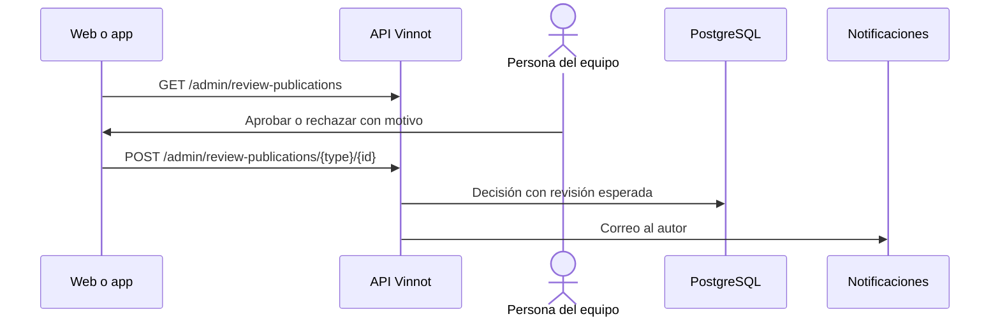

# UC-ADM-08 · Revisar publicaciones pendientes

| Campo | Valor |
|---|---|
| ID | `UC-ADM-08` |
| Módulo | [Administración y moderación](../README.md) |
| Plataformas | Web, APK |
| Actores | Equipo de moderación (administrador o moderador) |
| IDs en Lucidchart | [WEB UC-MOD-01](https://lucid.app/lucidchart/9f11a16b-bb5a-42fc-a9e8-0852b17bd241/edit), [APK UC-MOD-02](https://lucid.app/lucidchart/e095dd25-e8ac-41ba-bf5b-396e1055f217/edit) |
| Requisitos | [`RF-WEB-ADM-23`](../requirements.md), [`RF-APK-ADM-23`](../requirements.md) |
| Casos de prueba | [`CP-ADM-30`](../testing.md), [`CP-ADM-31`](../testing.md), [`CP-ADM-32`](../testing.md), [`CP-ADM-33`](../testing.md) |

## Precondiciones

- Hay reseñas o comentarios pendientes de una versión anterior, o editados sin aprobar.

## Postcondiciones

- La publicación quedó aprobada o rechazada con un motivo.

## Flujo principal

1. La persona abre «Publicaciones».
2. El cliente pide `GET /admin/review-publications` y muestra la cola con el autor y el vino de cada elemento.
3. La persona aprueba, o rechaza eligiendo un motivo predefinido; «Ofensivo» viene seleccionado.
4. El cliente envía la decisión con la revisión que se vio.
5. La API aplica la decisión y avisa al autor por correo.

## Flujos alternativos

- 2a. El autor o el vino fue eliminado: ese dato se oculta; nunca se muestran identificadores en su lugar.
- 3a. El motivo es «Otro»: aparece una nota opcional.
- 4a. El contenido cambió desde que se abrió: la API lo rechaza y se recarga la revisión actual.
- 4b. La persona es autora del contenido: la API lo rechaza.

## Reglas de negocio

- Las reseñas y comentarios nuevos se publican al instante; la cola solo tiene pendientes anteriores y ediciones sin aprobar.
- Motivos de rechazo: ofensivo, spam, fuera de tema, datos personales y otro.
- Aprobar recalcula las estadísticas del vino.

## Diagrama

[Ver diagrama de «UC-ADM-08 · Revisar publicaciones pendientes» completo](https://images.vinnot.com/docs/diagrams/v1/es/modules-admin-use-cases-uc-adm-08-review-publications-b5e4320b3065.svg)

Diagrama de componentes en Lucidchart: [WEB UC-MOD-01](https://lucid.app/lucidchart/9f11a16b-bb5a-42fc-a9e8-0852b17bd241/edit), [APK UC-MOD-02](https://lucid.app/lucidchart/e095dd25-e8ac-41ba-bf5b-396e1055f217/edit).

## Código

| Capa | Ubicación |
|---|---|
| Endpoints | `GET /admin/review-publications`, `POST /admin/review-publications/{type}/{id}` |
| Backend | [`ReviewPublicationController.java`](../../../../../backend/src/main/java/com/vinnot/review/infrastructure/web/controller/ReviewPublicationController.java), [`ReviewPublication.java`](../../../../../backend/src/main/java/com/vinnot/review/domain/model/ReviewPublication.java), [`DecideReviewPublicationCommandHandler.java`](../../../../../backend/src/main/java/com/vinnot/review/application/command/handler/DecideReviewPublicationCommandHandler.java) |
| Web | [`ReviewPublicationsPage.tsx`](../../../../../frontend-react/src/presentation/pages/community/ReviewPublicationsPage.tsx), [`publicationDecision.ts`](../../../../../frontend-react/src/domain/community/publicationDecision.ts), [`useCommunity.ts`](../../../../../frontend-react/src/presentation/hooks/queries/community/useCommunity.ts), [`community.client.ts`](../../../../../frontend-react/src/infrastructure/api/clients/community.client.ts) |
| App | `frontend-mobile/app/(app)/admin/publications.tsx`, [`ReviewPublicationsScreen.tsx`](../../../../../frontend-mobile/src/presentation/features/community/ReviewPublicationsScreen.tsx), [`useAdminCommunityViewModels.ts`](../../../../../frontend-mobile/src/presentation/features/community/useAdminCommunityViewModels.ts), [`community.client.ts`](../../../../../frontend-mobile/src/infrastructure/api/clients/community.client.ts) |

## Tests automáticos

- Backend: [`ReviewPublicationTest.java`](../../../../../backend/src/test/java/com/vinnot/review/domain/model/ReviewPublicationTest.java), [`DecideReviewPublicationCommandHandlerTest.java`](../../../../../backend/src/test/java/com/vinnot/review/application/command/handler/DecideReviewPublicationCommandHandlerTest.java), [`GetReviewPublicationQueueQueryHandlerTest.java`](../../../../../backend/src/test/java/com/vinnot/review/application/query/handler/GetReviewPublicationQueueQueryHandlerTest.java)
- Web: [`ReviewPublicationsPage.test.tsx`](../../../../../frontend-react/src/presentation/pages/community/ReviewPublicationsPage.test.tsx), [`publicationDecision.test.ts`](../../../../../frontend-react/src/domain/community/publicationDecision.test.ts)
- App: [`ReviewPublicationsScreen.test.tsx`](../../../../../frontend-mobile/src/presentation/features/community/ReviewPublicationsScreen.test.tsx)
