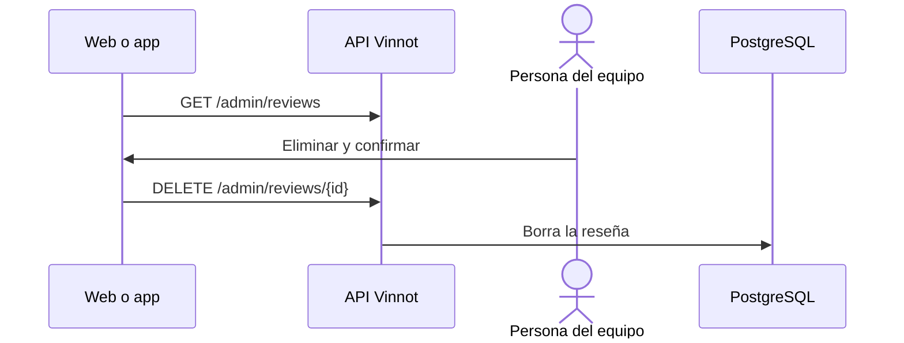

# UC-ADM-09 · Listar y eliminar reseñas

| Campo | Valor |
|---|---|
| ID | `UC-ADM-09` |
| Módulo | [Administración y moderación](../README.md) |
| Plataformas | Web, APK |
| Actores | Equipo de moderación (administrador o moderador) |
| IDs en Lucidchart | [WEB UC-MOD-04](https://lucid.app/lucidchart/9f11a16b-bb5a-42fc-a9e8-0852b17bd241/edit), [APK UC-MOD-03](https://lucid.app/lucidchart/e095dd25-e8ac-41ba-bf5b-396e1055f217/edit) |
| Requisitos | [`RF-WEB-ADM-24`](../requirements.md), [`RF-APK-ADM-24`](../requirements.md) |
| Casos de prueba | [`CP-ADM-34`](../testing.md), [`CP-ADM-35`](../testing.md), [`CP-ADM-36`](../testing.md) |

## Precondiciones

- La persona es administradora o moderadora.

## Postcondiciones

- La reseña quedó eliminada y su autor recibió el aviso.

## Flujo principal

1. La persona abre «Reseñas» en administración.
2. El cliente lista las reseñas y permite buscarlas por título, comentario, usuario de quien la escribió o nombre del vino, y abrir el detalle.
3. La persona elige eliminar y confirma.
4. El cliente envía `DELETE /admin/reviews/{id}` y la API borra la reseña.

## Flujos alternativos

- 3a. La persona cancela: no se envía nada.
- 4a. La eliminación falla: el detalle sigue abierto y se puede reintentar.

## Reglas de negocio

- Para retirar contenido denunciado se usa la revisión de denuncias, que registra el motivo.
- El autor recibe el aviso de contenido retirado.

## Diagrama

[Ver diagrama de «UC-ADM-09 · Listar y eliminar reseñas» completo](https://images.vinnot.com/docs/diagrams/v1/es/modules-admin-use-cases-uc-adm-09-manage-reviews-b780386bffa7.svg)

Diagrama de componentes en Lucidchart: [WEB UC-MOD-04](https://lucid.app/lucidchart/9f11a16b-bb5a-42fc-a9e8-0852b17bd241/edit), [APK UC-MOD-03](https://lucid.app/lucidchart/e095dd25-e8ac-41ba-bf5b-396e1055f217/edit).

## Código

| Capa | Ubicación |
|---|---|
| Endpoints | `GET /admin/reviews`, `GET /admin/reviews/{id}`, `DELETE /admin/reviews/{id}` |
| Backend | [`ReviewAdminController.java`](../../../../../backend/src/main/java/com/vinnot/admin/infrastructure/web/controller/ReviewAdminController.java) |
| Web | [`AdminReviewsPage.tsx`](../../../../../frontend-react/src/presentation/pages/admin/AdminReviewsPage.tsx), [`useAdminReviewsViewModel.ts`](../../../../../frontend-react/src/presentation/pages/admin/useAdminReviewsViewModel.ts), [`useAdminReviewMutations.ts`](../../../../../frontend-react/src/presentation/hooks/queries/admin/useAdminReviewMutations.ts), [`admin.service.ts`](../../../../../frontend-react/src/application/services/admin.service.ts) |
| App | `frontend-mobile/app/(app)/admin/reviews.tsx`, [`AdminReviewsScreen.tsx`](../../../../../frontend-mobile/src/presentation/features/admin/AdminReviewsScreen.tsx), [`admin.service.ts`](../../../../../frontend-mobile/src/application/services/admin.service.ts) |

## Tests automáticos

- Backend: [`AdminReviewQueryHandlersTest.java`](../../../../../backend/src/test/java/com/vinnot/admin/application/query/handler/AdminReviewQueryHandlersTest.java)
- Web: [`useAdminReviewMutations.test.tsx`](../../../../../frontend-react/src/presentation/hooks/queries/admin/useAdminReviewMutations.test.tsx)
- App: [`AdminReviewsScreen.test.tsx`](../../../../../frontend-mobile/src/presentation/features/admin/AdminReviewsScreen.test.tsx)
