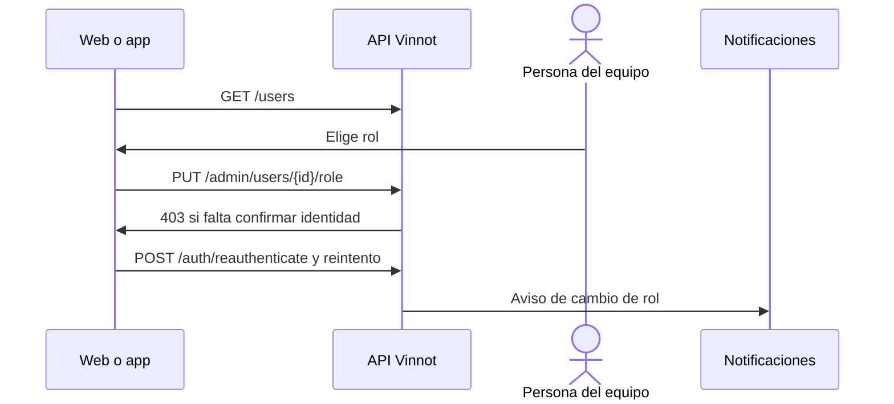

# UC-ADM-10 · Gestionar usuarios y roles

| Campo | Valor |
|---|---|
| ID | `UC-ADM-10` |
| Módulo | [Administración y moderación](../README.md) |
| Plataformas | Web, APK |
| Actores | Administrador |
| IDs en Lucidchart | [WEB UC-USR-01](https://lucid.app/lucidchart/9f11a16b-bb5a-42fc-a9e8-0852b17bd241/edit), [WEB UC-USR-02](https://lucid.app/lucidchart/9f11a16b-bb5a-42fc-a9e8-0852b17bd241/edit), [WEB UC-USR-04](https://lucid.app/lucidchart/9f11a16b-bb5a-42fc-a9e8-0852b17bd241/edit), [WEB UC-AUTH-12](https://lucid.app/lucidchart/9f11a16b-bb5a-42fc-a9e8-0852b17bd241/edit), [APK UC-ADM-06](https://lucid.app/lucidchart/e095dd25-e8ac-41ba-bf5b-396e1055f217/edit) |
| Requisitos | [`RF-WEB-ADM-25`](../requirements.md), [`RF-WEB-ADM-26`](../requirements.md), [`RF-WEB-ADM-27`](../requirements.md), [`RF-WEB-ADM-28`](../requirements.md), [`RF-WEB-ADM-29`](../requirements.md), [`RF-APK-ADM-25`](../requirements.md), [`RF-APK-ADM-26`](../requirements.md), [`RF-APK-ADM-27`](../requirements.md), [`RF-APK-ADM-28`](../requirements.md), [`RF-APK-ADM-29`](../requirements.md) |
| Casos de prueba | [`CP-ADM-37`](../testing.md), [`CP-ADM-38`](../testing.md), [`CP-ADM-39`](../testing.md), [`CP-ADM-40`](../testing.md) |

## Precondiciones

- La persona es administradora.

## Postcondiciones

- El rol quedó cambiado o la cuenta eliminada, y la persona afectada recibió el aviso.

## Flujo principal

1. La persona abre «Usuarios» y busca por nombre o correo.
2. El cliente lista las cuentas con roles, verificación y estado.
3. La persona elige un rol (usuario, moderador, partner o administrador) y guarda.
4. El cliente envía `PUT /admin/users/{id}/role`; la cuenta queda con usuario más el rol elegido.
5. La API pide confirmar la identidad si no hubo confirmación en los últimos 5 minutos.
6. La persona confirma con su contraseña, o con Google o Apple si su cuenta los usa, y el cliente reintenta una vez.

## Flujos alternativos

- 3a. La persona elige eliminar la cuenta y confirma: el cliente envía `DELETE /admin/users/{id}` y la cuenta se borra.
- 4a. El cambio quita el acceso de administración propio o deja sin administradores activos: la API responde 422.
- 6a. La persona cancela la confirmación: la acción no se ejecuta.

## Reglas de negocio

- Siempre queda al menos un administrador activo y sin bloquear.
- Cambiar el rol cierra las sesiones abiertas de esa cuenta.
- La confirmación de identidad es la de [UC-USR-12](../../users/use-cases/uc-usr-12-reauthenticate.md).
- Los moderadores no ven la gestión de usuarios.

## Diagrama

[Ver diagrama de «UC-ADM-10 · Gestionar usuarios y roles» completo](https://images.vinnot.com/docs/diagrams/v1/es/modules-admin-use-cases-uc-adm-10-manage-users-8dbdc7d8d1d7.svg)

Diagrama de componentes en Lucidchart: [WEB UC-USR-01](https://lucid.app/lucidchart/9f11a16b-bb5a-42fc-a9e8-0852b17bd241/edit), [WEB UC-USR-02](https://lucid.app/lucidchart/9f11a16b-bb5a-42fc-a9e8-0852b17bd241/edit), [WEB UC-USR-04](https://lucid.app/lucidchart/9f11a16b-bb5a-42fc-a9e8-0852b17bd241/edit), [WEB UC-AUTH-12](https://lucid.app/lucidchart/9f11a16b-bb5a-42fc-a9e8-0852b17bd241/edit), [APK UC-ADM-06](https://lucid.app/lucidchart/e095dd25-e8ac-41ba-bf5b-396e1055f217/edit).

## Código

| Capa | Ubicación |
|---|---|
| Endpoints | `GET /users`, `GET /admin/users/{id}`, `PUT /admin/users/{id}/role`, `DELETE /admin/users/{id}`, `POST /auth/reauthenticate` |
| Backend | [`UserAdminController.java`](../../../../../backend/src/main/java/com/vinnot/admin/infrastructure/web/controller/UserAdminController.java), [`AssignRoleCommandHandler.java`](../../../../../backend/src/main/java/com/vinnot/user/application/command/handler/AssignRoleCommandHandler.java), [`DeleteUserAdminCommandHandler.java`](../../../../../backend/src/main/java/com/vinnot/user/application/command/handler/DeleteUserAdminCommandHandler.java), [`AdminUserSafety.java`](../../../../../backend/src/main/java/com/vinnot/user/application/service/AdminUserSafety.java), [`AdminSensitiveActionInterceptor.java`](../../../../../backend/src/main/java/com/vinnot/admin/infrastructure/web/AdminSensitiveActionInterceptor.java) |
| Web | [`AdminUsersPage.tsx`](../../../../../frontend-react/src/presentation/pages/admin/AdminUsersPage.tsx), [`useAdminUsersViewModel.ts`](../../../../../frontend-react/src/presentation/pages/admin/useAdminUsersViewModel.ts), [`useAdminUserMutations.ts`](../../../../../frontend-react/src/presentation/hooks/queries/admin/useAdminUserMutations.ts), [`ReauthenticationDialog.tsx`](../../../../../frontend-react/src/presentation/components/auth/ReauthenticationDialog.tsx), [`admin.service.ts`](../../../../../frontend-react/src/application/services/admin.service.ts), [`admin.client.ts`](../../../../../frontend-react/src/infrastructure/api/clients/admin.client.ts) |
| App | `frontend-mobile/app/(app)/admin/users.tsx`, [`AdminUsersScreen.tsx`](../../../../../frontend-mobile/src/presentation/features/admin/AdminUsersScreen.tsx), [`AdminUserActionSheet.tsx`](../../../../../frontend-mobile/src/presentation/features/admin/AdminUserActionSheet.tsx), [`ReauthenticationDialog.tsx`](../../../../../frontend-mobile/src/presentation/features/auth/ReauthenticationDialog.tsx), [`admin.service.ts`](../../../../../frontend-mobile/src/application/services/admin.service.ts), [`admin.client.ts`](../../../../../frontend-mobile/src/infrastructure/api/clients/admin.client.ts) |

## Tests automáticos

- Backend: [`AdminUserCommandHandlersTest.java`](../../../../../backend/src/test/java/com/vinnot/user/application/command/handler/AdminUserCommandHandlersTest.java), [`AdminUserSafetyTest.java`](../../../../../backend/src/test/java/com/vinnot/user/application/service/AdminUserSafetyTest.java), [`AdminRoleAccessTest.java`](../../../../../backend/src/test/java/com/vinnot/admin/infrastructure/web/controller/AdminRoleAccessTest.java), [`AdminSensitiveActionInterceptorTest.java`](../../../../../backend/src/test/java/com/vinnot/admin/infrastructure/web/AdminSensitiveActionInterceptorTest.java), [`AccountAdministrationNoticeServiceTest.java`](../../../../../backend/src/test/java/com/vinnot/user/application/service/AccountAdministrationNoticeServiceTest.java)
- Web: [`AdminUsersPage.test.tsx`](../../../../../frontend-react/src/presentation/pages/admin/AdminUsersPage.test.tsx), [`useAdminUsersViewModel.test.tsx`](../../../../../frontend-react/src/presentation/pages/admin/useAdminUsersViewModel.test.tsx)
- App: [`AdminUserActionSheet.test.tsx`](../../../../../frontend-mobile/src/presentation/features/admin/AdminUserActionSheet.test.tsx), [`AdminUserRow.test.tsx`](../../../../../frontend-mobile/src/presentation/features/admin/AdminUserRow.test.tsx)
