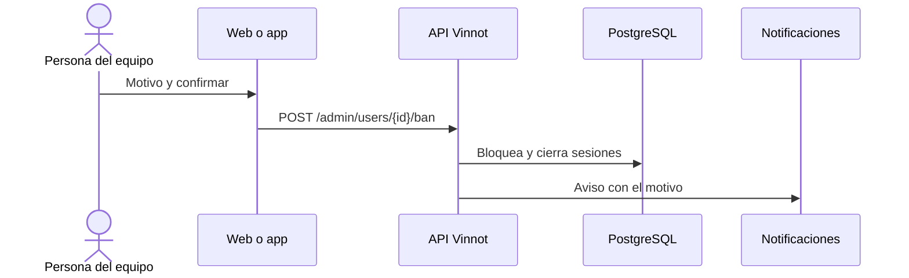

# UC-ADM-11 · Suspender o reactivar una cuenta

| Campo | Valor |
|---|---|
| ID | `UC-ADM-11` |
| Módulo | [Administración y moderación](../README.md) |
| Plataformas | Web, APK |
| Actores | Administrador |
| IDs en Lucidchart | [WEB UC-USR-03](https://lucid.app/lucidchart/9f11a16b-bb5a-42fc-a9e8-0852b17bd241/edit), [APK UC-ADM-06](https://lucid.app/lucidchart/e095dd25-e8ac-41ba-bf5b-396e1055f217/edit) |
| Requisitos | [`RF-WEB-ADM-30`](../requirements.md), [`RF-APK-ADM-30`](../requirements.md) |
| Casos de prueba | [`CP-ADM-41`](../testing.md), [`CP-ADM-42`](../testing.md), [`CP-ADM-43`](../testing.md), [`CP-ADM-44`](../testing.md) |

## Precondiciones

- La persona es administradora.

## Postcondiciones

- La cuenta quedó suspendida o reactivada y su titular recibió el aviso.

## Flujo principal

1. La persona elige suspender una cuenta.
2. Elige el motivo con un toque; «Spam» viene seleccionado.
3. Confirma y el cliente envía `POST /admin/users/{id}/ban` con el motivo.
4. La API bloquea la cuenta, cierra sus sesiones, olvida sus teléfonos para push y le envía el aviso con el motivo.

## Flujos alternativos

- 2a. El motivo es «Otro»: aparece un detalle opcional de hasta 255 caracteres, que se comparte con la persona.
- 1a. La cuenta está suspendida: la persona elige reactivarla, el cliente envía `POST /admin/users/{id}/unban` y el titular recibe el aviso.
- 4a. Es la propia cuenta o el último administrador activo: la API responde 422.

## Reglas de negocio

- Motivos: spam, acoso, fraude, suplantación, incumplimiento de los términos y otro.
- Suspender es distinto de bloquear una cuenta entre usuarios ([Comunidad](../../community/README.md)).
- La confirmación de identidad se pide igual que al cambiar un rol.

## Diagrama

[Ver diagrama de «UC-ADM-11 · Suspender o reactivar una cuenta» completo](https://images.vinnot.com/docs/diagrams/v1/es/modules-admin-use-cases-uc-adm-11-suspend-user-76d4d45ab9c7.svg)

Diagrama de componentes en Lucidchart: [WEB UC-USR-03](https://lucid.app/lucidchart/9f11a16b-bb5a-42fc-a9e8-0852b17bd241/edit), [APK UC-ADM-06](https://lucid.app/lucidchart/e095dd25-e8ac-41ba-bf5b-396e1055f217/edit).

## Código

| Capa | Ubicación |
|---|---|
| Endpoints | `POST /admin/users/{id}/ban`, `POST /admin/users/{id}/unban` |
| Backend | [`UserAdminController.java`](../../../../../backend/src/main/java/com/vinnot/admin/infrastructure/web/controller/UserAdminController.java), [`BanUserCommandHandler.java`](../../../../../backend/src/main/java/com/vinnot/user/application/command/handler/BanUserCommandHandler.java), [`AccountAdministrationNoticeService.java`](../../../../../backend/src/main/java/com/vinnot/user/application/service/AccountAdministrationNoticeService.java) |
| Web | [`AdminUsersPage.tsx`](../../../../../frontend-react/src/presentation/pages/admin/AdminUsersPage.tsx), [`useAdminUsersViewModel.ts`](../../../../../frontend-react/src/presentation/pages/admin/useAdminUsersViewModel.ts), [`suspensionReason.ts`](../../../../../frontend-react/src/domain/admin/suspensionReason.ts), [`useAdminUserMutations.ts`](../../../../../frontend-react/src/presentation/hooks/queries/admin/useAdminUserMutations.ts) |
| App | [`AdminUserActionSheet.tsx`](../../../../../frontend-mobile/src/presentation/features/admin/AdminUserActionSheet.tsx), [`suspensionReason.ts`](../../../../../frontend-mobile/src/domain/admin/suspensionReason.ts), [`admin.service.ts`](../../../../../frontend-mobile/src/application/services/admin.service.ts) |

## Tests automáticos

- Backend: [`AdminUserCommandHandlersTest.java`](../../../../../backend/src/test/java/com/vinnot/user/application/command/handler/AdminUserCommandHandlersTest.java), [`AccountAdministrationNoticeServiceTest.java`](../../../../../backend/src/test/java/com/vinnot/user/application/service/AccountAdministrationNoticeServiceTest.java)
- Web: [`suspensionReason.test.ts`](../../../../../frontend-react/src/domain/admin/suspensionReason.test.ts), [`useAdminUsersViewModel.test.tsx`](../../../../../frontend-react/src/presentation/pages/admin/useAdminUsersViewModel.test.tsx), [`adminSuspensionCopy.test.ts`](../../../../../frontend-react/src/shared/i18n/adminSuspensionCopy.test.ts)
- App: [`suspensionReason.test.ts`](../../../../../frontend-mobile/src/domain/admin/suspensionReason.test.ts), [`AdminUserActionSheet.test.tsx`](../../../../../frontend-mobile/src/presentation/features/admin/AdminUserActionSheet.test.tsx)
