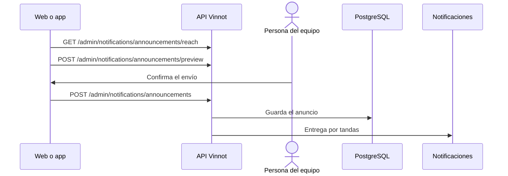

# UC-ADM-12 · Enviar un anuncio

| Campo | Valor |
|---|---|
| ID | `UC-ADM-12` |
| Módulo | [Administración y moderación](../README.md) |
| Plataformas | Web, APK |
| Actores | Administrador |
| IDs en Lucidchart | [APK UC-ADM-07](https://lucid.app/lucidchart/e095dd25-e8ac-41ba-bf5b-396e1055f217/edit) |
| Requisitos | [`RF-WEB-ADM-31`](../requirements.md), [`RF-APK-ADM-31`](../requirements.md) |
| Casos de prueba | [`CP-ADM-45`](../testing.md), [`CP-ADM-46`](../testing.md), [`CP-ADM-47`](../testing.md), [`CP-ADM-48`](../testing.md) |

## Precondiciones

- La persona es administradora.

## Postcondiciones

- El anuncio quedó en la cola y se entrega por tandas a las cuentas del segmento.

## Flujo principal

1. La persona abre «Notificaciones» y elige novedades o aviso de servicio.
2. Escribe título y contenido en español, en inglés o en ambos, con la barra de formato.
3. Elige canales (correo, push o ambos), idioma, país o región, rol y, para push, la pantalla que abre; el alcance se actualiza en vivo.
4. Pide la vista previa: el backend genera el correo y el push con las plantillas reales.
5. Se envía una prueba a sí misma y después elige «Enviar».
6. Confirma la cantidad de cuentas y su identidad; el cliente envía `POST /admin/notifications/announcements` y la API responde 202.
7. Una tarea entrega 500 cuentas cada 30 segundos, a cada una en su idioma si está escrito, y el historial muestra el avance.

## Flujos alternativos

- 6a. El segmento no tiene cuentas: la API responde 400.
- 6b. Se reintenta el mismo borrador: se reutiliza el ID de solicitud y no se envía dos veces.
- 3a. No se puede leer el alcance: el recuadro lo dice con reintento y el envío queda deshabilitado.

## Reglas de negocio

- Título de hasta 120 caracteres en una línea; contenido de hasta 5000, con título, negrita, enlace y botón, y solo enlaces http(s) absolutos.
- Solo llega a cuentas activas y sin suspender; el correo, a direcciones verificadas y no suprimidas; el push, a cuentas con un teléfono registrado.
- Las novedades son promocionales: no llegan a quien retiró el consentimiento de marketing o las apagó; el aviso de servicio sí.
- Los envíos no se programan ni se cancelan.
- La entrega sigue las reglas de [Notificaciones](../../notifications/README.md).

## Diagrama

[Ver diagrama de «UC-ADM-12 · Enviar un anuncio» completo](https://images.vinnot.com/docs/diagrams/v1/es/modules-admin-use-cases-uc-adm-12-send-announcements-95fdc38e7c9b.svg)

Diagrama de componentes en Lucidchart: [APK UC-ADM-07](https://lucid.app/lucidchart/e095dd25-e8ac-41ba-bf5b-396e1055f217/edit).

## Código

| Capa | Ubicación |
|---|---|
| Endpoints | `POST /admin/notifications/announcements/preview`, `GET /admin/notifications/announcements/reach`, `POST /admin/notifications/announcements/test`, `POST /admin/notifications/announcements`, `GET /admin/notifications/announcements` |
| Backend | [`AnnouncementController.java`](../../../../../backend/src/main/java/com/vinnot/notification/infrastructure/web/AnnouncementController.java), [`AnnouncementService.java`](../../../../../backend/src/main/java/com/vinnot/notification/application/service/AnnouncementService.java), [`AnnouncementCampaignService.java`](../../../../../backend/src/main/java/com/vinnot/notification/application/service/AnnouncementCampaignService.java), [`DeliverAnnouncementsService.java`](../../../../../backend/src/main/java/com/vinnot/notification/application/service/DeliverAnnouncementsService.java), [`JdbcAnnouncementAudience.java`](../../../../../backend/src/main/java/com/vinnot/notification/infrastructure/persistence/JdbcAnnouncementAudience.java) |
| Web | [`AdminNotificationsPage.tsx`](../../../../../frontend-react/src/presentation/pages/admin/AdminNotificationsPage.tsx), [`useAnnouncementComposerViewModel.ts`](../../../../../frontend-react/src/presentation/pages/admin/useAnnouncementComposerViewModel.ts), [`AnnouncementEditor.tsx`](../../../../../frontend-react/src/presentation/components/features/admin/notifications/AnnouncementEditor.tsx), [`AnnouncementAudienceForm.tsx`](../../../../../frontend-react/src/presentation/components/features/admin/notifications/AnnouncementAudienceForm.tsx), [`AnnouncementPreviewPane.tsx`](../../../../../frontend-react/src/presentation/components/features/admin/notifications/AnnouncementPreviewPane.tsx), [`useAdminNotifications.ts`](../../../../../frontend-react/src/presentation/hooks/queries/admin/useAdminNotifications.ts), [`adminNotifications.service.ts`](../../../../../frontend-react/src/application/services/adminNotifications.service.ts), [`adminNotifications.client.ts`](../../../../../frontend-react/src/infrastructure/api/clients/adminNotifications.client.ts), [`announcement.ts`](../../../../../frontend-react/src/domain/admin/announcement.ts) |
| App | `frontend-mobile/app/(app)/admin/notifications.tsx`, [`AdminNotificationsScreen.tsx`](../../../../../frontend-mobile/src/presentation/features/admin/AdminNotificationsScreen.tsx), [`AnnouncementsTab.tsx`](../../../../../frontend-mobile/src/presentation/features/admin/notifications/AnnouncementsTab.tsx), [`useAnnouncementComposerViewModel.ts`](../../../../../frontend-mobile/src/presentation/features/admin/notifications/useAnnouncementComposerViewModel.ts), [`adminNotifications.service.ts`](../../../../../frontend-mobile/src/application/services/adminNotifications.service.ts), [`adminNotifications.client.ts`](../../../../../frontend-mobile/src/infrastructure/api/clients/adminNotifications.client.ts), [`announcement.ts`](../../../../../frontend-mobile/src/domain/admin/announcement.ts) |

## Tests automáticos

- Backend: [`AnnouncementControllerTest.java`](../../../../../backend/src/test/java/com/vinnot/notification/infrastructure/web/AnnouncementControllerTest.java), [`AnnouncementServiceTest.java`](../../../../../backend/src/test/java/com/vinnot/notification/application/service/AnnouncementServiceTest.java), [`AnnouncementCampaignServiceTest.java`](../../../../../backend/src/test/java/com/vinnot/notification/application/service/AnnouncementCampaignServiceTest.java), [`DeliverAnnouncementsServiceTest.java`](../../../../../backend/src/test/java/com/vinnot/notification/application/service/DeliverAnnouncementsServiceTest.java), [`JdbcAnnouncementPostgresIntegrationTest.java`](../../../../../backend/src/test/java/com/vinnot/notification/infrastructure/persistence/JdbcAnnouncementPostgresIntegrationTest.java), [`AnnouncementTest.java`](../../../../../backend/src/test/java/com/vinnot/notification/domain/model/AnnouncementTest.java), [`AnnouncementBodyTest.java`](../../../../../backend/src/test/java/com/vinnot/notification/domain/model/AnnouncementBodyTest.java), [`AnnouncementDeliverySchedulerTest.java`](../../../../../backend/src/test/java/com/vinnot/notification/infrastructure/scheduling/AnnouncementDeliverySchedulerTest.java), [`AnnouncementPushTemplatesTest.java`](../../../../../backend/src/test/java/com/vinnot/notification/infrastructure/push/AnnouncementPushTemplatesTest.java), [`AnnouncementTestTemplateTest.java`](../../../../../backend/src/test/java/com/vinnot/notification/infrastructure/template/AnnouncementTestTemplateTest.java)
- Web: [`AdminNotificationsPage.test.tsx`](../../../../../frontend-react/src/presentation/pages/admin/AdminNotificationsPage.test.tsx), [`adminNotifications.service.test.ts`](../../../../../frontend-react/src/application/services/adminNotifications.service.test.ts), [`announcement.test.ts`](../../../../../frontend-react/src/domain/admin/announcement.test.ts), [`announcementFormat.test.ts`](../../../../../frontend-react/src/domain/admin/announcementFormat.test.ts), [`useAnnouncementComposerViewModel.test.tsx`](../../../../../frontend-react/src/presentation/pages/admin/useAnnouncementComposerViewModel.test.tsx)
- App: [`AdminNotificationsScreen.test.tsx`](../../../../../frontend-mobile/src/presentation/features/admin/AdminNotificationsScreen.test.tsx), [`adminNotifications.service.test.ts`](../../../../../frontend-mobile/src/application/services/adminNotifications.service.test.ts), [`announcement.test.ts`](../../../../../frontend-mobile/src/domain/admin/announcement.test.ts), [`announcementFormat.test.ts`](../../../../../frontend-mobile/src/domain/admin/announcementFormat.test.ts), [`useAnnouncementComposerViewModel.test.ts`](../../../../../frontend-mobile/src/presentation/features/admin/notifications/useAnnouncementComposerViewModel.test.ts)
