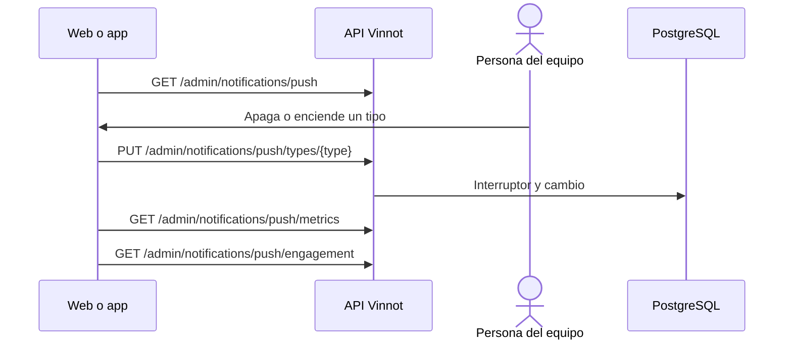

# UC-ADM-13 · Controlar los push por tipo

| Campo | Valor |
|---|---|
| ID | `UC-ADM-13` |
| Módulo | [Administración y moderación](../README.md) |
| Plataformas | Web, APK |
| Actores | Administrador |
| IDs en Lucidchart | [APK UC-ADM-08](https://lucid.app/lucidchart/e095dd25-e8ac-41ba-bf5b-396e1055f217/edit) |
| Requisitos | [`RF-WEB-ADM-32`](../requirements.md), [`RF-APK-ADM-32`](../requirements.md) |
| Casos de prueba | [`CP-ADM-49`](../testing.md), [`CP-ADM-50`](../testing.md), [`CP-ADM-51`](../testing.md) |

## Precondiciones

- La persona es administradora.

## Postcondiciones

- Un tipo de push quedó encendido o apagado, y el cambio quedó registrado.

## Flujo principal

1. La persona abre la pestaña «Ajustes de push» de Notificaciones; los resultados por tipo están en «Historial y métricas».
2. El cliente pide `GET /admin/notifications/push` y muestra el proveedor, cada tipo con su estado y los últimos 20 cambios.
3. La persona apaga o enciende un tipo.
4. Confirma su identidad y el cliente envía `PUT /admin/notifications/push/types/{type}`.
5. La persona consulta los resultados por tipo de hoy, 7 o 30 días.
6. En la web, consulta «Engagement» (`GET /admin/notifications/push/engagement`): por tipo de push de engagement, enviados, abiertos, tasa de apertura, bajas y si está pausado, de hoy, 7 o 30 días.

## Flujos alternativos

- 3a. El tipo es transaccional: apagarlo pide confirmación.
- 4a. El valor no cambió: no se guarda nada.

## Reglas de negocio

- Los push de un tipo apagado se descartan, no se postergan, y se cuentan como apagados.
- El proveedor se configura en el servidor y se muestra en solo lectura.
- «Engagement» es de solo lectura. Un tipo figura pausado cuando está apagado, por un administrador o solo porque sus bajas superaron el límite; se vuelve a encender con su interruptor. Sin envíos, la tasa de apertura se muestra como «—».

## Diagrama

[Ver diagrama de «UC-ADM-13 · Controlar los push por tipo» completo](https://images.vinnot.com/docs/diagrams/v1/es/modules-admin-use-cases-uc-adm-13-control-push-561a6df8e51f.svg)

Diagrama de componentes en Lucidchart: [APK UC-ADM-08](https://lucid.app/lucidchart/e095dd25-e8ac-41ba-bf5b-396e1055f217/edit).

## Código

| Capa | Ubicación |
|---|---|
| Endpoints | `GET /admin/notifications/push`, `PUT /admin/notifications/push/types/{type}`, `GET /admin/notifications/push/metrics`, `GET /admin/notifications/push/engagement` |
| Backend | [`PushAdministrationController.java`](../../../../../backend/src/main/java/com/vinnot/notification/infrastructure/web/PushAdministrationController.java), [`PushAdministrationService.java`](../../../../../backend/src/main/java/com/vinnot/notification/application/service/PushAdministrationService.java), [`JdbcPushTypeSwitches.java`](../../../../../backend/src/main/java/com/vinnot/notification/infrastructure/persistence/JdbcPushTypeSwitches.java), [`DeliverPushService.java`](../../../../../backend/src/main/java/com/vinnot/notification/application/service/DeliverPushService.java), [`EngagementAdministrationController.java`](../../../../../backend/src/main/java/com/vinnot/engagement/infrastructure/web/EngagementAdministrationController.java), [`EngagementMetricsService.java`](../../../../../backend/src/main/java/com/vinnot/engagement/application/service/EngagementMetricsService.java) |
| Web | [`AdminNotificationsPage.tsx`](../../../../../frontend-react/src/presentation/pages/admin/AdminNotificationsPage.tsx), [`usePushControlsViewModel.ts`](../../../../../frontend-react/src/presentation/pages/admin/usePushControlsViewModel.ts), [`PushTypeSwitches.tsx`](../../../../../frontend-react/src/presentation/components/features/admin/notifications/PushTypeSwitches.tsx), [`PushMetricsTable.tsx`](../../../../../frontend-react/src/presentation/components/features/admin/notifications/PushMetricsTable.tsx), [`PushEngagementTable.tsx`](../../../../../frontend-react/src/presentation/components/features/admin/notifications/PushEngagementTable.tsx), [`adminNotifications.service.ts`](../../../../../frontend-react/src/application/services/adminNotifications.service.ts), [`pushAdministration.ts`](../../../../../frontend-react/src/domain/admin/pushAdministration.ts) |
| App | [`AdminNotificationsScreen.tsx`](../../../../../frontend-mobile/src/presentation/features/admin/AdminNotificationsScreen.tsx), [`PushTab.tsx`](../../../../../frontend-mobile/src/presentation/features/admin/notifications/PushTab.tsx), [`usePushControlsViewModel.ts`](../../../../../frontend-mobile/src/presentation/features/admin/notifications/usePushControlsViewModel.ts), [`adminNotifications.service.ts`](../../../../../frontend-mobile/src/application/services/adminNotifications.service.ts), [`pushAdministration.ts`](../../../../../frontend-mobile/src/domain/admin/pushAdministration.ts) |

## Tests automáticos

- Backend: [`PushAdministrationControllerTest.java`](../../../../../backend/src/test/java/com/vinnot/notification/infrastructure/web/PushAdministrationControllerTest.java), [`PushAdministrationServiceTest.java`](../../../../../backend/src/test/java/com/vinnot/notification/application/service/PushAdministrationServiceTest.java), [`EngagementAdministrationControllerTest.java`](../../../../../backend/src/test/java/com/vinnot/engagement/infrastructure/web/EngagementAdministrationControllerTest.java), [`EngagementMetricsServiceTest.java`](../../../../../backend/src/test/java/com/vinnot/engagement/application/service/EngagementMetricsServiceTest.java), [`JdbcPushAdministrationPostgresIntegrationTest.java`](../../../../../backend/src/test/java/com/vinnot/notification/infrastructure/persistence/JdbcPushAdministrationPostgresIntegrationTest.java)
- Web: [`AdminNotificationsPage.test.tsx`](../../../../../frontend-react/src/presentation/pages/admin/AdminNotificationsPage.test.tsx), [`PushEngagementTable.test.tsx`](../../../../../frontend-react/src/presentation/components/features/admin/notifications/PushEngagementTable.test.tsx), [`pushAdministration.test.ts`](../../../../../frontend-react/src/domain/admin/pushAdministration.test.ts), [`usePushControlsViewModel.test.tsx`](../../../../../frontend-react/src/presentation/pages/admin/usePushControlsViewModel.test.tsx), [`adminPushCopy.test.ts`](../../../../../frontend-react/src/shared/i18n/adminPushCopy.test.ts)
- App: [`AdminNotificationsScreen.test.tsx`](../../../../../frontend-mobile/src/presentation/features/admin/AdminNotificationsScreen.test.tsx), [`pushAdministration.test.ts`](../../../../../frontend-mobile/src/domain/admin/pushAdministration.test.ts), [`usePushControlsViewModel.test.ts`](../../../../../frontend-mobile/src/presentation/features/admin/notifications/usePushControlsViewModel.test.ts)
