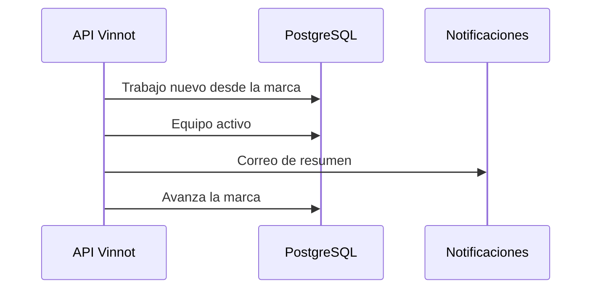

# UC-ADM-14 · Avisar al equipo de moderación del trabajo nuevo

| Campo | Valor |
|---|---|
| ID | `UC-ADM-14` |
| Módulo | [Administración y moderación](../README.md) |
| Plataformas | Solo backend |
| Actores | Sistema (tareas programadas) |
| IDs en Lucidchart | Ninguno |
| Requisitos | Ninguno |
| Casos de prueba | [`CP-ADM-52`](../testing.md), [`CP-ADM-53`](../testing.md), [`CP-ADM-54`](../testing.md), [`CP-ADM-55`](../testing.md) |

## Precondiciones

- El resumen al equipo está habilitado.

## Postcondiciones

- Cada persona del equipo recibió un correo con el trabajo nuevo.

## Flujo principal

1. Cada 15 minutos, una tarea revisa el trabajo que llegó desde el último resumen, sin contar los últimos 5 minutos.
2. Cuenta los vinos propuestos que esperan revisión y las denuncias abiertas nuevas.
3. Si hay trabajo, envía un correo en español a cada administrador y moderador activo y sin suspender, con enlaces a cada cola.
4. Avanza la marca del último resumen en la misma transacción.

## Flujos alternativos

- 3a. No hay trabajo nuevo: no se envía nada.
- 3b. Hay un solo vino o una sola denuncia: el correo nombra el vino o el motivo.
- 3c. Una cuenta del equipo está desactivada o suspendida: no recibe el correo.

## Reglas de negocio

- Cada resumen se envía una sola vez por persona y ventana.
- La marca del último resumen nunca retrocede.

## Diagrama

[Ver diagrama de «UC-ADM-14 · Avisar al equipo de moderación del trabajo nuevo» completo](https://images.vinnot.com/docs/diagrams/v1/es/modules-admin-use-cases-uc-adm-14-moderation-digest-344192bef6b6.svg)

## Código

| Capa | Ubicación |
|---|---|
| Backend | [`ModerationDigestScheduler.java`](../../../../../backend/src/main/java/com/vinnot/admin/infrastructure/scheduling/ModerationDigestScheduler.java), [`SendModerationDigestService.java`](../../../../../backend/src/main/java/com/vinnot/admin/application/service/SendModerationDigestService.java), [`JdbcModerationQueueDigest.java`](../../../../../backend/src/main/java/com/vinnot/admin/infrastructure/persistence/adapter/JdbcModerationQueueDigest.java) |

## Tests automáticos

- Backend: [`SendModerationDigestServiceTest.java`](../../../../../backend/src/test/java/com/vinnot/admin/application/service/SendModerationDigestServiceTest.java), [`ModerationDigestSchedulerTest.java`](../../../../../backend/src/test/java/com/vinnot/admin/infrastructure/scheduling/ModerationDigestSchedulerTest.java), [`JdbcModerationQueueDigestPostgresIntegrationTest.java`](../../../../../backend/src/test/java/com/vinnot/admin/infrastructure/persistence/adapter/JdbcModerationQueueDigestPostgresIntegrationTest.java), [`ModerationQueueDigestTemplateTest.java`](../../../../../backend/src/test/java/com/vinnot/notification/infrastructure/template/ModerationQueueDigestTemplateTest.java)
- Web: Ninguno
- App: Ninguno
