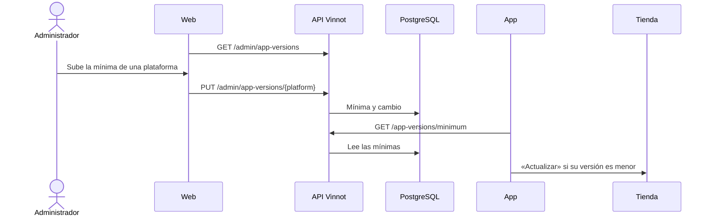

# UC-ADM-15 · Exigir una versión mínima de la app

| Campo | Valor |
|---|---|
| ID | `UC-ADM-15` |
| Módulo | [Administración y moderación](../README.md) |
| Plataformas | Web, APK |
| Actores | Administrador, Visitante o usuario autenticado |
| IDs en Lucidchart | Ninguno |
| Requisitos | [`RF-WEB-ADM-33`](../requirements.md), [`RF-APK-ADM-33`](../requirements.md) |
| Casos de prueba | [`CP-ADM-57`](../testing.md), [`CP-ADM-58`](../testing.md), [`CP-ADM-59`](../testing.md), [`CP-ADM-60`](../testing.md), [`CP-ADM-61`](../testing.md), [`CP-ADM-62`](../testing.md), [`CP-ADM-63`](../testing.md) |

## Precondiciones

- La persona que cambia la mínima es administradora y usa la web.
- La versión que se va a exigir ya está aprobada y publicada en la tienda de esa plataforma.

## Postcondiciones

- La plataforma quedó con su versión mínima nueva, o sin mínima, y el cambio quedó registrado.
- Las versiones de la app anteriores a la mínima muestran la pantalla de actualización en lugar de la app.

## Flujo principal

1. La persona abre Administración › «Versiones de la app» en la web.
2. El cliente pide `GET /admin/app-versions` y muestra, para iOS y para Android, la mínima actual, quién la cambió y cuándo, los «Cambios recientes» (los últimos 20) y el aviso de subirla solo cuando la tienda ya publicó esa versión.
3. La persona escribe una versión `mayor.menor.parche` más alta que la actual y elige «Guardar».
4. Confirma «Subir mínima» en el diálogo que avisa que toda versión anterior queda bloqueada.
5. Confirma su identidad y el cliente envía `PUT /admin/app-versions/{platform}` con `minimumVersion`.
6. La API guarda la mínima y registra el cambio con el valor anterior, el nuevo, quién lo hizo y cuándo.
7. Al abrirse y cada vez que vuelve al primer plano, la app pide `GET /app-versions/minimum`, sin sesión.
8. La app compara su versión con la mínima de su plataforma; es igual o mayor, y la app se usa normal.

## Flujos alternativos

- 3a. El valor no tiene el formato `mayor.menor.parche` (tres números de 0 a 9999, sin ceros a la izquierda): el campo muestra el error y no se envía nada. La API también rechaza un formato inválido con 400 `INVALID_APP_VERSION`.
- 3b. El valor es igual al actual: no se envía nada, y la API tampoco registra un cambio.
- 3c. La persona elige «Quitar mínima» o escribe una versión más baja: el cambio se aplica sin el diálogo de subida. Sin mínima no se bloquea ninguna versión de esa plataforma.
- 5a. La persona no confirmó su identidad en los últimos 5 minutos: la API responde 403 `REAUTHENTICATION_REQUIRED` y se abre la confirmación. Si la cancela, no cambia nada.
- 7a. La consulta falla, no responde a tiempo o devuelve algo ilegible: la app se usa normal.
- 8a. La versión instalada es menor que la mínima: la pantalla «Actualizá Vinnot para continuar» reemplaza toda la app y no se puede cerrar; en Android, el botón atrás tampoco la cierra. «Actualizar» abre la ficha de Vinnot en App Store o en Google Play.

## Reglas de negocio

- La mínima se sube solo después de que la tienda aprobó y publicó esa versión. Si se sube antes, nadie puede actualizar y la app queda bloqueada. El procedimiento está en la [guía de distribución](../../../frontend-mobile/guides/distribution.md#forzar-la-actualización).
- Cada plataforma (`IOS`, `ANDROID`) tiene su propia mínima. Una plataforma desconocida responde 400 `NOT_AN_APP_PLATFORM`.
- Las versiones se comparan número por número: `0.10.0` es mayor que `0.9.9`. La API acepta ceros a la izquierda y guarda la versión sin ellos.
- La app falla abierta: mientras la primera consulta no responde, si falla o si la plataforma no tiene mínima, la app no se bloquea.
- La API lee la mínima en cada consulta, así que un cambio rige sin desplegar nada, la próxima vez que la app se abre o vuelve al primer plano. `GET /app-versions/minimum` es público y no lo bloquean términos pendientes.
- La comprobación es código JavaScript: llega por OTA a las apps instaladas con el mismo runtime. Las OTA no cambian la versión de la app, así que no hace falta tocar la mínima al publicarlas.
- Cada cambio guarda el correo de quien lo hizo, que se conserva aunque se borre la cuenta. Dos cambios a la vez sobre una misma plataforma se aplican de a uno.

## Diagrama

[Ver diagrama de «UC-ADM-15 · Exigir una versión mínima de la app» completo](https://images.vinnot.com/docs/diagrams/v1/es/modules-admin-use-cases-uc-adm-15-minimum-app-version-ad615bebd309.svg)

## Código

| Capa | Ubicación |
|---|---|
| Endpoints | `GET /admin/app-versions`, `PUT /admin/app-versions/{platform}`, `GET /app-versions/minimum` |
| Backend | [`AppVersionAdminController.java`](../../../../../backend/src/main/java/com/vinnot/admin/infrastructure/web/controller/AppVersionAdminController.java), [`AppVersionPolicyController.java`](../../../../../backend/src/main/java/com/vinnot/admin/infrastructure/web/controller/AppVersionPolicyController.java), [`AppVersionAdministrationService.java`](../../../../../backend/src/main/java/com/vinnot/admin/application/service/AppVersionAdministrationService.java), [`MinimumAppVersionsService.java`](../../../../../backend/src/main/java/com/vinnot/admin/application/service/MinimumAppVersionsService.java), [`AppVersion.java`](../../../../../backend/src/main/java/com/vinnot/admin/domain/model/AppVersion.java), [`JdbcAppMinimumVersions.java`](../../../../../backend/src/main/java/com/vinnot/admin/infrastructure/persistence/adapter/JdbcAppMinimumVersions.java), [`V69__app_minimum_versions.sql`](../../../../../backend/src/main/resources/db/migration/V69__app_minimum_versions.sql) |
| Web | [`AdminAppVersionsPage.tsx`](../../../../../frontend-react/src/presentation/pages/admin/AdminAppVersionsPage.tsx), [`useAdminAppVersionsViewModel.ts`](../../../../../frontend-react/src/presentation/pages/admin/useAdminAppVersionsViewModel.ts), [`AppVersionPlatformCard.tsx`](../../../../../frontend-react/src/presentation/components/features/admin/appVersions/AppVersionPlatformCard.tsx), [`adminAppVersions.service.ts`](../../../../../frontend-react/src/application/services/adminAppVersions.service.ts), [`appVersion.validators.ts`](../../../../../frontend-react/src/domain/admin/appVersion.validators.ts) |
| App | [`AppUpdateGate.tsx`](../../../../../frontend-mobile/src/presentation/features/appUpdate/AppUpdateGate.tsx), [`UpdateRequiredScreen.tsx`](../../../../../frontend-mobile/src/presentation/features/appUpdate/UpdateRequiredScreen.tsx), [`useAppUpdateRequirement.ts`](../../../../../frontend-mobile/src/presentation/hooks/useAppUpdateRequirement.ts), [`appVersion.service.ts`](../../../../../frontend-mobile/src/application/services/appVersion.service.ts), [`appVersion.ts`](../../../../../frontend-mobile/src/domain/app/appVersion.ts) |

## Tests automáticos

- Backend: [`AppVersionTest.java`](../../../../../backend/src/test/java/com/vinnot/admin/domain/model/AppVersionTest.java), [`AppPlatformTest.java`](../../../../../backend/src/test/java/com/vinnot/admin/domain/model/AppPlatformTest.java), [`AppVersionAdministrationServiceTest.java`](../../../../../backend/src/test/java/com/vinnot/admin/application/service/AppVersionAdministrationServiceTest.java), [`MinimumAppVersionsServiceTest.java`](../../../../../backend/src/test/java/com/vinnot/admin/application/service/MinimumAppVersionsServiceTest.java), [`AppVersionAdminControllerTest.java`](../../../../../backend/src/test/java/com/vinnot/admin/infrastructure/web/controller/AppVersionAdminControllerTest.java), [`AppVersionPolicyControllerTest.java`](../../../../../backend/src/test/java/com/vinnot/admin/infrastructure/web/controller/AppVersionPolicyControllerTest.java), [`JdbcAppMinimumVersionsPostgresIntegrationTest.java`](../../../../../backend/src/test/java/com/vinnot/admin/infrastructure/persistence/adapter/JdbcAppMinimumVersionsPostgresIntegrationTest.java)
- Web: [`AdminAppVersionsPage.test.tsx`](../../../../../frontend-react/src/presentation/pages/admin/AdminAppVersionsPage.test.tsx), [`useAdminAppVersionsViewModel.test.tsx`](../../../../../frontend-react/src/presentation/pages/admin/useAdminAppVersionsViewModel.test.tsx), [`adminAppVersions.service.test.ts`](../../../../../frontend-react/src/application/services/adminAppVersions.service.test.ts), [`adminAppVersions.client.test.ts`](../../../../../frontend-react/src/infrastructure/api/clients/adminAppVersions.client.test.ts), [`appVersion.validators.test.ts`](../../../../../frontend-react/src/domain/admin/appVersion.validators.test.ts)
- App: [`AppUpdateGate.test.tsx`](../../../../../frontend-mobile/src/presentation/features/appUpdate/AppUpdateGate.test.tsx), [`useAppUpdateRequirement.test.ts`](../../../../../frontend-mobile/src/presentation/hooks/useAppUpdateRequirement.test.ts), [`appVersion.service.test.ts`](../../../../../frontend-mobile/src/application/services/appVersion.service.test.ts), [`appVersions.client.test.ts`](../../../../../frontend-mobile/src/infrastructure/api/clients/appVersions.client.test.ts), [`appBuild.gateway.test.ts`](../../../../../frontend-mobile/src/infrastructure/device/appBuild.gateway.test.ts), [`appVersion.test.ts`](../../../../../frontend-mobile/src/domain/app/appVersion.test.ts)
