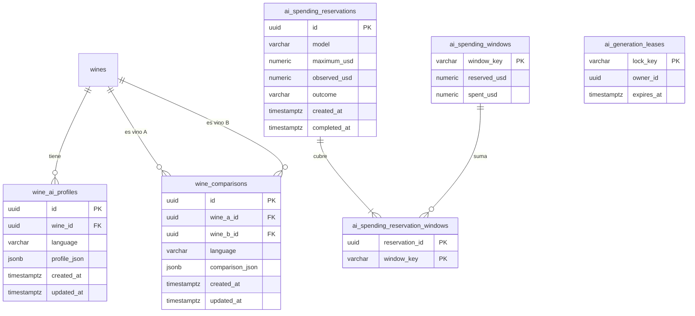

# Perfiles y comparaciones IA

Perfil de sommelier de cada vino y comparación entre dos vinos, generados con IA en
español e inglés. Quien tiene sesión lee el perfil guardado o pide generarlo, y compara
dos vinos del catálogo; el equipo edita o regenera los perfiles. El módulo controla que
cada llamada paga a la IA respete la capacidad y el presupuesto.

- Código del módulo: `AI`.
- Backend: paquete [`ai`](../../../../backend/src/main/java/com/vinnot/ai/).
- [Casos de uso](use-cases/README.md) · [Requisitos](requirements.md) ·
  [Arquitectura](architecture.md) · [Pruebas](testing.md)

## Actores

| Actor | Qué hace en este módulo |
|---|---|
| Usuario autenticado | Lee o genera el perfil de un vino y compara dos vinos |
| Administrador o moderador | Edita el perfil a mano o lo regenera |
| OpenAI | Genera perfiles y comparaciones |
| Sistema | Reserva capacidad y presupuesto antes de cada llamada paga |

## Reglas de negocio

| Regla | Detalle | Dónde |
|---|---|---|
| Idiomas | Solo español e inglés; cualquier otro usa español; se generan y guardan juntos | [`AiContentLanguage.java`](../../../../backend/src/main/java/com/vinnot/ai/domain/valueobject/AiContentLanguage.java) |
| Leer no genera | `GET` devuelve lo guardado; generar es un `POST` explícito | [`AiProfileService.java`](../../../../backend/src/main/java/com/vinnot/ai/application/service/AiProfileService.java) |
| Reutilización | Un perfil se reutiliza si existe en ambos idiomas y el vino y el modelo no cambiaron | [`AiProfileService.java`](../../../../backend/src/main/java/com/vinnot/ai/application/service/AiProfileService.java) |
| Ediciones manuales | Se conservan en una generación normal; regenerar las reemplaza | [`AiProfilePublicationService.java`](../../../../backend/src/main/java/com/vinnot/ai/application/service/AiProfilePublicationService.java) |
| Contenido manual válido | Resumen obligatorio, secciones con la forma esperada y puntajes de 0 a 100 | [`ManualProfileContent.java`](../../../../backend/src/main/java/com/vinnot/ai/domain/model/ManualProfileContent.java) |
| Comparación | Dos vinos distintos que la persona pueda ver; el orden no importa | [`WineComparisonService.java`](../../../../backend/src/main/java/com/vinnot/ai/application/service/WineComparisonService.java) |
| Validación de comparaciones | Hasta 6 elementos por lista, 8 atributos y 2000 caracteres, sin textos de relleno; exige notas de cata, cuándo elegir cada vino, maridajes, servicio y guarda | [`WineComparisonContentValidator.java`](../../../../backend/src/main/java/com/vinnot/ai/application/service/WineComparisonContentValidator.java) |
| Una generación a la vez | El mismo perfil o comparación no se genera dos veces en paralelo | [`AiGenerationCoordinator.java`](../../../../backend/src/main/java/com/vinnot/ai/application/service/AiGenerationCoordinator.java) |
| Costo | 3 llamadas simultáneas y 10 USD por mes por defecto; sin margen, 503 | [`AiProviderAdmissionService.java`](../../../../backend/src/main/java/com/vinnot/ai/application/service/AiProviderAdmissionService.java) |
| Límite por persona | 20 generaciones o comparaciones por hora | [`RateLimitPolicyResolver.java`](../../../../backend/src/main/java/com/vinnot/shared/infrastructure/security/RateLimitPolicyResolver.java) |
| Permisos de edición | Editar y regenerar exigen `WINE_UPDATE` (administradores y moderadores) | [`AiProfileController.java`](../../../../backend/src/main/java/com/vinnot/ai/infrastructure/web/controller/AiProfileController.java) |

## Dónde vive

| Parte | Ubicación |
|---|---|
| API | [`AiProfileController`](../../../../backend/src/main/java/com/vinnot/ai/infrastructure/web/controller/AiProfileController.java) bajo `/wines/{wineId}/ai-profile` y [`WineComparisonController`](../../../../backend/src/main/java/com/vinnot/ai/infrastructure/web/controller/WineComparisonController.java) en `/wines/compare` |
| Web | [`AiProfilePage`](../../../../frontend-react/src/presentation/pages/wines/AiProfilePage.tsx), [`WineComparePage`](../../../../frontend-react/src/presentation/pages/wines/WineComparePage.tsx) y [`AdminWineAiProfilePage`](../../../../frontend-react/src/presentation/pages/admin/AdminWineAiProfilePage.tsx) |
| App | Pestaña IA del vino, `frontend-mobile/app/(app)/(tabs)/wines/[id]/ai-profile.tsx`, [`WineCompareScreen`](../../../../frontend-mobile/src/presentation/screens/wines/WineCompareScreen.tsx) y [`AdminWineAiProfileScreen`](../../../../frontend-mobile/src/presentation/features/admin/AdminWineAiProfileScreen.tsx) |

## Datos

[Ver diagrama de «Perfiles y comparaciones IA · Datos» completo](https://images.vinnot.com/docs/diagrams/v1/es/modules-ai-readme-43ff67f12d5d.svg)

Cada vino tiene un perfil por idioma y cada par de vinos una comparación por idioma; se
borran en cascada con el vino. `ai_generation_leases` evita que dos servidores generen
lo mismo a la vez, y las tablas `ai_spending_*` llevan el gasto reservado y real.
