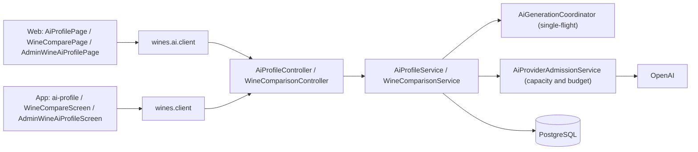
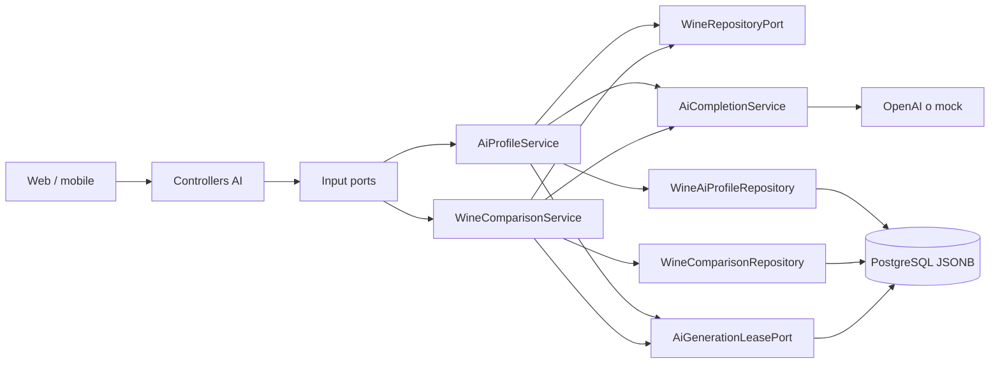
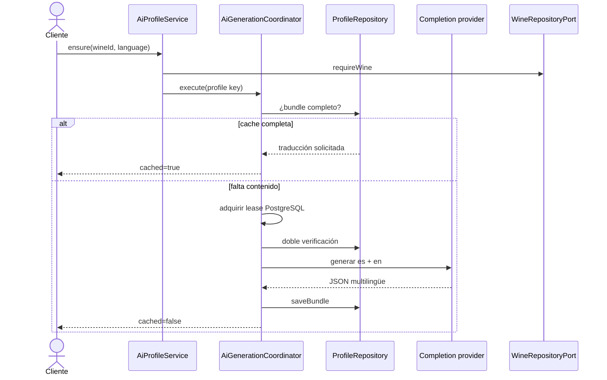
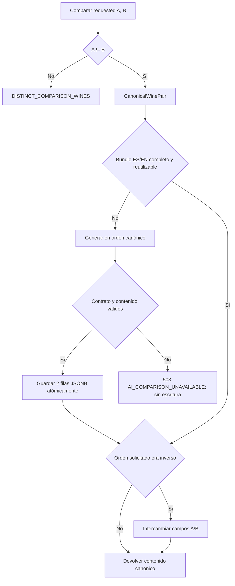
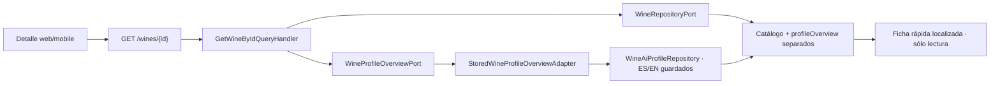
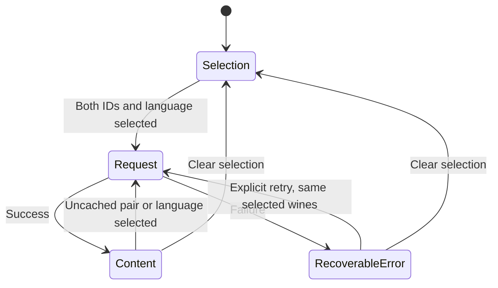

# Arquitectura

Cómo está construido el módulo en cada capa. El backend sigue el flujo hexagonal
`controller → servicio de aplicación → dominio → puerto de salida → adaptador`; la web y la
app siguen `pantalla → hook → servicio → cliente API → transporte HTTP`. El perfil resumido
que se ve en el detalle de un vino viene de este módulo ([Vinos](../wines/README.md)).



[Ver diagrama de «Arquitectura» completo](https://images.vinnot.com/docs/diagrams/v1/es/modules-ai-architecture-0775ee160e43.svg)

## Backend

### Alcance

El módulo `ai` genera, persiste y reutiliza contenido sensorial bilingüe para
dos casos de uso:

1. perfil individual de un vino;
2. comparación estructurada entre dos vinos.

La IA es un adapter reemplazable. Los casos de uso dependen de
`AiCompletionService`, repositorios de dominio y `AiGenerationLeasePort`; no
dependen de OpenAI, HTTP ni JPA. El perfil individual permite simulación sólo con AI_PROVIDER=mock; una falla real retorna 503 y no activa un fallback. Una comparación sin caché reutilizable consulta al proveedor y requiere contenido validado: si el
proveedor no está disponible o su respuesta es inválida, devuelve un error
recuperable y no persiste contenido sustituto.

### Límites del módulo



[Ver diagrama de «Límites del módulo» completo](https://images.vinnot.com/docs/diagrams/v1/es/modules-ai-architecture-0a6ccf7fb72a.svg)

El módulo consulta el catálogo de vinos por un puerto del módulo `wine` y la
bodega por un puerto del módulo `winery`. No importa entidades JPA externas.

### Familias aromáticas

`ClassifySensoryFamiliesUseCase` (implementado por
`SensoryFamilyClassificationService`) agrupa descriptores libres de aromas y
sabores, en español o en inglés, en familias aromáticas sin llamar a la IA. Cada
descriptor se clasifica con `SensoryNote.fromDescriptor` y cada nota con
`SensoryFamily.of`; el resultado son las claves de familia, en el orden del enum,
a las que pertenece al menos un descriptor. Los descriptores vacíos, nulos o
desconocidos se ignoran. Lo usa el perfil social de comunidad para los rasgos de
gusto de un miembro (ver [Comunidad](../community/architecture.md)).

| Familia | Notas |
|---|---|
| `FRUIT` | Todas las notas de fruta salvo `DRIED_FRUIT` y `JAM` |
| `FLORAL` | `HONEYSUCKLE`, `WHITE_FLOWERS`, `CHAMOMILE`, `ROSE`, `VIOLET` |
| `HERBAL` | `ROASTED_PEPPER`, `RED_PEPPER`, `GREEN_PEPPER`, `DRIED_HERBS`, `TOMATO_LEAF`, `DRIED_LEAF`, `BAY_LEAF`, `FRESH_HERBS`, `TEA`, `BLACK_OLIVE` |
| `SPICE` | `SWEET_SPICE`, `GINGER`, `ANISE`, `WHITE_PEPPER`, `BLACK_PEPPER` |
| `OAK` | `VANILLA`, `COFFEE`, `CHOCOLATE`, `OAK`, `SMOKE`, `TOBACCO`, `NUTS`, `BUTTER`, `CARAMEL` |
| `MINERAL` | `MINERAL`, `SALINE`, `WET_EARTH`, `LEATHER` |

`DRIED_FRUIT`, `JAM`, `HONEY`, `MOLASSES` y `BREAD` no pertenecen a ninguna
familia. `SensoryFamily.of` nombra cada nota en un `switch` exhaustivo, así una
nota nueva no compila hasta tener familia (o ninguna) asignada.

### Idiomas como bundle atómico

`AiContentLanguage` soporta actualmente `es` y `en`. Tags regionales se
normalizan: cualquier valor que comience con `en` elige inglés; el resto elige
español. El idioma solicitado determina qué traducción se devuelve, no qué
idioma se genera.

Cada llamada nueva al proveedor solicita ambos idiomas en el mismo JSON:

```json
{
  "translations": {
    "es": { "...": "perfil en español" },
    "en": { "...": "English profile" }
  }
}
```

`MultilingualAiContent` acepta la respuesta sólo si contiene un objeto para cada
idioma configurado. Un bundle parcial no se persiste. Una cache con el bundle completo permite seleccionar idioma sin nueva
generación en ensure. Si falta una traducción, ensure vuelve a generar el bundle.


### Perfil individual

#### Lectura y estado

- `GET /wines/{wineId}/ai-profile?language=...` sólo lee la versión solicitada;
  devuelve `404` si todavía no existe.
- `GET /wines/{wineId}/ai-profile/status?language=...` devuelve `GENERATED`
  únicamente cuando existe el idioma pedido **y** el bundle completo de idiomas.
- estos endpoints y `POST /wines/{wineId}/ai-profile` comprueban primero que la persona
  pueda ver el vino (`CheckWineReadAccessUseCase`, la misma regla que la comparación):
  un vino inexistente, o inactivo que la persona no creó ni modera, responde `404`
  `NOT_FOUND` antes de leer o generar un perfil.

El campo `cached` del response indica si el resultado provino de persistencia.
`generatedAt` se deriva de `updatedAt` del perfil localizado.

#### Ensure versus regeneración forzada

| Operación | Autorización | Semántica |
|---|---|---|
| `POST /wines/{id}/ai-profile` | autenticado | devuelve cache completa o genera bundle |
| `POST /wines/{id}/ai-profile/generate` | `WINE_UPDATE` | genera de nuevo aunque exista cache |
| `PATCH /wines/{id}/ai-profile` | `WINE_UPDATE` | reemplaza una traducción manualmente |

La UI normal debe usar ensure. La regeneración forzada es administrativa y
consume proveedor incluso si existe contenido.



[Ver diagrama de «Ensure versus regeneración forzada» completo](https://images.vinnot.com/docs/diagrams/v1/es/modules-ai-architecture-0ab9ff48bc65.svg)

#### Contexto del prompt

El prompt incluye sólo datos conocidos del agregado y su bodega:

- nombre, tipo, cosecha, estilo;
- bodega, región y país (primero la región y el país del vino, y los de la
  bodega como respaldo), subregión de la bodega, año de fundación y un extracto
  de su perfil de hasta 400 caracteres;
- descripciones disponibles;
- uvas, alcohol, maridaje, rango de precio del catálogo, temperatura de servicio
  del catálogo e indicador de vino natural;
- scores de acidez, tanino, cuerpo y dulzor.

La valoración de usuarios de Vinnot y su cantidad no se envían (#496): la
valoración de unos pocos usuarios no debe convertirse en la verdad sobre un vino.

Solicita análisis sensorial específico, evita texto genérico y fija un schema
por idioma. Una sección de especificidad pide identificar qué distingue al vino
de una botella típica de su cepa (productor, lugar, cosecha, segmento de precio,
estilo, corte, scores) y usarlo en todas las secciones. El `summary` es la
descripción principal del perfil: una descripción completa del vino (estilo,
cepa, origen, y elaboración y estructura cuando se conocen) con uno o dos datos
de la bodega. Nunca nombra platos, ingredientes ni comidas; la comida va sólo en
`foodPairings`, y los ejemplos ficticios de resumen no incluyen comida. Ofrece rangos típicos de
intensidad por cepa y estilo para los scores que faltan en el catálogo, en lugar
de valores medios por costumbre, desalienta maridajes de manual que sirven para
cualquier vino del tipo y vincula temperatura, decantación y guarda con la
estructura del vino. La huella de contexto incluye la versión del prompt
(`profile-v13`): los perfiles guardados con prompts anteriores quedan
desactualizados y se regeneran en el próximo pedido de generación no forzado y
con la [renovación en segundo plano](#renovación-en-segundo-plano-de-perfiles-desactualizados);
hasta entonces la lectura sigue sirviendo el perfil guardado. El perfil usa
`gpt-6-luna`, un modelo de razonamiento: el adapter envía `reasoning_effort=none` y
`max_completion_tokens=5200` en lugar de temperatura y `max_tokens`, en el tier
rápido (priority). En una comparación del 2026-10-22 con 18 vinos argentinos
mantuvo la forma del JSON en todas las respuestas, devolvió un perfil bilingüe en
unos 10 s (p50 10,4 s) y varió aromas, puntajes y maridajes por vino mucho más que
`gpt-4o-mini`. Pedir un solo idioma no fue más rápido: la latencia depende del
largo de la salida, no de la cantidad de idiomas.
El esqueleto JSON vacío define la estructura, no una respuesta por defecto:
se solicita completar todos los campos narrativos, listas y cuatro scores.
El catálogo aporta contexto prioritario, pero el análisis también utiliza el
conocimiento del modelo sobre el vino, la cepa, el estilo y el origen. Las
incertidumbres se expresan puntualmente en lenguaje natural, sin prefijos
repetidos como «Estimado:» o «Análisis orientativo:». No se solicita un
informe de campos faltantes ni se rellenan las secciones con «No documentado».
La línea de color del análisis visual es una descripción libre y completa del
color que muestra esa botella en la copa: el tono del centro, su profundidad, el
cambio hacia el borde, los reflejos, el brillo y las lágrimas. Desde `profile-v12`
el prompt lleva, después del catálogo, un bloque `<color_evidence>` con las pistas
de color que sostienen los datos de ese vino, derivadas en el dominio por
`WineColorEvidence`:

- el pigmento de cada cepa (`GrapeColor`: el Pinot Noir no tiene antocianos
  acilados, el Nebbiolo tiene poco pigmento, el Tannat y el Petit Verdot son de
  tinta) y, en un corte, que una parte chica de una cepa oscura lo oscurece;
- el clima y la altura del lugar (`WineGrowingArea`: Argentina por subregión con
  su altitud, como los Valles Calchaquíes de Salta a unos 1.700-3.100 m, el Valle
  de Uco, Luján de Cuyo o la Patagonia, y las principales regiones del mundo más
  en grueso): la altura y la radiación UV-B suman pigmento en la piel, el calor
  lo degrada, el clima frío deja el color más claro y brillante;
- la edad según la cosecha;
- lo que dicen el nombre o el estilo: términos legales de crianza (Crianza,
  Reserva y Gran Reserva de Rioja; Reserva y Gran Reserva argentinos según
  resoluciones del INV), madera o sin madera, maceración carbónica o vinos
  jóvenes, uvas pasificadas, cosecha tardía, blancos con maceración con pieles,
  rosados sangrados o gris, métodos de espumoso y estilos de Oporto, Jerez y
  Madeira; y un dulzor de catálogo de 60/100 o más en los blancos.

Sólo los datos del catálogo generan pistas: un lugar sin mapear no suma terruño
y una cosecha faltante no suma edad. El prompt da una escala general del color y
palabras de ejemplo para tono y profundidad sin limitarlas, pide variar la frase
y su arranque (centro, profundidad, borde, luz, o brillo y lágrimas) y nombra
fórmulas hechas a evitar («de intensidad media», «hacia el borde», «núcleo»,
«brillo limpio», arranques como «Amarillo pajizo de»). El proveedor es un modelo
de razonamiento sin temperatura de muestreo, así que la variedad sale de estos
datos de cada vino, no del azar. Desde `profile-v13` la línea dice sólo lo que se
ve: las pistas definen el color, pero el texto no nombra lugar, altura, clima,
uva, edad, madera ni elaboración, ni explica por qué el color es así. La pista
del Cabernet Franc es un rubí medio con violeta sólo de joven, así que un vino
joven puede seguir viéndose violeta y uno con guarda, granate. La pincelada se
adapta a la línea, no la línea a la pincelada.

Antes de publicar, `AiProfileScoreNormalizer` copia los scores no nulos de
acidez, taninos, cuerpo y dulzor del catálogo a ambas traducciones, incluido
cero. Si falta un score, conserva la estimación generada, sin modificar la
narrativa ni promoverla a una medición del catálogo. Los scores representan
intensidad, no calidad global ni análisis de laboratorio. La generación es
orientativa, no una verificación independiente de las características de la botella.
Estos parámetros son técnicos del adapter y no reglas del dominio.

#### Estructura funcional del perfil

El schema localizado contiene, entre otros conceptos:

- resumen y descripción sensorial;
- análisis visual, nariz y boca;
- descriptores y scores cuantitativos;
- perfil de sabores;
- maridajes;
- servicio y guarda;
- recomendación profesional.

El backend conserva JSONB porque el contenido es rico y evoluciona más rápido
que el agregado `Wine`. La UI debe mapear el contrato a un modelo de
presentación; no debe interpretar idioma traduciendo valores sueltos.

La respuesta suma campos derivados de la línea de color del análisis visual,
calculados al leer y no guardados: `visualColorTone`, el tono principal,
`visualColorIntensity`, la profundidad del centro (`PALE`, `MEDIUM` o `DEEP`),
`visualRimTone`, el tono del borde, `visualReflectionTones`, todos los tonos de
los reflejos en orden, y `visualHighlights`, si nombra un juego de luz. Los clasifica `WineColorTone` en el
dominio y la UI los usa para pintar la pincelada de color (ver
[Imágenes](../../shared/design/imagery.md)). Son `null` cuando la línea no nombra
un tono.

`profileArt` agrupa los códigos de ilustración de cada sección, también
calculados al leer: `aromas` y `flavors` (descriptor y código de nota),
`pairings` (plato y código) y `serving` (copa, si conviene decantar y la
temperatura mínima y máxima en °C). Los clasificadores viven en el dominio
(`SensoryNote`, `PairingDish`, `ServingGlass`, `DecantingAdvice`,
`ServingTemperatureRange`), reconocen español e inglés sin acentos y descartan lo
que no reconocen. Cada lista conserva el orden del perfil y el primer
descriptor de cada código. Las palabras genéricas («cítrico», «floral», «frutos
rojos», «frutas») y los acompañamientos de un plato («hongos», «aceitunas»,
«carne») solo cuentan cuando el texto no nombra algo más concreto: «Porcini
mushroom risotto» es risotto y «Fruits» es fruta mixta. Una nota con calificativo
tiene su propio código cuando cambia lo que se ve: «pimiento rojo asado» no es
«pimiento verde», «damasco» no es «durazno», «cassis» no es «grosella roja». En
los platos, la forma (paté, pizza, empanada, arroz con mariscos, risotto, curry,
tarta salada, postre de chocolate, tarta de frutas, pasta) gana sobre el relleno
en cualquier idioma, así que «lamb empanada» es empanada y «pumpkin risotto» es
risotto; los platos sin ilustración fiel («cheesecake», «cuscús», «ensalada de
frutas») no reciben código. La copa sale de la
familia que nombra la línea (tinto, blanco, rosado, espumoso, fortificado) y de
la forma que nombra primero (cáliz amplio, abertura estrecha, tulipa, Bordeaux);
si la línea no nombra familia, la toma del color del vino.

### Catálogo de solo lectura durante la generación

Generar un perfil publica análisis, no datos del agregado `Wine`. Ni el
proveedor real ni la simulación completan automáticamente campos del catálogo.
Un prompt, una URL bien formada o una respuesta JSON válida no prueban un dato.

| Información | Tratamiento |
|---|---|
| Alérgenos, alcohol, imágenes y origen | No se incorporan desde la respuesta generativa |
| Uvas, descripciones, temperatura y maridajes del catálogo | Se conservan; se editan mediante los casos de uso del catálogo |
| Scores sensoriales del perfil | Se copian de mediciones existentes; lo desconocido permanece null |
| Consejos de servicio y maridaje en el perfil | Texto orientativo, explícitamente identificado como tal; no modifica el vino |
| Bloque `enrichment` recibido de un proveedor antiguo | Se ignora, tanto en la raíz como dentro de cada traducción |

`AiProfilePublicationService` comprueba la revisión bajo bloqueo y guarda
únicamente el bundle ES/EN. No invoca `WineRepositoryPort.save`. El campo
`enrichedFields` se conserva en el contrato HTTP por compatibilidad y vale null.
No se modifica retroactivamente el catálogo ni se purgan perfiles históricos.

### Comparación de vinos

#### Reglas de entrada

- ambos UUID deben existir;
- deben ser distintos (`DISTINCT_COMPARISON_WINES`);
- el idioma se normaliza con la misma política de perfiles;
- una comparación genera y persiste ambos idiomas.

#### Par canónico

Comparar A con B y B con A representa el mismo contenido costoso. El value
object `CanonicalWinePair` ordena UUID lexicográficamente y establece una única
clave `(wine_a_id, wine_b_id, language)`.



[Ver diagrama de «Par canónico» completo](https://images.vinnot.com/docs/diagrams/v1/es/modules-ai-architecture-267749175745.svg)

La orientación inversa no regenera texto. `WineComparisonContentOrienter`
intercambia de forma estructural cada campo por vino:

- `recommendationWineA` / `recommendationWineB`;
- `bestFor`, `tastingNotes`, `pairings`, `serving` y `aging` (`wineA` / `wineB`);
- `wineAValue` / `wineBValue` y `wineAScore` / `wineBScore` de cada atributo;
- cada `chooseIf[].pick` (`A` ↔ `B`).

`pairings.shared` y `value` describen a ambos vinos y no se modifican. El
contenido histórico sin las secciones nuevas se orienta igual que antes.

El response siempre expone los IDs y display names en el orden pedido por el
cliente.

#### Contrato visual de comparación

El contrato es aditivo: cada campo existente conserva nombre y tipo, así que los
clientes instalados siguen funcionando. El JSON de cada idioma incluye:

- `summary` (dos o tres oraciones, 45-80 palabras, con el contraste central),
  `keyDifferences[]` (contrastes estructurales), `similarities[]` (rasgos compartidos);
- `recommendationWineA` / `recommendationWineB` (60-90 palabras cada una: quién
  debería elegir ese vino y por qué, según su estilo y estructura) y el veredicto
  final `recommendation` (60-100 palabras);
- `bestFor{wineA[], wineB[]}`: 2-3 perfiles de bebedor por lado, el «para quién»
  (por ejemplo «Quien busca un tinto sedoso y de acidez fresca»);
- `attributeComparison.attributes[{key, name, wineAValue, wineBValue, wineAScore, wineBScore}]`;
- `tastingNotes{wineA, wineB}`, cada una `{identity, appearance, nose, palate, finish}`,
  donde `identity` nombra el rasgo que distingue al vino;
- `chooseIf[{pick: "A"|"B", situation, why}]`, una guía por preferencias de gusto
  de 3-4 ítems con al menos uno por vino: `situation` dice «Si te gustan…» / «If
  you like…» seguido de rasgos de estilo (cuerpo, textura, acidez, peso, fruta,
  notas florales o herbales, madera o especias, dulzor) y `why` lo explica desde
  la estructura del vino;
- `pairings{wineA[{dish, why}], wineB[{dish, why}], shared: {dish, why} | null}`,
  2-3 categorías de comida con ejemplos refinados por vino, la única sección que
  nombra comida;
- `serving{wineA, wineB}`, cada uno `{temperature, decanting | null}`;
- `aging{wineA, wineB}` con la ventana de consumo según cosecha y estructura;
- `value`: nota de precio y calidad, o `null` cuando ningún vino tiene precio de catálogo.

Si la respuesta del proveedor trae vacíos `value`, `pairings.shared` o `decanting`,
se convierten en `null` antes de validar, así un campo opcional vacío nunca
descarta una comparación ya pagada.

`WineComparisonResponse` conserva los campos planos históricos, agrega las
secciones nuevas como records tipados (`TastingNotes`, `ChooseIf`, `Pairings`,
`ServingAdvice`, `Aging`, `value`) que son `null` para contenido histórico en
caché, y sigue devolviendo el documento localizado crudo en `comparisonContent`.

Los scores permiten que web/mobile dibujen barras comparativas sin inferir una
escala desde palabras. El nombre del atributo y los valores son localizados en
el backend.

El prompt ES/EN define ocho objetos separados en este orden, cada uno con una
`key` estable y un `name` localizado: `body`, `tannin`, `acidity`, `sweetness`,
`alcohol`, `fruitIntensity`, `complexity` y `finish`. Cada score expresa
intensidad de ese atributo, no calidad global; se solicita la misma puntuación
en ambos idiomas.

`WineComparisonAttributeNormalizer` proyecta tanto resultados nuevos como
persistidos después de orientar A/B. Una fila histórica con nombres y valores
separados por `/` se divide únicamente si los tres conjuntos tienen la misma
cantidad de elementos no vacíos. El score agregado se omite: no representa
puntajes individuales. Si la correspondencia es ambigua, se conserva el texto
compuesto sin scores. Las filas individuales conservan sus valores y scores.
Esta proyección no modifica el JSON almacenado ni provoca regeneración del
bundle; web y mobile reciben el mismo contrato normalizado.

#### Contexto específico y presupuesto de generación

`WineComparisonContextBuilder` utiliza los agregados ya cargados y el puerto de
bodegas. Cada vino recibe los mismos datos de catálogo que envía el perfil, con
el helper compartido `WineCatalogFacts`: nombre, tipo, cosecha, bodega, región y
país del vino primero (la ubicación de la bodega sólo como respaldo), subregión
y año de fundación de la bodega, extracto del perfil de la bodega (400
caracteres), estilo, descripciones ES y EN, cepas, alcohol, rango de precio de
catálogo, temperatura de servicio de catálogo, marca de vino natural, maridajes
conocidos y scores explícitos de acidez, taninos, cuerpo y dulzor. La valoración
de usuarios de Vinnot y su cantidad quedan afuera
(`WineCatalogFacts` no la envía a ninguno de los dos prompts): la valoración de
unos pocos usuarios no debe pesar más que un vino que nadie valoró todavía, y el
prompt prohíbe citar valoraciones, reseñas o popularidad.
Los datos desconocidos se omiten; cada valor se limita a 500 caracteres y se
delimita como dato, separado de las instrucciones y del esqueleto JSON vacío.

El prompt incluye una sección `# Specificity` adaptada del perfil: decidir qué
distingue a cada vino (productor, subregión, cosecha, segmento de precio,
estilo, blend, scores, elaboración natural), nombrar al menos un
rasgo por vino y no presentarlos nunca como intercambiables. Comparte con el
perfil (`WineSpecificityGuidance`) los rangos de score por cepa en lugar de
puntos medios habituales, la prohibición de maridajes comodín (pasta con salsa
de tomate, queso azul, cordero asado simple, salmón, ceviche) y de empanadas o
asado por defecto, un servicio y guarda que siguen a la estructura, el
segmento y la cosecha, y la regla de datos de elaboración (`# Production facts`).
Esa regla trata como hechos verificables los recipientes de fermentación o
crianza, las levaduras, la fermentación maloláctica, los tiempos de barrica y el
manejo del viñedo (orgánico, biodinámico, natural). Sólo se escriben si un dato
del catálogo los indica; si no, no se mencionan ni se aclara que faltan, y el
texto describe el resultado sensorial. Así se evita atribuir a una bodega un
método que no usa. El precio sólo puede aparecer en `value` y sólo si existe
un precio de catálogo; si no, el prompt pide `value: null` y el generador lo
fuerza a `null`.

Desde #496 el prompt mantiene la comparación en los vinos. Una sección
`# Focus on the wine` pide que cada campo hable de estilo y estructura (cuerpo,
taninos, acidez, alcohol, fruta, aromas, textura, final, evolución), prohíbe
hablar del catálogo («catalogado como», «cuvée no confirmada», «listed as») y
admite como máximo una oración sobre datos faltantes (cosecha o crianza
desconocidas), sólo en `summary`. Una sección `# One job per section` le da a
cada campo su propia función y prohíbe repetir oraciones o ideas de otro campo.
Todos los campos salvo `pairings` llevan «Never name a dish, ingredient or food
here», los consejos de servicio aparecen sólo en `serving`, y los maridajes
nombran categorías de comida refinadas, nunca comida callejera o rápida (pizza,
hamburguesas, empanadas, choripán, panchos). El español mantiene el voseo de la
app y el inglés queda natural. La forma del JSON de respuesta no cambia.

No se generan perfiles individuales, no se consulta otro proveedor y no se
agregan llamadas de IA para evaluar la respuesta. Se conserva una solicitud
multilingüe y un límite de `8000` tokens de salida, enviado a `gpt-6-luna` como
`max_completion_tokens` con `reasoning_effort=none` (la temperatura `0.2` sólo
aplica a modelos sin razonamiento). El límite alcanza para el documento
bilingüe específico de cada vino y queda por debajo del tope de la política de
precios (`maximum-output-tokens`, 16384). El coordinador mantiene la exclusión
por par canónico.

Se utiliza el contexto junto con el conocimiento del modelo; los contrastes
sensoriales inferidos se identifican como estimaciones. Si los estilos son
equivalentes, se explica esa cercanía y qué evaluar en copa, sin inventar
diferencias ni un ganador. La falta de información no es una diferencia
sensorial ni un motivo para desaconsejar un vino. Una única cepa registrada
tampoco demuestra una composición varietal del 100%.

Antes de persistir contenido nuevo, `WineComparisonAttributeNormalizer` copia
los scores no nulos de cuerpo, taninos, acidez y dulzor del catálogo,
identificando cada fila primero por `key` y por el nombre ES/EN sólo en filas
históricas, independientemente del orden. Si no existe puntuación registrada,
conserva la estimación generada; también conserva alcohol, fruta, complejidad y
final. No sustituye `keyDifferences`, similitudes ni recomendaciones por texto fijo.

#### Validación, caché y errores

`WineComparisonContentValidator` verifica localmente los campos narrativos,
tipos de listas, textos no vacíos, límites de tamaño, scores numéricos finitos
entre 0 y 100 o null, y ausencia de frases literales de las plantillas históricas.
Ambos idiomas deben contener las secciones requeridas, incluidas `tastingNotes`,
`chooseIf` (pick `A` o `B`), `pairings`, `serving` y `aging`; `pairings.shared`
y `value` pueden ser `null`. El contenido sin ellas no se reutiliza y se
regenera para ese par. No rechaza contenido por abreviar un nombre, repetir una
frase, exceder el objetivo editorial de tres observaciones o variar la
cantidad/orden de atributos (hasta ocho).
La personalización se solicita en el prompt, no mediante coincidencias textuales
exactas como condición de disponibilidad. La validación estructural no certifica
la veracidad semántica de cada oración generada.

La lectura de caché obtiene hasta dos filas, una por idioma, y evalúa ambas,
incluso si sólo se solicita una. Mantiene las comparaciones históricas útiles
y la normalización de atributos compuestos. Rechaza bundles incompletos,
textos de ejemplo y la firma del antiguo fallback ficticio. El rechazo produce
un cache miss del par solicitado, no una eliminación masiva ni una migración
que genere contenido pago. Sólo una generación válida reemplaza ambas filas
mediante `saveBundle`; si falla, las filas anteriores permanecen intactas.

Proveedor ausente, bundle parcial o respuesta inválida se traducen a
`503 AI_COMPARISON_UNAVAILABLE`. No se devuelve éxito con contenido inventado
ni se agrega una segunda llamada correctiva desde la aplicación. Los reintentos
de transporte del adapter mantienen su política existente.

`cached=true` significa lectura desde persistencia, no una certificación de
calidad. Cambiar de idioma o invertir A/B reutiliza el mismo bundle válido.
El generador de simulación de perfiles (MockAiProfileGenerator) requiere configuración mock explícita; no participa en la comparación ni enriquece catálogo.

### Single-flight distribuido

`AiGenerationCoordinator` evita duplicar llamadas pagas cuando llegan requests
concurrentes para la misma entidad:

1. consulta cache antes del lock;
2. intenta insertar una lease por clave en PostgreSQL;
3. `ON CONFLICT` sólo reemplaza una lease vencida;
4. el ganador vuelve a consultar cache para evitar una generación innecesaria;
5. los demás hacen polling y aceptan el resultado persistido;
6. el owner libera por `(key, ownerId)` en `finally`;
7. una lease abandonada puede recuperarse al vencer.

Defaults:

| Parámetro | Valor |
|---|---:|
| duración de lease | 5 min |
| espera máxima | 95 s |
| polling | 200 ms |

Las claves son `wine-profile:<wineId>` y
`wine-comparison:<canonicalA>:<canonicalB>`. No se mantiene una transacción de
base abierta durante la llamada al proveedor.

Al agotar la espera se devuelve `AI_GENERATION_BUSY`; una interrupción produce
`AI_GENERATION_INTERRUPTED` y restaura el flag del thread.

### Capacidad y costo de llamadas nuevas

La admisión global complementa al single-flight: antes de cada intento de
chat/visión adquiere una lease de capacidad y una reserva monetaria durable.
El default es tres intentos simultáneos y USD 10 mensuales por DB/entorno, sin
límite diario adicional. Con tres o más cupos, el último queda para los escaneos
de etiquetas, que esperan hasta 4 s un cupo; los perfiles y las comparaciones
fallan enseguida si los demás cupos están ocupados. Una lectura válida de caché evita esa admisión.
Una interrupción de facturación, capacidad o registro devuelve error operativo;
no reemplaza resultados guardados ni genera contenido simulado.
Los plazos, precios, códigos y conciliación se describen en
[protección de recursos](../../backend/architecture/resource-protection.md).

### Renovación en segundo plano de perfiles desactualizados

Cada cambio del prompt del perfil sube la versión de la huella en
`AiProfilePromptBuilder.contextFingerprint` (hoy `profile-v13`). Los perfiles
guardados con una versión anterior, o generados con datos de catálogo que luego
cambiaron, quedan desactualizados. `AiProfileRefreshScheduler` llama a
`AiProfileRefreshService` con un intervalo fijo; cada ejecución recorre los
vinos con perfil en orden de ID con un cursor en memoria y hace como máximo
`profiles-per-run` intentos de generación, exitosos o no, por el camino normal de generación no
forzada, así que el vuelo único, la admisión y el registro de gasto siguen
aplicando y los perfiles manuales nunca se sobrescriben. El cursor vuelve al
principio después del último vino; cuando una pasada completa no encuentra
nada para regenerar, la tarea queda inactiva hasta el próximo reinicio, en el
que los perfiles vigentes se saltean sin costo de proveedor.

Resguardos:

- nunca corre con el proveedor simulado ni sin un proveedor disponible, para
  que el contenido simulado no reemplace perfiles guardados;
- antes de cada regeneración lee el gasto del mes en curso (gastado más
  reservado) y corta esa ejecución cuando llega a `budget-share` de
  `AI_MONTHLY_LIMIT_USD`, de modo que el resto queda para los pedidos de usuarios;
- las llamadas pausadas, el presupuesto agotado, la capacidad saturada, la
  admisión no disponible o la falta de política de precios terminan la
  ejecución con una sola línea de log, antes de cualquier llamada al proveedor;
- cualquier otro error, como una respuesta incompleta del proveedor, registra
  una sola advertencia y saltea ese vino hasta el próximo reinicio, así un vino
  que falla nunca se reintenta en bucle ni impide que la tarea quede inactiva.

| Clave | Variable | Default |
|---|---|---|
| `ai.profile-refresh.enabled` | `AI_PROFILE_REFRESH_ENABLED` | `true` |
| `ai.profile-refresh.interval` | `AI_PROFILE_REFRESH_INTERVAL` | `2m` |
| `ai.profile-refresh.profiles-per-run` | `AI_PROFILE_REFRESH_PROFILES_PER_RUN` | `1` (1–20) |
| `ai.profile-refresh.budget-share` | `AI_PROFILE_REFRESH_BUDGET_SHARE` | `0.5` (mayor que 0, como máximo 1) |

El cursor vive en memoria: producción corre una sola instancia del backend, y
réplicas adicionales sólo repetirían controles baratos porque la concesión de
generación serializa cada vino. La tarea también corre en el entorno de
desarrollo, que tiene su propio proyecto y presupuesto de OpenAI (ver
[OpenAI: identidad de servicio y permisos](../../infra/architecture/environments-and-secrets.md#openai-identidad-de-servicio-y-permisos)).
Los tests desactivan la tarea con `src/test/resources/config/application.yml`.

### Persistencia

| Tabla | Unicidad | Contenido |
|---|---|---|
| `wine_ai_profiles` | `(wine_id, language)` | `profile_json` JSONB + timestamps |
| `wine_comparisons` | `(wine_a_id, wine_b_id, language)` | `comparison_json` JSONB + timestamps |
| `ai_generation_leases` | `lock_key` | owner y expiración de single-flight |
| `ai_spending_windows` | `window_key` | importe reservado y gastado por mes o día |
| `ai_spending_reservations` | `id` | costo máximo, costo observado y resultado de cada llamada |
| `ai_spending_reservation_windows` | `(reservation_id, window_key)` | ventanas que cubre cada reserva |

Los bundles se guardan mediante operaciones de repositorio específicas. La
restricción de unicidad es la última defensa ante carreras.

### Configuración, costo y resiliencia

- `AI_ENABLED` y `AI_PROVIDER` seleccionan proveedor o mock.
- `OPENAI_API_KEY`, URL y modelos pertenecen a configuración de infraestructura.
- connect/read timeout y retry del cliente se configuran por entorno.
- el endpoint de generación/comparación usa rate limit `ai`, 20/h por default.
- las lecturas de cache no deberían consumir una llamada paga.
- el proveedor puede reintentar fallos transitorios, pero los use cases no deben
  multiplicar reintentos por encima del adapter.

Los logs registran IDs, cache/generación y tipo de fallo; nunca prompts completos,
respuestas crudas, tokens o secretos.

### Pruebas

#### Dominio y aplicación

- normalización de idioma regional;
- rechazo del mismo vino;
- par canónico estable;
- reorientación completa y no mutante;
- cache hit sólo con bundle completo;
- generación de ambos idiomas en una llamada;
- error 503 sin persistir mock ante proveedor real ausente o payload parcial;
- rechazo de plantillas copiadas y errores explícitos de comparación sin persistencia;
- regeneración selectiva de bundles defectuosos, incluidos defectos del idioma no solicitado;
- contexto acotado, preservación de cache válida y scores documentados equivalentes ES/EN;
- catálogo sin escrituras durante generación, incluso ante enrichment no solicitado;
- force regenerate ignora cache;
- edición manual crea o actualiza el idioma solicitado.

#### Concurrencia e integración

- dos requests concurrentes producen una sola llamada de proveedor;
- recuperación de lease vencida;
- owner incorrecto no libera la lease ajena;
- espera observa el resultado del ganador;
- unicidad real en PostgreSQL;
- round-trip JSONB y bundle transaccional;
- endpoint cacheado no vuelve a invocar el proveedor.

#### Contrato

- estructura de perfil ES y EN;
- equivalencia semántica de scores entre idiomas;
- comparación A/B y B/A conserva contenido y cambia orientación;
- permisos de force/PATCH;
- `cached`, `language`, IDs y timestamps correctos.

### Referencias de código

- `backend/src/main/java/com/vinnot/ai`
- `backend/src/main/java/com/vinnot/shared/application/port/AiCompletionService.java`
- `backend/src/main/java/com/vinnot/shared/infrastructure/ai`
- `backend/src/main/resources/db/migration/V12__canonicalize_ai_content_languages.sql`
- [Catálogo de API](../../backend/architecture/api.md)
- [Seguridad y autorización](../../backend/architecture/security-and-authorization.md)

### Procedencia y publicación atómica

El backend estampa _generation.source y una huella del contexto/modelo. En
comparaciones, ambos idiomas deben tener huella vigente además de estructura
reutilizable. Filas históricas sin metadata producen cache miss sólo al solicitar
ese par. No hay regeneración masiva.

AiProfilePublicationService bloquea el vino y comprueba su revisión después de
la llamada remota. Las traducciones del bundle se confirman juntas o se revierten
juntas, sin modificar campos del catálogo. Un cambio concurrente responde 409 CONCURRENT_UPDATE. La generación
normal preserva traducciones manuales; forceRegenerate permite reemplazarlas.
GET y status de perfiles conservan acceso histórico sin invocar IA.

Véase [contrato y secuencia](../../backend/architecture/session-and-data-integrity.md).

#### Análisis orientativo y reutilización

El contexto aporta datos conocidos; el modelo completa las dimensiones
sensoriales mediante conocimiento del vino o estimaciones de estilo. El prompt
pide expresar incertidumbre sin advertencias repetitivas, conservar los nombres comerciales y no
deducir país, porcentajes varietales, premios ni métodos de producción por
simple asociación. Los resúmenes usan redacción editorial directa, sin una
fórmula introductoria fija, y no afirman una cata física ni una verificación externa.

En pares similares se explica la cercanía de estilos y se ofrecen criterios
de elección o evaluación en copa. Tener menos información no vuelve a un vino
más ligero, simple ni inferior. Las instrucciones de precisión no bloquean la
respuesta por coincidencias textuales: se mantiene la validación estructural
y no se añaden llamadas automáticas de corrección.

La generación de perfiles reutiliza caché sólo cuando ambas traducciones tienen
huella vigente o procedencia manual. Cambiar de idioma con ese bundle completo
no invoca IA. Una traducción obsoleta hace regenerar el bundle, preservando
ediciones manuales salvo forceRegenerate explícito. GET y status no generan
contenido ni borran perfiles históricos. Por ello, abrir un perfil antiguo no
lo actualiza automáticamente: la nueva política se aplica al solicitar su
generación con la huella vigente.

#### Generación completa y preservación del análisis

Todo par sin caché reutilizable sigue la misma ruta de generación mediante
`AiCompletionService`, aunque el catálogo tenga pocos datos. No existe una
plantilla determinista que sustituya la llamada para pares escasos. El bundle
se valida, se estampa con procedencia `provider` y se guarda mediante el mismo
caso de uso. Si el proveedor falla se retorna el error recuperable existente;
no se guarda un informe vacío como si hubiera sido generado correctamente.

El normalizador conserva la narrativa del proveedor y las estimaciones de
intensidad. Sólo los scores conocidos del catálogo tienen prioridad sobre la
cifra generada. Un valor cero se muestra como 0/100; un descriptor desconocido
con score conocido se sustituye por ese valor /100. Esto no modifica el catálogo
ni agrega llamadas de corrección.

Las huellas incluyen la política del prompt: `profile-v13:wine-description:`
y `comparison-v10:wine-focused:`, además de contexto y configuración
del proveedor. Las comparaciones generadas bajo políticas anteriores se renuevan
bajo demanda por par, no mediante regeneraciones masivas ni una migración; los
perfiles desactualizados además se regeneran con la renovación en segundo plano. Los
endpoints y la selección de idioma de web/mobile se mantienen; el JSON de la
comparación sólo suma secciones aditivas.

La completitud se solicita al modelo; no se certifica la verdad de cada
afirmación por validar JSON. La evaluación funcional debe separar campos
completos, coherencia entre idiomas, precisión semántica y latencia. Las
inferencias permanecen en el informe orientativo y nunca se promueven a datos
verificados del catálogo.

#### Profundidad editorial y ficha rápida

El resumen de perfil es la descripción principal y se solicita en 80–120 palabras
por idioma: identidad y estilo, cepa, origen, elaboración y estructura cuando se
conocen, aromas, final y evolución, más uno o dos datos de la bodega, sin comida. Bouquet, textura, balance y final
desarrollan relaciones sensoriales; los maridajes incluyen platos concretos y
su explicación. El prompt incluye ejemplos ficticios de ritmo y especificidad,
separados del contexto del vino; no son fuentes de datos ni textos para copiar.
La longitud es una guía editorial, no una validación que rechace contenido útil
o dispare reintentos. El resumen debe ser consistente con el análisis completo,
sin añadir historia inventada, puntuaciones numéricas ni elogios genéricos como relleno.
La recomendación comparativa vincula el estilo y la estructura de cada vino con
quien lo disfrutaría, sin platos, y no clasifica sólo ocasiones «formales» o «relajadas».
Los límites de tokens son máximos de salida, no objetivos de consumo ni garantías
de tiempo. Se conserva una llamada bilingüe y el modelo configurado.

GET del detalle incluye `profileOverview`, un mapa opcional ES/EN con el resumen,
cuatro scores y maridajes del perfil persistido. `GetWineByIdQueryHandler` usa
`WineProfileOverviewPort`; `StoredWineProfileOverviewAdapter` lee los perfiles
existentes, sin invocar al proveedor ni escribir en catálogo. El mapa separa la
procedencia IA de los campos editables originales. La ficha rápida selecciona
el idioma y usa el resumen/scores como complemento de campos ausentes; los
valores manuales, incluido cero, prevalecen. No se publican como alcohol,
alérgenos ni otra información verificada del agregado.



[Ver diagrama de «Profundidad editorial y ficha rápida» completo](https://images.vinnot.com/docs/diagrams/v1/es/modules-ai-architecture-bdbeeb03201a.svg)

## Web

### Responsabilidad y contrato

El frontend selecciona vinos e idioma y presenta contenido estructurado.
El backend decide si reutiliza contenido persistido o invoca al proveedor.
Una petición HTTP desde una pantalla no implica por sí sola otra generación
pagada. El resultado de comparación incluye `fromCache` para indicar reutilización.

| Intención | Contrato del cliente |
|---|---|
| Disponibilidad | GET `/wines/{id}/ai-profile/status` con `language` |
| Lectura de perfil | GET `/wines/{id}/ai-profile` con `language` |
| Generación inicial | Método `generateAiProfile` del cliente |
| Regeneración explícita | Método `regenerateAiProfile`; separado de lectura |
| Comparación | POST `/wines/compare`: `wineAId`, `wineBId`, `language` |

Los nombres de callbacks de UI no definen si hay regeneración forzada: la
autoridad es el método de servicio/cliente utilizado y el contrato backend.
Véase la sección [Backend](#backend).

### Perfil: lectura y generación

El ViewModel consulta el perfil por ID y expone loading/error. `generate=1`
dispara una vez el método de generación, elimina ese parámetro mediante replace
y deja que el hook invalide perfil/disponibilidad. El callback denominado
`handleRegenerate` en esa pantalla usa `useGenerateAiProfile`: no debe
documentarse como una regeneración forzada administrativa.

La marca que consume esa intención está asociada al ID del vino. Navegar a otro
vino con `generate=1` sin desmontar la pantalla inicia su propia generación;
rerenders y navegación de lectura sin ese parámetro no generan contenido.
Al consumir la intención se preservan los demás parámetros de búsqueda.

El detalle del vino consulta disponibilidad para elegir la acción de lectura
o generación. Volver desde el perfil invalida el detalle y navega hacia atrás.

### Comparación: selección y ejecución

El vino A se representa en la ruta y B en `compareWith`. El modal identifica
qué slot se reemplaza, busca por texto y acumula páginas de veinte resultados.
La selección actualiza la URL mediante replace y conserva el origen en state.

Cuando ambos IDs existen, el hook de comparación queda habilitado automáticamente.
La navegación no tiene el mismo disparador que el botón explícito mobile.
`clearAll` vuelve a la selección vacía. `fromCache`, diferencias y puntuaciones
se derivan del modelo mapeado para presentar la comparación.

### Idioma y caché

El locale de UI se normaliza a `es` o `en` para IA. El idioma integra
las query keys de TanStack.
Cambiar idioma selecciona otra representación; no traduce frases de IA en la
pantalla. El backend almacena las versiones de contenido y controla su generación.

La normalización de DTO, secciones opcionales y valores sensoriales vive en los
mappers de vino. La UI renderiza análisis visual, aromático, boca, sabores,
maridajes y conclusiones usando el modelo recibido, sin calcular un vino ganador
independiente del resultado backend.

### Estados y tiempo

Selección, solicitud, contenido y fallo de transporte son conceptos diferentes.
El timeout del cliente es un límite técnico; no es una duración prometida de IA.
La comparación desactiva retries automáticos y recargas por foco, reconexión o
remontaje. Su clave independiente `compare` evita que editar catálogo dispare IA.
Un fallo muestra un mensaje y botón de reintento sin borrar los vinos seleccionados.
Durante el reintento se muestra carga y no se ofrece otro disparo simultáneo.
Una query de comparación utiliza POST; la caché de frontend no sustituye la
política de reutilización/concurrencia del backend.



[Ver diagrama de «Estados y tiempo» completo](https://images.vinnot.com/docs/diagrams/v1/es/modules-ai-architecture-d8b85a807e05.svg)

Los estados y secuencias se detallan en
[procesos funcionales](../../frontend-web/diagrams/product-processes.md). Las pruebas separan
normalización de datos, elección de idioma, orquestación y representación;
no necesitan consumir el proveedor para validar esas responsabilidades.

### Evidencia

- [src/presentation/pages/wines/useAiProfileViewModel.ts](../../../../frontend-react/src/presentation/pages/wines/useAiProfileViewModel.ts)
- [src/presentation/pages/wines/useWineCompareViewModel.ts](../../../../frontend-react/src/presentation/pages/wines/useWineCompareViewModel.ts)
- [src/presentation/hooks/queries/wine/useAiProfile.ts](../../../../frontend-react/src/presentation/hooks/queries/wine/useAiProfile.ts)
- [src/domain/wine/wine.mappers.ai.ts](../../../../frontend-react/src/domain/wine/wine.mappers.ai.ts)

### Foco visual de la comparación

Al comenzar una comparación o reintentarla, la página desplaza la vista al
contenedor de carga. Respeta la preferencia de movimiento reducido del navegador.
El desplazamiento depende del inicio de la carga, no de cada render de progreso,
y no altera selecciones ni vuelve a ejecutar el caso de uso.

### Edición desde administración

`/admin/wines/:id/ai-profile` muestra `AdminWineAiProfilePage` →
`useAdminWineAiProfileViewModel`. El editor estructurado conserva el idioma activo y
guarda con `PATCH /wines/{id}/ai-profile` sin llamar a la IA. «Regenerar» pide
confirmación y usa `POST /wines/{id}/ai-profile/generate`, que reemplaza las ediciones
manuales. Solo ADMIN y MODERATOR llegan a esta pantalla.

## App

### Responsabilidad y contrato

El frontend selecciona vinos e idioma y presenta contenido estructurado.
El backend decide si reutiliza contenido persistido o invoca al proveedor.
Una petición HTTP desde una pantalla no implica por sí sola otra generación
pagada. El resultado de comparación incluye `fromCache` para indicar reutilización.

| Intención | Contrato del cliente |
|---|---|
| Disponibilidad | GET `/wines/{id}/ai-profile/status` con `language` |
| Lectura de perfil | GET `/wines/{id}/ai-profile` con `language` |
| Generación inicial | Método `generateAiProfile` del cliente |
| Regeneración explícita | Método `regenerateAiProfile`; separado de lectura |
| Comparación | POST `/wines/compare`: `wineAId`, `wineBId`, `language` |

Los nombres de callbacks de UI no definen si hay regeneración forzada: la
autoridad es el método de servicio/cliente utilizado y el contrato backend.
Véase la sección [Backend](#backend).

### Perfil: lectura y generación

La pantalla consulta disponibilidad. Sólo si el estado es `GENERATED`
habilita la lectura del perfil. `generate=1` solicita generación automática
una vez por montaje cuando no existe perfil, después de resolver disponibilidad.

Al generar se inicia el journey visual. Tras éxito se recarga disponibilidad;
la finalización visual espera al perfil leído y a que termine su fetch.
Un error cancela el journey. `useProcessJourneyVisibility` coordina duración
mínima y cierre; sus etapas son presentación, no telemetría enviada por OpenAI.

### Comparación: selección y ejecución

La pantalla mantiene selecciones A/B y una pareja independiente
`requestedComparison`. Elegir vinos no ejecuta por sí solo la comparación.
El botón Comparar exige dos IDs distintos y ausencia de operación/journey activo.

La búsqueda de selección usa debounce de 300 ms y muestra resultados desde dos
caracteres. Al seleccionar se oculta el formulario de ese slot. Quitar un vino
reabre su selector y limpia la pareja solicitada. El resultado usa `currentData`
y sólo corresponde a la pareja solicitada. Reintentar la misma pareja llama
`refetch`; los errores cancelan la animación y habilitan recuperación.

### Presentación de atributos

`WineComparisonAttributeTable` muestra el nombre del atributo sobre los valores
de ambos vinos, sin una columna central estrecha. Los nombres y descripciones
pueden ocupar varias líneas. Con un ancho de ventana efectivo menor a 380 puntos
(ancho dividido por escala de fuente), los textos se apilan; con más espacio se
disponen en dos columnas. Las barras permanecen enfrentadas sobre un eje común:
A crece desde el centro hacia la izquierda y B hacia la derecha, sin tarjetas
individuales ni una columna central que comprima las descripciones.

Cada barra queda contenida en su pista y representa únicamente un score numérico
finito recibido para ese vino/atributo, limitado visualmente a 0–100. Cero conserva
ancho cero; ausencia o valor no finito no genera barra. El lector de pantalla
recibe nombre del vino, atributo, descripción y valor. No se infieren puntajes
desde palabras ni se interpreta mayor intensidad como mejor calidad.

Las filas compuestas históricas se normalizan en backend. Cuando no hay puntajes
individuales, mobile conserva las descripciones sin inventar barras.

### Idioma y caché

El locale de UI se normaliza a `es` o `en` para IA. El idioma integra
los argumentos de las operaciones RTK.
Cambiar idioma selecciona otra representación; no traduce frases de IA en la
pantalla. El backend almacena las versiones de contenido y controla su generación.

La normalización de DTO, secciones opcionales y valores sensoriales vive en los
mappers de vino. La UI renderiza análisis visual, aromático, boca, sabores,
maridajes y conclusiones usando el modelo recibido, sin calcular un vino ganador
independiente del resultado backend.

### Estados y tiempo

Selección, solicitud, contenido y fallo de transporte son conceptos diferentes.
El timeout del cliente es un límite técnico; no es una duración prometida de IA.
`aiGeneration` admite 120000 ms en `WINE_OPERATION_TIMEOUTS`.
El journey puede conservarse un tiempo mínimo después de la respuesta para
completar su transición visual; no significa que el proveedor siga trabajando.

Los estados y secuencias se detallan en
[procesos funcionales](../../frontend-mobile/diagrams/product-processes.md). Las pruebas separan
normalización de datos, elección de idioma, orquestación y representación;
no necesitan consumir el proveedor para validar esas responsabilidades.

La pantalla distingue errores de transporte y de servicio: `TIMEOUT`
muestra demora; `NETWORK_ERROR` pide revisar la conexión; una respuesta HTTP
como `503 AI_COMPARISON_UNAVAILABLE` muestra un fallo de generación y permite
reintentar, sin afirmar que el dispositivo está desconectado.

### Edición manual del perfil completo

ADMIN y MODERATOR pueden abrir «Editar perfil completo» desde el perfil público
del vino o desde su entrada administrativa. Ambas entradas usan el mismo editor
visual: tarjetas para resumen, análisis visual, aromas, boca, sabores, maridajes,
servicio, ocasiones y vinos similares. No se expone un campo de JSON al usuario.
Los listados se editan elemento por elemento; los puntajes son opcionales,
admiten coma decimal y se validan entre 0 y 100. Cero no equivale a ausencia.

El formulario mantiene un borrador local. Restaurar revierte ese borrador;
salir con cambios exige confirmación. El scroll y la barra de acciones se
adaptan al teclado en iOS; Android utiliza el ajuste de ventana configurado.
Durante el guardado se bloquean nuevas escrituras y la salida. Ante error se
conserva el borrador y se permite reintentar, con mensajes ES/EN.

`useWineProfileEditor` coordina la pantalla y las operaciones de aplicación;
`wine-profile.validators` valida y arma el contenido sin metadatos de transporte.
Guardar llama PATCH `/wines/{id}/ai-profile` con el idioma activo normalizado a
`es` o `en`, conserva las secciones no modificadas y usa la respuesta confirmada.
RTK invalida las consultas relacionadas; no se agrega un `refetch` duplicado.
Editar no invoca IA. Regenerar sigue siendo una acción separada y confirmada.
La autorización real sigue en backend mediante `WINE_UPDATE`.

### Evidencia

- [src/presentation/hooks/queries/wine/useWines.ts](../../../../frontend-mobile/src/presentation/hooks/queries/wine/useWines.ts)
- [src/presentation/screens/wines/WineCompareScreen.tsx](../../../../frontend-mobile/src/presentation/screens/wines/WineCompareScreen.tsx)
- [src/presentation/hooks/useProcessJourneyVisibility.ts](../../../../frontend-mobile/src/presentation/hooks/useProcessJourneyVisibility.ts)
- [src/domain/wine/wine.mappers.ai.ts](../../../../frontend-mobile/src/domain/wine/wine.mappers.ai.ts)

### Inicio visible y recomendaciones

Al pulsar Comparar se marca una intención de scroll. Cuando el contenedor de la
animación termina su layout, el ScrollView se desplaza a ese punto respetando el
inset superior. Sólo se desplaza una vez por solicitud, no en cada actualización
de la animación. La recuperación mantiene los vinos seleccionados.
La recomendación muestra el consejo individual de cada vino y la conclusión
comparativa recibidos del backend, sin reemplazarlos por un texto fijo.
