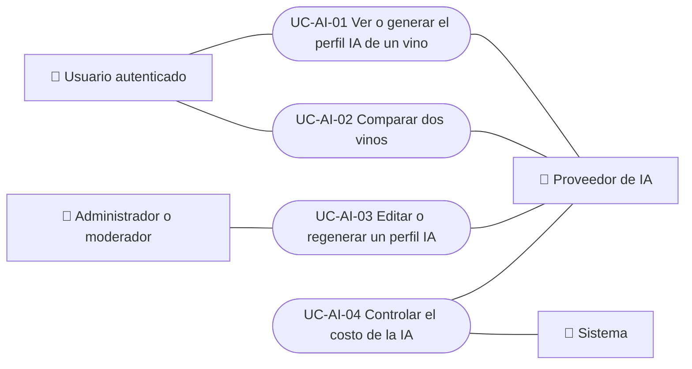

# Casos de uso

Casos de uso de IA: ver o generar el perfil de sommelier de un vino, comparar dos vinos, editar o regenerar un perfil desde el equipo, y controlar el costo de las llamadas a IA. Cada caso vale para las plataformas indicadas.

| ID | Caso de uso | Plataformas | Actores |
|---|---|---|---|
| `UC-AI-01` | [Ver o generar el perfil IA de un vino](uc-ai-01-view-ai-profile.md) | Web, APK | Usuario autenticado, Proveedor de IA |
| `UC-AI-02` | [Comparar dos vinos](uc-ai-02-compare-wines.md) | Web, APK | Usuario autenticado, Proveedor de IA |
| `UC-AI-03` | [Editar o regenerar un perfil IA](uc-ai-03-edit-ai-profile.md) | Web, APK | Administrador o moderador, Proveedor de IA |
| `UC-AI-04` | [Controlar el costo de la IA](uc-ai-04-control-ai-cost.md) | Solo backend | Sistema, Proveedor de IA |

## Diagrama de casos de uso

[Ver diagrama de «Casos de uso · Diagrama de casos de uso» completo](https://images.vinnot.com/docs/diagrams/v1/es/modules-ai-use-cases-readme-901e25703f60.svg)

## Equivalencia con Lucidchart

| ID | IDs en Lucidchart |
|---|---|
| `UC-AI-01` | [WEB UC-AI-01](https://lucid.app/lucidchart/9f11a16b-bb5a-42fc-a9e8-0852b17bd241/edit), [APK UC-AI-01](https://lucid.app/lucidchart/e095dd25-e8ac-41ba-bf5b-396e1055f217/edit) |
| `UC-AI-02` | [WEB UC-AI-02](https://lucid.app/lucidchart/9f11a16b-bb5a-42fc-a9e8-0852b17bd241/edit), [APK UC-AI-02](https://lucid.app/lucidchart/e095dd25-e8ac-41ba-bf5b-396e1055f217/edit) |
| `UC-AI-03` | [WEB UC-AI-03](https://lucid.app/lucidchart/9f11a16b-bb5a-42fc-a9e8-0852b17bd241/edit), [APK UC-AI-03](https://lucid.app/lucidchart/e095dd25-e8ac-41ba-bf5b-396e1055f217/edit) |
| `UC-AI-04` | Ninguno |
