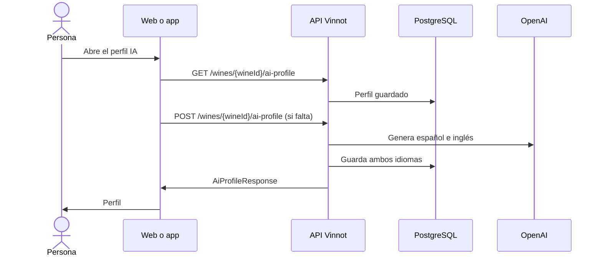

# UC-AI-01 · Ver o generar el perfil IA de un vino

| Campo | Valor |
|---|---|
| ID | `UC-AI-01` |
| Módulo | [Perfiles y comparaciones IA](../README.md) |
| Plataformas | Web, APK |
| Actores | Usuario autenticado, Proveedor de IA |
| IDs en Lucidchart | [WEB UC-AI-01](https://lucid.app/lucidchart/9f11a16b-bb5a-42fc-a9e8-0852b17bd241/edit), [APK UC-AI-01](https://lucid.app/lucidchart/e095dd25-e8ac-41ba-bf5b-396e1055f217/edit) |
| Requisitos | [`RF-WEB-AI-01`](../requirements.md), [`RF-WEB-AI-02`](../requirements.md), [`RF-WEB-AI-03`](../requirements.md), [`RF-WEB-AI-04`](../requirements.md), [`RF-APK-AI-01`](../requirements.md), [`RF-APK-AI-02`](../requirements.md), [`RF-APK-AI-03`](../requirements.md), [`RF-APK-AI-04`](../requirements.md) |
| Casos de prueba | [`CP-AI-01`](../testing.md), [`CP-AI-20`](../testing.md), [`CP-AI-02`](../testing.md), [`CP-AI-03`](../testing.md), [`CP-AI-04`](../testing.md), [`CP-AI-05`](../testing.md) |

## Precondiciones

- La persona tiene sesión iniciada y está en el detalle de un vino.

## Postcondiciones

- La persona ve el perfil de sommelier del vino en su idioma.

## Flujo principal

1. La persona abre el perfil IA: en la web, desde la tarjeta del sommelier; en la app, desde la tarjeta «Sommelier exclusivo» del vino con «Ver perfil» o «Generar perfil», o desde la pestaña «Perfil», que muestra el perfil guardado.
2. El cliente pide `GET /wines/{wineId}/ai-profile` en el idioma de la interfaz.
3. La API devuelve el perfil guardado sin generar nada.
4. El cliente muestra resumen, análisis visual, aromas, boca, sabores, maridajes, servicio, ocasiones y vinos similares, solo las secciones que existen.

## Flujos alternativos

- 2a. El vino no existe, o está inactivo y la persona no lo creó ni modera el catálogo: la API responde 404 `NOT_FOUND` sin leer ni generar ningún perfil.
- 3a. No hay perfil: la API responde 404 y el cliente lo trata como un perfil por generar. La web muestra «Este vino todavía no tiene perfil de IA» y la app «Perfil no disponible», las dos con «Generar perfil»; también lo pide solo al llegar con «generar». El cliente envía `POST /wines/{wineId}/ai-profile`.
- 3b. La API reutiliza el perfil si existe en los dos idiomas y el vino y el modelo no cambiaron; si no, lo genera en español e inglés y guarda ambos juntos.
- 3c. Otra persona ya está generando el mismo perfil: la API espera ese resultado en lugar de llamar de nuevo a la IA.
- 3d. La IA no está disponible o se agotó el presupuesto: la API responde 503 y el cliente permite reintentar.

## Reglas de negocio

- Leer un perfil nunca genera uno; generar es una acción explícita.
- El perfil sigue la visibilidad del vino: leer, generar y consultar el estado exigen poder ver el vino.
- Solo hay español e inglés; cualquier otro idioma usa español.
- Las ediciones manuales del equipo se conservan en una generación normal.
- Generar tiene un límite de 20 pedidos por hora por persona.

## Diagrama

[Ver diagrama de «UC-AI-01 · Ver o generar el perfil IA de un vino» completo](https://images.vinnot.com/docs/diagrams/v1/es/modules-ai-use-cases-uc-ai-01-view-ai-profile-88715023c1b2.svg)

Diagrama de componentes en Lucidchart: [WEB UC-AI-01](https://lucid.app/lucidchart/9f11a16b-bb5a-42fc-a9e8-0852b17bd241/edit), [APK UC-AI-01](https://lucid.app/lucidchart/e095dd25-e8ac-41ba-bf5b-396e1055f217/edit).

## Código

| Capa | Ubicación |
|---|---|
| Endpoints | `GET /wines/{wineId}/ai-profile`, `POST /wines/{wineId}/ai-profile`, `GET /wines/{wineId}/ai-profile/status` |
| Backend | [`AiProfileController.java`](../../../../../backend/src/main/java/com/vinnot/ai/infrastructure/web/controller/AiProfileController.java), [`AiProfileService.java`](../../../../../backend/src/main/java/com/vinnot/ai/application/service/AiProfileService.java), [`AiProfilePublicationService.java`](../../../../../backend/src/main/java/com/vinnot/ai/application/service/AiProfilePublicationService.java), [`AiProfilePromptBuilder.java`](../../../../../backend/src/main/java/com/vinnot/ai/application/service/AiProfilePromptBuilder.java), [`AiContentLanguage.java`](../../../../../backend/src/main/java/com/vinnot/ai/domain/valueobject/AiContentLanguage.java) |
| Web | [`AiProfilePage.tsx`](../../../../../frontend-react/src/presentation/pages/wines/AiProfilePage.tsx), [`useAiProfileViewModel.ts`](../../../../../frontend-react/src/presentation/pages/wines/useAiProfileViewModel.ts), [`useAiProfile.ts`](../../../../../frontend-react/src/presentation/hooks/queries/wine/useAiProfile.ts), [`useGenerateAiProfile.ts`](../../../../../frontend-react/src/presentation/hooks/queries/wine/useGenerateAiProfile.ts), [`wines.ai.client.ts`](../../../../../frontend-react/src/infrastructure/api/clients/wines.ai.client.ts), [`wine.mappers.ai.ts`](../../../../../frontend-react/src/domain/wine/wine.mappers.ai.ts) |
| App | `frontend-mobile/app/(app)/(tabs)/wines/[id]/ai-profile.tsx`, [`AiProfileSections.tsx`](../../../../../frontend-mobile/src/presentation/features/wine/AiProfileSections.tsx), [`useWines.ts`](../../../../../frontend-mobile/src/presentation/hooks/queries/wine/useWines.ts), [`wines.client.ts`](../../../../../frontend-mobile/src/infrastructure/api/clients/wines.client.ts) |

## Tests automáticos

- Backend: [`AiProfileControllerTest.java`](../../../../../backend/src/test/java/com/vinnot/ai/infrastructure/web/controller/AiProfileControllerTest.java), [`AiWineReadAccessTest.java`](../../../../../backend/src/test/java/com/vinnot/ai/infrastructure/web/controller/AiWineReadAccessTest.java), [`AiProfileServiceTest.java`](../../../../../backend/src/test/java/com/vinnot/ai/application/service/AiProfileServiceTest.java), [`AiProfilePublicationServiceTest.java`](../../../../../backend/src/test/java/com/vinnot/ai/application/service/AiProfilePublicationServiceTest.java), [`AiProfilePromptBuilderTest.java`](../../../../../backend/src/test/java/com/vinnot/ai/application/service/AiProfilePromptBuilderTest.java), [`AiContentLanguageTest.java`](../../../../../backend/src/test/java/com/vinnot/ai/domain/valueobject/AiContentLanguageTest.java), [`WineAiProfileTest.java`](../../../../../backend/src/test/java/com/vinnot/ai/domain/model/WineAiProfileTest.java), [`StoredWineProfileOverviewAdapterTest.java`](../../../../../backend/src/test/java/com/vinnot/ai/infrastructure/query/StoredWineProfileOverviewAdapterTest.java)
- Web: [`useAiProfileViewModel.test.tsx`](../../../../../frontend-react/src/presentation/pages/wines/useAiProfileViewModel.test.tsx), [`AiProfilePage.test.tsx`](../../../../../frontend-react/src/presentation/pages/wines/AiProfilePage.test.tsx), [`wines.ai.client.test.ts`](../../../../../frontend-react/src/infrastructure/api/clients/wines.ai.client.test.ts)
- App: [`AiProfileSections.test.tsx`](../../../../../frontend-mobile/src/presentation/features/wine/AiProfileSections.test.tsx), [`aiProfileRoute.test.tsx`](../../../../../frontend-mobile/src/presentation/features/wine/__tests__/aiProfileRoute.test.tsx)
