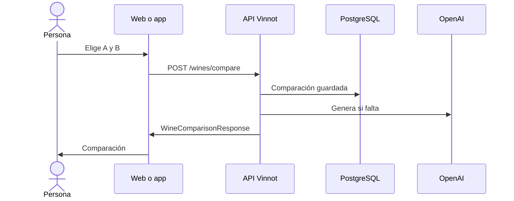

# UC-AI-02 · Comparar dos vinos

| Campo | Valor |
|---|---|
| ID | `UC-AI-02` |
| Módulo | [Perfiles y comparaciones IA](../README.md) |
| Plataformas | Web, APK |
| Actores | Usuario autenticado, Proveedor de IA |
| IDs en Lucidchart | [WEB UC-AI-02](https://lucid.app/lucidchart/9f11a16b-bb5a-42fc-a9e8-0852b17bd241/edit), [APK UC-AI-02](https://lucid.app/lucidchart/e095dd25-e8ac-41ba-bf5b-396e1055f217/edit) |
| Requisitos | [`RF-WEB-AI-05`](../requirements.md), [`RF-WEB-AI-06`](../requirements.md), [`RF-APK-AI-05`](../requirements.md), [`RF-APK-AI-06`](../requirements.md) |
| Casos de prueba | [`CP-AI-06`](../testing.md), [`CP-AI-07`](../testing.md), [`CP-AI-08`](../testing.md), [`CP-AI-09`](../testing.md) |

## Precondiciones

- La persona tiene sesión iniciada.

## Postcondiciones

- La persona ve la comparación de los dos vinos con atributos y una recomendación.

## Flujo principal

1. La persona abre Comparar, desde un vino o desde el catálogo.
2. Elige el vino A y el vino B con el buscador.
3. El cliente envía `POST /wines/compare`: en la web en cuanto hay dos vinos; en la app, al tocar «Comparar».
4. La API comprueba que la persona puede ver los dos vinos y reutiliza la comparación guardada para ese par e idioma, o la genera en español e inglés.
5. El cliente muestra resumen, diferencias, similitudes, tabla de atributos, para qué conviene cada uno y la recomendación.

## Flujos alternativos

- 3a. A y B son el mismo vino: la web no ofrece en el buscador el vino que ya ocupa la otra posición y la app no permite comparar; la API responde 422.
- 4a. La IA no está disponible o se agotó el presupuesto: la API responde 503 y el cliente conserva la selección y permite reintentar.
- 4b. Falla la red o vence el tiempo: el cliente lo distingue del error del servidor y no muestra ninguna recomendación.

## Reglas de negocio

- El orden de A y B no cambia la comparación guardada.
- Una comparación se guarda solo si pasa la validación: hasta 6 elementos por lista, hasta 2000 caracteres y sin textos de relleno.
- Sin proveedor de IA no hay comparación: no se usa contenido de prueba.
- Comparar tiene un límite de 20 pedidos por hora por persona.

## Diagrama

[Ver diagrama de «UC-AI-02 · Comparar dos vinos» completo](https://images.vinnot.com/docs/diagrams/v1/es/modules-ai-use-cases-uc-ai-02-compare-wines-358f8a781dc2.svg)

Diagrama de componentes en Lucidchart: [WEB UC-AI-02](https://lucid.app/lucidchart/9f11a16b-bb5a-42fc-a9e8-0852b17bd241/edit), [APK UC-AI-02](https://lucid.app/lucidchart/e095dd25-e8ac-41ba-bf5b-396e1055f217/edit).

## Código

| Capa | Ubicación |
|---|---|
| Endpoints | `POST /wines/compare` |
| Backend | [`WineComparisonController.java`](../../../../../backend/src/main/java/com/vinnot/ai/infrastructure/web/controller/WineComparisonController.java), [`WineComparisonService.java`](../../../../../backend/src/main/java/com/vinnot/ai/application/service/WineComparisonService.java), [`WineComparisonContentValidator.java`](../../../../../backend/src/main/java/com/vinnot/ai/application/service/WineComparisonContentValidator.java), [`CanonicalWinePair.java`](../../../../../backend/src/main/java/com/vinnot/ai/domain/valueobject/CanonicalWinePair.java) |
| Web | [`WineComparePage.tsx`](../../../../../frontend-react/src/presentation/pages/wines/WineComparePage.tsx), [`useWineCompareViewModel.ts`](../../../../../frontend-react/src/presentation/pages/wines/useWineCompareViewModel.ts), [`useWineComparison.ts`](../../../../../frontend-react/src/presentation/hooks/queries/wine/useWineComparison.ts), [`wines.ai.client.ts`](../../../../../frontend-react/src/infrastructure/api/clients/wines.ai.client.ts), [`wine.mappers.compare.ts`](../../../../../frontend-react/src/domain/wine/wine.mappers.compare.ts) |
| App | [`WineCompareScreen.tsx`](../../../../../frontend-mobile/src/presentation/screens/wines/WineCompareScreen.tsx), [`CompareLoadingSteps.tsx`](../../../../../frontend-mobile/src/presentation/features/wine/CompareLoadingSteps.tsx), [`WineComparisonAttributeTable.tsx`](../../../../../frontend-mobile/src/presentation/features/wine/WineComparisonAttributeTable.tsx), [`WineComparisonErrorState.tsx`](../../../../../frontend-mobile/src/presentation/features/wine/WineComparisonErrorState.tsx), [`useWines.ts`](../../../../../frontend-mobile/src/presentation/hooks/queries/wine/useWines.ts), [`wines.client.ts`](../../../../../frontend-mobile/src/infrastructure/api/clients/wines.client.ts) |

## Tests automáticos

- Backend: [`WineComparisonServiceTest.java`](../../../../../backend/src/test/java/com/vinnot/ai/application/service/WineComparisonServiceTest.java), [`WineComparisonContentValidatorTest.java`](../../../../../backend/src/test/java/com/vinnot/ai/application/service/WineComparisonContentValidatorTest.java), [`CanonicalWinePairTest.java`](../../../../../backend/src/test/java/com/vinnot/ai/domain/valueobject/CanonicalWinePairTest.java), [`WineComparisonTest.java`](../../../../../backend/src/test/java/com/vinnot/ai/domain/model/WineComparisonTest.java), [`WineComparisonContentGeneratorTest.java`](../../../../../backend/src/test/java/com/vinnot/ai/application/service/WineComparisonContentGeneratorTest.java)
- Web: [`WineComparePage.test.tsx`](../../../../../frontend-react/src/presentation/pages/wines/WineComparePage.test.tsx), [`useWineCompareViewModel.test.tsx`](../../../../../frontend-react/src/presentation/pages/wines/useWineCompareViewModel.test.tsx)
- App: [`compareRoute.test.tsx`](../../../../../frontend-mobile/src/presentation/features/wine/__tests__/compareRoute.test.tsx), [`CompareLoadingSteps.test.tsx`](../../../../../frontend-mobile/src/presentation/features/wine/CompareLoadingSteps.test.tsx), [`WineComparisonAttributeTable.test.tsx`](../../../../../frontend-mobile/src/presentation/features/wine/WineComparisonAttributeTable.test.tsx), [`WineComparisonErrorState.test.tsx`](../../../../../frontend-mobile/src/presentation/features/wine/WineComparisonErrorState.test.tsx)
