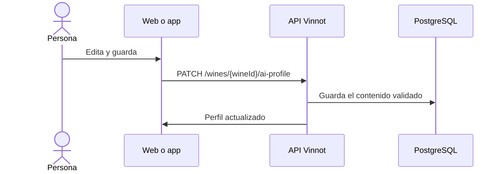

# UC-AI-03 · Editar o regenerar un perfil IA

| Campo | Valor |
|---|---|
| ID | `UC-AI-03` |
| Módulo | [Perfiles y comparaciones IA](../README.md) |
| Plataformas | Web, APK |
| Actores | Administrador o moderador, Proveedor de IA |
| IDs en Lucidchart | [WEB UC-AI-03](https://lucid.app/lucidchart/9f11a16b-bb5a-42fc-a9e8-0852b17bd241/edit), [APK UC-AI-03](https://lucid.app/lucidchart/e095dd25-e8ac-41ba-bf5b-396e1055f217/edit) |
| Requisitos | [`RF-WEB-AI-07`](../requirements.md), [`RF-WEB-AI-08`](../requirements.md), [`RF-APK-AI-07`](../requirements.md), [`RF-APK-AI-08`](../requirements.md), [`RF-APK-AI-09`](../requirements.md), [`RF-APK-AI-10`](../requirements.md) |
| Casos de prueba | [`CP-AI-10`](../testing.md), [`CP-AI-11`](../testing.md), [`CP-AI-12`](../testing.md), [`CP-AI-13`](../testing.md), [`CP-AI-14`](../testing.md) |

## Precondiciones

- La persona es administradora o moderadora y abre el editor del perfil IA de un vino.

## Postcondiciones

- El perfil del idioma activo quedó editado o regenerado.

## Flujo principal

1. El editor muestra las secciones del perfil del idioma activo como textos, listas y puntajes.
2. La persona edita y guarda.
3. El cliente envía `PATCH /wines/{wineId}/ai-profile` sin llamar a la IA.
4. La API valida el contenido y lo guarda.

## Flujos alternativos

- 2a. La persona elige «Regenerar» y confirma: el cliente envía `POST /wines/{wineId}/ai-profile/generate` y la API genera de nuevo los dos idiomas, reemplazando las ediciones manuales.
- 4a. Falta el resumen, una sección no tiene la forma esperada o un puntaje está fuera de 0 a 100: la API responde 400.
- 4b. El perfil cambió mientras se generaba: la API responde 409.
- 2b. En la app la persona sale con cambios sin guardar: se pide confirmación; «Restaurar» vuelve al contenido guardado.

## Reglas de negocio

- Editar y regenerar exigen el permiso `WINE_UPDATE` (administradores y moderadores).
- Editar no llama a la IA; regenerar sí y reemplaza lo editado.
- En la app el editor se abre desde el panel o desde el perfil completo.

## Diagrama

[Ver diagrama de «UC-AI-03 · Editar o regenerar un perfil IA» completo](https://images.vinnot.com/docs/diagrams/v1/es/modules-ai-use-cases-uc-ai-03-edit-ai-profile-0b491cb504dd.svg)

Diagrama de componentes en Lucidchart: [WEB UC-AI-03](https://lucid.app/lucidchart/9f11a16b-bb5a-42fc-a9e8-0852b17bd241/edit), [APK UC-AI-03](https://lucid.app/lucidchart/e095dd25-e8ac-41ba-bf5b-396e1055f217/edit).

## Código

| Capa | Ubicación |
|---|---|
| Endpoints | `PATCH /wines/{wineId}/ai-profile`, `POST /wines/{wineId}/ai-profile/generate` |
| Backend | [`AiProfileController.java`](../../../../../backend/src/main/java/com/vinnot/ai/infrastructure/web/controller/AiProfileController.java), [`AiProfileService.java`](../../../../../backend/src/main/java/com/vinnot/ai/application/service/AiProfileService.java), [`ManualProfileContent.java`](../../../../../backend/src/main/java/com/vinnot/ai/domain/model/ManualProfileContent.java) |
| Web | [`AdminWineAiProfilePage.tsx`](../../../../../frontend-react/src/presentation/pages/admin/AdminWineAiProfilePage.tsx), [`useAdminWineAiProfileViewModel.ts`](../../../../../frontend-react/src/presentation/pages/admin/useAdminWineAiProfileViewModel.ts), [`useRegenerateAiProfile.ts`](../../../../../frontend-react/src/presentation/hooks/queries/wine/useRegenerateAiProfile.ts) |
| App | [`AdminWineAiProfileScreen.tsx`](../../../../../frontend-mobile/src/presentation/features/admin/AdminWineAiProfileScreen.tsx), [`WineProfileEditor.tsx`](../../../../../frontend-mobile/src/presentation/features/wine/WineProfileEditor.tsx), [`useWineProfileEditor.ts`](../../../../../frontend-mobile/src/presentation/hooks/queries/admin/useWineProfileEditor.ts) |

## Tests automáticos

- Backend: [`AiProfileControllerTest.java`](../../../../../backend/src/test/java/com/vinnot/ai/infrastructure/web/controller/AiProfileControllerTest.java), [`ManualProfileContentTest.java`](../../../../../backend/src/test/java/com/vinnot/ai/domain/model/ManualProfileContentTest.java), [`AiProfileServiceTest.java`](../../../../../backend/src/test/java/com/vinnot/ai/application/service/AiProfileServiceTest.java)
- Web: Ninguno
- App: [`WineProfileEditor.test.tsx`](../../../../../frontend-mobile/src/presentation/features/wine/WineProfileEditor.test.tsx), [`wine-profile-editor.test.tsx`](../../../../../frontend-mobile/src/test/integration/wine-profile-editor.test.tsx)
