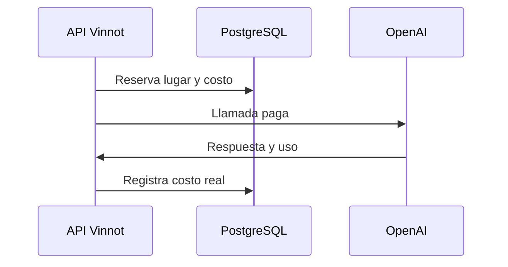

# UC-AI-04 · Controlar el costo de la IA

| Campo | Valor |
|---|---|
| ID | `UC-AI-04` |
| Módulo | [Perfiles y comparaciones IA](../README.md) |
| Plataformas | Solo backend |
| Actores | Sistema, Proveedor de IA |
| IDs en Lucidchart | Ninguno |
| Requisitos | Ninguno |
| Casos de prueba | [`CP-AI-15`](../testing.md), [`CP-AI-16`](../testing.md), [`CP-AI-17`](../testing.md), [`CP-AI-18`](../testing.md), [`CP-AI-19`](../testing.md) |

## Precondiciones

- Una función pide una llamada paga a la IA: perfil, comparación, lectura de etiquetas o moderación.

## Postcondiciones

- La llamada se hizo dentro del presupuesto o se rechazó sin costo.

## Flujo principal

1. El sistema verifica que las llamadas pagas estén habilitadas.
2. Reserva un lugar entre las llamadas simultáneas permitidas.
3. Reserva el costo máximo de la llamada contra el presupuesto mensual y, si existe, el diario.
4. Hace la llamada al proveedor.
5. Registra el costo real y libera el lugar.

## Flujos alternativos

- 1a. Las llamadas pagas están pausadas: se rechaza con 503.
- 2a. No hay lugar libre: se rechaza con 503.
- 3a. El presupuesto no alcanza: se rechaza con 503.
- 4a. No se sabe si la llamada se cobró: el costo queda reservado como desconocido.

## Reglas de negocio

- Por defecto: 3 llamadas simultáneas y 10 USD por mes; el límite diario está apagado.
- Un mismo perfil o una misma comparación se genera una sola vez a la vez; los demás pedidos esperan ese resultado.
- Con el proveedor `mock` (el de desarrollo local) los perfiles usan un generador de prueba y las comparaciones no están disponibles; sin proveedor, ambos responden 503.

## Diagrama

[Ver diagrama de «UC-AI-04 · Controlar el costo de la IA» completo](https://images.vinnot.com/docs/diagrams/v1/es/modules-ai-use-cases-uc-ai-04-control-ai-cost-a4775686e326.svg)

## Código

| Capa | Ubicación |
|---|---|
| Backend | [`AiProviderAdmissionService.java`](../../../../../backend/src/main/java/com/vinnot/ai/application/service/AiProviderAdmissionService.java), [`AiGenerationCoordinator.java`](../../../../../backend/src/main/java/com/vinnot/ai/application/service/AiGenerationCoordinator.java) |

## Tests automáticos

- Backend: [`AiProviderAdmissionServiceTest.java`](../../../../../backend/src/test/java/com/vinnot/ai/application/service/AiProviderAdmissionServiceTest.java), [`AiGenerationCoordinatorTest.java`](../../../../../backend/src/test/java/com/vinnot/ai/application/service/AiGenerationCoordinatorTest.java), [`PostgresAiGenerationLeaseAdapterTest.java`](../../../../../backend/src/test/java/com/vinnot/ai/infrastructure/persistence/lock/PostgresAiGenerationLeaseAdapterTest.java), [`AiSpendingPostgresIntegrationTest.java`](../../../../../backend/src/test/java/com/vinnot/ai/infrastructure/persistence/adapter/AiSpendingPostgresIntegrationTest.java)
- Web: Ninguno
- App: Ninguno
