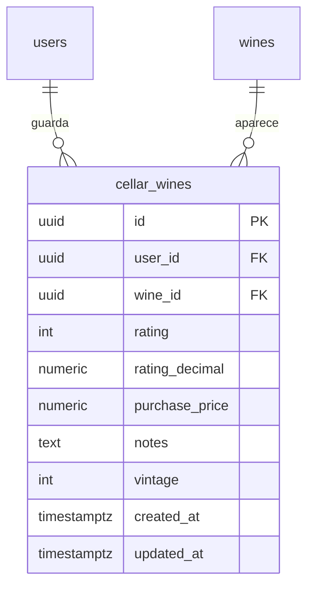

# Cava

La colección personal de vinos de cada persona, que en la web y la app se llama
«Mi Bodega». Cada vino del catálogo se guarda una vez, con un puntaje, notas y
precio de compra privados, y la cava muestra métricas de la colección. Desde la
cava una nota se puede publicar como reseña ([Reseñas](../reviews/README.md)); los
vinos vienen del catálogo de [Vinos](../wines/README.md).

- Código del módulo: `CEL`.
- Backend: paquete [`cellar`](../../../../backend/src/main/java/com/vinnot/cellar/).
- [Casos de uso](use-cases/README.md) · [Requisitos](requirements.md) ·
  [Arquitectura](architecture.md) · [Pruebas](testing.md)

## Actores

| Actor | Qué hace en este módulo |
|---|---|
| Usuario autenticado | Ve su cava, agrega, edita y quita vinos y publica notas como reseñas; ve la cava de otros miembros cuando su configuración lo permite |
| Administrador | Puede consultar la cava y las estadísticas de otra persona desde la API |

## Reglas de negocio

| Regla | Detalle | Dónde |
|---|---|---|
| Acceso | La cava requiere sesión y el permiso `CELLAR_MANAGE_OWN` | [`CellarController.java`](../../../../backend/src/main/java/com/vinnot/cellar/infrastructure/web/controller/CellarController.java) |
| Privacidad | Cada persona cambia solo su cava; las rutas completas por usuario, con notas y precios, admiten al titular o a un administrador | [`CellarController.java`](../../../../backend/src/main/java/com/vinnot/cellar/infrastructure/web/controller/CellarController.java) |
| Cava pública | Cada miembro elige quién ve su cava en el perfil público: `PUBLIC` (por defecto), `FOLLOWERS` o `PRIVATE`, desde `PATCH /users/me` (`cellarVisibility`). `GET /users/{id}/cellar` lista vino, añada, puntaje y fecha de alta, de la más reciente a la más antigua y solo de vinos activos; nunca incluye notas ni precio de compra y responde 403 `CELLAR_NOT_VISIBLE` cuando la configuración la oculta. El dueño siempre ve la suya | [Comunidad](../community/architecture.md) |
| Un vino por persona | Un vino aparece una sola vez en cada cava | [`AddWineToCellarCommandHandler.java`](../../../../backend/src/main/java/com/vinnot/cellar/application/command/handler/AddWineToCellarCommandHandler.java) |
| Datos personales | Puntaje de 0.1 a 5.0 con un decimal (el mismo de las reseñas), precio no negativo, notas de hasta 10000 caracteres y añada probada (de 1800 al año siguiente, independiente de la añada del catálogo), todos opcionales | [`CellarWine.java`](../../../../backend/src/main/java/com/vinnot/cellar/domain/model/CellarWine.java) |
| Puntos | Agregar un vino a mano suma 1 punto para el sello, una vez por vino para siempre y hasta 3 por día; la entrada creada al publicar una reseña no suma | [Puntos y sellos](../gamification/README.md) |
| Sin inventario | No registra botellas, consumos ni compras | [`CellarWine.java`](../../../../backend/src/main/java/com/vinnot/cellar/domain/model/CellarWine.java) |
| Edición | Guardar reemplaza puntaje, precio y notas, incluso con valores vacíos; la añada se conserva salvo que se envíe una nueva o `clearVintage` la elimine | [`UpdateCellarEntryCommandHandler.java`](../../../../backend/src/main/java/com/vinnot/cellar/application/command/handler/UpdateCellarEntryCommandHandler.java) |
| Reseñas | Publicar o editar la reseña propia sincroniza la cava; las notas solo se reemplazan cuando la reseña trae comentario, y la añada solo cuando la reseña trae una; quitar un vino de la cava no borra la reseña | [Reseñas](../reviews/README.md) |
| Lista | Hasta 1000 entradas por consulta | [`GetUserCellarQueryHandler.java`](../../../../backend/src/main/java/com/vinnot/cellar/application/query/handler/GetUserCellarQueryHandler.java) |
| Métricas | Web y app calculan lo mismo: cantidad, promedio de los puntuados, regiones distintas y mezcla de tipos; ninguna suma un total invertido | [Arquitectura](architecture.md) |

## Dónde vive

| Parte | Ubicación |
|---|---|
| API | [`CellarController`](../../../../backend/src/main/java/com/vinnot/cellar/infrastructure/web/controller/CellarController.java), bajo `/cellar` |
| Web | Página `/cellar` en [`pages/cellar`](../../../../frontend-react/src/presentation/pages/cellar/) y componentes en [`features/cellar`](../../../../frontend-react/src/presentation/components/features/cellar/) |
| App | Pantalla `frontend-mobile/app/(app)/cellar.tsx` y lógica en [`features/cellar`](../../../../frontend-mobile/src/presentation/features/cellar/) |

## Datos

Tabla creada en `V1__baseline_schema.sql`.

[Ver diagrama de «Cava · Datos» completo](https://images.vinnot.com/docs/diagrams/v1/es/modules-cellar-readme-7ed220f8b83f.svg)

`cellar_wines` es única por persona y vino y se borra en cascada con la persona o el
vino. V71 (#455) agrega `rating_decimal`, un decimal de 0.1 a 5.0 completado desde
`rating`, que sigue siendo un entero 1–5 para la revisión anterior del backend; el
backend lee `rating_decimal` y escribe ambas en cada guardado. Las afinidades de
gusto que usan las recomendaciones también leen esta tabla.
