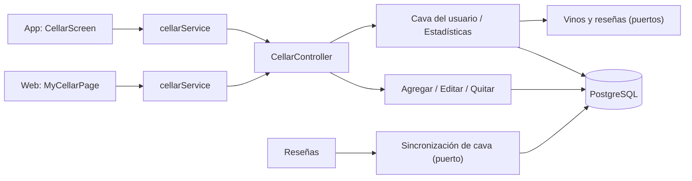
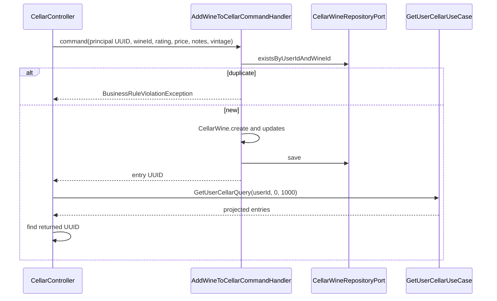

# Arquitectura

Cómo está construido el módulo en cada capa. El backend sigue el flujo hexagonal
`controller → puerto de entrada → handler → dominio → puerto de salida → adaptador`;
la web y la app siguen `pantalla → hook → servicio → cliente API → transporte HTTP`.



[Ver diagrama de «Arquitectura» completo](https://images.vinnot.com/docs/diagrams/v1/es/modules-cellar-architecture-23163477188d.svg)

## Backend

### Objetivo funcional

La cava modela el inventario personal de un usuario sobre vinos del catálogo. No
crea una copia del vino: mantiene una relación usuario-vino con rating personal,
precio de compra, notas, añada probada y timestamps. Las mutaciones de entradas existentes validan propiedad en backend;
el alcance de las lecturas se define por cada endpoint.

### Componentes

| Capa | Tipos principales |
|---|---|
| Dominio | `CellarWine` |
| Commands | `AddWineToCellarCommand`, `UpdateCellarEntryCommand`, `RemoveWineFromCellarCommand` |
| Queries | `GetUserCellarQuery`, `GetCellarStatsQuery` |
| Puertos | `CellarWineRepositoryPort`, `WineQueryPort`, `ReviewQueryPort` |
| Persistencia | `CellarWineJpaEntity`, repositorio, mapper y adapter |
| Entrada | `CellarController` |

### Modelo e invariantes

- `userId` y `wineId` son obligatorios e inmutables dentro de la entrada.
- La combinación usuario-vino debe ser única.
- Rating personal es opcional y admite de 0.1 a 5.0 con un decimal como máximo.
- Precio y notas son opcionales; no modifican precio ni descripción del catálogo.
- La añada probada es opcional, va de 1800 al año siguiente (`INVALID_VINTAGE`)
  y nunca modifica la añada del catálogo.
- Crear o cambiar un dato actualiza `updatedAt`.
- Actualizar/eliminar exige que `entry.userId` coincida con el principal.
- La proyección del vino se obtiene a través de `WineQueryPort`, no con una
  dependencia directa a JPA del módulo `wine`.

### Alta



[Ver diagrama de «Alta» completo](https://images.vinnot.com/docs/diagrams/v1/es/modules-cellar-architecture-e926c2ea1271.svg)

El command handler no consulta WineQueryPort: FK valida la referencia al vino al persistir. El puerto de vino participa en la query de proyección. El controller devuelve HTTP 201 con la entrada encontrada en la página consultada, o body null si no se encuentra allí. El usuario se deriva del principal, no del body. La unicidad usuario/vino se respalda en PostgreSQL.

### Lectura y alcance de identidad

`GET /cellar` y `GET /cellar/stats` derivan el UUID del principal autenticado.
Las variantes `/cellar/user/{userId}` reciben el UUID objetivo como path
variable. Las cuatro rutas delegan en `GetUserCellarUseCase` o
`GetCellarStatsUseCase`; los handlers consultan el repositorio mediante el UUID
contenido en la query.

`GET /cellar` construye una lista de `CellarWineResponse`. Cada respuesta combina:

- ID de la entrada y metadatos privados, incluida la `vintage` probada;
- ID, nombre, añada del catálogo (`wine.vintage`), imagen y tipo del vino;
- nombre de bodega;
- promedio público del catálogo;
- timestamps de la relación;
- `reviewId` de la reseña del titular para ese vino, o `null` si no existe.

`ReviewQueryPort` obtiene los IDs en un único lote acotado por titular y vinos
de la ventana; el adaptador puente usa el puerto del módulo de reseñas. No se
consulta cada vino por separado ni se publican notas privadas al consultar la cava.

El handler obtiene entradas por usuario y resuelve la vista de vinos mediante el
puerto de consulta. Una ausencia del vino no debe materializar una entidad JPA
parcial ni disparar lazy loading fuera de transacción.

El contrato de lista existente usa por defecto una ventana de 1.000 entradas,
también utilizada en respuestas de mutaciones. La aplicación lee esa ventana
con un máximo de cinco páginas de base de 200 entradas, ordenadas por ID único
dentro de una transacción de sólo lectura con aislamiento repeatable-read.
Se detiene al alcanzar el total registrado: una cava vacía requiere una sola
lectura acotada. Las páginas explícitas ordinarias conservan el máximo compartido
de 200; sólo el tamaño exacto de la ventana anterior recibe este tratamiento de
compatibilidad. Offsets negativos o desbordados se rechazan antes del repositorio.
La respuesta HTTP sigue siendo un array y no se amplía el límite común de base.

### Actualización

`PATCH /cellar/{id}` carga la entrada, verifica propiedad y aplica los métodos
de dominio:

1. `updateRating` valida 0.1–5.0 con un decimal o acepta `null`;
2. `updatePurchasePrice` reemplaza el precio personal;
3. `updateNotes` reemplaza las notas;
4. `updateVintage` valida la añada probada.

El request representa el estado editable soportado. El handler aplica los tres
valores recibidos de rating, precio y notas, incluidos los valores `null` admitidos
por el contrato. La añada es la excepción: una `vintage` omitida o `null` conserva la
guardada, así las versiones de la app que no la envían nunca la borran; un valor la
reemplaza y `clearVintage: true` la elimina (prevalece sobre una `vintage` enviada).

### Eliminación

`DELETE /cellar/{id}` exige una entrada existente y propia, y luego llama
`delete` en el puerto. La ausencia de la entrada no se trata como un borrado
exitoso.

### Estadísticas

`CellarStatsResponse` agrega información del inventario del UUID contenido en
`GetCellarStatsQuery`. La consulta se mantiene separada de las mutaciones y se
puede optimizar en persistencia sin cambiar el agregado. La ruta propia deriva
ese UUID del JWT; la variante `/user/{userId}/stats` usa el path como UUID objetivo de la query.

### Integración con reseñas

Después de persistir una reseña, `CreateReviewCommandHandler` siempre sincroniza la
cava: con comentario invoca `CellarCommandPort.syncReviewToCellar` (rating y notas);
sin comentario, `syncReviewRatingToCellar` (sólo rating, conserva las notas). `UpdateReviewCommandHandler` sólo
sincroniza cuando el autor edita su propia reseña: con notas si la edición envió
un comentario, o mediante `syncReviewRatingToCellar` (sólo rating, conserva las
notas) si envió únicamente un rating; la edición de un administrador nunca toca
la cava del autor. El adapter crea la relación si no existe o la actualiza si ya
existe. No captura excepciones: una falla se propaga y revierte la transacción
de la reseña. Esta integración no mueve ownership ni reglas
de cava al módulo `review`: el adapter traduce la intención al contrato
propietario.

### Frontend

Los clientes consumen la lista de `CellarWineResponse` y calculan sus métricas; no usan los endpoints de estadísticas. El controller devuelve `response.content()` para GET, no el wrapper PageResult completo. Las reglas de cache e invalidación pertenecen a la documentación de cada frontend; no forman parte de una garantía del backend.

### Seguridad y privacidad

- El controller exige `CELLAR_MANAGE_OWN`.
- `GET /cellar`, `GET /cellar/stats` y todas las mutaciones derivan el usuario
  del JWT.
- Update/Remove verifican propiedad de la entrada cargada.
- Notas y precio personal no forman parte del detalle público del vino.
- Logs no deben incluir notas del usuario.

### Pruebas

- dominio: `CellarWineTest` (puntaje mínimo, máximo y vacío, límites de añada y fechas);
- handlers: `AddWineToCellarCommandHandlerTest`, `UpdateCellarEntryCommandHandlerTest`, `RemoveWineFromCellarCommandHandlerTest` y `CellarEntryOwnershipTest`;
- consultas: `GetUserCellarQueryHandlerTest` y `GetCellarStatsQueryHandlerTest`;
- persistencia: `WineQueryAdapterTest`, `CellarWinePersistenceMapperTest` y, desde reseñas, `CellarCommandAdapterTest`;
- HTTP: `CellarPrivacyTest` (dueño o administrador en las rutas por usuario) y `CellarControllerTest` (mapeo y límites de añada).

### Archivos de referencia

- `backend/src/main/java/com/vinnot/cellar`
- `frontend-react/src/application/services/cellar.service.ts`
- `frontend-mobile/src/application/services/cellar.service.ts`
- [Reseñas](../reviews/architecture.md)

### Contrato de consistencia y acceso

GET /cellar/user/{userId} y /stats sólo permiten al titular con CELLAR_MANAGE_OWN o a ADMIN. Moderador, partner e institucional no pueden leer cavas ajenas por su rol. El rechazo ocurre antes de ejecutar el caso de uso.

[Detalle de coordinación](../../backend/architecture/session-and-data-integrity.md).

## Web

```text
MyCellarPage → useMyCellarViewModel → useCellar / useUpdateCellarEntry / useRemoveCellarEntry → cellarService → cellarClient → http
```

La cava es la página protegida `/cellar` («Mi Bodega»), con acceso desde el menú
y el inicio. El alta rápida está en la ficha del vino.

| Pieza | Qué hace |
|---|---|
| [`MyCellarPage.tsx`](../../../../frontend-react/src/presentation/pages/cellar/MyCellarPage.tsx) | Portada de la bodega, grilla de vinos y estados de carga, error y vacío |
| [`CellarCover.tsx`](../../../../frontend-react/src/presentation/components/features/cellar/CellarCover.tsx) | Portada como la de la app: ilustración de la cava con el título y «Agregar vino» encima; «Vinos», «Promedio» (con una copa) y «Regiones», y una barra con la mezcla de tipos y su leyenda (los mismos colores que la app). No muestra un total invertido: el precio se ve en cada tarjeta. Con la bodega vacía muestra solo el título y el botón |
| [`useMyCellarViewModel.ts`](../../../../frontend-react/src/presentation/pages/cellar/useMyCellarViewModel.ts) | Toma las métricas de `summarizeCellar` ([`cellar.stats.ts`](../../../../frontend-react/src/domain/cellar/cellar.stats.ts), la misma regla que la app), abre la edición y la publicación como reseña, confirma antes de quitar y avisa «Quitaste el vino de tu bodega» |
| [`CellarWineCard.tsx`](../../../../frontend-react/src/presentation/components/features/cellar/CellarWineCard.tsx) | Tarjeta con «Editar notas», «Eliminar» y «Publicar como reseña» o «Ver reseña» |
| [`CellarEditModal.tsx`](../../../../frontend-react/src/presentation/components/features/cellar/CellarEditModal.tsx) | Estrellas (tocar la elegida la borra), notas y precio |
| [`CellarReviewModal.tsx`](../../../../frontend-react/src/presentation/components/features/cellar/CellarReviewModal.tsx) y [`useCellarReviewPublication.ts`](../../../../frontend-react/src/presentation/hooks/useCellarReviewPublication.ts) | Borrador de reseña con el puntaje y las notas; vuelve a consultar si ya hay reseña propia antes de publicar |
| [`WineCellarModal.tsx`](../../../../frontend-react/src/presentation/pages/wines/WineCellarModal.tsx) y [`useCellarQuickAdd.ts`](../../../../frontend-react/src/presentation/hooks/queries/wine/useCellarQuickAdd.ts) | Alta desde la ficha del vino con puntaje, notas y precio; al guardar avisa «Agregaste el vino a tu bodega» |
| [`cellar.service.ts`](../../../../frontend-react/src/application/services/cellar.service.ts) y [`cellar.client.ts`](../../../../frontend-react/src/infrastructure/api/clients/cellar.client.ts) | Mapean los DTO y llaman a `/cellar`; no usan los endpoints de estadísticas |

## App

La pantalla es `frontend-mobile/app/(app)/cellar.tsx`, fuera de las pestañas. Se
abre desde el inicio, la tarjeta de vinos en la cava del perfil y la ficha de un
vino; volver regresa al origen o al inicio.

| Pieza | Qué hace |
|---|---|
| [`CellarScreen.tsx`](../../../../frontend-mobile/src/presentation/features/cellar/CellarScreen.tsx) | Búsqueda con espera de 250 ms, filtros, recarga al tirar hacia abajo, botón de agregar y lista |
| [`CellarStatsBanner.tsx`](../../../../frontend-mobile/src/presentation/features/cellar/CellarStatsBanner.tsx) | Portada con la ilustración de la cava, título y «Agregar vino»; «Vinos», «Promedio» (con una copa) y «Regiones», y una barra con la mezcla de tipos y su leyenda (colores `wineTypeSwatches`). Las cifras salen de `summarizeCellar` ([`cellar.stats.ts`](../../../../frontend-mobile/src/domain/cellar/cellar.stats.ts)); no muestra un total invertido. Con la cava vacía muestra solo el título y el botón |
| [`CellarFilterSheet.tsx`](../../../../frontend-mobile/src/presentation/features/cellar/CellarFilterSheet.tsx) | Todos, con puntaje (ícono de copa) o con notas |
| [`CellarEntryRow.tsx`](../../../../frontend-mobile/src/presentation/features/cellar/CellarEntryRow.tsx) | Entrada que abre la ficha del vino al tocarla, con la bodega, el tipo traducido, el puntaje en copas con su valor numérico y un menú de acciones de tres puntos; se quita deslizando, con confirmación |
| [`CellarEntryActionsMenu.tsx`](../../../../frontend-mobile/src/presentation/features/cellar/CellarEntryActionsMenu.tsx) | Menú de tres puntos de una entrada: una hoja inferior con editar notas, ver o publicar la reseña, abrir el vino y eliminar. La acción elegida corre cuando la hoja terminó de cerrarse, para que la hoja de edición o de publicación que abre no se descarte |
| [`CellarAddSheet.tsx`](../../../../frontend-mobile/src/presentation/features/cellar/CellarAddSheet.tsx) | Alta con buscador de vinos (8 resultados) y edición de una entrada, con el puntaje en el control de la botella sobre las copas; los vinos que ya están en la cava aparecen deshabilitados con «Ya está en tu bodega» |
| [`CellarReviewSheet.tsx`](../../../../frontend-mobile/src/presentation/features/cellar/CellarReviewSheet.tsx) y [`useCellarReviewPublication.ts`](../../../../frontend-mobile/src/presentation/hooks/useCellarReviewPublication.ts) | Borrador de reseña con el puntaje y las notas |
| [`discoveryNavigation.ts`](../../../../frontend-mobile/src/presentation/navigation/discoveryNavigation.ts) | Ruta de la cava y regreso al origen |
| [`cellar.service.ts`](../../../../frontend-mobile/src/application/services/cellar.service.ts) y [`cellar.client.ts`](../../../../frontend-mobile/src/infrastructure/api/clients/cellar.client.ts) | Mapean los DTO y llaman a `/cellar` |

En el catálogo, cada vino que ya está en la cava muestra una marca.
