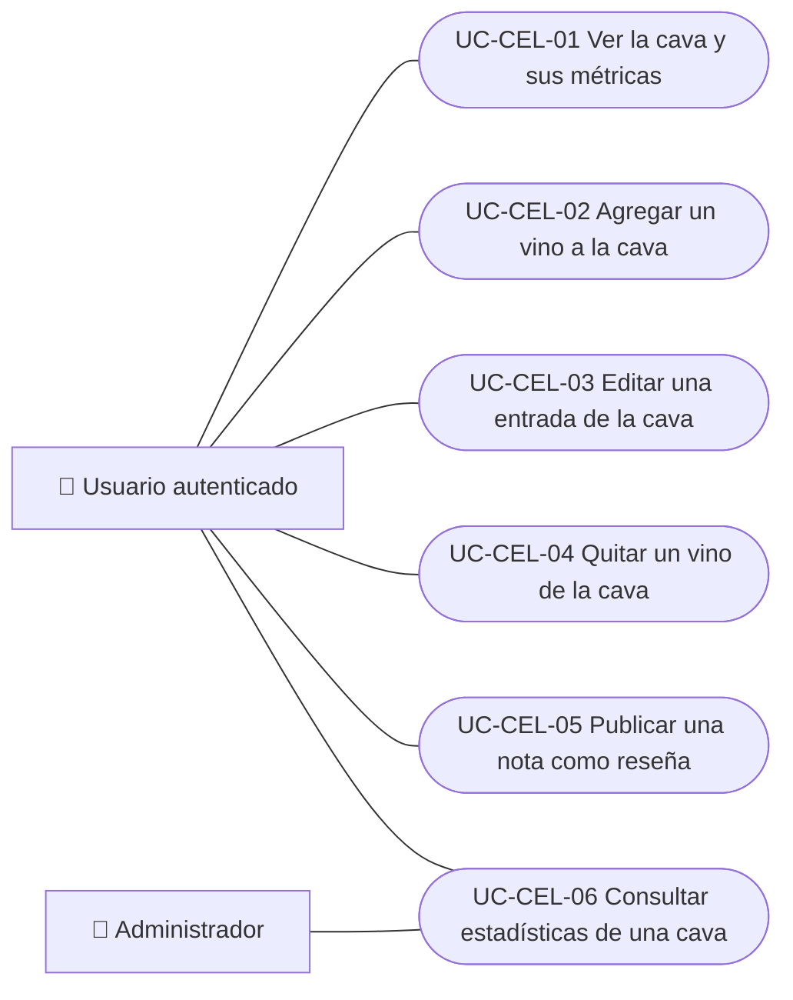

# Casos de uso

Casos de uso de la cava personal: ver la colección y sus métricas, agregar, editar y quitar vinos, publicar una nota como reseña y consultar estadísticas desde la API. Cada caso vale para las plataformas indicadas.

| ID | Caso de uso | Plataformas | Actores |
|---|---|---|---|
| `UC-CEL-01` | [Ver la cava y sus métricas](uc-cel-01-view-cellar.md) | Web, APK | Usuario autenticado |
| `UC-CEL-02` | [Agregar un vino a la cava](uc-cel-02-add-wine.md) | Web, APK | Usuario autenticado |
| `UC-CEL-03` | [Editar una entrada de la cava](uc-cel-03-edit-entry.md) | Web, APK | Usuario autenticado |
| `UC-CEL-04` | [Quitar un vino de la cava](uc-cel-04-remove-entry.md) | Web, APK | Usuario autenticado |
| `UC-CEL-05` | [Publicar una nota como reseña](uc-cel-05-publish-note-as-review.md) | Web, APK | Usuario autenticado |
| `UC-CEL-06` | [Consultar estadísticas de una cava](uc-cel-06-cellar-statistics.md) | Solo backend | Usuario autenticado, Administrador |

## Diagrama de casos de uso

[Ver diagrama de «Casos de uso · Diagrama de casos de uso» completo](https://images.vinnot.com/docs/diagrams/v1/es/modules-cellar-use-cases-readme-74d1649ecb6a.svg)

## Equivalencia con Lucidchart

| ID | IDs en Lucidchart |
|---|---|
| `UC-CEL-01` | [WEB UC-CEL-01](https://lucid.app/lucidchart/9f11a16b-bb5a-42fc-a9e8-0852b17bd241/edit), [APK UC-CEL-01](https://lucid.app/lucidchart/e095dd25-e8ac-41ba-bf5b-396e1055f217/edit) |
| `UC-CEL-02` | [WEB UC-CEL-02](https://lucid.app/lucidchart/9f11a16b-bb5a-42fc-a9e8-0852b17bd241/edit), [APK UC-CEL-02](https://lucid.app/lucidchart/e095dd25-e8ac-41ba-bf5b-396e1055f217/edit) |
| `UC-CEL-03` | [WEB UC-CEL-03](https://lucid.app/lucidchart/9f11a16b-bb5a-42fc-a9e8-0852b17bd241/edit), [APK UC-CEL-03](https://lucid.app/lucidchart/e095dd25-e8ac-41ba-bf5b-396e1055f217/edit) |
| `UC-CEL-04` | [WEB UC-CEL-04](https://lucid.app/lucidchart/9f11a16b-bb5a-42fc-a9e8-0852b17bd241/edit), [APK UC-CEL-04](https://lucid.app/lucidchart/e095dd25-e8ac-41ba-bf5b-396e1055f217/edit) |
| `UC-CEL-05` | [WEB UC-CEL-05](https://lucid.app/lucidchart/9f11a16b-bb5a-42fc-a9e8-0852b17bd241/edit), [APK UC-CEL-05](https://lucid.app/lucidchart/e095dd25-e8ac-41ba-bf5b-396e1055f217/edit) |
| `UC-CEL-06` | Ninguno |
