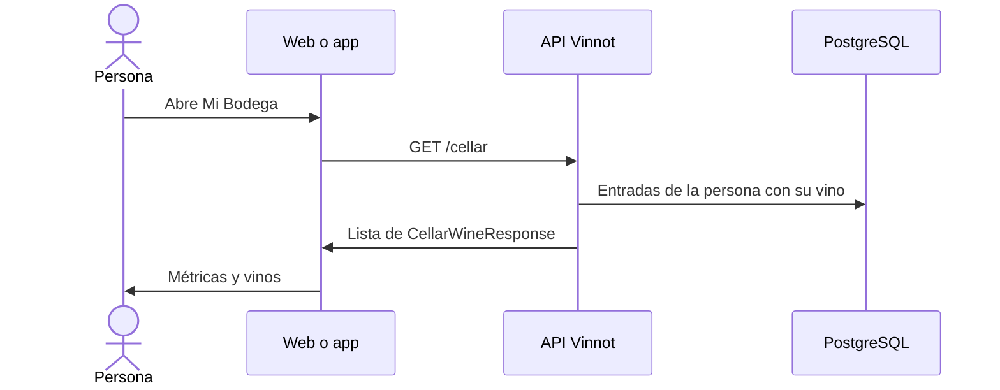

# UC-CEL-01 · Ver la cava y sus métricas

| Campo | Valor |
|---|---|
| ID | `UC-CEL-01` |
| Módulo | [Cava](../README.md) |
| Plataformas | Web, APK |
| Actores | Usuario autenticado |
| IDs en Lucidchart | [WEB UC-CEL-01](https://lucid.app/lucidchart/9f11a16b-bb5a-42fc-a9e8-0852b17bd241/edit), [APK UC-CEL-01](https://lucid.app/lucidchart/e095dd25-e8ac-41ba-bf5b-396e1055f217/edit) |
| Requisitos | [`RF-WEB-CEL-01`](../requirements.md), [`RF-WEB-CEL-02`](../requirements.md), [`RF-WEB-CEL-03`](../requirements.md), [`RF-APK-CEL-01`](../requirements.md), [`RF-APK-CEL-02`](../requirements.md), [`RF-APK-CEL-03`](../requirements.md), [`RF-APK-CEL-04`](../requirements.md) |
| Casos de prueba | [`CP-CEL-01`](../testing.md), [`CP-CEL-02`](../testing.md), [`CP-CEL-03`](../testing.md), [`CP-CEL-04`](../testing.md), [`CP-CEL-05`](../testing.md) |

## Precondiciones

- La persona tiene sesión iniciada.

## Postcondiciones

- Se muestran los vinos de su cava con sus datos personales y las métricas de la colección.

## Flujo principal

1. La persona abre «Mi Bodega»: en la web desde el menú o el inicio; en la app desde el inicio, el perfil o la ficha de un vino.
2. El cliente pide `GET /cellar`.
3. La API devuelve solo las entradas de la persona, cada una con el vino, el puntaje personal, el precio de compra, las notas, las fechas y la reseña propia si existe.
4. El cliente calcula la cantidad de vinos, el promedio de los puntuados, las regiones distintas y la mezcla de tipos de vino, igual en la web y en la app.
5. Muestra las métricas y la lista de vinos.

## Flujos alternativos

- 3a. La cava está vacía: se muestra el estado vacío con un acceso para agregar vinos.
- 5a. En la app la persona busca por nombre, bodega, región, país o notas, o filtra entre todos, con puntaje o con notas: la lista se filtra en el dispositivo.
- 5b. En la app la persona tira hacia abajo: la lista se recarga.
- 2a. Falla la consulta: se muestra el error con opción de reintentar.

## Reglas de negocio

- Cada persona ve solo su cava.
- La cava no registra botellas, consumos ni compras; guarda un vino una sola vez con datos personales.
- La lista trae hasta 1000 entradas.
- Los importes se muestran en pesos argentinos. Ni la web ni la app muestran un total invertido: el precio de compra se guarda y se ve en cada entrada.

## Diagrama

[Ver diagrama de «UC-CEL-01 · Ver la cava y sus métricas» completo](https://images.vinnot.com/docs/diagrams/v1/es/modules-cellar-use-cases-uc-cel-01-view-cellar-524ade4f97dc.svg)

Diagrama de componentes en Lucidchart: [WEB UC-CEL-01](https://lucid.app/lucidchart/9f11a16b-bb5a-42fc-a9e8-0852b17bd241/edit), [APK UC-CEL-01](https://lucid.app/lucidchart/e095dd25-e8ac-41ba-bf5b-396e1055f217/edit).

## Código

| Capa | Ubicación |
|---|---|
| Endpoints | `GET /cellar` |
| Backend | [`CellarController.java`](../../../../../backend/src/main/java/com/vinnot/cellar/infrastructure/web/controller/CellarController.java), [`GetUserCellarQueryHandler.java`](../../../../../backend/src/main/java/com/vinnot/cellar/application/query/handler/GetUserCellarQueryHandler.java), [`CellarWine.java`](../../../../../backend/src/main/java/com/vinnot/cellar/domain/model/CellarWine.java) |
| Web | [`MyCellarPage.tsx`](../../../../../frontend-react/src/presentation/pages/cellar/MyCellarPage.tsx), [`useMyCellarViewModel.ts`](../../../../../frontend-react/src/presentation/pages/cellar/useMyCellarViewModel.ts), [`CellarCover.tsx`](../../../../../frontend-react/src/presentation/components/features/cellar/CellarCover.tsx), [`cellar.stats.ts`](../../../../../frontend-react/src/domain/cellar/cellar.stats.ts), [`CellarWineCard.tsx`](../../../../../frontend-react/src/presentation/components/features/cellar/CellarWineCard.tsx), [`useCellar.ts`](../../../../../frontend-react/src/presentation/hooks/queries/cellar/useCellar.ts), [`cellar.service.ts`](../../../../../frontend-react/src/application/services/cellar.service.ts), [`cellar.client.ts`](../../../../../frontend-react/src/infrastructure/api/clients/cellar.client.ts) |
| App | [`CellarScreen.tsx`](../../../../../frontend-mobile/src/presentation/features/cellar/CellarScreen.tsx), [`CellarStatsBanner.tsx`](../../../../../frontend-mobile/src/presentation/features/cellar/CellarStatsBanner.tsx), [`cellar.stats.ts`](../../../../../frontend-mobile/src/domain/cellar/cellar.stats.ts), [`CellarFilterSheet.tsx`](../../../../../frontend-mobile/src/presentation/features/cellar/CellarFilterSheet.tsx), [`CellarEntryRow.tsx`](../../../../../frontend-mobile/src/presentation/features/cellar/CellarEntryRow.tsx), [`discoveryNavigation.ts`](../../../../../frontend-mobile/src/presentation/navigation/discoveryNavigation.ts), [`index.ts`](../../../../../frontend-mobile/src/presentation/hooks/queries/cellar/index.ts), [`cellar.service.ts`](../../../../../frontend-mobile/src/application/services/cellar.service.ts), [`cellar.client.ts`](../../../../../frontend-mobile/src/infrastructure/api/clients/cellar.client.ts) |

## Tests automáticos

- Backend: [`GetUserCellarQueryHandlerTest.java`](../../../../../backend/src/test/java/com/vinnot/cellar/application/query/handler/GetUserCellarQueryHandlerTest.java), [`CellarPrivacyTest.java`](../../../../../backend/src/test/java/com/vinnot/cellar/infrastructure/web/CellarPrivacyTest.java), [`WineQueryAdapterTest.java`](../../../../../backend/src/test/java/com/vinnot/cellar/infrastructure/persistence/adapter/WineQueryAdapterTest.java)
- Web: [`useMyCellarViewModel.test.tsx`](../../../../../frontend-react/src/presentation/pages/cellar/useMyCellarViewModel.test.tsx), [`cellar.mappers.test.ts`](../../../../../frontend-react/src/domain/cellar/cellar.mappers.test.ts), [`useCellarQueries.spec.tsx`](../../../../../frontend-react/tests/unit/hooks/useCellarQueries.spec.tsx)
- App: [`CellarScreen.test.tsx`](../../../../../frontend-mobile/src/presentation/features/cellar/CellarScreen.test.tsx), [`cellar.mappers.test.ts`](../../../../../frontend-mobile/src/domain/cellar/cellar.mappers.test.ts), [`discoveryNavigation.test.ts`](../../../../../frontend-mobile/src/presentation/navigation/__tests__/discoveryNavigation.test.ts)
