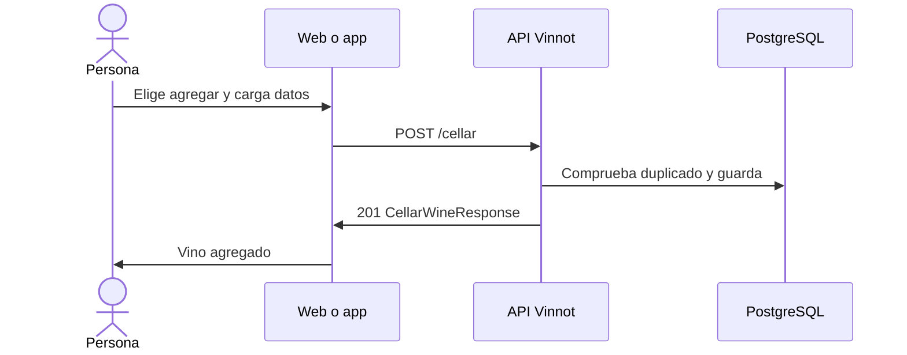

# UC-CEL-02 · Agregar un vino a la cava

| Campo | Valor |
|---|---|
| ID | `UC-CEL-02` |
| Módulo | [Cava](../README.md) |
| Plataformas | Web, APK |
| Actores | Usuario autenticado |
| IDs en Lucidchart | [WEB UC-CEL-02](https://lucid.app/lucidchart/9f11a16b-bb5a-42fc-a9e8-0852b17bd241/edit), [APK UC-CEL-02](https://lucid.app/lucidchart/e095dd25-e8ac-41ba-bf5b-396e1055f217/edit) |
| Requisitos | [`RF-WEB-CEL-04`](../requirements.md), [`RF-APK-CEL-05`](../requirements.md) |
| Casos de prueba | [`CP-CEL-06`](../testing.md), [`CP-CEL-07`](../testing.md), [`CP-CEL-08`](../testing.md), [`CP-CEL-26`](../testing.md), [`CP-CEL-09`](../testing.md) |

## Precondiciones

- La persona tiene sesión iniciada y el vino está en el catálogo.

## Postcondiciones

- El vino queda en la cava de la persona con los datos que cargó.

## Flujo principal

1. En la web la persona elige «Agregar a Bodega» en la ficha del vino; en la app usa ese mismo botón de la ficha o el botón de agregar de la cava y busca el vino.
2. Carga, si quiere, un puntaje de 0.1 a 5.0, notas, el precio de compra y la añada que probó.
3. El cliente envía `POST /cellar` con el vino y esos datos.
4. La API comprueba que el vino no esté ya en la cava de la persona y guarda la entrada.
5. La API responde 201 y el cliente confirma («Agregaste el vino a tu bodega» en la web) y actualiza la cava.

## Flujos alternativos

- 1a. El vino ya está en la cava: la web lo indica en la ficha y la app abre la cava en lugar del formulario.
- 4a. El vino ya está en la cava: la API responde 422, o 409 si llegaron dos pedidos a la vez.
- 1b. En el buscador de la app aparece un vino que ya está en la cava: se muestra con «Ya está en tu bodega» y no se puede elegir.
- 3a. El puntaje está fuera de 0.1 a 5.0 o tiene más de un decimal, el precio es negativo las notas superan 10000 caracteres o la añada está fuera de 1800 a 2100: la API responde 400; una añada posterior al año siguiente se rechaza con `INVALID_VINTAGE`.

## Reglas de negocio

- Un vino aparece una sola vez en la cava de cada persona.
- Todos los datos personales son opcionales.
- Publicar una reseña también agrega el vino a la cava ([Reseñas](../../reviews/README.md)).

## Diagrama

[Ver diagrama de «UC-CEL-02 · Agregar un vino a la cava» completo](https://images.vinnot.com/docs/diagrams/v1/es/modules-cellar-use-cases-uc-cel-02-add-wine-acbf3a04d0a8.svg)

Diagrama de componentes en Lucidchart: [WEB UC-CEL-02](https://lucid.app/lucidchart/9f11a16b-bb5a-42fc-a9e8-0852b17bd241/edit), [APK UC-CEL-02](https://lucid.app/lucidchart/e095dd25-e8ac-41ba-bf5b-396e1055f217/edit).

## Código

| Capa | Ubicación |
|---|---|
| Endpoints | `POST /cellar` |
| Backend | [`CellarController.java`](../../../../../backend/src/main/java/com/vinnot/cellar/infrastructure/web/controller/CellarController.java), [`AddWineToCellarCommandHandler.java`](../../../../../backend/src/main/java/com/vinnot/cellar/application/command/handler/AddWineToCellarCommandHandler.java), [`CellarWine.java`](../../../../../backend/src/main/java/com/vinnot/cellar/domain/model/CellarWine.java) |
| Web | [`WineCellarModal.tsx`](../../../../../frontend-react/src/presentation/pages/wines/WineCellarModal.tsx), [`useCellarQuickAdd.ts`](../../../../../frontend-react/src/presentation/hooks/queries/wine/useCellarQuickAdd.ts), [`cellar.service.ts`](../../../../../frontend-react/src/application/services/cellar.service.ts), [`cellar.client.ts`](../../../../../frontend-react/src/infrastructure/api/clients/cellar.client.ts) |
| App | [`CellarAddSheet.tsx`](../../../../../frontend-mobile/src/presentation/features/cellar/CellarAddSheet.tsx), [`index.ts`](../../../../../frontend-mobile/src/presentation/hooks/queries/cellar/index.ts), [`cellar.service.ts`](../../../../../frontend-mobile/src/application/services/cellar.service.ts), [`cellar.client.ts`](../../../../../frontend-mobile/src/infrastructure/api/clients/cellar.client.ts) |

## Tests automáticos

- Backend: [`AddWineToCellarCommandHandlerTest.java`](../../../../../backend/src/test/java/com/vinnot/cellar/application/command/handler/AddWineToCellarCommandHandlerTest.java), [`CellarWineTest.java`](../../../../../backend/src/test/java/com/vinnot/cellar/domain/model/CellarWineTest.java)
- Web: [`cellar.service.test.ts`](../../../../../frontend-react/src/application/services/cellar.service.test.ts), [`cellar-crud-flow.spec.tsx`](../../../../../frontend-react/tests/unit/integration/cellar-crud-flow.spec.tsx), [`useWineDetailsViewModel.test.tsx`](../../../../../frontend-react/src/presentation/pages/wines/useWineDetailsViewModel.test.tsx)
- App: [`cellar.service.test.ts`](../../../../../frontend-mobile/src/application/services/cellar.service.test.ts), [`CellarAddSheet.test.tsx`](../../../../../frontend-mobile/src/presentation/features/cellar/CellarAddSheet.test.tsx)
