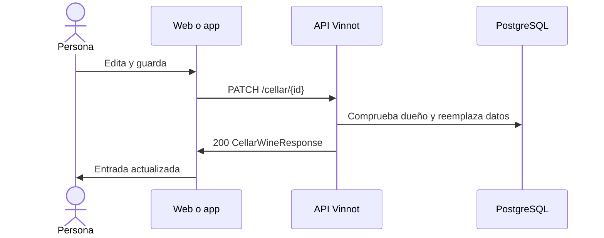

# UC-CEL-03 · Editar una entrada de la cava

| Campo | Valor |
|---|---|
| ID | `UC-CEL-03` |
| Módulo | [Cava](../README.md) |
| Plataformas | Web, APK |
| Actores | Usuario autenticado |
| IDs en Lucidchart | [WEB UC-CEL-03](https://lucid.app/lucidchart/9f11a16b-bb5a-42fc-a9e8-0852b17bd241/edit), [APK UC-CEL-03](https://lucid.app/lucidchart/e095dd25-e8ac-41ba-bf5b-396e1055f217/edit) |
| Requisitos | [`RF-WEB-CEL-05`](../requirements.md), [`RF-APK-CEL-06`](../requirements.md) |
| Casos de prueba | [`CP-CEL-10`](../testing.md), [`CP-CEL-11`](../testing.md), [`CP-CEL-12`](../testing.md), [`CP-CEL-13`](../testing.md), [`CP-CEL-14`](../testing.md) |

## Precondiciones

- La persona tiene el vino en su cava.

## Postcondiciones

- La entrada queda con el puntaje, el precio, las notas y la añada probada nuevos.

## Flujo principal

1. La persona elige «Editar notas» en un vino de su cava.
2. El formulario se abre con el puntaje, las notas, el precio y la añada actuales.
3. La persona cambia los datos y guarda.
4. El cliente envía `PATCH /cellar/{id}` con los tres datos y la añada, o `clearVintage: true` para quitarla.
5. La API comprueba que la entrada sea de la persona y reemplaza los tres datos, también los vacíos; una añada omitida conserva la guardada.
6. La API responde 200 y el cliente actualiza la entrada y las métricas.

## Flujos alternativos

- 3a. En la web la persona toca la estrella elegida: el puntaje se borra.
- 5a. La entrada es de otra persona: la API responde 422 `CELLAR_ENTRY_OWNERSHIP`.
- 5b. La entrada ya no existe: la API responde 404.
- 4a. Un dato está fuera de rango: la API responde 400.

## Reglas de negocio

- Editar la cava no cambia la ficha pública del vino ni la reseña.
- Puntaje de 0.1 a 5.0 con un decimal, precio no negativo, notas de hasta 10000 caracteres y añada de 1800 al año siguiente.
- Editar la reseña propia sincroniza la cava ([Reseñas](../../reviews/README.md)).

## Diagrama

[Ver diagrama de «UC-CEL-03 · Editar una entrada de la cava» completo](https://images.vinnot.com/docs/diagrams/v1/es/modules-cellar-use-cases-uc-cel-03-edit-entry-8b9982d8ad6a.svg)

Diagrama de componentes en Lucidchart: [WEB UC-CEL-03](https://lucid.app/lucidchart/9f11a16b-bb5a-42fc-a9e8-0852b17bd241/edit), [APK UC-CEL-03](https://lucid.app/lucidchart/e095dd25-e8ac-41ba-bf5b-396e1055f217/edit).

## Código

| Capa | Ubicación |
|---|---|
| Endpoints | `PATCH /cellar/{id}` |
| Backend | [`CellarController.java`](../../../../../backend/src/main/java/com/vinnot/cellar/infrastructure/web/controller/CellarController.java), [`UpdateCellarEntryCommandHandler.java`](../../../../../backend/src/main/java/com/vinnot/cellar/application/command/handler/UpdateCellarEntryCommandHandler.java), [`CellarWine.java`](../../../../../backend/src/main/java/com/vinnot/cellar/domain/model/CellarWine.java) |
| Web | [`CellarEditModal.tsx`](../../../../../frontend-react/src/presentation/components/features/cellar/CellarEditModal.tsx), [`useUpdateCellarEntry.ts`](../../../../../frontend-react/src/presentation/hooks/queries/cellar/useUpdateCellarEntry.ts), [`cellar.service.ts`](../../../../../frontend-react/src/application/services/cellar.service.ts), [`cellar.client.ts`](../../../../../frontend-react/src/infrastructure/api/clients/cellar.client.ts) |
| App | [`CellarAddSheet.tsx`](../../../../../frontend-mobile/src/presentation/features/cellar/CellarAddSheet.tsx), [`index.ts`](../../../../../frontend-mobile/src/presentation/hooks/queries/cellar/index.ts), [`cellar.service.ts`](../../../../../frontend-mobile/src/application/services/cellar.service.ts), [`cellar.client.ts`](../../../../../frontend-mobile/src/infrastructure/api/clients/cellar.client.ts) |

## Tests automáticos

- Backend: [`UpdateCellarEntryCommandHandlerTest.java`](../../../../../backend/src/test/java/com/vinnot/cellar/application/command/handler/UpdateCellarEntryCommandHandlerTest.java), [`CellarEntryOwnershipTest.java`](../../../../../backend/src/test/java/com/vinnot/cellar/application/command/handler/CellarEntryOwnershipTest.java), [`CellarWineTest.java`](../../../../../backend/src/test/java/com/vinnot/cellar/domain/model/CellarWineTest.java)
- Web: [`cellar-crud-flow.spec.tsx`](../../../../../frontend-react/tests/unit/integration/cellar-crud-flow.spec.tsx)
- App: [`cellar.service.test.ts`](../../../../../frontend-mobile/src/application/services/cellar.service.test.ts)
