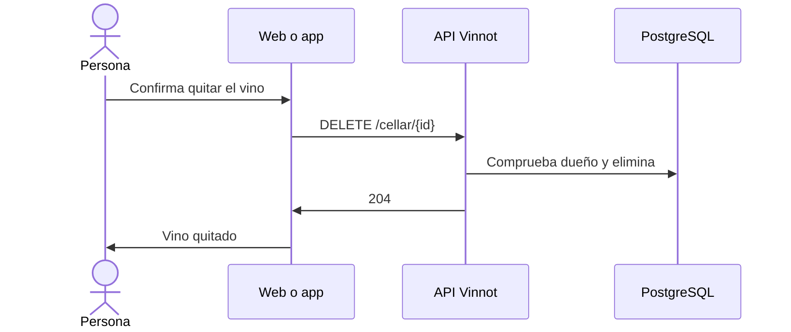

# UC-CEL-04 · Quitar un vino de la cava

| Campo | Valor |
|---|---|
| ID | `UC-CEL-04` |
| Módulo | [Cava](../README.md) |
| Plataformas | Web, APK |
| Actores | Usuario autenticado |
| IDs en Lucidchart | [WEB UC-CEL-04](https://lucid.app/lucidchart/9f11a16b-bb5a-42fc-a9e8-0852b17bd241/edit), [APK UC-CEL-04](https://lucid.app/lucidchart/e095dd25-e8ac-41ba-bf5b-396e1055f217/edit) |
| Requisitos | [`RF-WEB-CEL-06`](../requirements.md), [`RF-APK-CEL-07`](../requirements.md) |
| Casos de prueba | [`CP-CEL-15`](../testing.md), [`CP-CEL-16`](../testing.md), [`CP-CEL-17`](../testing.md), [`CP-CEL-18`](../testing.md) |

## Precondiciones

- La persona tiene el vino en su cava.

## Postcondiciones

- El vino ya no está en la cava; el vino del catálogo y la reseña siguen.

## Flujo principal

1. La persona elige «Eliminar» en la web, o en la app elige «Eliminar» en el menú «⋯» de la entrada o la desliza.
2. El cliente pide confirmación.
3. El cliente envía `DELETE /cellar/{id}`.
4. La API comprueba que la entrada sea de la persona y la elimina.
5. La API responde 204 y el cliente quita el vino, actualiza las métricas y, en la web, avisa «Quitaste el vino de tu bodega».

## Flujos alternativos

- 2a. La persona cancela: no se elimina nada.
- 4a. La entrada es de otra persona: la API responde 422 `CELLAR_ENTRY_OWNERSHIP`.
- 4b. La entrada ya no existe: la API responde 404.

## Reglas de negocio

- Quitar un vino de la cava no borra el vino del catálogo ni la reseña pública.
- Eliminar la reseña tampoco quita el vino de la cava.

## Diagrama

[Ver diagrama de «UC-CEL-04 · Quitar un vino de la cava» completo](https://images.vinnot.com/docs/diagrams/v1/es/modules-cellar-use-cases-uc-cel-04-remove-entry-93c4ac21bd28.svg)

Diagrama de componentes en Lucidchart: [WEB UC-CEL-04](https://lucid.app/lucidchart/9f11a16b-bb5a-42fc-a9e8-0852b17bd241/edit), [APK UC-CEL-04](https://lucid.app/lucidchart/e095dd25-e8ac-41ba-bf5b-396e1055f217/edit).

## Código

| Capa | Ubicación |
|---|---|
| Endpoints | `DELETE /cellar/{id}` |
| Backend | [`CellarController.java`](../../../../../backend/src/main/java/com/vinnot/cellar/infrastructure/web/controller/CellarController.java), [`RemoveWineFromCellarCommandHandler.java`](../../../../../backend/src/main/java/com/vinnot/cellar/application/command/handler/RemoveWineFromCellarCommandHandler.java) |
| Web | [`useMyCellarViewModel.ts`](../../../../../frontend-react/src/presentation/pages/cellar/useMyCellarViewModel.ts), [`useRemoveCellarEntry.ts`](../../../../../frontend-react/src/presentation/hooks/queries/cellar/useRemoveCellarEntry.ts), [`cellar.service.ts`](../../../../../frontend-react/src/application/services/cellar.service.ts), [`cellar.client.ts`](../../../../../frontend-react/src/infrastructure/api/clients/cellar.client.ts) |
| App | [`CellarEntryRow.tsx`](../../../../../frontend-mobile/src/presentation/features/cellar/CellarEntryRow.tsx), [`CellarScreen.tsx`](../../../../../frontend-mobile/src/presentation/features/cellar/CellarScreen.tsx), [`cellar.service.ts`](../../../../../frontend-mobile/src/application/services/cellar.service.ts), [`cellar.client.ts`](../../../../../frontend-mobile/src/infrastructure/api/clients/cellar.client.ts) |

## Tests automáticos

- Backend: [`RemoveWineFromCellarCommandHandlerTest.java`](../../../../../backend/src/test/java/com/vinnot/cellar/application/command/handler/RemoveWineFromCellarCommandHandlerTest.java), [`CellarEntryOwnershipTest.java`](../../../../../backend/src/test/java/com/vinnot/cellar/application/command/handler/CellarEntryOwnershipTest.java)
- Web: [`useMyCellarViewModel.test.tsx`](../../../../../frontend-react/src/presentation/pages/cellar/useMyCellarViewModel.test.tsx), [`useMyCellarViewModel.delete.test.tsx`](../../../../../frontend-react/src/presentation/pages/cellar/useMyCellarViewModel.delete.test.tsx), [`cellar-crud-flow.spec.tsx`](../../../../../frontend-react/tests/unit/integration/cellar-crud-flow.spec.tsx)
- App: [`CellarScreen.test.tsx`](../../../../../frontend-mobile/src/presentation/features/cellar/CellarScreen.test.tsx)
