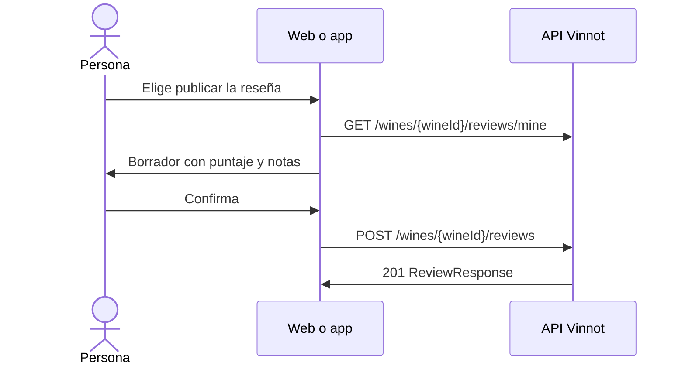

# UC-CEL-05 · Publicar una nota como reseña

| Campo | Valor |
|---|---|
| ID | `UC-CEL-05` |
| Módulo | [Cava](../README.md) |
| Plataformas | Web, APK |
| Actores | Usuario autenticado |
| IDs en Lucidchart | [WEB UC-CEL-05](https://lucid.app/lucidchart/9f11a16b-bb5a-42fc-a9e8-0852b17bd241/edit), [APK UC-CEL-05](https://lucid.app/lucidchart/e095dd25-e8ac-41ba-bf5b-396e1055f217/edit) |
| Requisitos | [`RF-WEB-CEL-07`](../requirements.md), [`RF-APK-CEL-08`](../requirements.md) |
| Casos de prueba | [`CP-CEL-19`](../testing.md), [`CP-CEL-20`](../testing.md), [`CP-CEL-21`](../testing.md), [`CP-CEL-22`](../testing.md) |

## Precondiciones

- La persona tiene el vino en su cava.

## Postcondiciones

- La nota queda publicada como reseña del vino, o se abre la reseña que ya existía.

## Flujo principal

1. La persona elige publicar la reseña desde un vino de su cava.
2. El cliente pide `GET /wines/{wineId}/reviews/mine` para saber si ya tiene una reseña.
3. El formulario de reseña se abre con el puntaje, las notas y la añada de la cava como borrador.
4. La persona revisa el borrador y confirma.
5. El cliente publica la reseña con `POST /wines/{wineId}/reviews` ([UC-REV-02](../../reviews/use-cases/uc-rev-02-publish-review.md)).

## Flujos alternativos

- 2a. Ya existe una reseña propia: la web abre la ficha del vino en esa reseña (`?review=mine`) y la app la muestra para editar; no se reemplaza sola.
- 3a. La cava no tiene puntaje: hay que elegir un puntaje antes de publicar (estrellas en la web, copas en la app).
- 4a. La persona cancela: no se publica nada y la cava no cambia.

## Reglas de negocio

- La nota de la cava es privada hasta que la persona confirma publicarla.
- La publicación usa el caso de uso de reseñas, nunca el endpoint de la cava.
- Al publicarse, la reseña vuelve a sincronizar la cava con su puntaje, comentario y añada.

## Diagrama

[Ver diagrama de «UC-CEL-05 · Publicar una nota como reseña» completo](https://images.vinnot.com/docs/diagrams/v1/es/modules-cellar-use-cases-uc-cel-05-publish-note-as-review-f1639017d66c.svg)

Diagrama de componentes en Lucidchart: [WEB UC-CEL-05](https://lucid.app/lucidchart/9f11a16b-bb5a-42fc-a9e8-0852b17bd241/edit), [APK UC-CEL-05](https://lucid.app/lucidchart/e095dd25-e8ac-41ba-bf5b-396e1055f217/edit).

## Código

| Capa | Ubicación |
|---|---|
| Endpoints | `GET /wines/{wineId}/reviews/mine`, `POST /wines/{wineId}/reviews` |
| Backend | [`CreateReviewCommandHandler.java`](../../../../../backend/src/main/java/com/vinnot/review/application/command/handler/CreateReviewCommandHandler.java), [`CellarCommandAdapter.java`](../../../../../backend/src/main/java/com/vinnot/review/infrastructure/persistence/adapter/CellarCommandAdapter.java) |
| Web | [`CellarReviewModal.tsx`](../../../../../frontend-react/src/presentation/components/features/cellar/CellarReviewModal.tsx), [`useCellarReviewPublication.ts`](../../../../../frontend-react/src/presentation/hooks/useCellarReviewPublication.ts) |
| App | [`CellarReviewSheet.tsx`](../../../../../frontend-mobile/src/presentation/features/cellar/CellarReviewSheet.tsx), [`useCellarReviewPublication.ts`](../../../../../frontend-mobile/src/presentation/hooks/useCellarReviewPublication.ts) |

## Tests automáticos

- Backend: [`CellarCommandAdapterTest.java`](../../../../../backend/src/test/java/com/vinnot/review/infrastructure/persistence/adapter/CellarCommandAdapterTest.java)
- Web: [`CellarReviewModal.test.tsx`](../../../../../frontend-react/src/presentation/components/features/cellar/CellarReviewModal.test.tsx)
- App: [`CellarReviewSheet.test.tsx`](../../../../../frontend-mobile/src/presentation/features/cellar/CellarReviewSheet.test.tsx)
