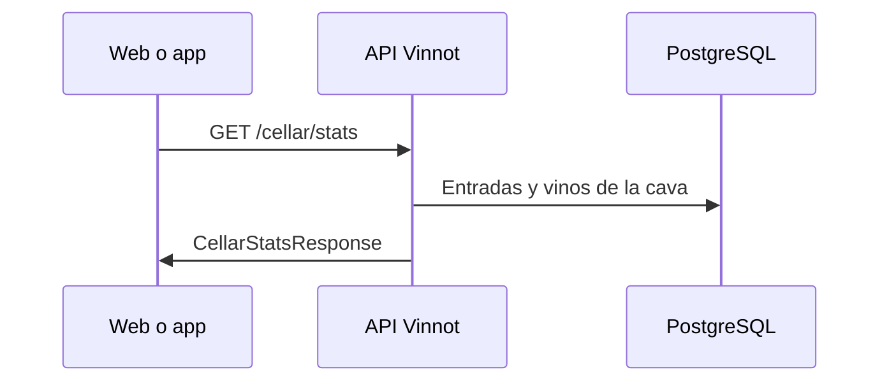

# UC-CEL-06 · Consultar estadísticas de una cava

| Campo | Valor |
|---|---|
| ID | `UC-CEL-06` |
| Módulo | [Cava](../README.md) |
| Plataformas | Solo backend |
| Actores | Usuario autenticado, Administrador |
| IDs en Lucidchart | Ninguno |
| Requisitos | Ninguno |
| Casos de prueba | [`CP-CEL-23`](../testing.md), [`CP-CEL-24`](../testing.md), [`CP-CEL-25`](../testing.md) |

## Precondiciones

- Quien consulta tiene sesión; para la cava de otra persona necesita el rol `ADMIN`.

## Postcondiciones

- Se devuelven las estadísticas o las entradas de la cava pedida.

## Flujo principal

1. Se pide `GET /cellar/stats` para la cava propia o `GET /cellar/user/{userId}/stats` para otra.
2. La API comprueba que quien consulta sea el dueño o un administrador.
3. Calcula la cantidad de vinos, los puntuados, el promedio, las bodegas y regiones distintas y la cantidad por tipo de vino.
4. Devuelve `CellarStatsResponse`.

## Flujos alternativos

- 1a. Se pide la lista de otra persona con `GET /cellar/user/{userId}`: se aplica la misma comprobación.
- 2a. Quien consulta no es el dueño ni administrador: la API responde 403.

## Reglas de negocio

- Web y app calculan sus métricas en el cliente y no usan estos endpoints.
- Un vino sin tipo se cuenta como `UNKNOWN`.

## Diagrama

[Ver diagrama de «UC-CEL-06 · Consultar estadísticas de una cava» completo](https://images.vinnot.com/docs/diagrams/v1/es/modules-cellar-use-cases-uc-cel-06-cellar-statistics-33be354f9847.svg)

## Código

| Capa | Ubicación |
|---|---|
| Endpoints | `GET /cellar/stats`, `GET /cellar/user/{userId}`, `GET /cellar/user/{userId}/stats` |
| Backend | [`CellarController.java`](../../../../../backend/src/main/java/com/vinnot/cellar/infrastructure/web/controller/CellarController.java), [`GetCellarStatsQueryHandler.java`](../../../../../backend/src/main/java/com/vinnot/cellar/application/query/handler/GetCellarStatsQueryHandler.java), [`GetUserCellarQueryHandler.java`](../../../../../backend/src/main/java/com/vinnot/cellar/application/query/handler/GetUserCellarQueryHandler.java) |

## Tests automáticos

- Backend: [`GetCellarStatsQueryHandlerTest.java`](../../../../../backend/src/test/java/com/vinnot/cellar/application/query/handler/GetCellarStatsQueryHandlerTest.java), [`CellarPrivacyTest.java`](../../../../../backend/src/test/java/com/vinnot/cellar/infrastructure/web/CellarPrivacyTest.java)
- Web: Ninguno
- App: Ninguno
