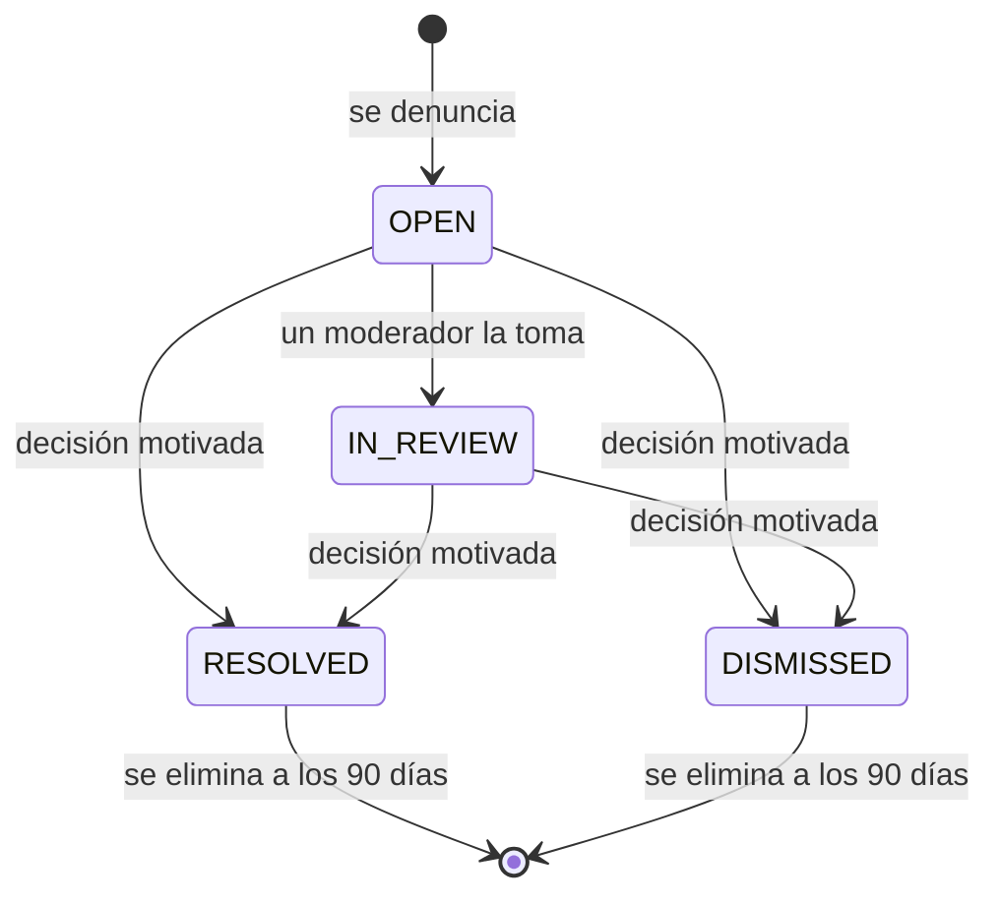
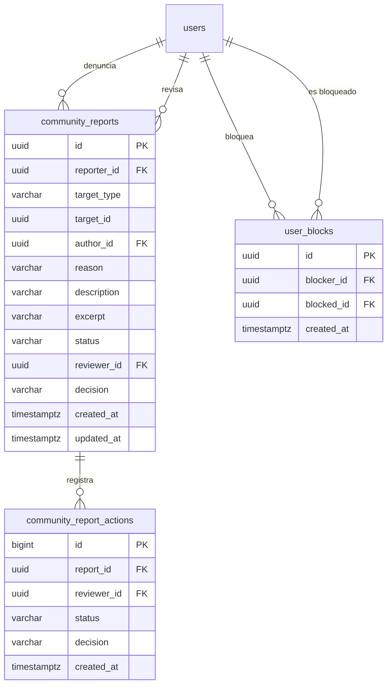

# Comunidad

Las herramientas de seguridad de la comunidad: denunciar contenido o personas,
bloquear cuentas y consultar la actividad propia. La moderación es reactiva:
reseñas y comentarios se publican al instante ([Reseñas](../reviews/README.md)) y
el equipo revisa las denuncias desde [Administración](../admin/README.md). Vinnot
no tiene seguidores ni muro de actividad.

- Código del módulo: `COM`.
- Backend: paquete [`community`](../../../../backend/src/main/java/com/vinnot/community/).
- [Casos de uso](use-cases/README.md) · [Requisitos](requirements.md) ·
  [Arquitectura](architecture.md) · [Pruebas](testing.md)

## Actores

| Actor | Qué hace en este módulo |
|---|---|
| Usuario autenticado | Denuncia contenido, bloquea y desbloquea cuentas y consulta su actividad |
| Moderador o administrador | Revisa las denuncias y retira contenido (desde Administración) |
| Servicio de email | Avisa el resultado de una denuncia y el retiro de contenido |

## Reglas de negocio

| Regla | Detalle | Dónde |
|---|---|---|
| Acceso | Denuncias y bloqueos requieren sesión; la identidad sale del token | [`CommunityController.java`](../../../../backend/src/main/java/com/vinnot/community/infrastructure/web/CommunityController.java) |
| Qué se denuncia | Usuarios activos, reseñas y comentarios aprobados de vinos activos, eventos ya publicados y rutas publicadas | [`JdbcCommunityTargetAdapter.java`](../../../../backend/src/main/java/com/vinnot/community/infrastructure/persistence/JdbcCommunityTargetAdapter.java) |
| Motivos | Spam, acoso, odio, contenido sexual, violencia, privacidad, desinformación u otro; «Otro» exige descripción de hasta 2000 caracteres | [`CommunityReport.java`](../../../../backend/src/main/java/com/vinnot/community/domain/model/CommunityReport.java) |
| Sin duplicados | Una denuncia abierta por persona y contenido; repetirla devuelve el mismo comprobante | [`CreateReportCommandHandler.java`](../../../../backend/src/main/java/com/vinnot/community/application/command/handler/CreateReportCommandHandler.java) |
| Límites | 10 denuncias nuevas por día y 10 envíos por hora con su propia política `report`, separada de las consultas a soporte | [`RateLimitPolicyResolver.java`](../../../../backend/src/main/java/com/vinnot/shared/infrastructure/security/RateLimitPolicyResolver.java) |
| Bloqueo | Vale en ambos sentidos: oculta reseñas, comentarios y perfil, y corta likes, comentarios y avisos | [`ChangeUserBlockCommandHandler.java`](../../../../backend/src/main/java/com/vinnot/community/application/command/handler/ChangeUserBlockCommandHandler.java) |
| Sin sanciones automáticas | Ninguna cantidad de denuncias oculta contenido ni suspende cuentas por sí sola | [Arquitectura](architecture.md) |
| Conservación | Las denuncias cerradas se eliminan 90 días después del cierre | [`PurgeClosedReportsCommandHandler.java`](../../../../backend/src/main/java/com/vinnot/community/application/command/handler/PurgeClosedReportsCommandHandler.java) |

## Estados de una denuncia

[Ver diagrama de «Estados de una denuncia» completo](https://images.vinnot.com/docs/diagrams/v1/es/modules-community-readme-5bd639f18548.svg)

## Dónde vive

| Parte | Ubicación |
|---|---|
| API | [`CommunityController`](../../../../backend/src/main/java/com/vinnot/community/infrastructure/web/CommunityController.java), bajo `/community` |
| Web | Página `/community` en [`pages/community`](../../../../frontend-react/src/presentation/pages/community/) y acciones en [`features/community`](../../../../frontend-react/src/presentation/components/features/community/) |
| App | Pantalla `frontend-mobile/app/(app)/community.tsx` y lógica en [`features/community`](../../../../frontend-mobile/src/presentation/features/community/) |

## Datos

Tablas creadas en `V24`; `V25` indexa las denuncias cerradas para la depuración.

[Ver diagrama de «Comunidad · Datos» completo](https://images.vinnot.com/docs/diagrams/v1/es/modules-community-readme-30416e4cde3c.svg)

El contenido denunciado se identifica por tipo y ID sin clave foránea, para que
el caso se conserve aunque el contenido se borre. Borrar una cuenta elimina sus
bloqueos y deja en `NULL` sus referencias en las denuncias.
