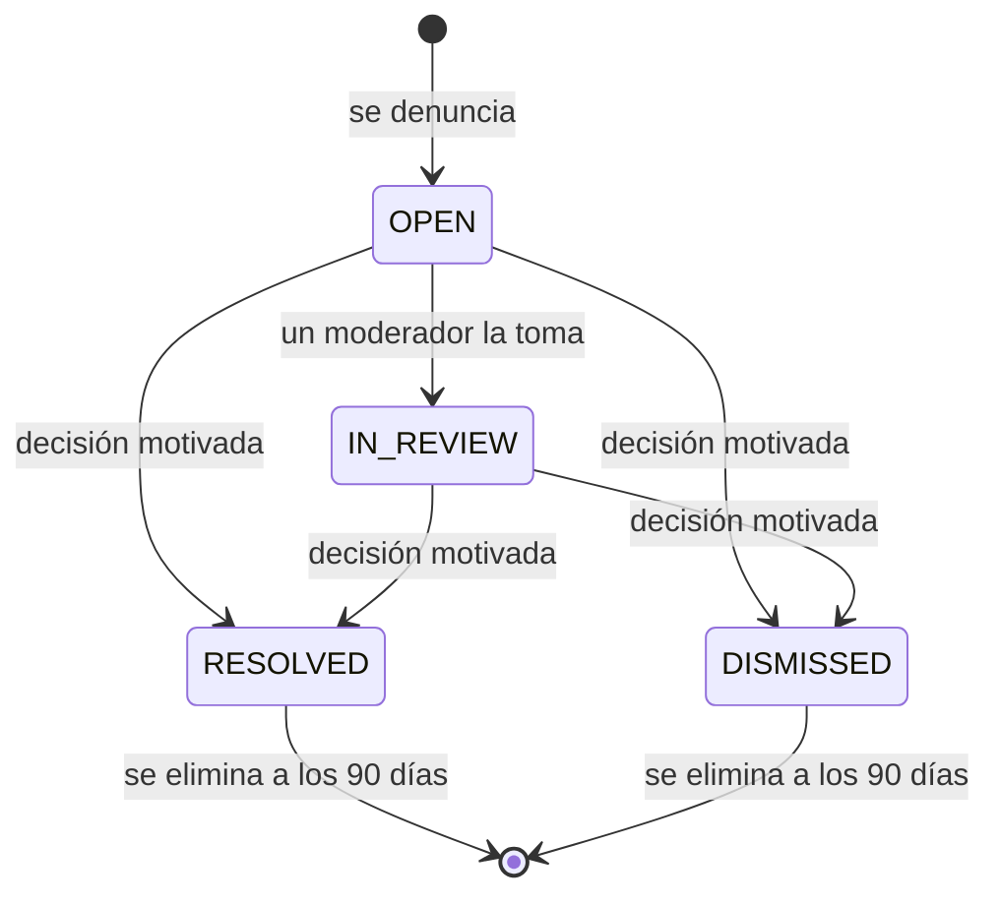
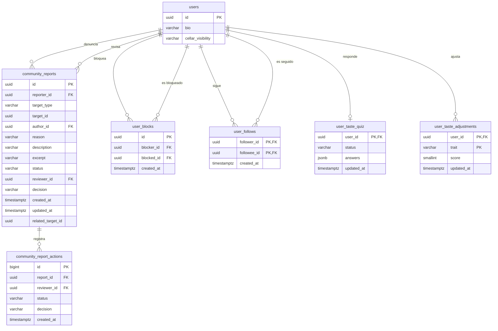

# Comunidad

La capa social y las herramientas de seguridad de la comunidad: seguir a otros
miembros, perfiles públicos, personas para seguir y el muro de quienes sigues,
además de denunciar contenido o personas, bloquear cuentas y consultar la
actividad propia. La moderación es reactiva: reseñas y comentarios se publican al
instante ([Reseñas](../reviews/README.md)) y el equipo revisa las denuncias desde
[Administración](../admin/README.md).

- Código del módulo: `COM`.
- Backend: paquete [`community`](../../../../backend/src/main/java/com/vinnot/community/).
- [Casos de uso](use-cases/README.md) · [Requisitos](requirements.md) ·
  [Arquitectura](architecture.md) · [Pruebas](testing.md)

## Actores

| Actor | Qué hace en este módulo |
|---|---|
| Usuario autenticado | Sigue a otros miembros, abre perfiles públicos, consulta sugerencias y el muro de quienes sigue, denuncia contenido, bloquea y desbloquea cuentas y consulta su actividad |
| Moderador o administrador | Revisa las denuncias y retira contenido (desde Administración) |
| Vinnot (automático) | Abre una denuncia de calidad de catálogo cuando un miembro corrige una coincidencia exacta del escaneo de etiquetas ([Vinos](../wines/use-cases/uc-win-05-scan-label.md)) |
| Servicio de email | Avisa el resultado de una denuncia y el retiro de contenido |
| Servicio de push | Avisa a un miembro que alguien empezó a seguirlo |

## Reglas de negocio

| Regla | Detalle | Dónde |
|---|---|---|
| Acceso | Denuncias y bloqueos requieren sesión; la identidad sale del token | [`CommunityController.java`](../../../../backend/src/main/java/com/vinnot/community/infrastructure/web/CommunityController.java) |
| Qué se denuncia | Usuarios activos, reseñas y comentarios aprobados de vinos activos, eventos ya publicados y rutas publicadas | [`JdbcCommunityTargetAdapter.java`](../../../../backend/src/main/java/com/vinnot/community/infrastructure/persistence/JdbcCommunityTargetAdapter.java) |
| Motivos | Spam, acoso, odio, contenido sexual, violencia, privacidad, desinformación u otro; «Otro» exige descripción de hasta 2000 caracteres | [`CommunityReport.java`](../../../../backend/src/main/java/com/vinnot/community/domain/model/CommunityReport.java) |
| Calidad de catálogo | Solo Vinnot denuncia un vino del catálogo: objetivo `WINE`, motivo `CATALOG_QUALITY`, sin denunciante y con el otro vino en `related_target_id`; una denuncia abierta por par de vinos en cualquier orden; la moderación la resuelve o la descarta y corrige el catálogo a mano, nunca automáticamente. Los miembros reciben 422 `REPORT_NOT_ALLOWED` | [`ReportCatalogIssueCommandHandler.java`](../../../../backend/src/main/java/com/vinnot/community/application/command/handler/ReportCatalogIssueCommandHandler.java) |
| Sin duplicados | Una denuncia abierta por persona y contenido; repetirla devuelve el mismo comprobante | [`CreateReportCommandHandler.java`](../../../../backend/src/main/java/com/vinnot/community/application/command/handler/CreateReportCommandHandler.java) |
| Límites | 10 denuncias nuevas por día y 10 envíos por hora con su propia política `report`, separada de las consultas a soporte | [`RateLimitPolicyResolver.java`](../../../../backend/src/main/java/com/vinnot/shared/infrastructure/security/RateLimitPolicyResolver.java) |
| Bloqueo | Vale en ambos sentidos: oculta reseñas, comentarios y perfil, corta likes, comentarios y avisos, y termina los seguimientos en ambas direcciones | [`ChangeUserBlockCommandHandler.java`](../../../../backend/src/main/java/com/vinnot/community/application/command/handler/ChangeUserBlockCommandHandler.java) |
| Seguir | Asimétrico y sin aprobación; idempotente; nunca a uno mismo, a un miembro inactivo ni con un bloqueo de por medio | [`ChangeFollowCommandHandler.java`](../../../../backend/src/main/java/com/vinnot/community/application/command/handler/ChangeFollowCommandHandler.java) |
| Puntos por seguidor | Un punto de sello por cada seguidor con email verificado y al menos una reseña aprobada, hasta 10 por día dentro del tope global de 40; se quitan al dejar de seguir o al bloquear | [Gamificación](../gamification/README.md) |
| Cava en el perfil | `PUBLIC` (por defecto), `FOLLOWERS` o `PRIVATE`; el dueño siempre la ve; las notas y el precio de compra nunca son públicos | [`CellarVisibility.java`](../../../../backend/src/main/java/com/vinnot/community/domain/model/CellarVisibility.java) |
| Gusto | Rueda y porcentaje de afinidad a partir de cinco vinos valorados; la afinidad es el coseno de ambos vectores de gusto | [`TasteProfile.java`](../../../../backend/src/main/java/com/vinnot/community/domain/model/TasteProfile.java) |
| Test de gustos | Cinco preguntas ilustradas al registrarse o desde el perfil; se ofrece mientras está pendiente y con menos de cinco vinos valorados; saltearlo nunca borra un test completado; sus respuestas completan los rasgos de gusto donde falta el dato real y nunca son públicas | [`TasteQuiz.java`](../../../../backend/src/main/java/com/vinnot/community/domain/model/TasteQuiz.java) |
| Paladar ajustable | El miembro fija sus propias barras de estructura (acidez, cuerpo, taninos, dulzor) de 0 a 100 con `PUT /users/me/taste-traits` y las borra con `DELETE`; un valor manual reemplaza el valor calculado o del test de su rasgo, se marca `adjusted` y lo ve cualquiera que pueda ver el perfil | [`TasteAdjustment.java`](../../../../backend/src/main/java/com/vinnot/community/domain/model/TasteAdjustment.java) |
| Sin sanciones automáticas | Ninguna cantidad de denuncias oculta contenido ni suspende cuentas por sí sola | [Arquitectura](architecture.md) |
| Conservación | Las denuncias cerradas se eliminan 90 días después del cierre | [`PurgeClosedReportsCommandHandler.java`](../../../../backend/src/main/java/com/vinnot/community/application/command/handler/PurgeClosedReportsCommandHandler.java) |

## Estados de una denuncia

[Ver diagrama de «Estados de una denuncia» completo](https://images.vinnot.com/docs/diagrams/v1/es/modules-community-readme-5bd639f18548.svg)

## Dónde vive

| Parte | Ubicación |
|---|---|
| API | [`CommunityController`](../../../../backend/src/main/java/com/vinnot/community/infrastructure/web/CommunityController.java), bajo `/community` |
| Web | Página `/community` en [`pages/community`](../../../../frontend-react/src/presentation/pages/community/) y acciones en [`features/community`](../../../../frontend-react/src/presentation/components/features/community/) |
| App | Pantalla `frontend-mobile/app/(app)/community.tsx` y lógica en [`features/community`](../../../../frontend-mobile/src/presentation/features/community/) |
| API social | [`MemberActivityController`](../../../../backend/src/main/java/com/vinnot/community/infrastructure/web/MemberActivityController.java) (reseñas y cava de un miembro), [`TasteQuizController`](../../../../backend/src/main/java/com/vinnot/community/infrastructure/web/TasteQuizController.java) y [`TasteTraitsController`](../../../../backend/src/main/java/com/vinnot/community/infrastructure/web/TasteTraitsController.java), bajo `/users`; el perfil público lo compone [Usuarios](../users/README.md) |
| Web social | Páginas `/users/:id`, `/users/:id/followers`, `/users/:id/following`, `/feed` y `/taste-quiz` en [`pages/social`](../../../../frontend-react/src/presentation/pages/social/) y [`pages/user`](../../../../frontend-react/src/presentation/pages/user/), con componentes en [`features/social`](../../../../frontend-react/src/presentation/components/features/social/) y [`features/tasteQuiz`](../../../../frontend-react/src/presentation/components/features/tasteQuiz/) |
| App social | Pantallas `frontend-mobile/app/(app)/users/[id].tsx`, `users/[id]/followers.tsx`, `users/[id]/following.tsx`, `feed.tsx` y `taste-quiz.tsx`, con lógica en [`features/social`](../../../../frontend-mobile/src/presentation/features/social/) y [`features/tasteQuiz`](../../../../frontend-mobile/src/presentation/features/tasteQuiz/) |

## Datos

Tablas creadas en `V24`; `V25` indexa las denuncias cerradas para la depuración. `V87`, `V88` y `V89` agregan la capa social y el perfil de gustos, y `V93` las denuncias de calidad de catálogo (ver abajo).

[Ver diagrama de «Comunidad · Datos» completo](https://images.vinnot.com/docs/diagrams/v1/es/modules-community-readme-1c0033997903.svg)

El contenido denunciado se identifica por tipo y ID sin clave foránea, para que
el caso se conserve aunque el contenido se borre. Borrar una cuenta elimina sus
bloqueos y deja en `NULL` sus referencias en las denuncias.

`V87` agrega los seguimientos y dos columnas del perfil:

| Tabla o columna | Contenido |
|---|---|
| `user_follows` | `follower_id` y `followee_id` (par de clave primaria, ambos referencian `users` con `ON DELETE CASCADE`, un CHECK impide seguirse a uno mismo) y `created_at`; índice sobre `(followee_id, created_at DESC)` |
| `users.bio` | Biografía pública, `varchar(160)`, opcional |
| `users.cellar_visibility` | `PUBLIC`, `FOLLOWERS` o `PRIVATE` (CHECK), por defecto `PUBLIC` |

Borrar una cuenta elimina sus seguimientos en ambas direcciones. La afinidad y el
umbral de cinco vinos de la rueda de gusto leen `user_taste_affinities` (`V52`),
que el proceso nocturno de recomendaciones de [Vinos](../wines/README.md)
recalcula; las porciones de uvas, tipos y regiones de la rueda se calculan en
cada pedido con las valoraciones del miembro.

`V88` agrega `user_taste_quiz`: una fila por miembro (clave primaria `user_id`,
que referencia `users` con `ON DELETE CASCADE`), `status` `COMPLETED` o `SKIPPED`,
`answers` jsonb solo cuando está completado y `updated_at`. Sin fila, el test está
pendiente. Ver [Test de gustos](architecture.md#test-de-gustos).

`V89` agrega `user_taste_adjustments`: una fila por miembro y rasgo (clave
primaria `(user_id, trait)`, `user_id` referencia `users` con `ON DELETE
CASCADE`), `trait` `ACIDITY`, `BODY`, `TANNIN` o `SWEETNESS`, `score` de 0 a 100 y
`updated_at`. Sin fila, el rasgo muestra su valor calculado. Ver
[Paladar ajustable](architecture.md#paladar-ajustable).

`V93` suma a `community_reports` las denuncias de calidad de catálogo: el tipo de
objetivo `WINE`, el motivo `CATALOG_QUALITY`, la columna opcional
`related_target_id` (el vino que eligió el miembro) y el índice único parcial
`community_report_open_catalog_pair` sobre
`(LEAST(target_id, related_target_id), GREATEST(target_id, related_target_id))`
para las denuncias `CATALOG_QUALITY` en `OPEN` o `IN_REVIEW`, así que un par de
vinos tiene como máximo una denuncia abierta. Ver
[Denuncias de calidad de catálogo](architecture.md#denuncias-de-calidad-de-catálogo).
