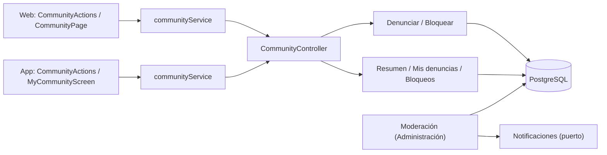
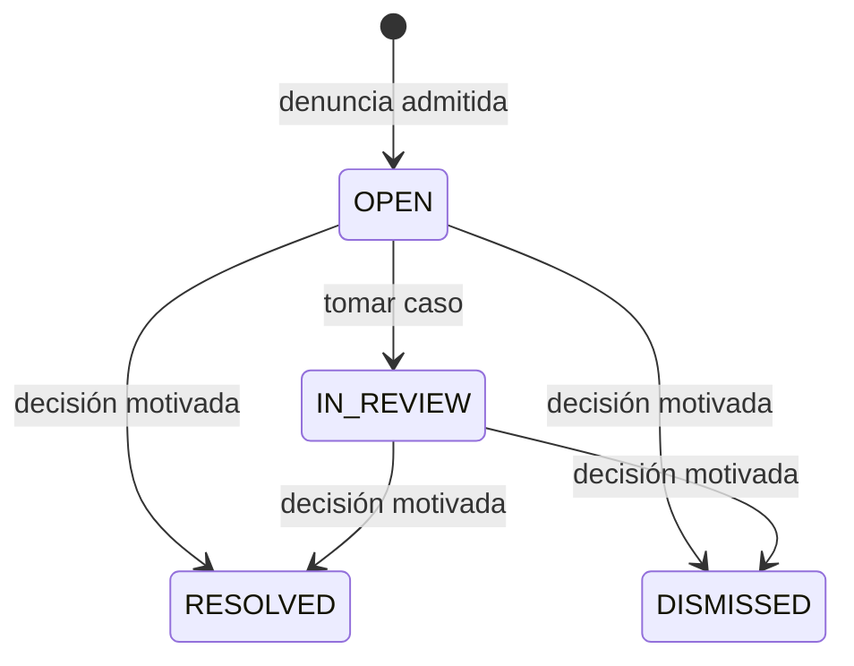
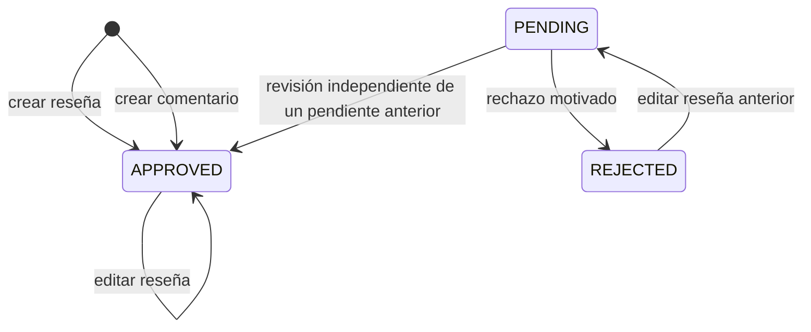

# Arquitectura

Cómo está construido el módulo en cada capa. El backend sigue el flujo hexagonal
`controller → puerto de entrada → handler → dominio → puerto de salida → adaptador`;
la web y la app siguen `pantalla → hook → servicio → cliente API → transporte HTTP`.
La sección de backend también describe la revisión de denuncias por el equipo,
que se opera desde [Administración](../admin/README.md).



[Ver diagrama de «Arquitectura» completo](https://images.vinnot.com/docs/diagrams/v1/es/modules-community-architecture-2dd519405376.svg)

## Backend

### Contrato y límites

`community` administra denuncias de `REVIEW`, `COMMENT`, `USER`, `EVENT` y
`WINE_ROUTE`. El servidor obtiene el autor y una copia acotada del contenido;
el cliente sólo indica tipo, ID, motivo y descripción. Se aceptan usuarios activos,
reseñas/comentarios aprobados de vinos activos, eventos que ya fueron publicados y rutas
publicadas. Los borradores no son denunciables por este circuito público.

La descripción admite hasta 2000 caracteres y es obligatoria para `OTHER`.
Una denuncia propia se rechaza. Una denuncia abierta del mismo usuario sobre el
mismo contenido devuelve el comprobante existente, incluso si el contenido ya no
está disponible. La creación toma un lock por denunciante y limita a diez casos
nuevos en 24 horas; el filtro HTTP agrega su propio límite de solicitudes `report`
(10 por hora), separado de soporte. No se envía correo por cada denuncia.

### Puertos, capas y transacciones

| Capa | Responsabilidad |
|---|---|
| Dominio | `CommunityReport`, motivos, transiciones, conflicto de interés y decisión obligatoria |
| Aplicación | Crear/revisar/retirar contenido, cambiar bloqueo y consultar comprobantes/cola |
| Puertos de salida | Persistencia de casos/bloqueos, resolución pública del contenido y retiro |
| Adaptadores | JDBC, consultas JPA de visibilidad, puente a casos de uso de review y HTTP autenticado |
| Presentación | Formularios contextuales, confirmación de bloqueo/retiro y estado recuperable de errores |

`ReportedContentRemovalAdapter` llama a los casos de uso existentes para borrar
reseñas/comentarios. La eliminación, el recálculo de valoraciones de una reseña y
el cierre del caso participan en la misma transacción. Un error revierte el cierre.
El dominio y los handlers no importan clientes HTTP ni persistencia de otro módulo.

### API

Rutas relativas al contexto `/api`. Las identidades provienen del JWT, nunca del
cuerpo del request. La paginación usa `content`, `totalItems` y `totalPages`, con
máximo 50 elementos por página.

| Método y ruta | Acceso y resultado |
|---|---|
| `POST /community/reports` | Autenticado; comprobante privado sin evidencia ni notas |
| `GET /community/reports/mine` | Sólo casos del usuario; ID, objetivo, estado y fecha |
| `GET /community/blocks` | Sólo bloqueos realizados por el usuario |
| `PUT /community/blocks/{userId}` | Bloqueo idempotente; prohíbe autobloqueo |
| `DELETE /community/blocks/{userId}` | Desbloqueo idempotente; desbloquearse a uno mismo responde 422 |
| `GET /admin/community/reports?status=OPEN` | ADMIN/MODERATOR; cola con evidencia privada más `authorUsername`, `reviewerUsername` y `targetLabel` |
| `PATCH /admin/community/reports/{id}` | ADMIN/MODERATOR; asignación o decisión documentada |
| `POST /admin/community/reports/{id}/remove-content` | ADMIN/MODERATOR y `REVIEW_DELETE`; sólo reseña/comentario; motivo obligatorio |

El retiro es explícito e irreversible desde la interfaz. Resolver un caso mediante
PATCH registra la decisión; por sí solo no borra contenido ni cambia una cuenta.
Los eventos, rutas y cuentas se administran con sus flujos y permisos existentes.
La cola excluye casos donde el revisor es denunciante o autor antes de paginar;
el comando comprueba también ese conflicto. El rol de moderador no adquiere
facultades administrativas sobre cuentas.

Cada elemento de la cola conserva todos los campos del caso y suma tres nombres
que pueden ser `null`, para que quien modera nunca lea identificadores crudos:
`authorUsername`, `reviewerUsername` y `targetLabel`, que es el nombre del vino de
una reseña o un comentario, el título del evento en `EVENT`, el nombre de la ruta en
`WINE_ROUTE` y el nombre de usuario en `USER`. `GetCommunityQueryHandler` los
resuelve por página con una sola llamada a `CommunityTargetPort.describe`;
`JdbcCommunityTargetAdapter` la responde con una única sentencia SQL, y un usuario o
contenido eliminado o inexistente deja su nombre en `null` en lugar de fallar.
`PATCH` y `remove-content` siguen devolviendo el caso sin nombres.



[Ver diagrama de «API» completo](https://images.vinnot.com/docs/diagrams/v1/es/modules-community-architecture-0a824868fcad.svg)

El revisor asignado conserva el caso; otro revisor no puede cambiarlo. Los estados
finales no se reabren. `community_report_actions` conserva cada transición con
revisor, fecha y decisión. Los comprobantes del denunciante no revelan esas notas.

### Efecto del bloqueo

Entre cuentas autenticadas, cualquiera de las dos direcciones de bloqueo oculta
las reseñas, comentarios y perfil e impide nuevos likes/comentarios sobre reseñas
del otro usuario. Los filtros de lectura se aplican antes del conteo y paginación.
En comentarios también se comprueba el autor de la reseña padre. Se permite quitar
un like o eliminar contenido propio ya existente. Las valoraciones y conteos
agregados del vino no cambian por un bloqueo. Los avisos de la
comunidad también omiten a quienes se bloquean: no hay aviso de comentario y
sus "me gusta" quedan fuera de los resúmenes.

Los eventos, rutas e inscripciones mantienen sus reglas. Las lecturas funcionales
requieren sesión; bloquear otra cuenta filtra contenido dentro de ese acceso
autenticado. Las herramientas de moderación conservan su acceso privilegiado.

### Persistencia y borrado de cuenta

V24 crea `community_reports`, `community_report_actions` y `user_blocks`, con
unicidad parcial de casos abiertos, unicidad de pares de bloqueo e índices de
colas y claves foráneas. Los objetivos usan tipo+UUID sin FK al contenido, para
conservar el caso si se elimina su objetivo. El borrado de una cuenta elimina sus
pares de bloqueo y pone en NULL las referencias de identidad de las denuncias y
acciones. La evidencia textual del caso se conserva separadamente del contenido
público; no se devuelve en perfiles ni listados de usuarios.

### Publicación de reseñas y comentarios

`Review.create` publica la reseña como `APPROVED`:
las reseñas nuevas son visibles inmediatamente para otras
cuentas y actualizan el promedio/conteo. Los comentarios nuevos también se
guardan como `APPROVED` y se ven al instante; la moderación es reactiva,
mediante denuncias, bloqueos y retiro. No hay detector automático de texto.
Los estados pendientes/rechazados anteriores se conservan; no se ejecuta una
aprobación masiva. Editar una reseña aprobada la mantiene pública; editar una
pendiente o rechazada la devuelve a `PENDING`.
El autor puede leer su contenido pendiente/rechazado. La lectura de comentarios
exige padre aprobado o propio y comentario aprobado o propio. Los bloqueos y
la retirada de contenido denunciado mantienen sus reglas. Las propuestas de
catálogo tienen un circuito independiente.



[Ver diagrama de «Publicación de reseñas y comentarios» completo](https://images.vinnot.com/docs/diagrams/v1/es/modules-community-architecture-fa27e5a6eb79.svg)

`GET /admin/review-publications` devuelve una cola paginada de las reseñas y los
comentarios que quedaron pendientes antes de la publicación inmediata,
excluyendo el contenido propio antes de paginar. Requiere ADMIN/MODERATOR y
`REVIEW_DELETE`, igual que `POST /admin/review-publications/{type}/{id}`. La decisión
recibe `status`, `reasonCode`, `reason` y `expectedRevision`: el valor exacto
`updatedAt` de la cola, conservado como cadena por ambos clientes para no perder
microsegundos. Un rechazo lleva un `reasonCode` predefinido (`OFFENSIVE`, `SPAM`,
`OFF_TOPIC`, `PERSONAL_DATA`, `OTHER`; guardado en
`review_publication_decisions.reason_code`, V53) que se le comunica al autor por
correo; `reason` es la nota del moderador y solo se envía cuando el moderador
eligió explícitamente `OTHER`. Una aprobación no lleva `reasonCode`. Un cliente
que solo envía la nota (versión anterior) sigue pudiendo rechazar, registrado como
`OTHER`, pero esa nota queda interna y nunca se envía por correo (igual que las
notas de suspensión heredadas); sin ninguno de los dos se
rechaza la decisión; una revisión propia, repetida o sobre una versión que
cambió se rechaza sin publicar. Un comentario sólo puede aprobarse si su reseña
padre está aprobada. El rol no adquiere permisos sobre cuentas.

Cada elemento de la cola conserva todos los campos de la publicación y suma
`authorUsername` y `wineName`. `GetReviewPublicationQueueQueryHandler` los resuelve
por página con una sola llamada a `ReviewPublicationRepositoryPort.findNames`, una
única sentencia SQL en `JdbcReviewPublicationAdapter`; un usuario o vino eliminado o
inexistente da `null`.

`DecideReviewPublicationCommandHandler` toma primero el lock del vino y luego el
del contenido, el mismo orden que la edición y eliminación de reseñas. Valida
`ReviewPublication`, actualiza estado, registra auditoría y recalcula las
valoraciones aprobadas en una transacción. Los adapters JDBC/JPA implementan los
puertos; no se incorpora un proveedor externo ni moderación mediante IA.
Las denuncias públicas admiten sólo reseñas/comentarios aprobados. Los nuevos
likes y comentarios sobre reseñas pendientes/rechazadas se rechazan.

V26 añade `publication_status`: los registros previos permanecen `APPROVED`;
el default SQL sigue `PENDING`, pero el dominio guarda explícitamente las
reseñas nuevas y los comentarios nuevos como `APPROVED`. `review_publication_decisions` registra
objetivo, revisor, decisión, motivo, revisión del contenido y fecha; no duplica
el texto completo. La eliminación de cuenta anula el revisor, sin afirmar que
un motivo textual sea anónimo. Una restauración o rollback debe mantener el
código que filtra estados: volver a una versión anterior a V26 puede exponer
pendientes aunque la migración sea aditiva.

### Operación de revisión y apelación

El revisor consulta publicaciones pendientes y denuncias abiertas por separado.
Evalúa contenido objetable, spam, acoso, privacidad, derechos de terceros y
pertinencia usando la política de contenido; una valoración negativa por sí sola
no justifica retirarla. Aprueba o rechaza la publicación y documenta los motivos
necesarios. En una denuncia puede tomar el caso, descartarlo o resolverlo; el
retiro explícito sólo admite reseñas/comentarios. No hay sanciones automáticas
por cantidad de denuncias ni decisión automática de IA.

La reincidencia se evalúa manualmente con los casos conservados. Las medidas
sobre cuentas se derivan al flujo ADMIN existente `POST /admin/users/{id}/ban`,
con motivo y sus propias validaciones; MODERATOR no recibe ese permiso. Una
apelación ingresa por Contacto con la referencia del caso o contenido. Los casos
cerrados no se reabren en esta API; revisar una decisión no restaura contenido
eliminado ni publica una reseña rechazada automáticamente. Editar una reseña rechazada la devuelve a `PENDING`. Un conflicto de interés exige otro revisor autorizado.

### Conservación y purga

`PurgeClosedReportsCommandHandler` fija un plazo de 90 días desde el cierre
(`updated_at` del estado final inmutable). Un scheduler local al backend invoca
el caso de uso cada hora; V25 indexa los casos cerrados por fecha. El adapter
elimina hasta 500 casos vencidos por ejecución, con sus acciones por FK cascade,
y hasta 500 decisiones de publicación con más de 90 días desde su decisión.
`OPEN` e `IN_REVIEW` nunca se eliminan por antigüedad. Los locks `SKIP LOCKED`
evitan duplicar el trabajo entre instancias; la transacción revierte si falla.

El plazo vuelve elegible un registro para la siguiente ejecución; una cola
acumulada o una interrupción puede retrasar la eliminación. No se crean recursos
cloud adicionales. El borrado afecta la base activa, no elimina inmediatamente
backups ni conversaciones ya recibidas por el canal de soporte. Los comprobantes
de casos purgados también desaparecen de la consulta del usuario.

### Clientes y verificación

Web usa página/componente → hook TanStack Query → servicio → cliente HTTP. Mobile
usa pantalla → hook → operaciones Redux Toolkit Query → servicio → cliente HTTP;
los archivos de Expo Router sólo componen las pantallas. Las fechas se mapean en
servicios y los DTO quedan en infraestructura.

Después de un bloqueo exitoso se descartan las proyecciones sociales almacenadas
antes de recargarlas. Si falla el bloqueo, se conserva la vista previa. La
invalidación no ejecuta comparaciones ni regeneración de IA. El borrador de una
denuncia fallida se conserva para reintentar.

Las pruebas HTTP con PostgreSQL comprueban permisos, conflictos de interés,
privacidad, deduplicación concurrente, límites, filtros anteriores a paginación,
retiro transaccional y borrado de cuentas. Las pruebas de clientes cubren mapeo,
confirmación/cancelación, errores y caché. La ejecución de componentes nativos no
sustituye aceptación en un dispositivo con build firmado.


### Resumen de actividad y acciones sobre reseñas

`GET /community/overview` devuelve los totales por estado de las denuncias del
usuario autenticado y la cantidad de personas bloqueadas. `GET /admin/community/reports/overview`
requiere ADMIN/MODERATOR y aplica las mismas exclusiones por conflicto de interés
que la cola: excluye casos presentados por el revisor o sobre él. Ningún resumen
expone evidencia, identidades ni referencias de casos. Los totales abarcan todas
las páginas: pendientes suma OPEN e IN_REVIEW; cerradas suma RESOLVED y DISMISSED.
Cuentan registros conservados, no un historial acumulado permanente.

Web y mobile muestran el resumen de moderación y las publicaciones pendientes en
el inicio administrativo, y actividad personal desde el perfil. Denuncias y
bloqueos se paginan por separado. La carga y los errores son explícitos: un fallo
no aparece como cero pendientes. Las mutaciones invalidan los totales mediante
la caché existente de comunidad. No hay sondeo periódico ni servicios cloud nuevos.

El autor o ADMIN pueden editar una reseña. MODERATOR puede eliminar la reseña de
otra persona según los permisos existentes del servidor, pero no editarla.
Los clientes muestran editar y eliminar por separado; la autorización definitiva
sigue correspondiendo al servidor.

## Web

```text
CommunityPage / CommunityActions → useCommunity → communityService → communityClient → http
```

Las acciones de denuncia y bloqueo aparecen junto al contenido; la actividad
propia está en la página protegida `/community`, enlazada desde el perfil. Las
pantallas del equipo están en [Administración](../admin/README.md).

| Pieza | Qué hace |
|---|---|
| [`CommunityActions.tsx`](../../../../frontend-react/src/presentation/components/features/community/CommunityActions.tsx) | «Denunciar», «Denunciar usuario» y «Bloquear» con confirmación; motivos predefinidos y descripción obligatoria para «Otro»; se oculta al autor y al organizador. Un error muestra el motivo con `communityErrorMessage`: límite diario (`REPORT_LIMIT`), demasiados envíos (429), contenido o cuenta propios (`SELF_REPORT`, `SELF_BLOCK`) o contenido que ya no existe (404) |
| Lugares de uso | Tarjetas de reseña, comentarios y fichas de evento y de ruta (en eventos y rutas no se ofrece bloquear) |
| [`CommunityActionsMenu.tsx`](../../../../frontend-react/src/presentation/components/features/community/CommunityActionsMenu.tsx) y [`CommunityReportForm.tsx`](../../../../frontend-react/src/presentation/components/features/community/CommunityReportForm.tsx) | En reseñas y comentarios las acciones están en un menú de tres puntos arriba a la derecha (`variant="menu"`); el formulario de denuncia se abre en un diálogo y un aviso lo confirma. Eventos y rutas mantienen los enlaces en línea |
| [`CommunityPage.tsx`](../../../../frontend-react/src/presentation/pages/community/CommunityPage.tsx) | Resumen, denuncias propias, cuentas bloqueadas con desbloqueo y acceso a Contacto |
| [`CommunityOverview.tsx`](../../../../frontend-react/src/presentation/components/features/community/CommunityOverview.tsx) | Paneles de resumen y el enlace a la actividad desde el perfil |
| [`ModerationNames.tsx`](../../../../frontend-react/src/presentation/components/features/community/ModerationNames.tsx) | Nombres de cada elemento de moderación (autor, a qué se refiere, quién revisa, vino) en ambas colas de administración; oculta el dato cuyo nombre es `null` y nunca muestra identificadores |
| [`useCommunity.ts`](../../../../frontend-react/src/presentation/hooks/queries/community/useCommunity.ts) | Consultas y mutaciones; bloquear recarga reseñas y perfiles |
| [`community.service.ts`](../../../../frontend-react/src/application/services/community.service.ts) y [`community.client.ts`](../../../../frontend-react/src/infrastructure/api/clients/community.client.ts) | Mapean los DTO y llaman a `/community` |

## App

La actividad propia es la pantalla `frontend-mobile/app/(app)/community.tsx`, que
se abre desde el perfil.

| Pieza | Qué hace |
|---|---|
| [`CommunityActions.tsx`](../../../../frontend-mobile/src/presentation/features/community/CommunityActions.tsx) | Denunciar y bloquear con motivos como opciones y confirmación del sistema; se usa en reseñas, comentarios, eventos y rutas. `communityErrorKey` traduce el error al mismo conjunto de motivos que la web |
| [`CommunityActionsMenu.tsx`](../../../../frontend-mobile/src/presentation/features/community/CommunityActionsMenu.tsx) y [`CommunityReportForm.tsx`](../../../../frontend-mobile/src/presentation/features/community/CommunityReportForm.tsx) | En reseñas y comentarios un botón de tres puntos arriba a la derecha abre una hoja inferior con las acciones y el formulario de denuncia; un aviso lo confirma. Eventos y rutas mantienen los enlaces en línea |
| [`CommunityScreens.tsx`](../../../../frontend-mobile/src/presentation/features/community/CommunityScreens.tsx) | Resumen, denuncias propias y cuentas bloqueadas con desbloqueo |
| [`useCommunity.ts`](../../../../frontend-mobile/src/presentation/hooks/queries/community/useCommunity.ts) | Consultas y mutaciones de comunidad |
| [`api.ts`](../../../../frontend-mobile/src/presentation/store/api.ts) | Al bloquear borra de la caché las reseñas y comentarios guardados |
| [`community.service.ts`](../../../../frontend-mobile/src/application/services/community.service.ts) y [`community.client.ts`](../../../../frontend-mobile/src/infrastructure/api/clients/community.client.ts) | Mapean los DTO y llaman a `/community` |
