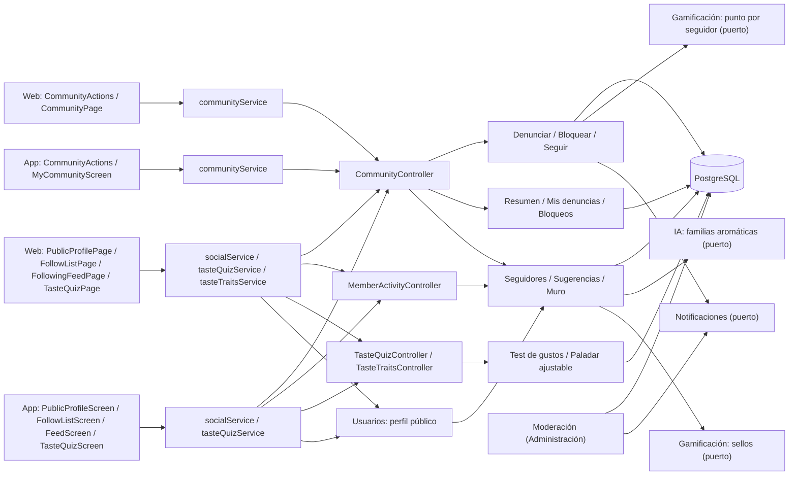
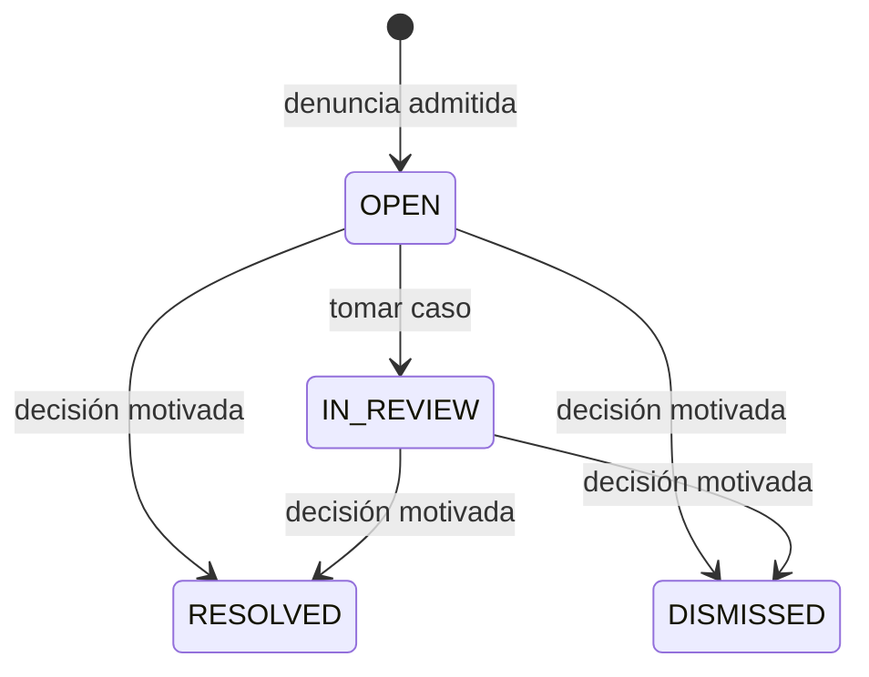
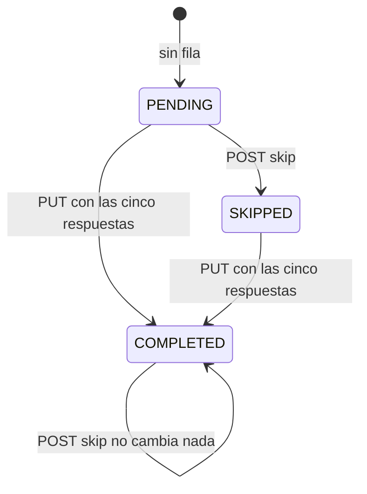
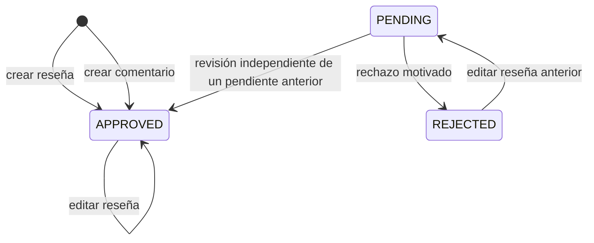

# Arquitectura

Cómo está construido el módulo en cada capa. El backend sigue el flujo hexagonal
`controller → puerto de entrada → handler → dominio → puerto de salida → adaptador`;
la web y la app siguen `pantalla → hook → servicio → cliente API → transporte HTTP`.
La sección de backend también describe la revisión de denuncias por el equipo,
que se opera desde [Administración](../admin/README.md).



[Ver diagrama de «Arquitectura» completo](https://images.vinnot.com/docs/diagrams/v1/es/modules-community-architecture-66ddab2dc2cb.svg)

## Backend

### Contrato y límites

`community` administra denuncias de `REVIEW`, `COMMENT`, `USER`, `EVENT` y
`WINE_ROUTE`. El servidor obtiene el autor y una copia acotada del contenido;
el cliente sólo indica tipo, ID, motivo y descripción. Se aceptan usuarios activos,
reseñas/comentarios aprobados de vinos activos, eventos que ya fueron publicados y rutas
publicadas. Los borradores no son denunciables por este circuito público.

La descripción admite hasta 2000 caracteres y es obligatoria para `OTHER`.
Una denuncia propia se rechaza. Una denuncia abierta del mismo usuario sobre el
mismo contenido devuelve el comprobante existente, incluso si el contenido ya no
está disponible. La creación toma un lock por denunciante y limita a diez casos
nuevos en 24 horas; el filtro HTTP agrega su propio límite de solicitudes `report`
(10 por hora), separado de soporte. No se envía correo por cada denuncia.

### Puertos, capas y transacciones

| Capa | Responsabilidad |
|---|---|
| Dominio | `CommunityReport`, motivos, transiciones, conflicto de interés y decisión obligatoria; `CellarVisibility`, `TasteProfile` y `PublicName` para el perfil social |
| Aplicación | Crear/revisar/retirar contenido, cambiar bloqueos y seguimientos, y consultar comprobantes/cola, listas de seguidores, sugerencias, el muro y perfiles públicos |
| Puertos de salida | Persistencia de casos/bloqueos/seguimientos, lecturas sociales, resolución pública del contenido, retiro, puntos por seguidor, sellos y el push de nuevo seguidor |
| Adaptadores | JDBC, consultas JPA de visibilidad, puente a casos de uso de review y HTTP autenticado |
| Presentación | Formularios contextuales, confirmación de bloqueo/retiro y estado recuperable de errores |

`ReportedContentRemovalAdapter` llama a los casos de uso existentes para borrar
reseñas/comentarios. La eliminación, el recálculo de valoraciones de una reseña y
el cierre del caso participan en la misma transacción. Un error revierte el cierre.
El dominio y los handlers no importan clientes HTTP ni persistencia de otro módulo.

### API

Rutas relativas al contexto `/api`. Las identidades provienen del JWT, nunca del
cuerpo del request. La paginación usa `content`, `totalItems` y `totalPages`, con
máximo 50 elementos por página.

| Método y ruta | Acceso y resultado |
|---|---|
| `POST /community/reports` | Autenticado; comprobante privado sin evidencia ni notas |
| `GET /community/reports/mine` | Sólo casos del usuario; ID, objetivo, estado y fecha |
| `GET /community/blocks` | Sólo bloqueos realizados por el usuario |
| `PUT /community/blocks/{userId}` | Bloqueo idempotente; prohíbe autobloqueo |
| `DELETE /community/blocks/{userId}` | Desbloqueo idempotente; desbloquearse a uno mismo responde 422 |
| `PUT /community/follows/{userId}` | 204, idempotente; seguirse a uno mismo responde 400 `SELF_FOLLOW`; un miembro inexistente, inactivo o bloqueado responde 404 |
| `DELETE /community/follows/{userId}` | 204, idempotente; 400 `SELF_FOLLOW` para uno mismo |
| `GET /community/users/{userId}/followers` y `/following` | `page`, `size` (máximo 50); `FollowUserResponse` `{id, username, displayName, avatarUrl, tier, following}`, del seguimiento más reciente al más antiguo, sin miembros bloqueados en cualquier sentido con quien consulta |
| `GET /community/suggestions?size` | `size` de 1 a 20, por defecto 10; lista de `SuggestedUserResponse` `{id, username, displayName, avatarUrl, tier, affinityPercent, reviewsCount}` |
| `GET /community/feed` | `page`, `size` (máximo 50); `UserReviewResponse` con las reseñas aprobadas de los miembros seguidos, de la más reciente a la más antigua |
| `GET /users/{userId}/reviews` | `page`, `size` (máximo 50); las `UserReviewResponse` aprobadas del miembro, de la más reciente a la más antigua |
| `GET /users/{userId}/cellar` | `page`, `size` (máximo 50); `PublicCellarWineResponse` `{id, wine, vintage, rating, addedAt}`, de la más reciente a la más antigua; 403 `CELLAR_NOT_VISIBLE` cuando la configuración del dueño la oculta |
| `GET /users/me/taste-quiz` | El test de gustos propio, envuelto como `{data, timestamp}`: `{status, answers, shouldPrompt}` (ver [Test de gustos](#test-de-gustos)) |
| `PUT /users/me/taste-quiz` | Cuerpo `{answers}` con una opción para cada una de las cinco preguntas; 204, repetirlo sobrescribe; 400 `INVALID_TASTE_QUIZ` ante una pregunta faltante o desconocida o una opción desconocida |
| `POST /users/me/taste-quiz/skip` | 204; registra `SKIPPED` solo cuando el usuario todavía no tiene test, así nunca borra un test completado |
| `PUT /users/me/taste-traits` | Cuerpo `{structure}`: la clave de un rasgo con un puntaje entero de 0 a 100, o con `null` para borrar ese rasgo; los rasgos omitidos no cambian; 204. 400 `INVALID_TASTE_ADJUSTMENT` ante un `structure` faltante o vacío, un rasgo desconocido o un puntaje que no sea un entero de 0 a 100, sin guardar nada (ver [Paladar ajustable](#paladar-ajustable)) |
| `DELETE /users/me/taste-traits` | 204, idempotente; borra todos los valores manuales del usuario |
| `GET /admin/community/reports?status=OPEN` | ADMIN/MODERATOR; cola con evidencia privada más `authorUsername`, `reviewerUsername` y `targetLabel` |
| `PATCH /admin/community/reports/{id}` | ADMIN/MODERATOR; asignación o decisión documentada |
| `POST /admin/community/reports/{id}/remove-content` | ADMIN/MODERATOR y `REVIEW_DELETE`; sólo reseña/comentario; motivo obligatorio |

El retiro es explícito e irreversible desde la interfaz. Resolver un caso mediante
PATCH registra la decisión; por sí solo no borra contenido ni cambia una cuenta.
Los eventos, rutas y cuentas se administran con sus flujos y permisos existentes.
La cola excluye casos donde el revisor es denunciante o autor antes de paginar;
el comando comprueba también ese conflicto. El rol de moderador no adquiere
facultades administrativas sobre cuentas.

Cada elemento de la cola conserva todos los campos del caso y suma tres nombres
que pueden ser `null`, para que quien modera nunca lea identificadores crudos:
`authorUsername`, `reviewerUsername` y `targetLabel`, que es el nombre del vino de
una reseña o un comentario, el título del evento en `EVENT`, el nombre de la ruta en
`WINE_ROUTE` y el nombre de usuario en `USER`. `GetCommunityQueryHandler` los
resuelve por página con una sola llamada a `CommunityTargetPort.describe`;
`JdbcCommunityTargetAdapter` la responde con una única sentencia SQL, y un usuario o
contenido eliminado o inexistente deja su nombre en `null` en lugar de fallar.
`PATCH` y `remove-content` siguen devolviendo el caso sin nombres.



[Ver diagrama de «API» completo](https://images.vinnot.com/docs/diagrams/v1/es/modules-community-architecture-0a824868fcad.svg)

El revisor asignado conserva el caso; otro revisor no puede cambiarlo. Los estados
finales no se reabren. `community_report_actions` conserva cada transición con
revisor, fecha y decisión. Los comprobantes del denunciante no revelan esas notas.

### Efecto del bloqueo

Entre cuentas autenticadas, cualquiera de las dos direcciones de bloqueo oculta
las reseñas, comentarios y perfil e impide nuevos likes/comentarios sobre reseñas
del otro usuario. Los filtros de lectura se aplican antes del conteo y paginación.
En comentarios también se comprueba el autor de la reseña padre. Se permite quitar
un like o eliminar contenido propio ya existente. Las valoraciones y conteos
agregados del vino no cambian por un bloqueo. Los avisos de la
comunidad también omiten a quienes se bloquean: no hay aviso de comentario y
sus "me gusta" quedan fuera de los resúmenes.

Los eventos, rutas e inscripciones mantienen sus reglas. Las lecturas funcionales
requieren sesión; bloquear otra cuenta filtra contenido dentro de ese acceso
autenticado. Las herramientas de moderación conservan su acceso privilegiado.

### Seguimientos y perfil social

Seguir (#541) es asimétrico y no requiere aprobación. `ChangeFollowCommandHandler`
rechaza seguirse a uno mismo (`SELF_FOLLOW`, 400) y responde 404 ante un miembro
inexistente o inactivo o mientras cualquiera de los dos bloquee al otro, igual que
el perfil. Seguir y bloquear toman primero un lock consultivo de transacción sobre
el par (`JdbcFollowAdapter.lockPair`), así un seguimiento no sobrevive a un bloqueo
confirmado al mismo tiempo. Un bloqueo borra los seguimientos en ambas direcciones
en su propia transacción y quita sus puntos por seguidor.

Un seguimiento nuevo guarda la fila, otorga al miembro seguido un punto
`FOLLOWER_GAINED` cuando el seguidor tiene el email verificado y al menos una
reseña aprobada (clave: el ID del seguidor, límite de 10 por día dentro del tope
global de 40) y encola el push `NEW_FOLLOWER` (clave: seguidor, miembro seguido y
día UTC). Dejar de seguir revoca el punto. Todo participa de la transacción del
seguimiento.

Toda lectura social sobre un miembro responde 404 cuando el miembro no existe,
está inactivo o hay un bloqueo en cualquier sentido con quien consulta.
`JdbcSocialQueryAdapter` lee miembros activos, reseñas aprobadas de vinos activos
y entradas de cava de vinos activos; los conteos siguen las mismas reglas.
`GetSocialQueryHandler` lee los sellos de una página entera en una sola llamada a
través de `MemberBadgePort` (posiciones de gamificación). `UserReviewResponse` es
`{reviewId, rating, title, comment, vintage, createdAt, reviewer {id, username,
displayName, avatarUrl, tier}, wine {id, name, imageUrl, type, wineryName}}`;
`displayName` es el nombre y apellido, o el nombre de usuario.

| Regla | Comportamiento |
|---|---|
| Cava | `PUBLIC` para todos los miembros, `FOLLOWERS` para los seguidores, `PRIVATE` para nadie; el dueño siempre la ve. El listado público nunca incluye notas ni precios de compra |
| Rueda de gusto | Hasta ocho porciones `GRAPE`, ocho `TYPE` y ocho `REGION` (`{kind, value, label, score, tone, ratedWines}`), cada tipo con el mejor puntaje primero (empates: más vinos valorados, luego etiqueta), calculadas en cada pedido con las valoraciones del miembro por `TasteWheel`; `null` con menos de cinco vinos valorados. Los clientes muestran un tipo por vez |
| Vinos valorados | Suma de las filas `TYPE` del miembro en `user_taste_affinities`: cada vino valorado tiene exactamente un tipo |
| Afinidad | Similitud coseno de ambos vectores de puntaje sobre `(kind, value)`, redondeada a 0–100; `null` para uno mismo o cuando alguno valoró menos de cinco vinos |
| Sugerencias | Miembros activos con al menos cinco vinos valorados, que no sean uno mismo, no seguidos y sin bloqueo en ningún sentido; ordenados por afinidad (cuando quien consulta valoró cinco vinos) y luego por reseñas aprobadas |
| Rasgos de gusto | La estructura y las familias aromáticas de los vinos que le gustan al miembro (ver abajo), completadas por un test de gustos terminado donde ese dato falta y reemplazadas rasgo por rasgo por los valores manuales del miembro; `null` con menos de cinco vinos valorados, sin test completado y sin valores manuales |

La rueda de gusto (#541 S15) no tiene tabla propia. El umbral de cinco
vinos sigue leyendo `user_taste_affinities`, igual que la afinidad. Cuando se
cumple, `JdbcSocialQueryAdapter.ratedWines` lee cada vino valorado del miembro
con las mismas fuentes y el mismo filtro de uvas del proceso nocturno: reseñas
no rechazadas y valoraciones de cava de vinos sin reseña, uvas no vacías y de
120 caracteres como máximo. Cada fila trae el tipo, las uvas y la región del
vino. `grapeCatalog` lee `grape_types`. La clase de dominio `TasteWheel` las
agrega:

- `score` es el promedio de las valoraciones (dos decimales) y `ratedWines` la
  cantidad de vinos valorados detrás de la porción; una uva repetida en un mismo
  vino cuenta una vez.
- Las porciones `GRAPE` unen grafías en cualquier alfabeto, mayúsculas o
  acentos: `GrapeName` pasa a minúsculas, quita acentos, translitera el griego
  según ELOT 743 y, para comparar, ignora letras dobles ("Agiorgitiko",
  "ΑΓΙΩΡΓΙΤΙΚΟ" y "Αγιωργίτικο" son una porción, y también "Assyrtiko" y
  "ασύρτικο"). `label` es la grafía latina más frecuente o, si no hay, la
  transliteración con mayúscula inicial; `value` es la clave de esa etiqueta.
  `tone` es el tipo más frecuente entre los vinos de esa uva; un empate se
  resuelve por el tipo que coincide con `grape_types.category` (`RED` o
  `WHITE`) y si no por el primer código de tipo.
- Las porciones `TYPE` usan el código de tipo recortado y en mayúsculas como
  `value`, `label` y `tone`.
- Las porciones `REGION` usan el id de la región como `value` y su nombre como
  `label`, con `tone` `null`; el país no se muestra.

Del handler solo salen estos agregados, así que un miembro con cava `PRIVATE`
sigue mostrando la rueda pero nunca un vino. `user_taste_affinities` mantiene sus
filas `TYPE` y `GRAPE` tal como se escriben, así que las sugerencias, la afinidad
y las fuentes de recomendación que la leen no cambian.

Los rasgos de gusto (`tasteTraits`) se calculan en cada consulta, sin tabla
propia. `JdbcSocialQueryAdapter.likedWines` lee las mismas valoraciones que
`user_taste_affinities` (reseñas no rechazadas y valoraciones de cava de vinos sin
reseña propia) con nota de al menos 3,5, las 200 más recientes. Cada vino trae los
puntajes `acidity_score`, `body_score`, `tannin_score` y `sweetness_score` del
catálogo y uno de sus perfiles de IA (cualquier idioma): los puntajes numéricos de
`palateAnalysis` y los aromas y sabores primarios y secundarios. El dominio
`TasteTraits` pondera cada vino por su nota:

| Rasgo | Regla |
|---|---|
| Estructura | Por `ACIDITY`, `BODY`, `TANNIN` y `SWEETNESS`, el promedio ponderado (0–100) de los vinos con dato: el puntaje del catálogo cuando existe y está entre 0 y 100, si no el de `palateAnalysis` del perfil de IA. Un rasgo con menos de tres vinos con dato se omite; `wines` indica cuántos vinos lo forman |
| Familias | Por `FRUIT`, `FLORAL`, `HERBAL`, `SPICE`, `OAK` y `MINERAL`, la parte ponderada (0–100) de los vinos con perfil de IA que tienen al menos una nota de esa familia. Solo cuentan los vinos con perfil de IA; con menos de tres, la lista queda vacía. Una familia con 0 % se omite y el resto se ordena de mayor a menor (empates: por clave) |

`GetSocialQueryHandler` clasifica los descriptores de cada vino con perfil a través
de `SensoryFamilyPort`, que implementa `AiSensoryFamilyAdapter` sobre
`ClassifySensoryFamiliesUseCase` del módulo de IA (ver
[IA](../ai/architecture.md)); el módulo de comunidad recibe claves de familia y no
usa tipos de dominio de IA.

### Test de gustos

El test de gustos (#541) son cinco preguntas ilustradas que el miembro responde al
registrarse o más tarde desde su perfil, para que su perfil de gustos tenga un
punto de partida antes de valorar vinos. El miembro ve las opciones; cómo cada
opción se traduce en rasgos de gusto es interno y nunca se envía a los clientes.
`TasteQuizQuestion` y `TasteQuizAnswer` son enums de dominio con las claves de
abajo; `TasteQuiz` valida un juego completo de respuestas y calcula la semilla.

| Pregunta | Opciones |
|---|---|
| `RAINY_DAY` | `DARK_CHOCOLATE_COFFEE`, `SPICED_TEA_APPLE_TART` |
| `FRUIT` | `CITRUS`, `RED_BERRIES`, `DARK_BERRIES`, `STONE_TROPICAL` |
| `DESSERT` | `LEMON_TART`, `CARAMEL_FLAN`, `BROWNIE`, `FRESH_FRUIT` |
| `DINNER` | `GRILLED_RED_MEAT`, `LEMON_FISH`, `MUSHROOM_PASTA`, `SPICY_CURRY` |
| `AROMA` | `VANILLA_TOAST`, `PEPPER_CINNAMON`, `ROSES_VIOLETS`, `CUT_GRASS` |

`GET /users/me/taste-quiz` devuelve `status` `PENDING` (sin fila), `COMPLETED` o
`SKIPPED`; `answers`, un objeto pregunta-opción en el orden del test, solo cuando
está completado y solo a su dueño; y `shouldPrompt`, verdadero mientras el test
está pendiente y el miembro valoró menos de cinco vinos, contados igual que la
rueda del perfil (suma de las filas `TYPE` de `user_taste_affinities`). `PUT`
valida las respuestas en `TasteQuiz.of` antes de guardarlas como `COMPLETED`;
`POST .../skip` inserta `SKIPPED` con `ON CONFLICT DO NOTHING`.
`GetTasteQuizQueryHandler`, `CompleteTasteQuizCommandHandler` y
`SkipTasteQuizCommandHandler` usan `TasteQuizRepositoryPort`, que implementa
`JdbcTasteQuizAdapter` sobre `user_taste_quiz`. `TasteQuizController` atiende las
rutas bajo `/users/me`, como el resto de la cuenta propia, y
`CommunityExceptionHandler` responde `INVALID_TASTE_QUIZ` con 400.



[Ver diagrama de «Test de gustos» completo](https://images.vinnot.com/docs/diagrams/v1/es/modules-community-architecture-b1e026ba524d.svg)

La semilla arranca cada rasgo de estructura en 50, suma los desplazamientos de las
respuestas y acota el resultado a 0–100; los rasgos sembrados informan
`wines: 0`. Las familias son menciones ponderadas: cada familia que nombra una
respuesta suma 1, o 2 si es la respuesta de `AROMA`; el porcentaje de una familia
es su peso sobre el total, redondeado, un porcentaje de 0 se omite y el resto se
ordena de mayor a menor (empates: por clave).

| Opción | Desplazamientos de estructura | Familias |
|---|---|---|
| `DARK_CHOCOLATE_COFFEE` | taninos +20, cuerpo +15 | `OAK` |
| `SPICED_TEA_APPLE_TART` | acidez +15 | `SPICE`, `FRUIT` |
| `CITRUS` | acidez +20, cuerpo −10 | `FRUIT` |
| `RED_BERRIES` | cuerpo −5, taninos −5 | `FRUIT` |
| `DARK_BERRIES` | cuerpo +15, taninos +10 | `FRUIT` |
| `STONE_TROPICAL` | dulzor +10, acidez −5 | `FRUIT`, `FLORAL` |
| `LEMON_TART` | acidez +15 | — |
| `CARAMEL_FLAN` | dulzor +25 | `OAK` |
| `BROWNIE` | taninos +10, cuerpo +10 | `OAK` |
| `FRESH_FRUIT` | dulzor −15, acidez +5 | `FRUIT` |
| `GRILLED_RED_MEAT` | cuerpo +20, taninos +15 | `SPICE` |
| `LEMON_FISH` | acidez +10, cuerpo −15, taninos −15 | `MINERAL` |
| `MUSHROOM_PASTA` | cuerpo +5 | `MINERAL`, `HERBAL` |
| `SPICY_CURRY` | dulzor +10, taninos −10 | `SPICE` |
| `VANILLA_TOAST` | cuerpo +5 | `OAK` (peso 2) |
| `PEPPER_CINNAMON` | — | `SPICE` (peso 2) |
| `ROSES_VIOLETS` | — | `FLORAL` (peso 2) |
| `CUT_GRASS` | acidez +10 | `HERBAL` (peso 2) |

El perfil combina la semilla con `tasteTraits` mediante `TasteTraits.blend`; la
rueda y la afinidad siguen leyendo solo valoraciones reales.

| Caso | `tasteTraits` |
|---|---|
| Sin test completado | Los rasgos reales, o `null` con menos de cinco vinos valorados; `fromQuiz: false` |
| Test completado, menos de cinco vinos valorados | La semilla; `fromQuiz: true` |
| Test completado, cinco o más vinos valorados | Cada rasgo de estructura conserva su puntaje real y toma el de la semilla cuando no lo tiene; las familias conservan la lista real salvo que esté vacía. `fromQuiz` es verdadero cuando algún valor vino de la semilla |

El perfil público lleva los rasgos combinados y nunca las respuestas.

El módulo de usuarios compone el perfil público: `GetPublicUserProfileQueryHandler`
lee la cuenta y consulta `SocialProfilePort`, que implementa
`CommunitySocialProfileAdapter` sobre `GetSocialUseCase.profile`. Ver
[Usuarios](../users/architecture.md).

### Paladar ajustable

Los miembros refinan las barras de estructura de su propio perfil de gustos
(#541): cada puntaje manual reemplaza el valor calculado o del test de su rasgo.
`TasteAdjustment` es el modelo de dominio de un cambio: valida todo el objeto
`structure` antes de guardar nada, así que un cuerpo con un rasgo inválido no
cambia nada.

| Valor en `structure` | Efecto |
|---|---|
| Entero de 0 a 100 | Inserta o actualiza el puntaje manual de ese rasgo |
| `null` | Borra el puntaje manual de ese rasgo |
| Rasgo omitido | Sin cambios |
| `structure` faltante o vacío, rasgo desconocido (las claves distinguen mayúsculas), decimal, texto, booleano o un número fuera de 0–100 | 400 `INVALID_TASTE_ADJUSTMENT` |

`AdjustTasteTraitsCommandHandler` y `ResetTasteTraitsCommandHandler` usan
`TasteAdjustmentRepositoryPort`, que implementa `JdbcTasteAdjustmentAdapter`
sobre `user_taste_adjustments`. `TasteTraitsController` atiende `PUT` y `DELETE
/users/me/taste-traits` junto al test de gustos, y `CommunityExceptionHandler`
responde `INVALID_TASTE_ADJUSTMENT` con 400.

`GetSocialQueryHandler` pasa los puntajes manuales a `TasteTraits.blend`, que
resuelve cada rasgo de estructura en este orden:

| Origen | Ítem de estructura |
|---|---|
| Valor manual | El `score` manual, `adjusted: true`; `wines` conserva la cantidad real, o 0 sin datos reales |
| Datos reales | El `score` y `wines` calculados, `adjusted: false` |
| Test completado | El `score` de la semilla, `wines: 0`, `adjusted: false`; `fromQuiz` pasa a verdadero |

Los ítems mantienen el orden `ACIDITY`, `BODY`, `TANNIN`, `SWEETNESS`, y un rasgo
ajustado aparece aunque no lo tengan ni los datos reales ni el test. `fromQuiz` es
verdadero solo cuando un valor mostrado viene del test, así que un rasgo
reemplazado a mano deja de contar. Con valores manuales y sin rasgos reales ni
test completado, `tasteTraits` es `{structure, families: [], fromQuiz: false}` en
lugar de `null`. Las familias, la rueda y la afinidad ignoran los valores
manuales. Los valores manuales son públicos como el resto de `tasteTraits`:
cualquiera que pueda ver el perfil los ve.

### Persistencia y borrado de cuenta

V24 crea `community_reports`, `community_report_actions` y `user_blocks`, con
unicidad parcial de casos abiertos, unicidad de pares de bloqueo e índices de
colas y claves foráneas. Los objetivos usan tipo+UUID sin FK al contenido, para
conservar el caso si se elimina su objetivo. El borrado de una cuenta elimina sus
pares de bloqueo y pone en NULL las referencias de identidad de las denuncias y
acciones. La evidencia textual del caso se conserva separadamente del contenido
público; no se devuelve en perfiles ni listados de usuarios.

V87 crea `user_follows`: un par `(follower_id, followee_id)` como clave primaria,
ambos con clave foránea a `users` y `ON DELETE CASCADE`, un CHECK que impide
seguirse a uno mismo, `created_at` y un índice sobre `(followee_id, created_at
DESC)` para las listas de seguidores. Agrega a `users` la biografía `bio`
(`varchar(160)`, opcional) y `cellar_visibility` (`PUBLIC`, `FOLLOWERS` o
`PRIVATE` por CHECK, por defecto `PUBLIC`). Borrar una cuenta elimina sus
seguimientos en ambas direcciones.

V88 crea `user_taste_quiz`: una fila por miembro con clave `user_id` (clave
foránea a `users` con `ON DELETE CASCADE`), `status` `COMPLETED` o `SKIPPED`,
`answers` como objeto jsonb presente solo cuando está completado (lo asegura un
CHECK) y `updated_at`. Borrar una cuenta elimina su test. El módulo de usuarios no
tiene exportación de datos personales, así que no hay nada más que extender.

V89 crea `user_taste_adjustments`: una fila por miembro y rasgo, con clave
primaria `(user_id, trait)`, `user_id` como clave foránea a `users` con `ON DELETE
CASCADE`, `trait` limitado por un CHECK a `ACIDITY`, `BODY`, `TANNIN` y
`SWEETNESS`, `score` un smallint entre 0 y 100 y `updated_at`. Borrar una cuenta
elimina sus valores manuales.

### Publicación de reseñas y comentarios

`Review.create` publica la reseña como `APPROVED`:
las reseñas nuevas son visibles inmediatamente para otras
cuentas y actualizan el promedio/conteo. Los comentarios nuevos también se
guardan como `APPROVED` y se ven al instante; la moderación es reactiva,
mediante denuncias, bloqueos y retiro. No hay detector automático de texto.
Los estados pendientes/rechazados anteriores se conservan; no se ejecuta una
aprobación masiva. Editar una reseña aprobada la mantiene pública; editar una
pendiente o rechazada la devuelve a `PENDING`.
El autor puede leer su contenido pendiente/rechazado. La lectura de comentarios
exige padre aprobado o propio y comentario aprobado o propio. Los bloqueos y
la retirada de contenido denunciado mantienen sus reglas. Las propuestas de
catálogo tienen un circuito independiente.



[Ver diagrama de «Publicación de reseñas y comentarios» completo](https://images.vinnot.com/docs/diagrams/v1/es/modules-community-architecture-fa27e5a6eb79.svg)

`GET /admin/review-publications` devuelve una cola paginada de las reseñas y los
comentarios que quedaron pendientes antes de la publicación inmediata,
excluyendo el contenido propio antes de paginar. Requiere ADMIN/MODERATOR y
`REVIEW_DELETE`, igual que `POST /admin/review-publications/{type}/{id}`. La decisión
recibe `status`, `reasonCode`, `reason` y `expectedRevision`: el valor exacto
`updatedAt` de la cola, conservado como cadena por ambos clientes para no perder
microsegundos. Un rechazo lleva un `reasonCode` predefinido (`OFFENSIVE`, `SPAM`,
`OFF_TOPIC`, `PERSONAL_DATA`, `OTHER`; guardado en
`review_publication_decisions.reason_code`, V53) que se le comunica al autor por
correo; `reason` es la nota del moderador y solo se envía cuando el moderador
eligió explícitamente `OTHER`. Una aprobación no lleva `reasonCode`. Un cliente
que solo envía la nota (versión anterior) sigue pudiendo rechazar, registrado como
`OTHER`, pero esa nota queda interna y nunca se envía por correo (igual que las
notas de suspensión heredadas); sin ninguno de los dos se
rechaza la decisión; una revisión propia, repetida o sobre una versión que
cambió se rechaza sin publicar. Un comentario sólo puede aprobarse si su reseña
padre está aprobada. El rol no adquiere permisos sobre cuentas.

Cada elemento de la cola conserva todos los campos de la publicación y suma
`authorUsername` y `wineName`. `GetReviewPublicationQueueQueryHandler` los resuelve
por página con una sola llamada a `ReviewPublicationRepositoryPort.findNames`, una
única sentencia SQL en `JdbcReviewPublicationAdapter`; un usuario o vino eliminado o
inexistente da `null`.

`DecideReviewPublicationCommandHandler` toma primero el lock del vino y luego el
del contenido, el mismo orden que la edición y eliminación de reseñas. Valida
`ReviewPublication`, actualiza estado, registra auditoría y recalcula las
valoraciones aprobadas en una transacción. Los adapters JDBC/JPA implementan los
puertos; no se incorpora un proveedor externo ni moderación mediante IA.
Las denuncias públicas admiten sólo reseñas/comentarios aprobados. Los nuevos
likes y comentarios sobre reseñas pendientes/rechazadas se rechazan.

V26 añade `publication_status`: los registros previos permanecen `APPROVED`;
el default SQL sigue `PENDING`, pero el dominio guarda explícitamente las
reseñas nuevas y los comentarios nuevos como `APPROVED`. `review_publication_decisions` registra
objetivo, revisor, decisión, motivo, revisión del contenido y fecha; no duplica
el texto completo. La eliminación de cuenta anula el revisor, sin afirmar que
un motivo textual sea anónimo. Una restauración o rollback debe mantener el
código que filtra estados: volver a una versión anterior a V26 puede exponer
pendientes aunque la migración sea aditiva.

### Operación de revisión y apelación

El revisor consulta publicaciones pendientes y denuncias abiertas por separado.
Evalúa contenido objetable, spam, acoso, privacidad, derechos de terceros y
pertinencia usando la política de contenido; una valoración negativa por sí sola
no justifica retirarla. Aprueba o rechaza la publicación y documenta los motivos
necesarios. En una denuncia puede tomar el caso, descartarlo o resolverlo; el
retiro explícito sólo admite reseñas/comentarios. No hay sanciones automáticas
por cantidad de denuncias ni decisión automática de IA.

La reincidencia se evalúa manualmente con los casos conservados. Las medidas
sobre cuentas se derivan al flujo ADMIN existente `POST /admin/users/{id}/ban`,
con motivo y sus propias validaciones; MODERATOR no recibe ese permiso. Una
apelación ingresa por Contacto con la referencia del caso o contenido. Los casos
cerrados no se reabren en esta API; revisar una decisión no restaura contenido
eliminado ni publica una reseña rechazada automáticamente. Editar una reseña rechazada la devuelve a `PENDING`. Un conflicto de interés exige otro revisor autorizado.

### Conservación y purga

`PurgeClosedReportsCommandHandler` fija un plazo de 90 días desde el cierre
(`updated_at` del estado final inmutable). Un scheduler local al backend invoca
el caso de uso cada hora; V25 indexa los casos cerrados por fecha. El adapter
elimina hasta 500 casos vencidos por ejecución, con sus acciones por FK cascade,
y hasta 500 decisiones de publicación con más de 90 días desde su decisión.
`OPEN` e `IN_REVIEW` nunca se eliminan por antigüedad. Los locks `SKIP LOCKED`
evitan duplicar el trabajo entre instancias; la transacción revierte si falla.

El plazo vuelve elegible un registro para la siguiente ejecución; una cola
acumulada o una interrupción puede retrasar la eliminación. No se crean recursos
cloud adicionales. El borrado afecta la base activa, no elimina inmediatamente
backups ni conversaciones ya recibidas por el canal de soporte. Los comprobantes
de casos purgados también desaparecen de la consulta del usuario.

### Clientes y verificación

Web usa página/componente → hook TanStack Query → servicio → cliente HTTP. Mobile
usa pantalla → hook → operaciones Redux Toolkit Query → servicio → cliente HTTP;
los archivos de Expo Router sólo componen las pantallas. Las fechas se mapean en
servicios y los DTO quedan en infraestructura.

Después de un bloqueo exitoso se descartan las proyecciones sociales almacenadas
antes de recargarlas. Si falla el bloqueo, se conserva la vista previa. La
invalidación no ejecuta comparaciones ni regeneración de IA. El borrador de una
denuncia fallida se conserva para reintentar.

Las pruebas HTTP con PostgreSQL comprueban permisos, conflictos de interés,
privacidad, deduplicación concurrente, límites, filtros anteriores a paginación,
retiro transaccional y borrado de cuentas. Las pruebas de clientes cubren mapeo,
confirmación/cancelación, errores y caché. La ejecución de componentes nativos no
sustituye aceptación en un dispositivo con build firmado.


### Resumen de actividad y acciones sobre reseñas

`GET /community/overview` devuelve los totales por estado de las denuncias del
usuario autenticado y la cantidad de personas bloqueadas. `GET /admin/community/reports/overview`
requiere ADMIN/MODERATOR y aplica las mismas exclusiones por conflicto de interés
que la cola: excluye casos presentados por el revisor o sobre él. Ningún resumen
expone evidencia, identidades ni referencias de casos. Los totales abarcan todas
las páginas: pendientes suma OPEN e IN_REVIEW; cerradas suma RESOLVED y DISMISSED.
Cuentan registros conservados, no un historial acumulado permanente.

Web y mobile muestran el resumen de moderación y las publicaciones pendientes en
el inicio administrativo, y actividad personal desde el perfil. Denuncias y
bloqueos se paginan por separado. La carga y los errores son explícitos: un fallo
no aparece como cero pendientes. Las mutaciones invalidan los totales mediante
la caché existente de comunidad. No hay sondeo periódico ni servicios cloud nuevos.

El autor o ADMIN pueden editar una reseña. MODERATOR puede eliminar la reseña de
otra persona según los permisos existentes del servidor, pero no editarla.
Los clientes muestran editar y eliminar por separado; la autorización definitiva
sigue correspondiendo al servidor.

## Web

```text
CommunityPage / CommunityActions → useCommunity → communityService → communityClient → http
```

Las acciones de denuncia y bloqueo aparecen junto al contenido; la actividad
propia está en la página protegida `/community`, enlazada desde el perfil. Las
pantallas del equipo están en [Administración](../admin/README.md).

| Pieza | Qué hace |
|---|---|
| [`CommunityActions.tsx`](../../../../frontend-react/src/presentation/components/features/community/CommunityActions.tsx) | «Denunciar», «Denunciar usuario» y «Bloquear» con confirmación; motivos predefinidos y descripción obligatoria para «Otro»; se oculta al autor y al organizador. Un error muestra el motivo con `communityErrorMessage`: límite diario (`REPORT_LIMIT`), demasiados envíos (429), contenido o cuenta propios (`SELF_REPORT`, `SELF_BLOCK`) o contenido que ya no existe (404) |
| Lugares de uso | Tarjetas de reseña, comentarios y fichas de evento y de ruta (en eventos y rutas no se ofrece bloquear) |
| [`CommunityActionsMenu.tsx`](../../../../frontend-react/src/presentation/components/features/community/CommunityActionsMenu.tsx) y [`CommunityReportForm.tsx`](../../../../frontend-react/src/presentation/components/features/community/CommunityReportForm.tsx) | En reseñas y comentarios las acciones están en un menú de tres puntos arriba a la derecha (`variant="menu"`); el formulario de denuncia se abre en un diálogo y un aviso lo confirma. Eventos y rutas mantienen los enlaces en línea |
| [`CommunityPage.tsx`](../../../../frontend-react/src/presentation/pages/community/CommunityPage.tsx) | Resumen, denuncias propias, cuentas bloqueadas con desbloqueo y acceso a Contacto |
| [`CommunityOverview.tsx`](../../../../frontend-react/src/presentation/components/features/community/CommunityOverview.tsx) | Paneles de resumen y el enlace a la actividad desde el perfil |
| [`ModerationNames.tsx`](../../../../frontend-react/src/presentation/components/features/community/ModerationNames.tsx) | Nombres de cada elemento de moderación (autor, a qué se refiere, quién revisa, vino) en ambas colas de administración; oculta el dato cuyo nombre es `null` y nunca muestra identificadores |
| [`useCommunity.ts`](../../../../frontend-react/src/presentation/hooks/queries/community/useCommunity.ts) | Consultas y mutaciones; bloquear recarga reseñas y perfiles |
| [`community.service.ts`](../../../../frontend-react/src/application/services/community.service.ts) y [`community.client.ts`](../../../../frontend-react/src/infrastructure/api/clients/community.client.ts) | Mapean los DTO y llaman a `/community` |

## App

La actividad propia es la pantalla `frontend-mobile/app/(app)/community.tsx`, que
se abre desde el perfil.

| Pieza | Qué hace |
|---|---|
| [`CommunityActions.tsx`](../../../../frontend-mobile/src/presentation/features/community/CommunityActions.tsx) | Denunciar y bloquear con motivos como opciones y confirmación del sistema; se usa en reseñas, comentarios, eventos y rutas. `communityErrorKey` traduce el error al mismo conjunto de motivos que la web |
| [`CommunityActionsMenu.tsx`](../../../../frontend-mobile/src/presentation/features/community/CommunityActionsMenu.tsx) y [`CommunityReportForm.tsx`](../../../../frontend-mobile/src/presentation/features/community/CommunityReportForm.tsx) | En reseñas y comentarios un botón de tres puntos arriba a la derecha abre una hoja inferior con las acciones y el formulario de denuncia; un aviso lo confirma. Eventos y rutas mantienen los enlaces en línea |
| [`CommunityScreens.tsx`](../../../../frontend-mobile/src/presentation/features/community/CommunityScreens.tsx) | Resumen, denuncias propias y cuentas bloqueadas con desbloqueo |
| [`useCommunity.ts`](../../../../frontend-mobile/src/presentation/hooks/queries/community/useCommunity.ts) | Consultas y mutaciones de comunidad |
| [`api.ts`](../../../../frontend-mobile/src/presentation/store/api.ts) | Al bloquear borra de la caché las reseñas y comentarios guardados |
| [`community.service.ts`](../../../../frontend-mobile/src/application/services/community.service.ts) y [`community.client.ts`](../../../../frontend-mobile/src/infrastructure/api/clients/community.client.ts) | Mapean los DTO y llaman a `/community` |
