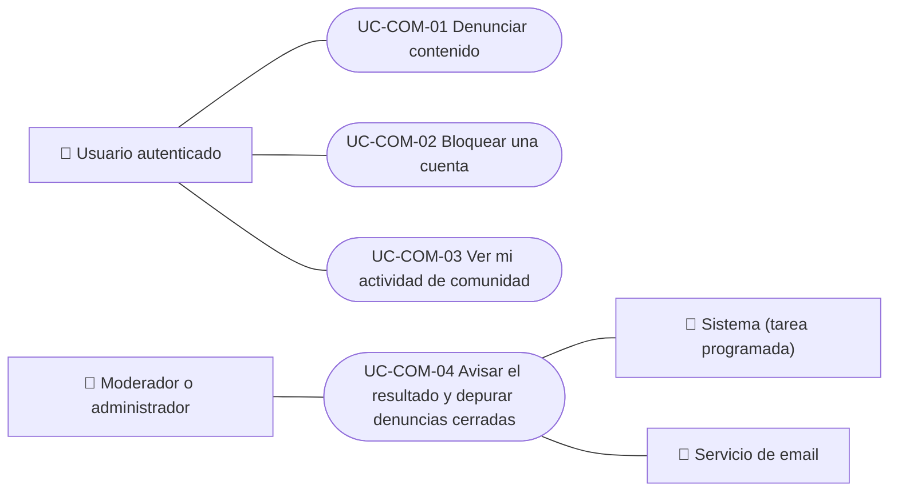

# Casos de uso

Casos de uso de comunidad: denunciar contenido, bloquear y desbloquear cuentas, ver la actividad propia y avisar el resultado de una denuncia. La revisión de denuncias por el equipo está en Administración. Cada caso vale para las plataformas indicadas.

| ID | Caso de uso | Plataformas | Actores |
|---|---|---|---|
| `UC-COM-01` | [Denunciar contenido](uc-com-01-report-content.md) | Web, APK | Usuario autenticado |
| `UC-COM-02` | [Bloquear una cuenta](uc-com-02-block-user.md) | Web, APK | Usuario autenticado |
| `UC-COM-03` | [Ver mi actividad de comunidad](uc-com-03-my-community.md) | Web, APK | Usuario autenticado |
| `UC-COM-04` | [Avisar el resultado y depurar denuncias cerradas](uc-com-04-report-outcome-and-retention.md) | Solo backend | Moderador o administrador, Sistema (tarea programada), Servicio de email |

## Diagrama de casos de uso

[Ver diagrama de «Casos de uso · Diagrama de casos de uso» completo](https://images.vinnot.com/docs/diagrams/v1/es/modules-community-use-cases-readme-e88c993dd745.svg)

## Equivalencia con Lucidchart

| ID | IDs en Lucidchart |
|---|---|
| `UC-COM-01` | [WEB UC-COM-01](https://lucid.app/lucidchart/9f11a16b-bb5a-42fc-a9e8-0852b17bd241/edit), [APK UC-COM-01](https://lucid.app/lucidchart/e095dd25-e8ac-41ba-bf5b-396e1055f217/edit) |
| `UC-COM-02` | [WEB UC-COM-02](https://lucid.app/lucidchart/9f11a16b-bb5a-42fc-a9e8-0852b17bd241/edit), [APK UC-COM-02](https://lucid.app/lucidchart/e095dd25-e8ac-41ba-bf5b-396e1055f217/edit) |
| `UC-COM-03` | [WEB UC-COM-03](https://lucid.app/lucidchart/9f11a16b-bb5a-42fc-a9e8-0852b17bd241/edit), [APK UC-COM-03](https://lucid.app/lucidchart/e095dd25-e8ac-41ba-bf5b-396e1055f217/edit) |
| `UC-COM-04` | Ninguno |
