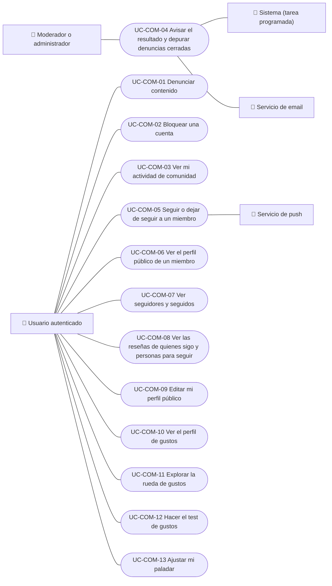

# Casos de uso

Casos de uso de comunidad: denunciar contenido, bloquear y desbloquear cuentas, ver la actividad propia, avisar el resultado de una denuncia y la capa social: seguir a otros miembros, perfiles públicos, el muro de quienes se sigue, el perfil y la rueda de gustos, el test de gustos y el ajuste del paladar. La revisión de denuncias por el equipo está en Administración. Cada caso vale para las plataformas indicadas.

| ID | Caso de uso | Plataformas | Actores |
|---|---|---|---|
| `UC-COM-01` | [Denunciar contenido](uc-com-01-report-content.md) | Web, APK | Usuario autenticado |
| `UC-COM-02` | [Bloquear una cuenta](uc-com-02-block-user.md) | Web, APK | Usuario autenticado |
| `UC-COM-03` | [Ver mi actividad de comunidad](uc-com-03-my-community.md) | Web, APK | Usuario autenticado |
| `UC-COM-04` | [Avisar el resultado y depurar denuncias cerradas](uc-com-04-report-outcome-and-retention.md) | Solo backend | Moderador o administrador, Sistema (tarea programada), Servicio de email |
| `UC-COM-05` | [Seguir o dejar de seguir a un miembro](uc-com-05-follow-member.md) | Web, App | Usuario autenticado, Servicio de push |
| `UC-COM-06` | [Ver el perfil público de un miembro](uc-com-06-view-public-profile.md) | Web, App | Usuario autenticado |
| `UC-COM-07` | [Ver seguidores y seguidos](uc-com-07-view-follow-lists.md) | Web, App | Usuario autenticado |
| `UC-COM-08` | [Ver las reseñas de quienes sigo y personas para seguir](uc-com-08-following-feed-and-suggestions.md) | Web, App | Usuario autenticado |
| `UC-COM-09` | [Editar mi perfil público](uc-com-09-edit-public-profile.md) | Web, App | Usuario autenticado |
| `UC-COM-10` | [Ver el perfil de gustos](uc-com-10-view-taste-profile.md) | Web, App | Usuario autenticado |
| `UC-COM-11` | [Explorar la rueda de gustos](uc-com-11-explore-taste-wheel.md) | Web, App | Usuario autenticado |
| `UC-COM-12` | [Hacer el test de gustos](uc-com-12-take-taste-quiz.md) | Web, App | Usuario autenticado |
| `UC-COM-13` | [Ajustar mi paladar](uc-com-13-adjust-palate.md) | Web, App | Usuario autenticado |

## Diagrama de casos de uso

[Ver diagrama de «Casos de uso · Diagrama de casos de uso» completo](https://images.vinnot.com/docs/diagrams/v1/es/modules-community-use-cases-readme-ef180ef149cf.svg)

## Equivalencia con Lucidchart

| ID | IDs en Lucidchart |
|---|---|
| `UC-COM-01` | [WEB UC-COM-01](https://lucid.app/lucidchart/9f11a16b-bb5a-42fc-a9e8-0852b17bd241/edit), [APK UC-COM-01](https://lucid.app/lucidchart/e095dd25-e8ac-41ba-bf5b-396e1055f217/edit) |
| `UC-COM-02` | [WEB UC-COM-02](https://lucid.app/lucidchart/9f11a16b-bb5a-42fc-a9e8-0852b17bd241/edit), [APK UC-COM-02](https://lucid.app/lucidchart/e095dd25-e8ac-41ba-bf5b-396e1055f217/edit) |
| `UC-COM-03` | [WEB UC-COM-03](https://lucid.app/lucidchart/9f11a16b-bb5a-42fc-a9e8-0852b17bd241/edit), [APK UC-COM-03](https://lucid.app/lucidchart/e095dd25-e8ac-41ba-bf5b-396e1055f217/edit) |
| `UC-COM-04` | Ninguno |
| `UC-COM-05` | Ninguno |
| `UC-COM-06` | Ninguno |
| `UC-COM-07` | Ninguno |
| `UC-COM-08` | Ninguno |
| `UC-COM-09` | Ninguno |
| `UC-COM-10` | Ninguno |
| `UC-COM-11` | Ninguno |
| `UC-COM-12` | Ninguno |
| `UC-COM-13` | Ninguno |
