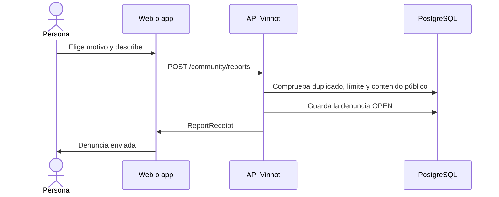

# UC-COM-01 · Denunciar contenido

| Campo | Valor |
|---|---|
| ID | `UC-COM-01` |
| Módulo | [Comunidad](../README.md) |
| Plataformas | Web, APK |
| Actores | Usuario autenticado |
| IDs en Lucidchart | [WEB UC-COM-01](https://lucid.app/lucidchart/9f11a16b-bb5a-42fc-a9e8-0852b17bd241/edit), [APK UC-COM-01](https://lucid.app/lucidchart/e095dd25-e8ac-41ba-bf5b-396e1055f217/edit) |
| Requisitos | [`RF-WEB-COM-01`](../requirements.md), [`RF-WEB-COM-02`](../requirements.md), [`RF-APK-COM-01`](../requirements.md), [`RF-APK-COM-02`](../requirements.md) |
| Casos de prueba | [`CP-COM-01`](../testing.md), [`CP-COM-02`](../testing.md), [`CP-COM-03`](../testing.md), [`CP-COM-04`](../testing.md), [`CP-COM-05`](../testing.md), [`CP-COM-06`](../testing.md), [`CP-COM-07`](../testing.md), [`CP-COM-08`](../testing.md) |

## Precondiciones

- La persona tiene sesión iniciada y ve una reseña, un comentario, un evento o una ruta del vino de otra persona.

## Postcondiciones

- La denuncia queda abierta para el equipo de moderación y la persona recibe un comprobante.

## Flujo principal

1. La persona elige «Denunciar» en el contenido o, en una reseña o un comentario, «Denunciar usuario» para quien lo escribió. En reseñas y comentarios estas acciones están en el menú de tres puntos arriba a la derecha.
2. Elige un motivo: spam, acoso, odio, contenido sexual, violencia, privacidad, desinformación u otro.
3. Puede sumar una descripción de hasta 2000 caracteres.
4. El cliente envía `POST /community/reports` con el tipo y el ID del contenido, el motivo y la descripción.
5. La API comprueba que el contenido sea público y no sea de quien denuncia, y guarda el autor y un extracto del contenido.
6. La API guarda la denuncia como `OPEN` y devuelve el comprobante; el cliente confirma el envío.

## Flujos alternativos

- 3a. El motivo es «Otro» y falta la descripción: no se puede enviar y la API responde 422 `INVALID_REPORT_DESCRIPTION`.
- 5a. La persona ya tiene una denuncia abierta sobre ese contenido: la API devuelve ese mismo comprobante sin crear otra.
- 5b. La persona superó 10 denuncias en 24 horas: la API responde 422 `REPORT_LIMIT` y el cliente explica que llegó al límite diario y que podrá volver a denunciar más tarde.
- 5c. El contenido es propio: la API responde 422 `SELF_REPORT` y el cliente avisa que no se puede denunciar el propio contenido.
- 5d. El contenido ya no es público: la API responde 404 y el cliente avisa que el contenido ya no está disponible.
- 4a. Se superó el límite de 10 envíos por hora: la API responde 429 y el cliente pide esperar un rato antes de reintentar.
- 4b. Falla el envío: el cliente conserva el borrador para reintentar.

## Reglas de negocio

- Se puede denunciar a usuarios activos, reseñas y comentarios aprobados de vinos activos, eventos ya publicados y rutas publicadas.
- La acción no se muestra a quien escribió el contenido ni al organizador del evento.
- El comprobante no muestra evidencia, notas internas ni otras denuncias.
- No hay sanciones ni ocultamientos automáticos por cantidad de denuncias; las decide el equipo ([Administración](../../admin/README.md)).
- Las denuncias tienen su propio límite de 10 envíos por hora (política `report`), independiente de las consultas a soporte. Repetir una denuncia que sigue abierta también cuenta como envío.

## Diagrama

[Ver diagrama de «UC-COM-01 · Denunciar contenido» completo](https://images.vinnot.com/docs/diagrams/v1/es/modules-community-use-cases-uc-com-01-report-content-e82fbbae61c7.svg)

Diagrama de componentes en Lucidchart: [WEB UC-COM-01](https://lucid.app/lucidchart/9f11a16b-bb5a-42fc-a9e8-0852b17bd241/edit), [APK UC-COM-01](https://lucid.app/lucidchart/e095dd25-e8ac-41ba-bf5b-396e1055f217/edit).

## Código

| Capa | Ubicación |
|---|---|
| Endpoints | `POST /community/reports` |
| Backend | [`CommunityController.java`](../../../../../backend/src/main/java/com/vinnot/community/infrastructure/web/CommunityController.java), [`CreateReportCommandHandler.java`](../../../../../backend/src/main/java/com/vinnot/community/application/command/handler/CreateReportCommandHandler.java), [`JdbcCommunityTargetAdapter.java`](../../../../../backend/src/main/java/com/vinnot/community/infrastructure/persistence/JdbcCommunityTargetAdapter.java), [`CommunityReport.java`](../../../../../backend/src/main/java/com/vinnot/community/domain/model/CommunityReport.java) |
| Web | [`CommunityActions.tsx`](../../../../../frontend-react/src/presentation/components/features/community/CommunityActions.tsx), [`useCommunity.ts`](../../../../../frontend-react/src/presentation/hooks/queries/community/useCommunity.ts), [`community.service.ts`](../../../../../frontend-react/src/application/services/community.service.ts), [`community.client.ts`](../../../../../frontend-react/src/infrastructure/api/clients/community.client.ts) |
| App | [`CommunityActions.tsx`](../../../../../frontend-mobile/src/presentation/features/community/CommunityActions.tsx), [`useCommunity.ts`](../../../../../frontend-mobile/src/presentation/hooks/queries/community/useCommunity.ts), [`community.service.ts`](../../../../../frontend-mobile/src/application/services/community.service.ts), [`community.client.ts`](../../../../../frontend-mobile/src/infrastructure/api/clients/community.client.ts) |

## Tests automáticos

- Backend: [`CommunityCommandHandlersTest.java`](../../../../../backend/src/test/java/com/vinnot/community/application/command/handler/CommunityCommandHandlersTest.java), [`RateLimitPolicyResolverTest.java`](../../../../../backend/src/test/java/com/vinnot/shared/infrastructure/security/RateLimitPolicyResolverTest.java), [`CommunityReportTest.java`](../../../../../backend/src/test/java/com/vinnot/community/domain/model/CommunityReportTest.java), [`CommunityHttpPostgresIntegrationTest.java`](../../../../../backend/src/test/java/com/vinnot/community/infrastructure/CommunityHttpPostgresIntegrationTest.java)
- Web: [`CommunityActions.test.tsx`](../../../../../frontend-react/src/presentation/components/features/community/CommunityActions.test.tsx), [`community.service.test.ts`](../../../../../frontend-react/src/application/services/community.service.test.ts), [`community.client.test.ts`](../../../../../frontend-react/src/infrastructure/api/clients/community.client.test.ts), [`communityErrorMessage.test.ts`](../../../../../frontend-react/src/presentation/feedback/communityErrorMessage.test.ts)
- App: [`CommunityActions.test.tsx`](../../../../../frontend-mobile/src/presentation/features/community/CommunityActions.test.tsx), [`community.service.test.ts`](../../../../../frontend-mobile/src/application/services/community.service.test.ts)
