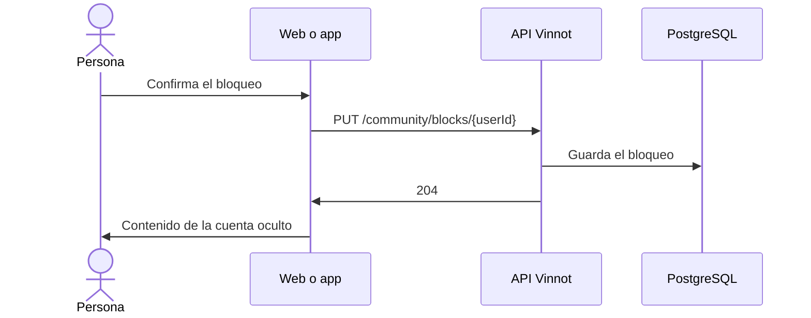

# UC-COM-02 · Bloquear una cuenta

| Campo | Valor |
|---|---|
| ID | `UC-COM-02` |
| Módulo | [Comunidad](../README.md) |
| Plataformas | Web, APK |
| Actores | Usuario autenticado |
| IDs en Lucidchart | [WEB UC-COM-02](https://lucid.app/lucidchart/9f11a16b-bb5a-42fc-a9e8-0852b17bd241/edit), [APK UC-COM-02](https://lucid.app/lucidchart/e095dd25-e8ac-41ba-bf5b-396e1055f217/edit) |
| Requisitos | [`RF-WEB-COM-03`](../requirements.md), [`RF-APK-COM-03`](../requirements.md) |
| Casos de prueba | [`CP-COM-09`](../testing.md), [`CP-COM-10`](../testing.md), [`CP-COM-11`](../testing.md), [`CP-COM-12`](../testing.md), [`CP-COM-13`](../testing.md), [`CP-COM-14`](../testing.md) |

## Precondiciones

- La persona tiene sesión iniciada y ve una reseña o un comentario de otra persona.

## Postcondiciones

- La otra cuenta queda bloqueada para la persona.

## Flujo principal

1. La persona elige «Bloquear» en la reseña o el comentario.
2. El cliente explica el efecto y pide confirmación.
3. El cliente envía `PUT /community/blocks/{userId}`.
4. La API guarda el bloqueo y responde 204.
5. El cliente descarta las reseñas, comentarios y perfiles guardados y los vuelve a cargar sin el contenido de esa cuenta.

## Flujos alternativos

- 2a. La persona cancela: no se bloquea nada.
- 4a. La cuenta ya estaba bloqueada: la API responde 204 igual.
- 4b. Es la propia cuenta: la API responde 422 `SELF_BLOCK` y el cliente avisa que no se puede bloquear la propia cuenta.
- 4c. La cuenta no existe: la API responde 404 y el cliente avisa que el contenido ya no está disponible.
- 4d. Falla el bloqueo: se conserva la vista anterior.

## Reglas de negocio

- El bloqueo vale en ambos sentidos: oculta reseñas, comentarios y perfil, e impide likes y comentarios nuevos entre las dos cuentas.
- Las cuentas bloqueadas no reciben avisos de comentarios ni cuentan en los resúmenes de likes, ni en los avisos de eventos nuevos.
- Eventos y rutas siguen visibles, y los promedios de los vinos no cambian.
- Es un bloqueo personal; no equivale a una suspensión de la cuenta por el equipo.
- Se desbloquea desde la actividad de comunidad ([UC-COM-03](uc-com-03-my-community.md)).

## Diagrama

[Ver diagrama de «UC-COM-02 · Bloquear una cuenta» completo](https://images.vinnot.com/docs/diagrams/v1/es/modules-community-use-cases-uc-com-02-block-user-6dd64bf38e34.svg)

Diagrama de componentes en Lucidchart: [WEB UC-COM-02](https://lucid.app/lucidchart/9f11a16b-bb5a-42fc-a9e8-0852b17bd241/edit), [APK UC-COM-02](https://lucid.app/lucidchart/e095dd25-e8ac-41ba-bf5b-396e1055f217/edit).

## Código

| Capa | Ubicación |
|---|---|
| Endpoints | `PUT /community/blocks/{userId}`, `DELETE /community/blocks/{userId}` |
| Backend | [`CommunityController.java`](../../../../../backend/src/main/java/com/vinnot/community/infrastructure/web/CommunityController.java), [`ChangeUserBlockCommandHandler.java`](../../../../../backend/src/main/java/com/vinnot/community/application/command/handler/ChangeUserBlockCommandHandler.java) |
| Web | [`CommunityActions.tsx`](../../../../../frontend-react/src/presentation/components/features/community/CommunityActions.tsx), [`useCommunity.ts`](../../../../../frontend-react/src/presentation/hooks/queries/community/useCommunity.ts), [`community.service.ts`](../../../../../frontend-react/src/application/services/community.service.ts), [`community.client.ts`](../../../../../frontend-react/src/infrastructure/api/clients/community.client.ts) |
| App | [`CommunityActions.tsx`](../../../../../frontend-mobile/src/presentation/features/community/CommunityActions.tsx), [`useCommunity.ts`](../../../../../frontend-mobile/src/presentation/hooks/queries/community/useCommunity.ts), [`api.ts`](../../../../../frontend-mobile/src/presentation/store/api.ts), [`community.service.ts`](../../../../../frontend-mobile/src/application/services/community.service.ts), [`community.client.ts`](../../../../../frontend-mobile/src/infrastructure/api/clients/community.client.ts) |

## Tests automáticos

- Backend: [`CommunityCommandHandlersTest.java`](../../../../../backend/src/test/java/com/vinnot/community/application/command/handler/CommunityCommandHandlersTest.java), [`CommunityHttpPostgresIntegrationTest.java`](../../../../../backend/src/test/java/com/vinnot/community/infrastructure/CommunityHttpPostgresIntegrationTest.java)
- Web: [`useCommunity.test.tsx`](../../../../../frontend-react/src/presentation/hooks/queries/community/useCommunity.test.tsx), [`CommunityActions.test.tsx`](../../../../../frontend-react/src/presentation/components/features/community/CommunityActions.test.tsx)
- App: [`CommunityActions.test.tsx`](../../../../../frontend-mobile/src/presentation/features/community/CommunityActions.test.tsx)
