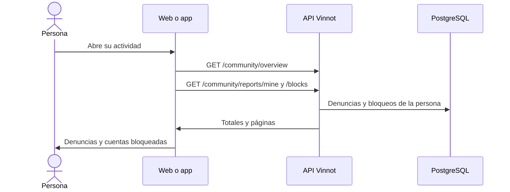

# UC-COM-03 · Ver mi actividad de comunidad

| Campo | Valor |
|---|---|
| ID | `UC-COM-03` |
| Módulo | [Comunidad](../README.md) |
| Plataformas | Web, APK |
| Actores | Usuario autenticado |
| IDs en Lucidchart | [WEB UC-COM-03](https://lucid.app/lucidchart/9f11a16b-bb5a-42fc-a9e8-0852b17bd241/edit), [APK UC-COM-03](https://lucid.app/lucidchart/e095dd25-e8ac-41ba-bf5b-396e1055f217/edit) |
| Requisitos | [`RF-WEB-COM-04`](../requirements.md), [`RF-APK-COM-04`](../requirements.md) |
| Casos de prueba | [`CP-COM-15`](../testing.md), [`CP-COM-16`](../testing.md), [`CP-COM-17`](../testing.md), [`CP-COM-18`](../testing.md) |

## Precondiciones

- La persona tiene sesión iniciada.

## Postcondiciones

- La persona ve sus denuncias y bloqueos, y puede desbloquear cuentas.

## Flujo principal

1. La persona abre su actividad de comunidad: en la web la página `/community`, desde el perfil; en la app desde el perfil.
2. El cliente pide `GET /community/overview` con los totales de denuncias por estado y la cantidad de cuentas bloqueadas.
3. Pide `GET /community/reports/mine` y `GET /community/blocks`, cada una paginada por separado.
4. Muestra cada denuncia con su objetivo, estado y fecha, y cada cuenta bloqueada con su nombre y fecha.

## Flujos alternativos

- 4a. La persona desbloquea una cuenta: el cliente envía `DELETE /community/blocks/{userId}`, la API responde 204 y la lista se actualiza.
- 4b. No hay denuncias ni bloqueos: se muestra el estado vacío con un acceso a Contacto.
- 2a. Falla la consulta: se muestra el error, no un cero.

## Reglas de negocio

- Cada persona ve solo sus denuncias y sus bloqueos.
- Páginas de 20 por defecto y de hasta 50.
- Las denuncias cerradas desaparecen 90 días después de cerrarse ([UC-COM-04](uc-com-04-report-outcome-and-retention.md)).
- Una apelación se envía por Contacto con la referencia del caso ([Soporte](../../support/README.md)).

## Diagrama

[Ver diagrama de «UC-COM-03 · Ver mi actividad de comunidad» completo](https://images.vinnot.com/docs/diagrams/v1/es/modules-community-use-cases-uc-com-03-my-community-8d432386e713.svg)

Diagrama de componentes en Lucidchart: [WEB UC-COM-03](https://lucid.app/lucidchart/9f11a16b-bb5a-42fc-a9e8-0852b17bd241/edit), [APK UC-COM-03](https://lucid.app/lucidchart/e095dd25-e8ac-41ba-bf5b-396e1055f217/edit).

## Código

| Capa | Ubicación |
|---|---|
| Endpoints | `GET /community/overview`, `GET /community/reports/mine`, `GET /community/blocks`, `DELETE /community/blocks/{userId}` |
| Backend | [`CommunityController.java`](../../../../../backend/src/main/java/com/vinnot/community/infrastructure/web/CommunityController.java), [`GetCommunityQueryHandler.java`](../../../../../backend/src/main/java/com/vinnot/community/application/query/handler/GetCommunityQueryHandler.java) |
| Web | [`CommunityPage.tsx`](../../../../../frontend-react/src/presentation/pages/community/CommunityPage.tsx), [`CommunityOverview.tsx`](../../../../../frontend-react/src/presentation/components/features/community/CommunityOverview.tsx), [`useCommunity.ts`](../../../../../frontend-react/src/presentation/hooks/queries/community/useCommunity.ts), [`community.service.ts`](../../../../../frontend-react/src/application/services/community.service.ts), [`community.client.ts`](../../../../../frontend-react/src/infrastructure/api/clients/community.client.ts) |
| App | [`CommunityScreens.tsx`](../../../../../frontend-mobile/src/presentation/features/community/CommunityScreens.tsx), [`useCommunity.ts`](../../../../../frontend-mobile/src/presentation/hooks/queries/community/useCommunity.ts), [`community.service.ts`](../../../../../frontend-mobile/src/application/services/community.service.ts), [`community.client.ts`](../../../../../frontend-mobile/src/infrastructure/api/clients/community.client.ts) |

## Tests automáticos

- Backend: [`CommunityQueryHandlersTest.java`](../../../../../backend/src/test/java/com/vinnot/community/application/query/handler/CommunityQueryHandlersTest.java), [`CommunityHttpPostgresIntegrationTest.java`](../../../../../backend/src/test/java/com/vinnot/community/infrastructure/CommunityHttpPostgresIntegrationTest.java)
- Web: [`CommunityPage.test.tsx`](../../../../../frontend-react/src/presentation/pages/community/CommunityPage.test.tsx), [`CommunityOverview.test.tsx`](../../../../../frontend-react/src/presentation/components/features/community/CommunityOverview.test.tsx)
- App: [`CommunityOverview.test.tsx`](../../../../../frontend-mobile/src/presentation/features/community/CommunityOverview.test.tsx)
