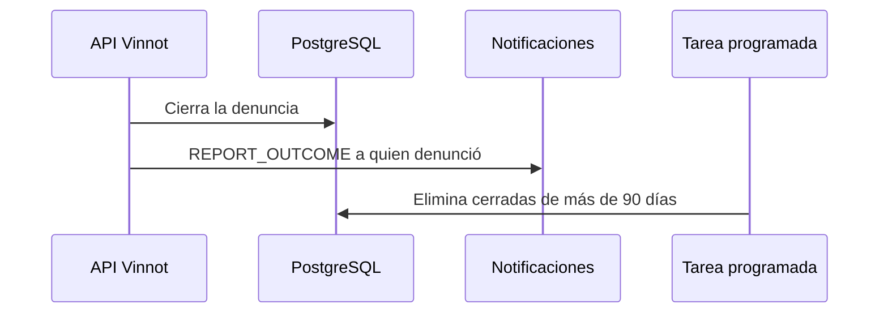

# UC-COM-04 · Avisar el resultado y depurar denuncias cerradas

| Campo | Valor |
|---|---|
| ID | `UC-COM-04` |
| Módulo | [Comunidad](../README.md) |
| Plataformas | Solo backend |
| Actores | Moderador o administrador, Sistema (tarea programada), Servicio de email |
| IDs en Lucidchart | Ninguno |
| Requisitos | Ninguno |
| Casos de prueba | [`CP-COM-19`](../testing.md), [`CP-COM-20`](../testing.md), [`CP-COM-21`](../testing.md), [`CP-COM-76`](../testing.md) |

## Precondiciones

- Hay denuncias que el equipo cerró o contenido que retiró.

## Postcondiciones

- Quien denunció conoce el resultado y las denuncias cerradas viejas se eliminan.

## Flujo principal

1. Un moderador resuelve o descarta una denuncia, o retira el contenido denunciado ([Administración](../../admin/README.md)).
2. La API encola un email `REPORT_OUTCOME` para quien denunció, con el resultado.
3. Si el contenido se retiró, su autor recibe un email `CONTENT_REMOVED`.
4. Cada hora la tarea programada elimina hasta 500 denuncias cerradas hace más de 90 días, con su historial de acciones.

## Flujos alternativos

- 2a. El mismo resultado ya se avisó: la clave del aviso evita un segundo email.
- 2b. La denuncia es de calidad de catálogo y la abrió Vinnot: no tiene denunciante, así que no se envía email de resultado.
- 4a. Hay más de 500 vencidas: el resto se elimina en las ejecuciones siguientes.

## Reglas de negocio

- Crear una denuncia no envía emails.
- Las denuncias `OPEN` e `IN_REVIEW` nunca se eliminan por antigüedad.
- La depuración afecta la base activa, no los backups.
- El email del resultado no revela notas internas ni la identidad del revisor.

## Diagrama

[Ver diagrama de «UC-COM-04 · Avisar el resultado y depurar denuncias cerradas» completo](https://images.vinnot.com/docs/diagrams/v1/es/modules-community-use-cases-uc-com-04-report-outcome-and-retention-d2098121a435.svg)

## Código

| Capa | Ubicación |
|---|---|
| Backend | [`EmailReportOutcomeNotifier.java`](../../../../../backend/src/main/java/com/vinnot/community/infrastructure/notification/EmailReportOutcomeNotifier.java), [`PurgeClosedReportsCommandHandler.java`](../../../../../backend/src/main/java/com/vinnot/community/application/command/handler/PurgeClosedReportsCommandHandler.java), [`CommunityRetentionScheduler.java`](../../../../../backend/src/main/java/com/vinnot/community/infrastructure/CommunityRetentionScheduler.java) |

## Tests automáticos

- Backend: [`EmailReportOutcomeNotifierTest.java`](../../../../../backend/src/test/java/com/vinnot/community/infrastructure/notification/EmailReportOutcomeNotifierTest.java), [`PurgeClosedReportsCommandHandlerTest.java`](../../../../../backend/src/test/java/com/vinnot/community/application/command/handler/PurgeClosedReportsCommandHandlerTest.java), [`CommunityEmailTemplatesTest.java`](../../../../../backend/src/test/java/com/vinnot/notification/infrastructure/template/CommunityEmailTemplatesTest.java), [`ModerationOutcomeTemplatesTest.java`](../../../../../backend/src/test/java/com/vinnot/notification/infrastructure/template/ModerationOutcomeTemplatesTest.java)
- Web: Ninguno
- App: Ninguno
