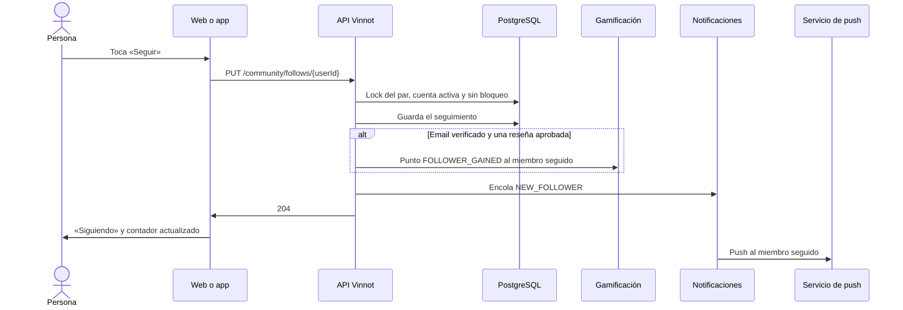

# UC-COM-05 · Seguir o dejar de seguir a un miembro

| Campo | Valor |
|---|---|
| ID | `UC-COM-05` |
| Módulo | [Comunidad](../README.md) |
| Plataformas | Web, App |
| Actores | Usuario autenticado, Servicio de push |
| IDs en Lucidchart | Ninguno |
| Requisitos | [`RF-WEB-COM-05`](../requirements.md), [`RF-WEB-COM-06`](../requirements.md), [`RF-APK-COM-05`](../requirements.md), [`RF-APK-COM-06`](../requirements.md), [`RF-APK-COM-22`](../requirements.md) |
| Casos de prueba | [`CP-COM-22`](../testing.md), [`CP-COM-23`](../testing.md), [`CP-COM-24`](../testing.md), [`CP-COM-25`](../testing.md), [`CP-COM-26`](../testing.md), [`CP-COM-27`](../testing.md), [`CP-COM-28`](../testing.md) |

## Precondiciones

- La persona tiene sesión iniciada.
- Ve a otro miembro en su perfil público, en una lista de seguidores o seguidos o en «Personas para seguir».

## Postcondiciones

- La persona sigue al otro miembro, o deja de seguirlo, sin que este tenga que aprobarlo.
- Los contadores de seguidores y seguidos reflejan el cambio.

## Flujo principal

1. La persona toca «Seguir».
2. El cliente envía `PUT /community/follows/{userId}`.
3. La API toma un lock sobre el par, comprueba que la cuenta exista, esté activa y no tenga un bloqueo en ningún sentido con quien sigue, y guarda el seguimiento.
4. Si quien sigue tiene el email verificado y al menos una reseña aprobada, la API otorga al miembro seguido un punto `FOLLOWER_GAINED`.
5. La API encola el push `NEW_FOLLOWER` para el miembro seguido y responde 204.
6. El botón pasa a «Siguiendo» y el contador de seguidores se actualiza.

## Flujos alternativos

- 1a. La persona toca «Siguiendo»: el cliente envía `DELETE /community/follows/{userId}`, la API borra el seguimiento, quita el punto que había otorgado y responde 204; el botón vuelve a «Seguir».
- 3a. La persona ya seguía a esa cuenta: la API responde 204 sin crear otro seguimiento, sin otro punto y sin otro push.
- 3b. Es la propia cuenta: la API responde 400 `SELF_FOLLOW`. Los clientes no muestran el botón en el perfil propio ni en la fila propia de una lista.
- 3c. La cuenta no existe, está inactiva o hay un bloqueo en cualquier sentido: la API responde 404.
- 6a. Falla el pedido: el botón vuelve a su estado anterior y el cliente avisa que no pudo actualizar el seguimiento.
- 5a. En la app, el miembro seguido toca el push: la app abre el perfil público de quien empezó a seguirlo (`/users/{followerId}`).

## Reglas de negocio

- Seguir es asimétrico y no requiere aprobación; las dos operaciones son idempotentes.
- El punto por seguidor tiene como clave el ID de quien sigue, un límite propio de 10 por día y cuenta para el tope global de 40 puntos diarios ([Gamificación](../../gamification/README.md)).
- El push se envía una vez por seguidor, miembro seguido y día UTC; el aviso es solo un push.
- Un bloqueo borra los seguimientos en ambas direcciones y quita sus puntos en la misma transacción ([UC-COM-02](uc-com-02-block-user.md)).
- Borrar una cuenta borra sus seguimientos en ambas direcciones.

## Diagrama

[Ver diagrama de «UC-COM-05 · Seguir o dejar de seguir a un miembro» completo](https://images.vinnot.com/docs/diagrams/v1/es/modules-community-use-cases-uc-com-05-follow-member-becfab120321.svg)

## Código

| Capa | Ubicación |
|---|---|
| Endpoints | `PUT /community/follows/{userId}`, `DELETE /community/follows/{userId}` |
| Backend | [`CommunityController.java`](../../../../../backend/src/main/java/com/vinnot/community/infrastructure/web/CommunityController.java), [`ChangeFollowCommandHandler.java`](../../../../../backend/src/main/java/com/vinnot/community/application/command/handler/ChangeFollowCommandHandler.java) |
| Web | [`FollowButton.tsx`](../../../../../frontend-react/src/presentation/components/features/social/FollowButton.tsx), [`useFollowUser.ts`](../../../../../frontend-react/src/presentation/hooks/queries/social/useFollowUser.ts), [`social.service.ts`](../../../../../frontend-react/src/application/services/social.service.ts), [`social.client.ts`](../../../../../frontend-react/src/infrastructure/api/clients/social.client.ts) |
| App | [`FollowButton.tsx`](../../../../../frontend-mobile/src/presentation/features/social/FollowButton.tsx), [`useFollowToggle.ts`](../../../../../frontend-mobile/src/presentation/features/social/useFollowToggle.ts), [`social.service.ts`](../../../../../frontend-mobile/src/application/services/social.service.ts), [`social.client.ts`](../../../../../frontend-mobile/src/infrastructure/api/clients/social.client.ts), [`pushRoute.ts`](../../../../../frontend-mobile/src/domain/notification/pushRoute.ts) |

## Tests automáticos

- Backend: [`ChangeFollowCommandHandlerTest.java`](../../../../../backend/src/test/java/com/vinnot/community/application/command/handler/ChangeFollowCommandHandlerTest.java), [`SocialAdaptersTest.java`](../../../../../backend/src/test/java/com/vinnot/community/infrastructure/notification/SocialAdaptersTest.java), [`SocialHttpPostgresIntegrationTest.java`](../../../../../backend/src/test/java/com/vinnot/community/infrastructure/SocialHttpPostgresIntegrationTest.java)
- Web: [`useFollowUser.test.tsx`](../../../../../frontend-react/src/presentation/hooks/queries/social/useFollowUser.test.tsx), [`social.service.test.ts`](../../../../../frontend-react/src/application/services/social.service.test.ts), [`social.client.test.ts`](../../../../../frontend-react/src/infrastructure/api/clients/social.client.test.ts)
- App: [`useFollowToggle.test.tsx`](../../../../../frontend-mobile/src/presentation/features/social/useFollowToggle.test.tsx), [`socialOperations.test.ts`](../../../../../frontend-mobile/src/application/operations/socialOperations.test.ts), [`social.client.test.ts`](../../../../../frontend-mobile/src/infrastructure/api/clients/social.client.test.ts), [`pushRoute.test.ts`](../../../../../frontend-mobile/src/domain/notification/pushRoute.test.ts)
