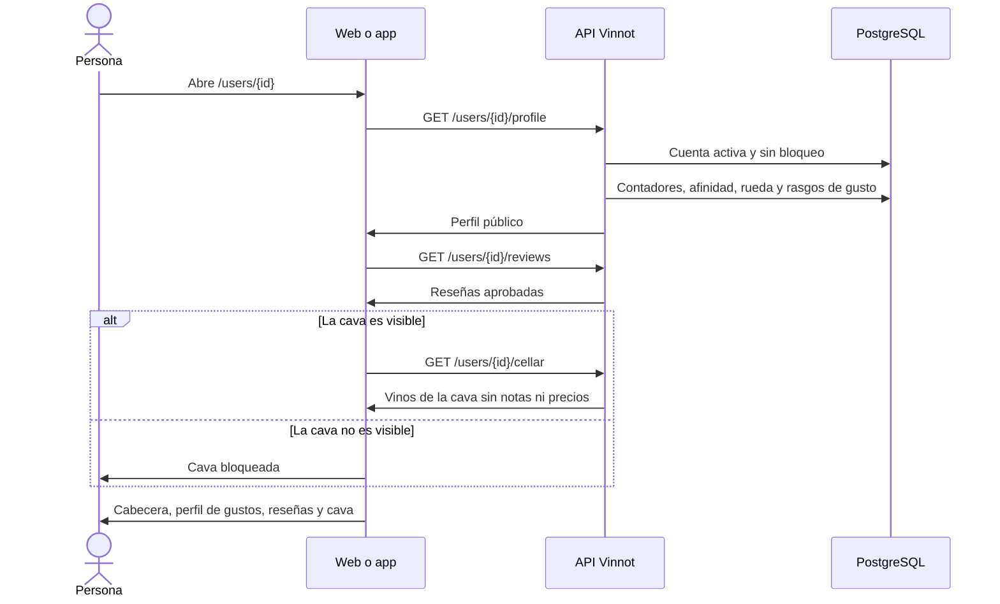

# UC-COM-06 · Ver el perfil público de un miembro

| Campo | Valor |
|---|---|
| ID | `UC-COM-06` |
| Módulo | [Comunidad](../README.md) |
| Plataformas | Web, App |
| Actores | Usuario autenticado |
| IDs en Lucidchart | Ninguno |
| Requisitos | [`RF-WEB-COM-07`](../requirements.md), [`RF-WEB-COM-08`](../requirements.md), [`RF-WEB-COM-09`](../requirements.md), [`RF-APK-COM-07`](../requirements.md), [`RF-APK-COM-08`](../requirements.md), [`RF-APK-COM-09`](../requirements.md) |
| Casos de prueba | [`CP-COM-29`](../testing.md), [`CP-COM-30`](../testing.md), [`CP-COM-31`](../testing.md), [`CP-COM-32`](../testing.md), [`CP-COM-33`](../testing.md), [`CP-COM-34`](../testing.md) |

## Precondiciones

- La persona tiene sesión iniciada.

## Postcondiciones

- La persona ve el perfil público del miembro, con sus reseñas y, si es visible para ella, su cava.

## Flujo principal

1. La persona abre `/users/{id}`: desde el nombre o la foto de quien escribió una reseña, una fila de seguidores o seguidos, una sugerencia o una reseña del muro.
2. El cliente pide `GET /users/{id}/profile`.
3. La API comprueba que la cuenta exista, esté activa y no tenga un bloqueo en ningún sentido con quien consulta, y devuelve los datos públicos: foto, nombre, @usuario, biografía, sello, contadores, si quien consulta lo sigue, si lo sigue a quien consulta, la afinidad, la rueda y los rasgos de gusto.
4. El cliente pide `GET /users/{id}/reviews`, paginado.
5. El cliente muestra la cabecera con foto, nombre, @usuario, sello, biografía, los contadores «Seguidores», «Siguiendo», «Reseñas» y «Vinos en cava», «Te sigue» y la afinidad en %; el botón «Seguir» o «Siguiendo» ([UC-COM-05](uc-com-05-follow-member.md)); el perfil de gustos ([UC-COM-10](uc-com-10-view-taste-profile.md)) y la sección de reseñas.
6. Si la cava es visible, el cliente pide `GET /users/{id}/cellar` y muestra cada vino con su bodega, añada, valoración y fecha en que se agregó. En la app se pide al elegir la pestaña de la cava.

## Flujos alternativos

- 3a. La cuenta no existe, está inactiva o hay un bloqueo: la API responde 404. La web muestra «Este perfil no está disponible»; la app muestra el error con la opción de reintentar.
- 5a. Es el propio perfil: en lugar de «Seguir» aparece «Editar perfil» ([UC-COM-09](uc-com-09-edit-public-profile.md)), sin «Te sigue» ni afinidad; el perfil de gustos ofrece el test ([UC-COM-12](uc-com-12-take-taste-quiz.md)) y «Ajustar» ([UC-COM-13](uc-com-13-adjust-palate.md)).
- 6a. La cava no es visible para quien mira: el perfil informa `cellarVisible: false` y `cellarCount: null`, el contador de la cava muestra «—» y la sección muestra un estado bloqueado sin pedir la lista. Si la API responde 403 `CELLAR_NOT_VISIBLE` a la lista, el cliente muestra el mismo estado.
- 4a. El miembro no tiene reseñas o la cava está vacía: cada sección muestra su estado vacío.
- 4b. En la web, falla la carga de reseñas o de la cava: la sección muestra «No pudimos cargar esta sección» sin ocultar el resto del perfil.

## Reglas de negocio

- La afinidad es la similitud coseno de ambos vectores de gusto, de 0 a 100; no se muestra en el perfil propio ni cuando alguno valoró menos de cinco vinos.
- Las reseñas son las aprobadas de vinos activos, de la más reciente a la más antigua.
- La cava `PUBLIC` la ve cualquier miembro, `FOLLOWERS` solo quienes siguen al dueño y `PRIVATE` nadie; el dueño siempre la ve. La lista nunca incluye notas privadas ni precios de compra.
- En la app, el menú de tres puntos del perfil permite denunciar o bloquear la cuenta ([UC-COM-01](uc-com-01-report-content.md), [UC-COM-02](uc-com-02-block-user.md)), y el perfil propio se abre desde «Accesos rápidos» › «Mi perfil público».
- Las páginas admiten hasta 50 elementos; un tamaño mayor responde 422 `INVALID_PAGINATION`.

## Diagrama

[Ver diagrama de «UC-COM-06 · Ver el perfil público de un miembro» completo](https://images.vinnot.com/docs/diagrams/v1/es/modules-community-use-cases-uc-com-06-view-public-profile-4a98d8dea895.svg)

## Código

| Capa | Ubicación |
|---|---|
| Endpoints | `GET /users/{id}/profile`, `GET /users/{id}/reviews`, `GET /users/{id}/cellar` |
| Backend | [`GetPublicUserProfileQueryHandler.java`](../../../../../backend/src/main/java/com/vinnot/user/application/query/handler/GetPublicUserProfileQueryHandler.java), [`MemberActivityController.java`](../../../../../backend/src/main/java/com/vinnot/community/infrastructure/web/MemberActivityController.java), [`GetSocialQueryHandler.java`](../../../../../backend/src/main/java/com/vinnot/community/application/query/handler/GetSocialQueryHandler.java), [`CellarVisibility.java`](../../../../../backend/src/main/java/com/vinnot/community/domain/model/CellarVisibility.java) |
| Web | [`PublicProfilePage.tsx`](../../../../../frontend-react/src/presentation/pages/social/PublicProfilePage.tsx), [`usePublicProfileViewModel.ts`](../../../../../frontend-react/src/presentation/pages/social/usePublicProfileViewModel.ts), [`useSocialQueries.ts`](../../../../../frontend-react/src/presentation/hooks/queries/social/useSocialQueries.ts), [`ReviewCard.tsx`](../../../../../frontend-react/src/presentation/components/features/wine/ReviewCard.tsx) |
| App | [`PublicProfileScreen.tsx`](../../../../../frontend-mobile/src/presentation/features/social/PublicProfileScreen.tsx), [`PublicProfileHeader.tsx`](../../../../../frontend-mobile/src/presentation/features/social/PublicProfileHeader.tsx), [`usePublicProfileViewModel.ts`](../../../../../frontend-mobile/src/presentation/features/social/usePublicProfileViewModel.ts), [`ProfileCellarList.tsx`](../../../../../frontend-mobile/src/presentation/features/social/ProfileCellarList.tsx), [`ReviewItem.tsx`](../../../../../frontend-mobile/src/presentation/features/wine/ReviewItem.tsx) |

## Tests automáticos

- Backend: [`GetPublicUserProfileQueryHandlerTest.java`](../../../../../backend/src/test/java/com/vinnot/user/application/query/handler/GetPublicUserProfileQueryHandlerTest.java), [`SocialRulesTest.java`](../../../../../backend/src/test/java/com/vinnot/community/domain/model/SocialRulesTest.java), [`SocialHttpPostgresIntegrationTest.java`](../../../../../backend/src/test/java/com/vinnot/community/infrastructure/SocialHttpPostgresIntegrationTest.java)
- Web: [`PublicProfilePage.test.tsx`](../../../../../frontend-react/src/presentation/pages/social/PublicProfilePage.test.tsx), [`social.mappers.test.ts`](../../../../../frontend-react/src/domain/social/social.mappers.test.ts)
- App: [`PublicProfileScreen.test.tsx`](../../../../../frontend-mobile/src/presentation/features/social/PublicProfileScreen.test.tsx), [`social.mappers.test.ts`](../../../../../frontend-mobile/src/domain/social/social.mappers.test.ts), [`socialRules.test.ts`](../../../../../frontend-mobile/src/domain/social/socialRules.test.ts)
