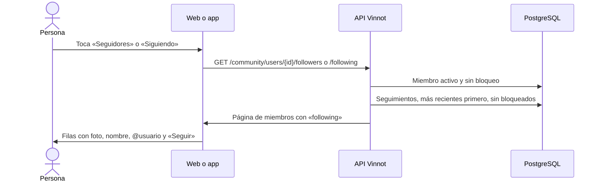

# UC-COM-07 · Ver seguidores y seguidos

| Campo | Valor |
|---|---|
| ID | `UC-COM-07` |
| Módulo | [Comunidad](../README.md) |
| Plataformas | Web, App |
| Actores | Usuario autenticado |
| IDs en Lucidchart | Ninguno |
| Requisitos | [`RF-WEB-COM-10`](../requirements.md), [`RF-APK-COM-10`](../requirements.md) |
| Casos de prueba | [`CP-COM-35`](../testing.md), [`CP-COM-36`](../testing.md), [`CP-COM-37`](../testing.md), [`CP-COM-38`](../testing.md) |

## Precondiciones

- La persona tiene sesión iniciada y está en un perfil público ([UC-COM-06](uc-com-06-view-public-profile.md)).

## Postcondiciones

- La persona ve quiénes siguen al miembro o a quiénes sigue, y puede seguirlos o abrir sus perfiles.

## Flujo principal

1. La persona toca el contador «Seguidores» o «Siguiendo» del perfil.
2. El cliente abre `/users/{id}/followers` o `/users/{id}/following` y pide `GET /community/users/{id}/followers` o `/following`, paginado.
3. La API devuelve los miembros activos del seguimiento más reciente al más antiguo, sin las cuentas que tienen un bloqueo en cualquier sentido con quien consulta, cada uno con un indicador de si quien consulta ya lo sigue.
4. El cliente muestra cada fila con foto, nombre, sello, @usuario y el botón «Seguir» o «Siguiendo» ([UC-COM-05](uc-com-05-follow-member.md)); tocar la fila abre su perfil público.

## Flujos alternativos

- 4a. La fila es la propia persona: la fila no muestra el botón.
- 4b. La lista está vacía: el cliente muestra «Todavía no tiene seguidores» o «Todavía no sigue a nadie».
- 3a. El perfil no existe, está inactivo o hay un bloqueo: la API responde 404 y el cliente muestra el error.

## Reglas de negocio

- Páginas de 20 por defecto y de hasta 50; un tamaño mayor responde 422 `INVALID_PAGINATION`.
- La web pagina la lista; la app carga la página siguiente al llegar al final.
- Los contadores del perfil cuentan todos los seguimientos de miembros activos; la lista además omite las cuentas bloqueadas.

## Diagrama

[Ver diagrama de «UC-COM-07 · Ver seguidores y seguidos» completo](https://images.vinnot.com/docs/diagrams/v1/es/modules-community-use-cases-uc-com-07-view-follow-lists-0e91eca8f148.svg)

## Código

| Capa | Ubicación |
|---|---|
| Endpoints | `GET /community/users/{userId}/followers`, `GET /community/users/{userId}/following` |
| Backend | [`CommunityController.java`](../../../../../backend/src/main/java/com/vinnot/community/infrastructure/web/CommunityController.java), [`GetSocialQueryHandler.java`](../../../../../backend/src/main/java/com/vinnot/community/application/query/handler/GetSocialQueryHandler.java) |
| Web | [`FollowListPage.tsx`](../../../../../frontend-react/src/presentation/pages/social/FollowListPage.tsx), [`useFollowListViewModel.ts`](../../../../../frontend-react/src/presentation/pages/social/useFollowListViewModel.ts), [`SocialUserRow.tsx`](../../../../../frontend-react/src/presentation/components/features/social/SocialUserRow.tsx) |
| App | [`FollowListScreen.tsx`](../../../../../frontend-mobile/src/presentation/features/social/FollowListScreen.tsx), [`social.service.ts`](../../../../../frontend-mobile/src/application/services/social.service.ts) |

## Tests automáticos

- Backend: [`SocialHttpPostgresIntegrationTest.java`](../../../../../backend/src/test/java/com/vinnot/community/infrastructure/SocialHttpPostgresIntegrationTest.java)
- Web: [`FollowListPage.test.tsx`](../../../../../frontend-react/src/presentation/pages/social/FollowListPage.test.tsx)
- App: [`FollowListScreen.test.tsx`](../../../../../frontend-mobile/src/presentation/features/social/FollowListScreen.test.tsx)
