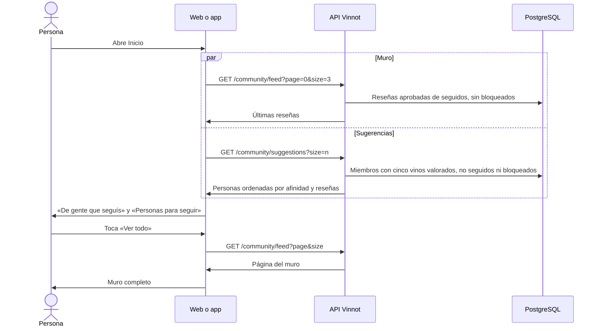

# UC-COM-08 · Ver las reseñas de quienes sigo y personas para seguir

| Campo | Valor |
|---|---|
| ID | `UC-COM-08` |
| Módulo | [Comunidad](../README.md) |
| Plataformas | Web, App |
| Actores | Usuario autenticado |
| IDs en Lucidchart | Ninguno |
| Requisitos | [`RF-WEB-COM-11`](../requirements.md), [`RF-WEB-COM-12`](../requirements.md), [`RF-APK-COM-11`](../requirements.md), [`RF-APK-COM-12`](../requirements.md) |
| Casos de prueba | [`CP-COM-39`](../testing.md), [`CP-COM-40`](../testing.md), [`CP-COM-41`](../testing.md), [`CP-COM-42`](../testing.md), [`CP-COM-43`](../testing.md) |

## Precondiciones

- La persona tiene sesión iniciada.

## Postcondiciones

- La persona ve las últimas reseñas de los miembros que sigue y personas que podría seguir.

## Flujo principal

1. La persona abre Inicio. Al final están las secciones «De gente que seguís» y «Personas para seguir».
2. El cliente pide `GET /community/feed` con las tres reseñas más recientes y `GET /community/suggestions`: seis en la web, diez en la app.
3. La API devuelve las reseñas aprobadas de vinos activos escritas por los miembros que la persona sigue, de la más reciente a la más antigua y sin cuentas con bloqueo; y como sugerencias, miembros activos con al menos cinco vinos valorados que la persona no sigue, sin bloqueo en ningún sentido y distintos de ella, ordenados por afinidad y luego por reseñas aprobadas.
4. El cliente muestra cada reseña con su autor, el vino, la valoración y la fecha, y cada sugerencia con foto, nombre, afinidad, cantidad de reseñas y el botón «Seguir» ([UC-COM-05](uc-com-05-follow-member.md)).
5. La persona toca «Ver todo» y el cliente abre el muro completo (`/feed`), con todas las reseñas de quienes sigue.

## Flujos alternativos

- 3a. La persona no sigue a nadie o sus seguidos no publicaron reseñas: la sección muestra un estado vacío que invita a seguir a otras personas.
- 3b. No hay sugerencias: la web muestra un aviso en la sección; la app no muestra la sección.
- 2a. Falla una de las consultas: el resto de Inicio sigue disponible. La web muestra «No pudimos cargar esta sección» en la sección que falló; la app muestra el error del muro con la opción de reintentar y oculta las sugerencias.
- 5a. La persona toca el autor de una reseña, una sugerencia o un vino: se abre el perfil público de esa persona ([UC-COM-06](uc-com-06-view-public-profile.md)) o la ficha del vino.

## Reglas de negocio

- Las secciones aparecen solo con sesión iniciada y cierran Inicio ([UC-USR-22](../../users/use-cases/uc-usr-22-home.md)).
- El muro completo pagina de a 10 reseñas en la web; la app carga la página siguiente al llegar al final.
- La afinidad ordena las sugerencias solo cuando quien consulta valoró al menos cinco vinos; si no, se ordenan por reseñas aprobadas.
- Las sugerencias admiten de 1 a 20 resultados, 10 por defecto; fuera de ese rango responde 422 `INVALID_PAGINATION`.

## Diagrama

[Ver diagrama de «UC-COM-08 · Ver las reseñas de quienes sigo y personas para seguir» completo](https://images.vinnot.com/docs/diagrams/v1/es/modules-community-use-cases-uc-com-08-following-feed-and-suggestions-255f33251836.svg)

## Código

| Capa | Ubicación |
|---|---|
| Endpoints | `GET /community/feed`, `GET /community/suggestions` |
| Backend | [`CommunityController.java`](../../../../../backend/src/main/java/com/vinnot/community/infrastructure/web/CommunityController.java), [`GetSocialQueryHandler.java`](../../../../../backend/src/main/java/com/vinnot/community/application/query/handler/GetSocialQueryHandler.java) |
| Web | [`HomeSocialSections.tsx`](../../../../../frontend-react/src/presentation/pages/public/HomeSocialSections.tsx), [`useHomeSocialViewModel.ts`](../../../../../frontend-react/src/presentation/pages/public/useHomeSocialViewModel.ts), [`FollowingFeedPage.tsx`](../../../../../frontend-react/src/presentation/pages/social/FollowingFeedPage.tsx), [`useFollowingFeedViewModel.ts`](../../../../../frontend-react/src/presentation/pages/social/useFollowingFeedViewModel.ts), [`SocialReviewCard.tsx`](../../../../../frontend-react/src/presentation/components/features/social/SocialReviewCard.tsx), [`SocialPersonCard.tsx`](../../../../../frontend-react/src/presentation/components/features/social/SocialPersonCard.tsx) |
| App | [`HomeSocialSections.tsx`](../../../../../frontend-mobile/src/presentation/features/social/HomeSocialSections.tsx), [`useHomeSocial.ts`](../../../../../frontend-mobile/src/presentation/features/social/useHomeSocial.ts), [`FeedScreen.tsx`](../../../../../frontend-mobile/src/presentation/features/social/FeedScreen.tsx), [`SocialReviewCard.tsx`](../../../../../frontend-mobile/src/presentation/features/social/SocialReviewCard.tsx) |

## Tests automáticos

- Backend: [`SocialHttpPostgresIntegrationTest.java`](../../../../../backend/src/test/java/com/vinnot/community/infrastructure/SocialHttpPostgresIntegrationTest.java)
- Web: [`HomeSocialSections.test.tsx`](../../../../../frontend-react/src/presentation/pages/public/HomeSocialSections.test.tsx), [`FollowingFeedPage.test.tsx`](../../../../../frontend-react/src/presentation/pages/social/FollowingFeedPage.test.tsx), [`SocialReviewCard.test.tsx`](../../../../../frontend-react/src/presentation/components/features/social/SocialReviewCard.test.tsx)
- App: [`HomeSocialSections.test.tsx`](../../../../../frontend-mobile/src/presentation/features/social/HomeSocialSections.test.tsx), [`FeedScreen.test.tsx`](../../../../../frontend-mobile/src/presentation/features/social/FeedScreen.test.tsx)
