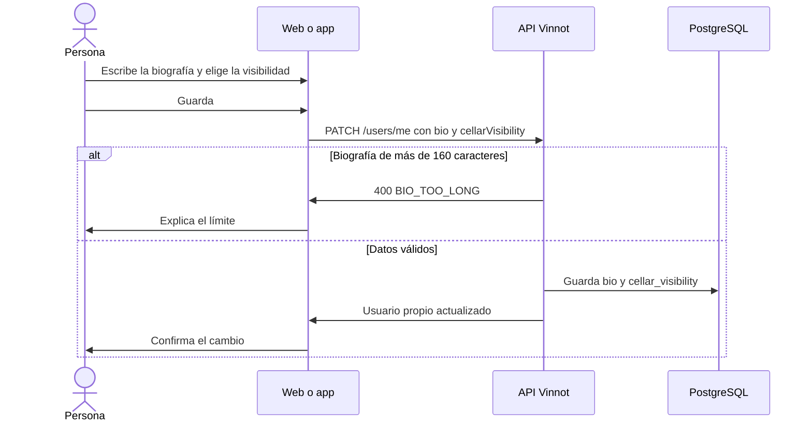

# UC-COM-09 · Editar mi perfil público

| Campo | Valor |
|---|---|
| ID | `UC-COM-09` |
| Módulo | [Comunidad](../README.md) |
| Plataformas | Web, App |
| Actores | Usuario autenticado |
| IDs en Lucidchart | Ninguno |
| Requisitos | [`RF-WEB-COM-13`](../requirements.md), [`RF-APK-COM-13`](../requirements.md) |
| Casos de prueba | [`CP-COM-44`](../testing.md), [`CP-COM-45`](../testing.md), [`CP-COM-46`](../testing.md), [`CP-COM-47`](../testing.md) |

## Precondiciones

- La persona tiene sesión iniciada.

## Postcondiciones

- La biografía y la visibilidad de la cava quedan guardadas y el perfil público las refleja.

## Flujo principal

1. La persona abre la edición de su perfil público: en la web, la tarjeta «Perfil público» de la pestaña de perfil en `/profile` (también desde «Editar perfil» en su perfil público); en la app, «Editar perfil» en su perfil o en su perfil público.
2. Escribe una biografía, con un contador de caracteres sobre 160.
3. Elige quién ve su cava: «Pública», «Solo seguidores» o «Privada».
4. Guarda. El cliente envía `PATCH /users/me` con `bio` y `cellarVisibility`; en la app el mismo pedido incluye los demás datos del formulario.
5. La API recorta la biografía, guarda `null` si queda vacía, guarda la visibilidad y devuelve el usuario propio con ambos campos.
6. El cliente confirma el cambio y el perfil público muestra la biografía nueva y aplica la visibilidad elegida.

## Flujos alternativos

- 2a. La biografía supera 160 caracteres: el campo no admite más; si la API la recibe igual, responde 400 `BIO_TOO_LONG` y el cliente explica el límite.
- 3a. La visibilidad no es `PUBLIC`, `FOLLOWERS` ni `PRIVATE`: la API responde 400 sin guardar.
- 5a. Falla el guardado: el cliente avisa que no pudo guardar y conserva lo escrito.

## Reglas de negocio

- La visibilidad por defecto es `PUBLIC`.
- Las notas privadas y el precio de compra de la cava nunca se muestran, sea cual sea la visibilidad.
- `GET /auth/me` y la respuesta de `PATCH /users/me` devuelven `bio` y `cellarVisibility`.

## Diagrama

[Ver diagrama de «UC-COM-09 · Editar mi perfil público» completo](https://images.vinnot.com/docs/diagrams/v1/es/modules-community-use-cases-uc-com-09-edit-public-profile-3239c7aaf257.svg)

## Código

| Capa | Ubicación |
|---|---|
| Endpoints | `PATCH /users/me`, `GET /auth/me` |
| Backend | [`UserController.java`](../../../../../backend/src/main/java/com/vinnot/user/infrastructure/web/controller/UserController.java), [`UpdateUserProfileCommandHandler.java`](../../../../../backend/src/main/java/com/vinnot/user/application/command/handler/UpdateUserProfileCommandHandler.java) |
| Web | [`UserProfileSocialCard.tsx`](../../../../../frontend-react/src/presentation/pages/user/UserProfileSocialCard.tsx), [`useSocialProfileEditor.ts`](../../../../../frontend-react/src/presentation/pages/user/useSocialProfileEditor.ts), [`useUpdateSocialProfile.ts`](../../../../../frontend-react/src/presentation/hooks/queries/social/useUpdateSocialProfile.ts), [`social.validators.ts`](../../../../../frontend-react/src/domain/social/social.validators.ts), [`users.service.ts`](../../../../../frontend-react/src/application/services/users.service.ts) |
| App | [`EditProfileSheet.tsx`](../../../../../frontend-mobile/src/presentation/features/user/EditProfileSheet.tsx), [`users.service.ts`](../../../../../frontend-mobile/src/application/services/users.service.ts) |

## Tests automáticos

- Backend: [`UserSocialProfileTest.java`](../../../../../backend/src/test/java/com/vinnot/user/domain/model/UserSocialProfileTest.java), [`UpdateUserProfileCommandHandlerTest.java`](../../../../../backend/src/test/java/com/vinnot/user/application/command/handler/UpdateUserProfileCommandHandlerTest.java), [`SocialHttpPostgresIntegrationTest.java`](../../../../../backend/src/test/java/com/vinnot/community/infrastructure/SocialHttpPostgresIntegrationTest.java)
- Web: [`UserProfileSocialCard.test.tsx`](../../../../../frontend-react/src/presentation/pages/user/UserProfileSocialCard.test.tsx), [`social.validators.test.ts`](../../../../../frontend-react/src/domain/social/social.validators.test.ts), [`users.service.social.test.ts`](../../../../../frontend-react/src/application/services/users.service.social.test.ts)
- App: [`EditProfileSheet.test.tsx`](../../../../../frontend-mobile/src/presentation/features/user/EditProfileSheet.test.tsx)
