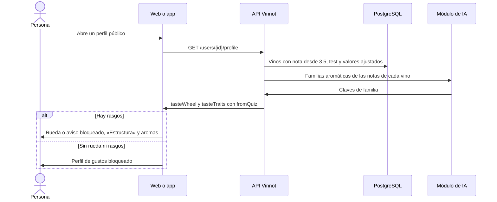

# UC-COM-10 · Ver el perfil de gustos

| Campo | Valor |
|---|---|
| ID | `UC-COM-10` |
| Módulo | [Comunidad](../README.md) |
| Plataformas | Web, App |
| Actores | Usuario autenticado |
| IDs en Lucidchart | Ninguno |
| Requisitos | [`RF-WEB-COM-14`](../requirements.md), [`RF-WEB-COM-17`](../requirements.md), [`RF-APK-COM-14`](../requirements.md), [`RF-APK-COM-17`](../requirements.md) |
| Casos de prueba | [`CP-COM-48`](../testing.md), [`CP-COM-49`](../testing.md), [`CP-COM-50`](../testing.md), [`CP-COM-51`](../testing.md), [`CP-COM-52`](../testing.md), [`CP-COM-53`](../testing.md), [`CP-COM-54`](../testing.md) |

## Precondiciones

- La persona está en un perfil público ([UC-COM-06](uc-com-06-view-public-profile.md)).

## Postcondiciones

- La persona ve qué estructura y qué aromas prefiere el miembro, en el estilo ilustrado de Vinnot.

## Flujo principal

1. El perfil público trae `tasteWheel` y `tasteTraits`, calculados en cada pedido.
2. El cliente muestra la tarjeta del perfil de gustos: la rueda ([UC-COM-11](uc-com-11-explore-taste-wheel.md)) sobre su fondo crema con el emblema del racimo.
3. Debajo muestra «Estructura»: acidez, cuerpo, taninos y dulzor, cada uno con su ilustración en acuarela, una barra de 0 a 100 y la palabra de su nivel (baja, media o alta; para el dulzor, seco, semiseco o dulce).
4. Después muestra «Aromas que prefiere» (en el perfil propio, en segunda persona): las familias frutado, floral, herbal, especiado, madera y mineral como chips ilustrados con su porcentaje, de mayor a menor.

## Flujos alternativos

- 1a. Algún valor viene del test de gustos: la tarjeta lo indica con «Según tu test de gustos» en el perfil propio o «Según su test de gustos» en el de otra persona ([UC-COM-12](uc-com-12-take-taste-quiz.md)).
- 2a. El miembro valoró menos de cinco vinos pero tiene rasgos del test o valores ajustados: en lugar de la rueda aparece un aviso compacto con el emblema y un candado, y los rasgos se muestran igual.
- 2b. No hay rueda ni rasgos: en el perfil de otra persona la tarjeta muestra solo el estado bloqueado, con la explicación de que el perfil aparece al valorar cinco vinos; en el perfil propio el bloqueo convive con «Estructura» para ajustarla (3a).
- 3a. Un rasgo no tiene datos suficientes: el rasgo se omite; sin ningún rasgo, la sección «Estructura» no aparece salvo en el perfil propio, que ofrece ajustarla ([UC-COM-13](uc-com-13-adjust-palate.md)).
- 4a. Hay menos de tres vinos con perfil de IA y el test no aporta familias: la sección de aromas no aparece.
- 3b. Un rasgo tiene un valor ajustado a mano: el rasgo muestra la etiqueta «Ajustado».

## Reglas de negocio

- Los vinos que le gustan al miembro son sus reseñas no rechazadas y sus valoraciones de cava sin reseña con nota de al menos 3,5, los 200 más recientes, ponderados por la nota.
- Un rasgo de estructura usa el puntaje del catálogo o, si falta, el del perfil de IA; con menos de tres vinos con dato se omite.
- Una familia es la parte ponderada de los vinos con perfil de IA que tienen al menos una nota de esa familia; una familia con 0 % se omite.
- Cada rasgo toma, en orden, el valor ajustado a mano, el calculado y el del test completado; las familias calculadas reemplazan a las del test cuando existen.
- El nivel es bajo por debajo de 34, medio por debajo de 67 y alto desde 67.
- Las ilustraciones son decorativas: el texto lleva el significado.
- Las respuestas del test nunca aparecen en el perfil público.

## Diagrama

[Ver diagrama de «UC-COM-10 · Ver el perfil de gustos» completo](https://images.vinnot.com/docs/diagrams/v1/es/modules-community-use-cases-uc-com-10-view-taste-profile-a88455776063.svg)

## Código

| Capa | Ubicación |
|---|---|
| Endpoints | `GET /users/{id}/profile` (campos `tasteWheel` y `tasteTraits`) |
| Backend | [`GetSocialQueryHandler.java`](../../../../../backend/src/main/java/com/vinnot/community/application/query/handler/GetSocialQueryHandler.java), [`TasteTraits.java`](../../../../../backend/src/main/java/com/vinnot/community/domain/model/TasteTraits.java), [`TasteProfile.java`](../../../../../backend/src/main/java/com/vinnot/community/domain/model/TasteProfile.java) |
| Web | [`TasteProfileCard.tsx`](../../../../../frontend-react/src/presentation/components/features/social/TasteProfileCard.tsx), [`tasteProfileArt.ts`](../../../../../frontend-react/src/presentation/components/features/social/tasteProfileArt.ts), [`tasteTraits.ts`](../../../../../frontend-react/src/domain/social/tasteTraits.ts) |
| App | [`TasteProfileCard.tsx`](../../../../../frontend-mobile/src/presentation/features/social/TasteProfileCard.tsx), [`profileArt.ts`](../../../../../frontend-mobile/src/shared/profileArt.ts) |

## Tests automáticos

- Backend: [`TasteTraitsTest.java`](../../../../../backend/src/test/java/com/vinnot/community/domain/model/TasteTraitsTest.java), [`TasteTraitsBlendTest.java`](../../../../../backend/src/test/java/com/vinnot/community/domain/model/TasteTraitsBlendTest.java), [`GetSocialQueryHandlerTasteTraitsTest.java`](../../../../../backend/src/test/java/com/vinnot/community/application/query/handler/GetSocialQueryHandlerTasteTraitsTest.java), [`SocialHttpPostgresIntegrationTest.java`](../../../../../backend/src/test/java/com/vinnot/community/infrastructure/SocialHttpPostgresIntegrationTest.java)
- Web: [`PublicProfilePage.test.tsx`](../../../../../frontend-react/src/presentation/pages/social/PublicProfilePage.test.tsx), [`tasteTraits.test.ts`](../../../../../frontend-react/src/domain/social/tasteTraits.test.ts), [`tasteProfileArt.test.ts`](../../../../../frontend-react/src/presentation/components/features/social/tasteProfileArt.test.ts)
- App: [`TasteProfileCard.test.tsx`](../../../../../frontend-mobile/src/presentation/features/social/TasteProfileCard.test.tsx)
