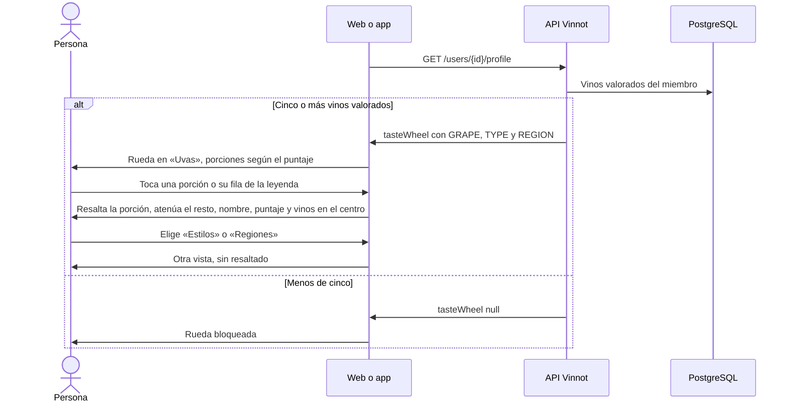

# UC-COM-11 · Explorar la rueda de gustos

| Campo | Valor |
|---|---|
| ID | `UC-COM-11` |
| Módulo | [Comunidad](../README.md) |
| Plataformas | Web, App |
| Actores | Usuario autenticado |
| IDs en Lucidchart | Ninguno |
| Requisitos | [`RF-WEB-COM-15`](../requirements.md), [`RF-WEB-COM-16`](../requirements.md), [`RF-WEB-COM-17`](../requirements.md), [`RF-APK-COM-15`](../requirements.md), [`RF-APK-COM-16`](../requirements.md), [`RF-APK-COM-17`](../requirements.md) |
| Casos de prueba | [`CP-COM-55`](../testing.md), [`CP-COM-56`](../testing.md), [`CP-COM-57`](../testing.md), [`CP-COM-58`](../testing.md), [`CP-COM-59`](../testing.md), [`CP-COM-60`](../testing.md) |

## Precondiciones

- La persona está en un perfil público ([UC-COM-06](uc-com-06-view-public-profile.md)) de un miembro con al menos cinco vinos valorados.

## Postcondiciones

- La persona ve qué uvas, estilos o regiones prefiere el miembro y con qué puntaje.

## Flujo principal

1. El perfil trae `tasteWheel`: hasta ocho porciones de uvas (`GRAPE`), ocho de estilos (`TYPE`) y ocho de regiones (`REGION`), cada una con etiqueta, puntaje de 0 a 5, tono y vinos valorados.
2. El cliente abre la rueda en «Uvas» y muestra el selector «Uvas», «Estilos» y «Regiones» con las vistas que tienen porciones.
3. Dibuja una porción de igual ancho por entrada, pintada en acuarela con un borde orgánico, y la leyenda con el color de cada porción. Dentro de la vista, la porción de mejor puntaje llega al borde y la de menor puntaje ocupa el 65 % del anillo. Al abrirse, la rueda aparece con una breve animación.
4. La persona toca una porción o su fila de la leyenda: esa porción se resalta, las demás se atenúan y el centro muestra el nombre, el puntaje de 5 y la cantidad de vinos valorados.
5. La persona toca la misma porción otra vez y el resaltado se quita.

## Flujos alternativos

- 2a. La persona elige otra vista: la rueda muestra solo ese tipo de porciones y quita el resaltado.
- 2b. No hay uvas: la rueda abre en la primera vista con porciones; con una sola vista no se muestra el selector.
- 3a. Todas las porciones de la vista tienen el mismo puntaje: todas llegan al borde.
- 3b. La persona tiene activado el movimiento reducido: la rueda se dibuja de una vez, sin animación.
- 1a. El miembro valoró menos de cinco vinos: `tasteWheel` es `null` y en su lugar aparece el estado bloqueado ([UC-COM-10](uc-com-10-view-taste-profile.md)).

## Reglas de negocio

- El puntaje de una porción es el promedio de las valoraciones de sus vinos, con dos decimales; una uva repetida en un vino cuenta una vez.
- Las uvas unen grafías en cualquier alfabeto, mayúsculas o acentos (por ejemplo, las grafías griegas y latinas de una misma uva son una porción).
- Las uvas toman los colores de su tono: granate, rubí y violeta para las tintas, rosados para los rosados, dorado y verde para las blancas; los estilos usan el color de cada tipo de vino y las regiones, tonos bien distintos. El país de la región no se muestra.
- Las etiquetas de los estilos se traducen al idioma de la interfaz.
- La cuenta de vinos valorados es la suma de las filas `TYPE` del miembro en `user_taste_affinities`; la rueda se calcula en cada pedido y no muestra vinos, así que una cava privada no queda expuesta.

## Diagrama

[Ver diagrama de «UC-COM-11 · Explorar la rueda de gustos» completo](https://images.vinnot.com/docs/diagrams/v1/es/modules-community-use-cases-uc-com-11-explore-taste-wheel-daf25dd3e8a3.svg)

## Código

| Capa | Ubicación |
|---|---|
| Endpoints | `GET /users/{id}/profile` (campo `tasteWheel`) |
| Backend | [`TasteWheel.java`](../../../../../backend/src/main/java/com/vinnot/community/domain/model/TasteWheel.java), [`GrapeName.java`](../../../../../backend/src/main/java/com/vinnot/community/domain/model/GrapeName.java), [`GetSocialQueryHandler.java`](../../../../../backend/src/main/java/com/vinnot/community/application/query/handler/GetSocialQueryHandler.java) |
| Web | [`TasteWheel.tsx`](../../../../../frontend-react/src/presentation/components/features/social/TasteWheel.tsx), [`useTasteWheelView.ts`](../../../../../frontend-react/src/presentation/components/features/social/useTasteWheelView.ts), [`tasteWheel.ts`](../../../../../frontend-react/src/domain/social/tasteWheel.ts) |
| App | [`TasteWheel.tsx`](../../../../../frontend-mobile/src/presentation/features/social/TasteWheel.tsx), [`TasteWheelCanvas.tsx`](../../../../../frontend-mobile/src/presentation/features/social/TasteWheelCanvas.tsx), [`useTasteWheel.ts`](../../../../../frontend-mobile/src/presentation/features/social/useTasteWheel.ts), [`tasteWheelGeometry.ts`](../../../../../frontend-mobile/src/presentation/features/social/tasteWheelGeometry.ts), [`tasteWheelPalette.ts`](../../../../../frontend-mobile/src/presentation/features/social/tasteWheelPalette.ts) |

## Tests automáticos

- Backend: [`TasteWheelTest.java`](../../../../../backend/src/test/java/com/vinnot/community/domain/model/TasteWheelTest.java), [`GrapeNameTest.java`](../../../../../backend/src/test/java/com/vinnot/community/domain/model/GrapeNameTest.java), [`GetSocialQueryHandlerTasteWheelTest.java`](../../../../../backend/src/test/java/com/vinnot/community/application/query/handler/GetSocialQueryHandlerTasteWheelTest.java), [`SocialHttpPostgresIntegrationTest.java`](../../../../../backend/src/test/java/com/vinnot/community/infrastructure/SocialHttpPostgresIntegrationTest.java)
- Web: [`TasteWheel.test.tsx`](../../../../../frontend-react/src/presentation/components/features/social/TasteWheel.test.tsx), [`tasteWheel.test.ts`](../../../../../frontend-react/src/domain/social/tasteWheel.test.ts)
- App: [`TasteWheel.test.tsx`](../../../../../frontend-mobile/src/presentation/features/social/TasteWheel.test.tsx), [`TasteWheelCanvas.test.tsx`](../../../../../frontend-mobile/src/presentation/features/social/TasteWheelCanvas.test.tsx), [`tasteWheelGeometry.test.ts`](../../../../../frontend-mobile/src/presentation/features/social/tasteWheelGeometry.test.ts), [`tasteWheelPalette.test.ts`](../../../../../frontend-mobile/src/presentation/features/social/tasteWheelPalette.test.ts)
