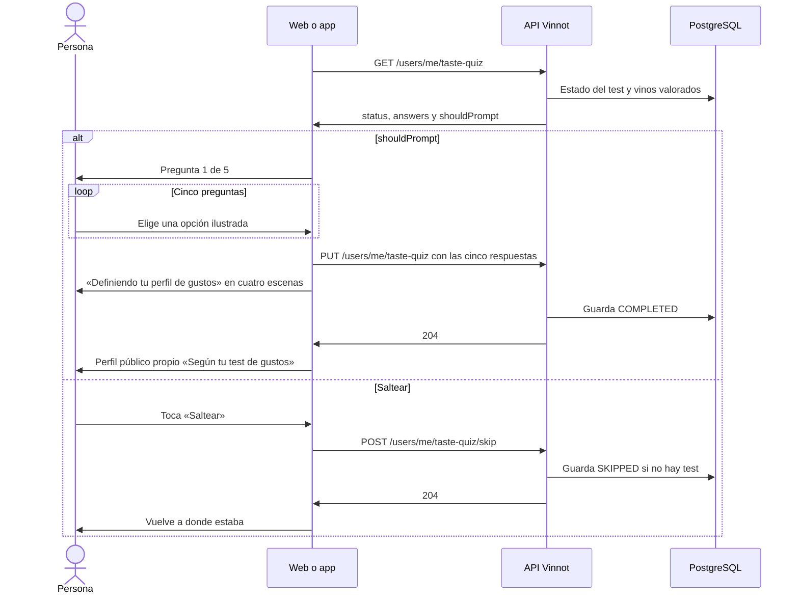

# UC-COM-12 · Hacer el test de gustos

| Campo | Valor |
|---|---|
| ID | `UC-COM-12` |
| Módulo | [Comunidad](../README.md) |
| Plataformas | Web, App |
| Actores | Usuario autenticado |
| IDs en Lucidchart | Ninguno |
| Requisitos | [`RF-WEB-COM-18`](../requirements.md), [`RF-WEB-COM-19`](../requirements.md), [`RF-WEB-COM-20`](../requirements.md), [`RF-APK-COM-18`](../requirements.md), [`RF-APK-COM-19`](../requirements.md), [`RF-APK-COM-20`](../requirements.md) |
| Casos de prueba | [`CP-COM-61`](../testing.md), [`CP-COM-62`](../testing.md), [`CP-COM-63`](../testing.md), [`CP-COM-64`](../testing.md), [`CP-COM-65`](../testing.md), [`CP-COM-66`](../testing.md), [`CP-COM-67`](../testing.md), [`CP-COM-68`](../testing.md) |

## Precondiciones

- La persona tiene sesión iniciada, con los términos aceptados y el perfil completo.

## Postcondiciones

- El test queda `COMPLETED` con sus cinco respuestas, o `SKIPPED` si la persona lo salteó.
- Un test completado da un punto de partida al perfil de gustos ([UC-COM-10](uc-com-10-view-taste-profile.md)).

## Flujo principal

1. Después de iniciar sesión, el cliente pide `GET /users/me/taste-quiz`. Con `shouldPrompt` verdadero (test pendiente y menos de cinco vinos valorados), abre el test: en la web, `/taste-quiz`; en la app, su pantalla.
2. El cliente muestra cinco preguntas de a una, con «Pregunta n de 5» y una ilustración en acuarela por opción: un día de lluvia, la fruta favorita, el postre, una cena especial y el aroma que más le gusta.
3. La persona toca una opción; queda marcada y, tras una pausa breve, aparece la pregunta siguiente.
4. Después de la quinta respuesta, el cliente envía `PUT /users/me/taste-quiz` con las cinco respuestas y muestra la animación «Definiendo tu perfil de gustos», con cuatro escenas: «Reuniendo tus elecciones», «Llenando tu copa», «Mezclando tus sabores» y «Dando forma a tu perfil de gustos».
5. La API valida las respuestas, las guarda como `COMPLETED` y responde 204.
6. Terminada la animación, el cliente abre el perfil público propio con el perfil de gustos «Según tu test de gustos».

## Flujos alternativos

- 1a. La persona toca «Hacé tu test de gustos» en su perfil público, o «Repetir el test» si ya lo completó: el test se abre y, al repetirlo, las respuestas nuevas reemplazan a las anteriores.
- 1b. El test ya está completado o salteado, o la persona valoró cinco vinos o más: el cliente no lo ofrece solo.
- 3a. La persona toca «Anterior» («Pregunta anterior» en la app): vuelve a la pregunta previa y conserva las respuestas.
- 3b. La persona toca «Saltear» en cualquier paso: el cliente envía `POST /users/me/taste-quiz/skip`, la API registra `SKIPPED` y la persona vuelve a donde estaba; el test no se vuelve a ofrecer solo.
- 3c. «Saltear» durante una repetición: la persona sale sin registrar nada y el test completado queda como estaba.
- 5a. Falla el guardado: el cliente muestra el error, conserva las respuestas y ofrece «Reintentar». En la web, «Ahora no» sale y registra el salteo salvo en una repetición; en la app, «Más tarde» sale sin registrar nada, así que el test se vuelve a ofrecer más adelante.
- 5b. Falta una pregunta, o una pregunta u opción es desconocida: la API responde 400 `INVALID_TASTE_QUIZ` sin guardar nada.

## Reglas de negocio

- El test se ofrece solo una vez por sesión del navegador o de la app; entre sesiones decide el estado guardado en el servidor.
- Saltear nunca borra un test completado.
- La persona ve las opciones, nunca cómo se traducen en rasgos de gusto; la traducción vive en el dominio del backend.
- Cada escena dura unos 3 segundos con movimiento suave, y la animación dura al menos 13,4 segundos en la web y 12,8 segundos en la app aunque la respuesta llegue antes. Con el movimiento reducido activado, las escenas no se animan.
- Las respuestas nunca aparecen en el perfil público; `GET /users/me/taste-quiz` las devuelve solo a su dueño.

## Diagrama

[Ver diagrama de «UC-COM-12 · Hacer el test de gustos» completo](https://images.vinnot.com/docs/diagrams/v1/es/modules-community-use-cases-uc-com-12-take-taste-quiz-4dfb525467f1.svg)

## Código

| Capa | Ubicación |
|---|---|
| Endpoints | `GET /users/me/taste-quiz`, `PUT /users/me/taste-quiz`, `POST /users/me/taste-quiz/skip` |
| Backend | [`TasteQuizController.java`](../../../../../backend/src/main/java/com/vinnot/community/infrastructure/web/TasteQuizController.java), [`GetTasteQuizQueryHandler.java`](../../../../../backend/src/main/java/com/vinnot/community/application/query/handler/GetTasteQuizQueryHandler.java), [`CompleteTasteQuizCommandHandler.java`](../../../../../backend/src/main/java/com/vinnot/community/application/command/handler/CompleteTasteQuizCommandHandler.java), [`SkipTasteQuizCommandHandler.java`](../../../../../backend/src/main/java/com/vinnot/community/application/command/handler/SkipTasteQuizCommandHandler.java), [`TasteQuiz.java`](../../../../../backend/src/main/java/com/vinnot/community/domain/model/TasteQuiz.java) |
| Web | [`TasteQuizPage.tsx`](../../../../../frontend-react/src/presentation/pages/user/TasteQuizPage.tsx), [`useTasteQuizViewModel.ts`](../../../../../frontend-react/src/presentation/pages/user/useTasteQuizViewModel.ts), [`TasteQuizLoadingSteps.tsx`](../../../../../frontend-react/src/presentation/components/features/tasteQuiz/TasteQuizLoadingSteps.tsx), [`TasteQuizPrompt.tsx`](../../../../../frontend-react/src/presentation/components/features/tasteQuiz/TasteQuizPrompt.tsx), [`useTasteQuizPrompt.ts`](../../../../../frontend-react/src/presentation/hooks/useTasteQuizPrompt.ts), [`tasteQuiz.service.ts`](../../../../../frontend-react/src/application/services/tasteQuiz.service.ts), [`tasteQuiz.client.ts`](../../../../../frontend-react/src/infrastructure/api/clients/tasteQuiz.client.ts) |
| App | [`TasteQuizScreen.tsx`](../../../../../frontend-mobile/src/presentation/features/tasteQuiz/TasteQuizScreen.tsx), [`useTasteQuizFlow.ts`](../../../../../frontend-mobile/src/presentation/features/tasteQuiz/useTasteQuizFlow.ts), [`TasteQuizLoadingSteps.tsx`](../../../../../frontend-mobile/src/presentation/features/tasteQuiz/TasteQuizLoadingSteps.tsx), [`TasteQuizPromptHost.tsx`](../../../../../frontend-mobile/src/presentation/features/tasteQuiz/TasteQuizPromptHost.tsx), [`useTasteQuizPrompt.ts`](../../../../../frontend-mobile/src/presentation/features/tasteQuiz/useTasteQuizPrompt.ts), [`tasteQuiz.service.ts`](../../../../../frontend-mobile/src/application/services/tasteQuiz.service.ts), [`tasteQuiz.client.ts`](../../../../../frontend-mobile/src/infrastructure/api/clients/tasteQuiz.client.ts) |

## Tests automáticos

- Backend: [`TasteQuizTest.java`](../../../../../backend/src/test/java/com/vinnot/community/domain/model/TasteQuizTest.java), [`TasteQuizCommandHandlersTest.java`](../../../../../backend/src/test/java/com/vinnot/community/application/command/handler/TasteQuizCommandHandlersTest.java), [`GetTasteQuizQueryHandlerTest.java`](../../../../../backend/src/test/java/com/vinnot/community/application/query/handler/GetTasteQuizQueryHandlerTest.java), [`SocialHttpPostgresIntegrationTest.java`](../../../../../backend/src/test/java/com/vinnot/community/infrastructure/SocialHttpPostgresIntegrationTest.java)
- Web: [`TasteQuizPage.test.tsx`](../../../../../frontend-react/src/presentation/pages/user/TasteQuizPage.test.tsx), [`TasteQuizPrompt.test.tsx`](../../../../../frontend-react/src/presentation/components/features/tasteQuiz/TasteQuizPrompt.test.tsx), [`TasteQuizLoadingSteps.test.tsx`](../../../../../frontend-react/src/presentation/components/features/tasteQuiz/TasteQuizLoadingSteps.test.tsx), [`tasteQuiz.mappers.test.ts`](../../../../../frontend-react/src/domain/tasteQuiz/tasteQuiz.mappers.test.ts), [`tasteQuiz.service.test.ts`](../../../../../frontend-react/src/application/services/tasteQuiz.service.test.ts), [`tasteQuiz.client.test.ts`](../../../../../frontend-react/src/infrastructure/api/clients/tasteQuiz.client.test.ts)
- App: [`TasteQuizScreen.test.tsx`](../../../../../frontend-mobile/src/presentation/features/tasteQuiz/TasteQuizScreen.test.tsx), [`TasteQuizPromptHost.test.tsx`](../../../../../frontend-mobile/src/presentation/features/tasteQuiz/TasteQuizPromptHost.test.tsx), [`TasteQuizLoadingSteps.test.tsx`](../../../../../frontend-mobile/src/presentation/features/tasteQuiz/TasteQuizLoadingSteps.test.tsx), [`tasteQuiz.rules.test.ts`](../../../../../frontend-mobile/src/domain/tasteQuiz/tasteQuiz.rules.test.ts), [`tasteQuiz.mappers.test.ts`](../../../../../frontend-mobile/src/domain/tasteQuiz/tasteQuiz.mappers.test.ts), [`tasteQuizOperations.test.ts`](../../../../../frontend-mobile/src/application/operations/tasteQuizOperations.test.ts), [`tasteQuiz.service.test.ts`](../../../../../frontend-mobile/src/application/services/tasteQuiz.service.test.ts), [`tasteQuiz.client.test.ts`](../../../../../frontend-mobile/src/infrastructure/api/clients/tasteQuiz.client.test.ts)
