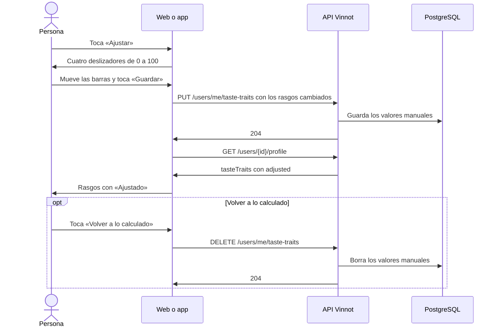

# UC-COM-13 · Ajustar mi paladar

| Campo | Valor |
|---|---|
| ID | `UC-COM-13` |
| Módulo | [Comunidad](../README.md) |
| Plataformas | Web, App |
| Actores | Usuario autenticado |
| IDs en Lucidchart | Ninguno |
| Requisitos | [`RF-WEB-COM-21`](../requirements.md), [`RF-APK-COM-21`](../requirements.md) |
| Casos de prueba | [`CP-COM-69`](../testing.md), [`CP-COM-70`](../testing.md), [`CP-COM-71`](../testing.md), [`CP-COM-72`](../testing.md), [`CP-COM-73`](../testing.md), [`CP-COM-74`](../testing.md) |

## Precondiciones

- La persona está en su propio perfil público ([UC-COM-06](uc-com-06-view-public-profile.md)).

## Postcondiciones

- Los rasgos de estructura que la persona ajustó muestran su valor manual, con la etiqueta «Ajustado», a cualquiera que vea el perfil.

## Flujo principal

1. La persona toca «Ajustar» en la sección «Estructura» de su perfil de gustos.
2. Las barras de acidez, cuerpo, taninos y dulzor pasan a ser deslizadores de 0 a 100; un rasgo sin datos empieza en el medio.
3. La persona mueve las barras para llenarlas o vaciarlas y toca «Guardar».
4. El cliente envía `PUT /users/me/taste-traits` con `structure`, solo con los rasgos que cambió.
5. La API valida todo el objeto, guarda los valores manuales y responde 204.
6. El perfil se vuelve a cargar: cada rasgo ajustado muestra su valor con la etiqueta «Ajustado».

## Flujos alternativos

- 3a. La persona toca «Cancelar»: las barras vuelven a los valores mostrados y no se guarda nada.
- 3b. La persona toca «Guardar» sin cambiar nada: el editor se cierra sin enviar un pedido.
- 3c. La persona toca «Volver a lo calculado», visible cuando algún rasgo está ajustado: el cliente envía `DELETE /users/me/taste-traits`, la API borra todos los valores manuales y responde 204, y los rasgos vuelven a su valor calculado o del test.
- 5a. Un rasgo es desconocido o un puntaje no es un entero de 0 a 100: la API responde 400 `INVALID_TASTE_ADJUSTMENT` y no guarda nada.
- 5b. Falla el guardado: el editor sigue abierto con un mensaje de error.

## Reglas de negocio

- Solo el dueño ve «Ajustar»; los visitantes nunca reciben el editor.
- Un valor manual reemplaza el valor calculado y el del test de su rasgo; enviar `null` para un rasgo borra solo ese valor manual.
- Las familias aromáticas, la rueda y la afinidad no cambian con los valores manuales.
- Los deslizadores se pueden usar con teclado en la web (flechas de a 5, Inicio y Fin) y con el lector de pantalla en la app (pasos de 5), y anuncian la palabra del nivel.

## Diagrama

[Ver diagrama de «UC-COM-13 · Ajustar mi paladar» completo](https://images.vinnot.com/docs/diagrams/v1/es/modules-community-use-cases-uc-com-13-adjust-palate-937cf6c1ee52.svg)

## Código

| Capa | Ubicación |
|---|---|
| Endpoints | `PUT /users/me/taste-traits`, `DELETE /users/me/taste-traits` |
| Backend | [`TasteTraitsController.java`](../../../../../backend/src/main/java/com/vinnot/community/infrastructure/web/TasteTraitsController.java), [`AdjustTasteTraitsCommandHandler.java`](../../../../../backend/src/main/java/com/vinnot/community/application/command/handler/AdjustTasteTraitsCommandHandler.java), [`ResetTasteTraitsCommandHandler.java`](../../../../../backend/src/main/java/com/vinnot/community/application/command/handler/ResetTasteTraitsCommandHandler.java), [`TasteAdjustment.java`](../../../../../backend/src/main/java/com/vinnot/community/domain/model/TasteAdjustment.java) |
| Web | [`TasteProfileCard.tsx`](../../../../../frontend-react/src/presentation/components/features/social/TasteProfileCard.tsx), [`TasteTraitSlider.tsx`](../../../../../frontend-react/src/presentation/components/features/social/TasteTraitSlider.tsx), [`useTasteStructureEditor.ts`](../../../../../frontend-react/src/presentation/pages/social/useTasteStructureEditor.ts), [`useTasteTraits.ts`](../../../../../frontend-react/src/presentation/hooks/queries/user/useTasteTraits.ts), [`tasteTraits.service.ts`](../../../../../frontend-react/src/application/services/tasteTraits.service.ts), [`tasteTraits.client.ts`](../../../../../frontend-react/src/infrastructure/api/clients/tasteTraits.client.ts) |
| App | [`TasteProfileCard.tsx`](../../../../../frontend-mobile/src/presentation/features/social/TasteProfileCard.tsx), [`TasteTraitSlider.tsx`](../../../../../frontend-mobile/src/presentation/features/social/TasteTraitSlider.tsx), [`useTasteStructureEditor.ts`](../../../../../frontend-mobile/src/presentation/features/social/useTasteStructureEditor.ts), [`social.client.ts`](../../../../../frontend-mobile/src/infrastructure/api/clients/social.client.ts) |

## Tests automáticos

- Backend: [`TasteAdjustmentTest.java`](../../../../../backend/src/test/java/com/vinnot/community/domain/model/TasteAdjustmentTest.java), [`TasteAdjustmentCommandHandlersTest.java`](../../../../../backend/src/test/java/com/vinnot/community/application/command/handler/TasteAdjustmentCommandHandlersTest.java), [`SocialHttpPostgresIntegrationTest.java`](../../../../../backend/src/test/java/com/vinnot/community/infrastructure/SocialHttpPostgresIntegrationTest.java)
- Web: [`PublicProfilePage.test.tsx`](../../../../../frontend-react/src/presentation/pages/social/PublicProfilePage.test.tsx), [`tasteTraits.test.ts`](../../../../../frontend-react/src/domain/social/tasteTraits.test.ts), [`tasteTraits.client.test.ts`](../../../../../frontend-react/src/infrastructure/api/clients/tasteTraits.client.test.ts)
- App: [`TasteTraitSlider.test.tsx`](../../../../../frontend-mobile/src/presentation/features/social/TasteTraitSlider.test.tsx), [`TasteProfileCard.test.tsx`](../../../../../frontend-mobile/src/presentation/features/social/TasteProfileCard.test.tsx)
