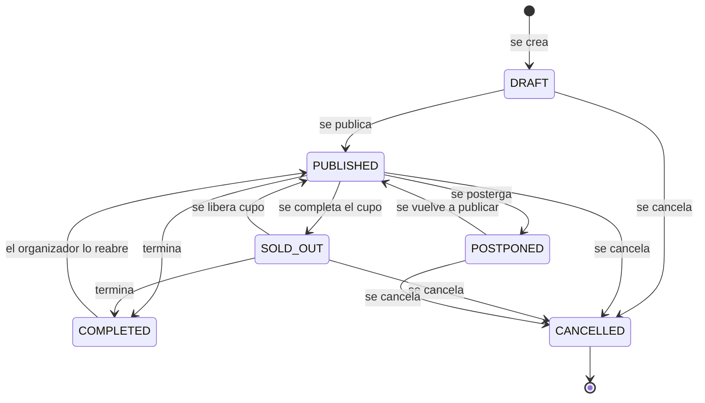
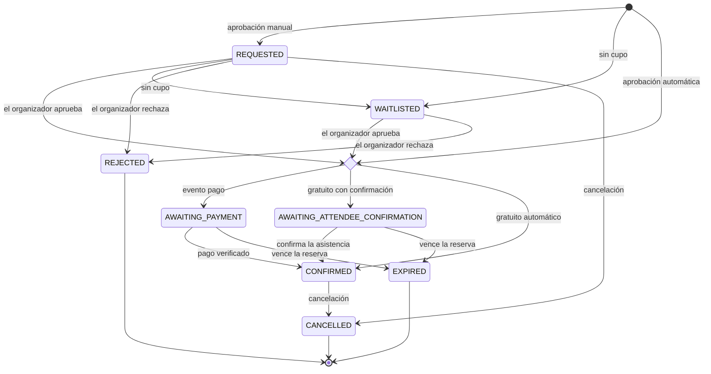
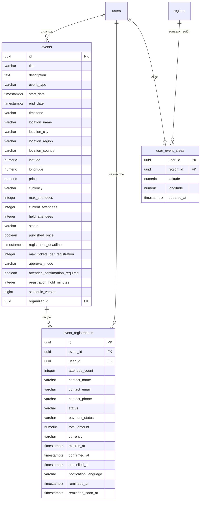

# Eventos y entradas

Eventos del mundo del vino publicados por organizadores: descubrirlos por cercanía
o con filtros, inscribirse, confirmar la asistencia, cancelar la inscripción y ver
las entradas. También incluye la zona de avisos de eventos cercanos y las tareas
que cierran eventos terminados, vencen reservas y avisan a quienes asisten. El
cobro de inscripciones está en [Pagos](../payments/README.md) y la gestión de
eventos por el organizador, en [Partners](../partner/README.md).

- Código del módulo: `EVT`.
- Backend: paquete [`event`](../../../../backend/src/main/java/com/vinnot/event/).
- [Casos de uso](use-cases/README.md) · [Requisitos](requirements.md) ·
  [Arquitectura](architecture.md) · [Pruebas](testing.md)

## Actores

| Actor | Qué hace en este módulo |
|---|---|
| Usuario autenticado | Descubre eventos, se inscribe, confirma o cancela su inscripción, ve sus entradas y elige su zona de avisos |
| Organizador | Recibe y revisa inscripciones (desde [Partners](../partner/README.md)) y recibe avisos |
| Sistema (tareas programadas) | Cierra eventos terminados, vence reservas y envía recordatorios |
| Servicio de email y push | Entrega los avisos de inscripción, cambios, cancelación, recordatorios y eventos cercanos |

## Reglas de negocio

| Regla | Detalle | Dónde |
|---|---|---|
| Acceso | Toda consulta de eventos requiere sesión | [`EventController.java`](../../../../backend/src/main/java/com/vinnot/event/infrastructure/web/controller/EventController.java) |
| Listados | Solo eventos `PUBLISHED` o `SOLD_OUT` cuyo fin es posterior a la consulta | [`EventPersistenceAdapter.java`](../../../../backend/src/main/java/com/vinnot/event/infrastructure/persistence/adapter/EventPersistenceAdapter.java) |
| Cercanía | Radio de 0 a 500 km (0 equivale a 100); separa eventos cercanos de otros eventos | [`DiscoverEventsQueryHandler.java`](../../../../backend/src/main/java/com/vinnot/event/application/query/handler/DiscoverEventsQueryHandler.java) |
| Detalle | Un evento se ve si se publicó alguna vez y no es borrador; el organizador y el equipo ven también los privados | [`GetEventByIdQueryHandler.java`](../../../../backend/src/main/java/com/vinnot/event/application/query/handler/GetEventByIdQueryHandler.java) |
| Una inscripción activa | Por persona y evento; de 1 a 20 entradas dentro del máximo del evento (6 por defecto) | [`RegisterForEventCommandHandler.java`](../../../../backend/src/main/java/com/vinnot/event/application/command/handler/RegisterForEventCommandHandler.java) |
| Cierre | La inscripción cierra en la fecha límite y nunca después del inicio | [`EventRegistrationSettings.java`](../../../../backend/src/main/java/com/vinnot/event/domain/valueobject/EventRegistrationSettings.java) |
| Capacidad | Confirmadas y reservas nunca superan el cupo; al llenarse el evento pasa a `SOLD_OUT` y vuelve a `PUBLISHED` si se libera | [`Event.java`](../../../../backend/src/main/java/com/vinnot/event/domain/model/Event.java) |
| Reservas | Duran lo que define el evento (1440 minutos por defecto); vencidas liberan el cupo | [`MaintainEventLifecycleCommandHandler.java`](../../../../backend/src/main/java/com/vinnot/event/application/command/handler/MaintainEventLifecycleCommandHandler.java) |
| Lista de espera | No asciende sola cuando se libera un cupo | [`EventRegistration.java`](../../../../backend/src/main/java/com/vinnot/event/domain/model/EventRegistration.java) |
| Cancelación propia | Una inscripción confirmada y pagada en línea la cancela el organizador | [`CancelEventRegistrationCommandHandler.java`](../../../../backend/src/main/java/com/vinnot/event/application/command/handler/CancelEventRegistrationCommandHandler.java) |
| Recordatorios | Email y push entre 24 y 1 hora antes, y otro push entre 2 horas y 15 minutos antes | [`SendEventRemindersService.java`](../../../../backend/src/main/java/com/vinnot/event/application/service/SendEventRemindersService.java) |
| Eventos cercanos | Push al publicarse por primera vez, como mucho uno por día, a quienes tienen una zona que coincide | [`AnnounceNewEventNearbyService.java`](../../../../backend/src/main/java/com/vinnot/event/application/service/AnnounceNewEventNearbyService.java) |
| Zona de avisos | Una región o un punto redondeado a 0,1° con 50 km de radio | [`EventArea.java`](../../../../backend/src/main/java/com/vinnot/event/domain/valueobject/EventArea.java) |

## Estados de un evento

[Ver diagrama de «Estados de un evento» completo](https://images.vinnot.com/docs/diagrams/v1/es/modules-events-readme-fe0ac11800af.svg)

`SOLD_OUT` lo pone el sistema según el cupo; no se puede pedir a mano.

## Estados de una inscripción

[Ver diagrama de «Estados de una inscripción» completo](https://images.vinnot.com/docs/diagrams/v1/es/modules-events-readme-38fecb38cc52.svg)

## Dónde vive

| Parte | Ubicación |
|---|---|
| API | [`EventController`](../../../../backend/src/main/java/com/vinnot/event/infrastructure/web/controller/EventController.java) bajo `/events`, [`MyTicketsController`](../../../../backend/src/main/java/com/vinnot/event/infrastructure/web/controller/MyTicketsController.java) bajo `/me/tickets` y [`EventAreaController`](../../../../backend/src/main/java/com/vinnot/event/infrastructure/web/controller/EventAreaController.java) bajo `/users/me/event-area` |
| Web | Páginas `/events`, `/events/:id` y `/my-tickets` en [`pages/events`](../../../../frontend-react/src/presentation/pages/events/) |
| App | Pestaña Eventos en `frontend-mobile/app/(app)/(tabs)/events/`, entradas en `frontend-mobile/app/(app)/my-tickets/` y lógica en [`features/event`](../../../../frontend-mobile/src/presentation/features/event/) |

## Datos

`V1` crea `events` y `event_registrations`; `V8` agrega el flujo de inscripción y
la capacidad, `V22` el historial de publicación, `V35` el idioma de los avisos,
`V40` la zona horaria, `V44` la versión del horario, `V45` y `V48` los
recordatorios y `V50` las zonas de avisos.

[Ver diagrama de «Eventos y entradas · Datos» completo](https://images.vinnot.com/docs/diagrams/v1/es/modules-events-readme-17fa62a1c4f7.svg)

Borrar una cuenta elimina sus eventos, sus inscripciones y su zona de avisos.
