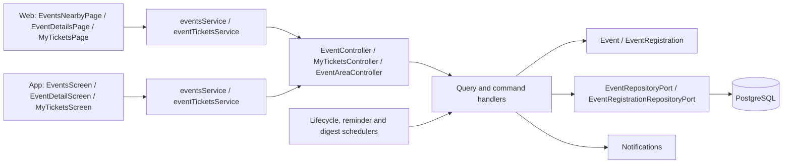
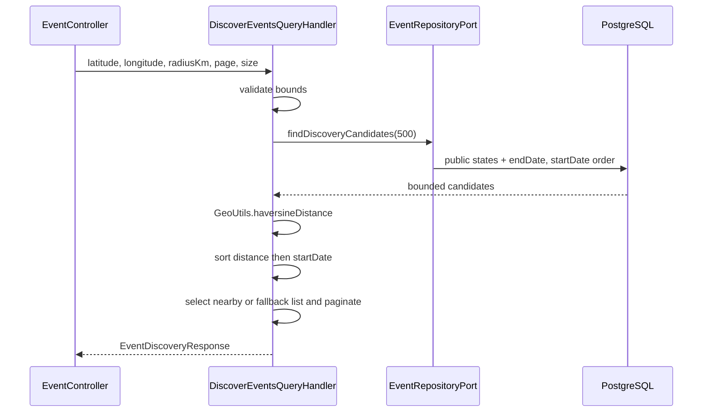
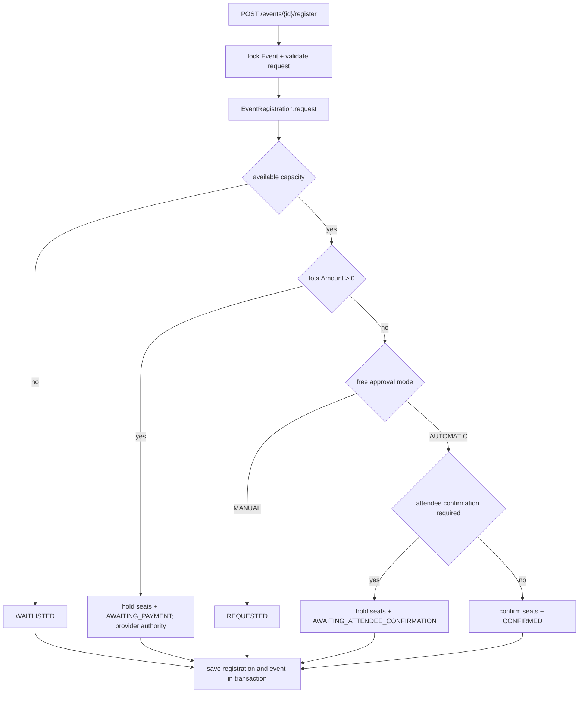

# Arquitectura

Cómo está construido el módulo en cada capa. El backend sigue el flujo hexagonal
`controller → puerto de entrada → handler → dominio → puerto de salida → adaptador`;
la web y la app siguen `pantalla → hook → servicio → cliente API → transporte HTTP`.
El cobro de inscripciones está en [Pagos](../payments/README.md) y la gestión de
eventos por el organizador, en [Partners](../partner/README.md).

[Ver diagrama de «Arquitectura» completo](https://images.vinnot.com/docs/diagrams/v1/es/modules-events-architecture-eccde02c4dad.svg)

## Backend

### Propósito, actores y límites

El módulo event administra descubrimiento, contenido, configuración de inscripción, solicitudes, reservas y capacidad. Toda consulta requiere sesión. El usuario autenticado consulta eventos, solicita o cancela su inscripción, inicia el checkout y confirma la asistencia gratuita; el organizador o el administrador revisa las solicitudes. Partner es un adapter HTTP que reutiliza casos de uso de event.

La inscripción paga sólo se confirma con un cobro verificado por el módulo payment. Los endpoints legacy de reporte y acreditación manual rechazan con PAYMENT_PROVIDER_VERIFICATION_REQUIRED, sin modificar cupos.

### Contratos de lectura

| GET | Comportamiento |
|---|---|
| `/events` | texto, tipo, ciudad, región y país; estados públicos y endDate posterior al instante de consulta |
| `/events/upcoming` | consulta específica de próximos eventos |
| `/events/nearby` | consulta geográfica del repositorio; no es el algoritmo de discovery |
| `/events/discovery` | candidatos acotados + Haversine local + partición por radio |
| `/events/{id}` | proyección de la entidad obtenida por UUID |
| `/events/my-events` | eventos del organizador autenticado |
| `/events/{eventId}/registrations/me` | inscripción del principal; consulta autenticada |

Los listados públicos usan PUBLISHED y SOLD_OUT con endDate > now. El detalle usa findById y la política publishedOnce con estado distinto de DRAFT; el organizador y ADMIN/MODERATOR conservan lectura privada. Así se mantienen enlaces de eventos históricos publicados sin exponer borradores. `EventDetailsResponse.publiclyVisible` (`Event.isPubliclyVisible()`: publicado alguna vez y estado distinto de `DRAFT`) dice si el evento tiene página pública; un evento cancelado sin haberse publicado no la tiene. Las rutas se expresan relativas a /api.

### Algoritmo de discovery

[Ver diagrama de «Algoritmo de discovery» completo](https://images.vinnot.com/docs/diagrams/v1/es/modules-events-architecture-b9e10bb03efd.svg)

Latitude admite [-90,90], longitude [-180,180], radio 0..500 km, page >= 0 y size 1..50. Radio 0 selecciona el default de 100 km. La distancia se redondea a una décima; eventos sin coordenadas quedan con distancia null y se ordenan al final. No se llama a Google Maps.

Si hay candidatos dentro del radio, se pagina esa lista y la lista alternativa queda vacía. Si no los hay, se devuelve la lista ordenada alternativa y un mensaje. El total corresponde al conjunto seleccionado de candidatos, no a una consulta geoespacial sobre todo el catálogo.

### Precondiciones y configuración de inscripción

RegisterForEventCommandHandler obtiene el evento con findByIdForUpdate. ensureRegistrationRequestAllowed admite PUBLISHED/SOLD_OUT, exige now anterior al menor entre registrationDeadline y startDate, y controla maxTicketsPerRegistration. La cantidad y los datos de contacto se validan al crear EventRegistration. Una inscripción activa para el mismo evento/usuario genera EVENT_ALREADY_REGISTERED.

EventRegistrationSettings define moneda, deadline, máximo por solicitud (1..20), MANUAL/AUTOMATIC, confirmación del asistente y duración del hold (5..10080 minutos). El total se calcula como precio del evento × asistentes; precio null equivale a cero. Contacto vacío de nombre/email se completa con datos del usuario; la respuesta puede incluir URL de WhatsApp o mailto del organizador.

[Ver diagrama de «Precondiciones y configuración de inscripción» completo](https://images.vinnot.com/docs/diagrams/v1/es/modules-events-architecture-bf31c57c8b74.svg)

### Acciones y contadores

| Acción / actor | Estado de entrada | Resultado y capacidad |
|---|---|---|
| APPROVE / organizador-admin | REQUESTED, WAITLISTED | aplica las ramas de gratuito/pago; sin cupo pasa a WAITLISTED |
| WAITLIST / organizador-admin | REQUESTED, WAITLISTED | WAITLISTED; sin reserva de cupo |
| REJECT / organizador-admin | no terminal, no CONFIRMED | REJECTED; libera hold si existe |
| APPROVE_PAYMENT / organizador-admin | Cualquier estado | Rechazado: verificación del proveedor obligatoria |
| CONFIRM_PAY_AT_VENUE / organizador-admin | Cualquier estado | Rechazado: no hay pago en puerta |
| confirm-attendance / titular | AWAITING_ATTENDEE_CONFIRMATION + hold vigente | CONFIRMED; held -= n, current += n |
| report-payment / titular | Cualquier estado | Rechazado: no se aceptan declaraciones de pago |
| cancelar inscripción / titular | no terminal, salvo CONFIRMED con pago verificado por el proveedor (online) | CANCELLED; libera hold o cupo confirmado. Un pago online confirmado devuelve 422 `PAID_REGISTRATION_REQUIRES_ORGANIZER`: el reembolso lo autoriza el organizador, así que la persona asistente debe contactarlo |
| expire / scheduler | estado con hold y expiresAt <= now | EXPIRED; held -= n |

La revisión verifica rol admin o organizerId=requestingUserId y que registration.eventId coincida con el evento de la ruta. Los endpoints personales derivan el usuario del principal y validan propiedad en el handler. Cancelar el evento cambia el agregado Event; cancelar una inscripción es otra operación.

### Diagrama de actividad: inscripción y cancelación

Muestra en notación de actividad UML cómo `RegisterForEventCommandHandler` resuelve una solicitud y cuándo el titular puede cancelarla.

```mermaid
flowchart TD
    start((" ")) --> a1("Solicitar inscripción con cantidad y contacto")
    a1 --> a2("Bloquear el evento y validar estado, plazo y límite")
    a2 --> d1{" "}
    d1 -->|"[cerrada, excede el límite o ya inscripto]"| a3("Responder el error de dominio")
    d1 -->|"[válida]"| d2{" "}
    d2 -->|"[sin cupo]"| a4("WAITLISTED")
    d2 -->|"[con cupo y total > 0]"| a5("Reservar cupo: AWAITING_PAYMENT")
    d2 -->|"[gratuita y MANUAL]"| a6("REQUESTED: espera la revisión del organizador")
    d2 -->|"[gratuita y AUTOMATIC]"| d3{" "}
    d3 -->|"[requiere confirmación]"| a7("Reservar cupo: AWAITING_ATTENDEE_CONFIRMATION")
    d3 -->|"[sin confirmación]"| a8("Confirmar cupo: CONFIRMED")
    a4 & a5 & a6 & a7 & a8 --> m1{" "}
    m1 --> a9("Guardar evento e inscripción en una transacción")
    a9 --> d4{" "}
    d4 -->|"[el titular cancela]"| d5{" "}
    d5 -->|"[CONFIRMED con pago online]"| a10("Rechazar: PAID_REGISTRATION_REQUIRES_ORGANIZER")
    d5 -->|"[no terminal]"| a11("CANCELLED: liberar la reserva o el cupo")
    d4 -->|"[sigue activa]"| stop
    a3 & a10 & a11 --> stop(((" ")))
    classDef bar fill:#30262c,stroke:#30262c,color:#30262c
    style start fill:#30262c,stroke:#30262c
    style stop fill:#30262c,stroke:#30262c
```

[Ver diagrama de «Diagrama de actividad: inscripción y cancelación» completo](https://images.vinnot.com/docs/diagrams/v1/es/modules-events-architecture-1c792d77886a.svg)

### HTTP y errores de dominio

Crear evento exige EVENT_CREATE; editar/publicar/cancelar exige EVENT_UPDATE o EVENT_UPDATE_OWN. Revisar/listar inscripciones usa esas autoridades más ownership. Solicitar, confirmar, informar pago y cancelar inscripción exige sesión. Los contratos administrativos se detallan en [Administración](../admin/architecture.md#backend) y [Partners](../partner/architecture.md#backend).

Las actualizaciones (`PATCH /events/{id}`, `PUT /partner/events/{id}` y `PATCH /admin/events/{id}`) no cancelan: pedir un cambio de estado a `CANCELLED` responde 400 `USE_CANCEL_ENDPOINT`, porque la cancelación tiene su propio endpoint con motivo y avisos. Reenviar el estado actual, incluido `SOLD_OUT` o `CANCELLED`, no cuenta como cambio de estado y el resto de los campos se guarda.

La cancelación acepta un cuerpo JSON opcional `{"reason": "...", "note": "..."}`
en `PATCH /events/{id}/cancel`, `DELETE /partner/events/{id}`,
`PATCH /admin/events/{id}/cancel` y `DELETE /admin/events/{id}`. `reason` es uno
de `UNFORESEEN_CIRCUMSTANCES` (el valor preseleccionado, que también se usa si
falta el cuerpo o el motivo),
`SCHEDULING_CONFLICT`, `VENUE_UNAVAILABLE`, `INSUFFICIENT_ATTENDANCE`, `WEATHER`,
`HEALTH_AND_SAFETY` u `OTHER`; `note` (hasta 280 caracteres) solo se conserva con
`OTHER`. El motivo no se guarda: `EventCancellationService` lee las inscripciones
activas antes de la cascada y encola un correo `EVENT_CANCELLED_ATTENDEE` por
cada una, con el motivo y qué pasa con el dinero (`CancellationRefund`:
`ONLINE` para un pago en línea aprobado, que se devuelve automáticamente al mismo medio de pago ([Pagos](../payments/README.md)), `ORGANIZER` para un pago directo
aprobado o informado, `NONE` en otro caso). V44 hace que el trigger de
inscripciones omita su copia genérica al asistente en esa cascada. El
organizador sigue recibiendo un resumen solo cuando otra persona canceló.

Un cambio de inicio, fin o lugar en un evento `PUBLISHED` o `SOLD_OUT` (por
`PATCH /events/{id}` o la edición de partner/admin) incrementa
`events.schedule_version`. El lugar cuenta tal como lo lee la gente (nombre,
dirección, ciudad, región, país); un cambio solo de coordenadas o de URL del mapa
no cuenta. Después de guardar, `UpdateEventCommandHandler` entrega el horario
anterior a `EventScheduleChangeService`, que encola un correo
`EVENT_CHANGED_ATTENDEE` por inscripción confirmada con los valores nuevos y, para
lo que cambió, los anteriores. La clave incluye la versión de horario, así que
guardar los mismos valores otra vez no envía nada. Los borradores y los eventos
cancelados no envían aviso de cambio.

Códigos relevantes: NOT_AVAILABLE, REGISTRATION_CLOSED, REGISTRATION_LIMIT_EXCEEDED, EVENT_SOLD_OUT, REGISTRATION_HOLD_EXPIRED, INVALID_PAYMENT_METHOD, EVENT_ALREADY_REGISTERED, EVENT_OWNERSHIP y REGISTRATION_EVENT_MISMATCH. La clase de excepción determina HTTP: DomainException normalmente 400; BusinessRuleViolationException normalmente 422; entidad ausente 404. No todo conflicto de negocio es 409.

### Transacción y mantenimiento temporal

Los comandos de inscripción guardan evento e inscripción dentro de @Transactional. Los métodos findByIdForUpdate usan PESSIMISTIC_WRITE; las constraints controlan contadores no negativos y capacidad total. Una solicitud manual REQUESTED no consume hold. El workflow no promueve WAITLISTED automáticamente por liberar cupos.

EventLifecycleScheduler usa initial-delay 60000 ms y fixed-delay 300000 ms configurables. MaintainEventLifecycleCommandHandler completa PUBLISHED/SOLD_OUT cuyo endDate venció y procesa hasta 200 holds expirados: recarga cada inscripción bloqueada, revalida expiración, bloquea evento, libera hold y guarda ambos. Las fechas se comparan como Instant.

EventReminderScheduler (`app.events.reminders.enabled`, true por defecto;
initial-delay `app.events.reminders.initial-delay-ms` 60000 ms, fixed-delay
`app.events.reminders.delay-ms` 300000 ms) ejecuta `SendEventRemindersUseCase`.
`SendEventRemindersService` reserva hasta 200 inscripciones `CONFIRMED` de
eventos `PUBLISHED`/`SOLD_OUT` que empiezan entre una y 24 horas desde ahora y
todavía no recibieron recordatorio, y encola un correo `EVENT_REMINDER` por cada
una (fecha local, lugar, enlace a la entrada; clave
`reminder:<registrationId>:24h:<startEpoch>`, así el correo corregido de un evento
reprogramado no se deduplica contra el viejo), más un push si al evento le faltan más de dos
horas (puede esperar el horario de descanso y vence dos horas antes del inicio),
en una sola transacción. En la misma ejecución
reserva las inscripciones de eventos que empiezan en 15 minutos a dos horas para un
recordatorio solo push (`reminded_soon_at`). Las claves de push terminan con el
inicio del evento, así un evento reprogramado vuelve a recibir push.
`PostgresEventReminderStore` reserva con `FOR UPDATE SKIP LOCKED` y marca
`event_registrations.reminded_at`, así cada asistente recibe un solo recordatorio
aunque haya varias instancias o reinicios. Nunca se reservan inscripciones ni
eventos cancelados. Una nueva fecha u horario limpia `reminded_at` y `reminded_soon_at` del evento,
para recordar la fecha nueva. En dev la instancia EC2 sigue su horario de
encendido y apagado: los recordatorios que vencen mientras está apagada se envían
en la siguiente ejecución solo mientras su ventana siga abierta.

### Pruebas y trazabilidad

La estrategia cubre métodos de dominio, combinaciones manual/automática-gratuito/pago, cantidad grupal, expiración, ownership, vínculo inscripción/evento y límites geográficos. Las pruebas de concurrencia requieren transacciones PostgreSQL independientes; mocks no demuestran serialización. Correlación HTTP proviene del filtro compartido; no se atribuye una métrica específica de transición a este módulo.

Fuentes bajo `backend/src/main/java/com/vinnot/event/`:

- `infrastructure/web/controller/EventController.java`.
- `application/query/handler/DiscoverEventsQueryHandler.java`.
- `application/command/handler/RegisterForEventCommandHandler.java`, `ReviewEventRegistrationCommandHandler.java`, `MaintainEventLifecycleCommandHandler.java`.
- `domain/model/Event.java`, `EventRegistration.java`, `domain/valueobject/EventRegistrationSettings.java`.
- `infrastructure/persistence/jpa/EventJpaRepository.java`, `EventRegistrationJpaRepository.java`.
- `infrastructure/scheduling/EventLifecycleScheduler.java`.

[Estados](../../backend/diagrams/domain-state-machines.md) · [Consistencia](../../backend/diagrams/data-consistency.md) · [API](../../backend/architecture/api.md).

### Contrato de consistencia y acceso

Confirmación, revisión y expiración adquieren evento antes de inscripción. Expiración procesa cada hold en su propia transacción. Cancelación marca inscripciones activas CANCELLED y libera contadores, sin modificar el estado de pago; la devolución de los pagos en línea la hace el módulo de pagos. Eventos completados/cancelados no se reabren al liberar capacidad.

[Detalle de coordinación](../../backend/architecture/session-and-data-integrity.md).

### Contacto reutilizable e inscripción gratuita

La inscripción admite `saveContactPhone` opcional (false por defecto). `contactPhone` no vacío se normaliza mediante el puerto compartido `PhoneNumberNormalizer`; `INVALID_PHONE_NUMBER` se traduce a un mensaje localizado en los formularios. Para compatibilidad, omitir el teléfono toma el del perfil, si existe; enviar texto vacío deja esta reserva sin teléfono. No se permite solicitar guardarlo sin un número válido. Los formularios actuales requieren contacto telefónico internacional, aunque el contrato legacy sigue admitiendo su ausencia.

La copia de contacto en `EventRegistration` queda independiente del perfil. Guardar explícitamente en perfil, crear la inscripción y modificar capacidad pertenecen a la misma transacción. Guardar el teléfono también verifica si el perfil gana sus puntos únicos de `PROFILE_COMPLETE` (foto, nombre, apellido y teléfono), mediante el `ProfilePointsPort` del módulo de usuarios.

`FreeEventRegistrationPostgresIntegrationTest` ejecuta migraciones y transacciones PostgreSQL reales: dos usuarios compiten por una plaza (CONFIRMED/WAITLISTED), solicitud manual → aprobación → confirmación → cancelación, expiración idempotente, rechazo de contacto inválido, rollback ante fallo de persistencia del perfil y conservación de snapshots. `SessionAccessHttpPostgresIntegrationTest` verifica edición propia y exclusión del teléfono del perfil público con HTTP y seguridad reales. Estas pruebas no sustituyen aceptación de teclado o mapas en dispositivos físicos.

### Correos de inscripción

- V35 genera trabajos durables por versión/estado y destinatario (asistente/organizador) dentro de la transacción. El caso de uso omite versiones ya superadas. SES usa HTML y texto plano de marca, es/en, datos escapados y fecha límite real; los errores seguros se reintentan por el outbox. Entrega al menos una vez: un corte después de enviar y antes del acuse puede duplicar un correo. No hay backfill de reservas históricas.
- El aviso al asistente usa el idioma elegido al inscribirse; el aviso al organizador usa su `preferred_language`. Las fechas del correo usan la zona horaria del evento (`events.timezone`, un identificador IANA que se muestra junto a cada fecha), igual para todos los destinatarios. V40 la completa con `users.timezone` del organizador al crear el evento y completó los eventos existentes del mismo modo; no forma parte de ningún contrato HTTP. Los mensajes encolados antes de V40 se siguen mostrando en UTC y lo indican.
- El organizador no recibe correos por los cambios que hizo él mismo: aprobar, rechazar o pasar a lista de espera registra `event_registrations.last_actor_id` y el trigger de V40 omite el aviso al organizador. Los cambios del asistente (inscripción, confirmación, cancelación propia), de un administrador o de los pagos siguen llegando al organizador.
- Cancelar un evento (cancelar o eliminar) envía a cada asistente su propio aviso y ningún aviso al organizador por inscripción. Cuando lo canceló otra persona, `EventCancellationService` encola un único `EVENT_CANCELLED_ORGANIZER_SUMMARY` al organizador con el nombre del evento y la cantidad de inscripciones canceladas (clave `event-cancelled-summary:<eventId>`); si el organizador cancela su propio evento, o la cancelación no canceló ninguna inscripción, no se envía.

## Web

### Descubrimiento y límites

Consultar eventos, detalles geográficos e inscribirse requiere sesión.
El organizador administra las inscripciones desde una vista distinta.
La ubicación del dispositivo es una entrada opcional de discovery, no una
prueba de residencia ni una autorización.

`eventsService` separa listado, cercanía y discovery. Discovery devuelve
`nearbyEventsFound`, `nearbyEvents`, `otherEvents`, mensaje y paginación.
El servicio elige la metadata de la colección cercana cuando existe; en otro
caso usa la colección alternativa. No convierte ambas colecciones en una sola
página inventada.
El mensaje del servidor nunca se muestra: si no hay eventos cercanos, la
pantalla muestra su propio aviso traducido y solo mientras lista otros eventos.

`useEventsNearbyViewModel` consulta discovery con radio de 100 km y páginas
de 50 cuando hay coordenadas. Sin filtros activos muestra cercanos o, si no
hay, `otherEvents`. Si hay texto, tipo, país o región seleccionados, o faltan
coordenadas, la vista usa el listado global filtrado. Las consultas de listado
y discovery se habilitan según la modalidad activa, esperando la ubicación antes
de consultar por defecto. La vista indica ubicación en curso, cercanos, alternativas,
exploración global o filtros en todas las ubicaciones. El endpoint discovery no
combina texto/tipo con radio; ese cambio a global queda explícito y no altera SQL.
Los selectores no se precargan con el país/región del dispositivo.

### Detalle e inscripción

El detalle carga evento e inscripción propia de forma separada. La consulta
personal se habilita con sesión. El formulario recoge cantidad de asistentes,
nombre/correo de la cuenta precargados, celular con selector de país y cantidad acotada de asistentes. No solicita acompañantes, nota ni declaración de pago. Las reglas persistentes de
capacidad y plazo se resuelven en backend.

1. Abrir detalle por ID y leer configuración de inscripción.
2. Si no hay sesión, iniciar autenticación antes de enviar.
3. Validar formulario y llamar `registerForEvent`.
4. Representar el estado retornado, no asumir confirmación inmediata. El aviso depende del estado (`registrationSuccessFeedback` en `@domain/event/eventRegistrationFeedback`): CONFIRMED, REQUESTED y WAITLISTED tienen texto propio; un estado pendiente de pago u otro no muestra aviso de éxito. El botón de envío dice «Enviar solicitud» sólo con aprobación manual, «Confirmar inscripción» con aprobación automática y conserva el texto de pago en eventos pagos.
5. Si es pago y retorna AWAITING_PAYMENT, abrir Mercado Pago inmediatamente. En gratuitos puede abrirse `contactActionUrl`.
6. Consultar nuevamente tras confirmación de asistencia o retorno del checkout. Los estados CANCELLED/REJECTED/EXPIRED ofrecen reinscripción si el evento sigue disponible. Un evento cancelado avisa que el organizador lo canceló y no ofrece inscripción.
7. Mientras la inscripción no está cancelada, rechazada ni vencida, «Tu inscripción» ofrece «Cancelar inscripción»: pide confirmación y llama `DELETE /events/{eventId}/register` con `useCancelRegistration`.

«Compartir» solo aparece cuando el evento tiene página pública (`isPublicEvent` en `@domain/sharing/publicContent`, que usa `publiclyVisible` y, si falta, un estado distinto de `DRAFT`).

El CTA distingue «Inscripciones cerradas» (evento no publicado, plazo vencido o evento iniciado) de «Agotado» (cupo completo) con `eventRegistrationAvailability`.

El detalle se coordina en `useEventDetailsViewModel`. Las mutaciones de
confirmación/cancelación/checkout actualizan la caché de inscripción propia y después
invalidan el detalle del evento. La gestión usa `EventRegistrationsManagerModal`.

### Errores y consistencia

Permiso denegado, sin eventos cercanos y error de API son resultados distintos.
Las acciones de inscripción pueden rechazarse por capacidad, plazo, ownership o
transición inválida aunque la pantalla mostrara una acción al abrirse.
El estado final proviene de releer la inscripción/evento, no de incrementar
manualmente un contador de asistentes.

### Contacto de inscripción y teléfono de perfil

El editor de perfil permite guardar o borrar un teléfono privado opcional con código internacional. `useEventRegistrationForm` precarga nombre, email y teléfono del usuario, valida el contacto, coordina la cantidad de asistentes y describe si la inscripción gratuita espera aprobación, se confirma inmediatamente o requiere confirmar dentro del plazo. No limita el grupo al cupo momentáneamente disponible: respeta el máximo del organizador y permite que backend decida la lista de espera.

Guardar el teléfono para próximas reservas requiere marcar la opción correspondiente. La reserva conserva su propia copia aunque luego cambie el perfil. El servicio envía `saveContactPhone` y mantiene la diferencia entre teléfono omitido y vacío. La mutación actualiza el estado de perfil sólo al guardar explícitamente; un refresco de perfil fallido no convierte una inscripción persistida en un error de reserva. Los mensajes de teléfono inválido son ES/EN; la autoridad final es el backend.

Pruebas: reglas de formato, mapeos privados/públicos, serialización del servicio y casos de uso del hook de inscripción. La captura de contacto no activa Mercado Pago ni envíos transaccionales.

### Mis entradas

`/my-tickets` y `/my-tickets/:id` están dentro de `ProtectedLayout` y se acceden desde el menú de usuario de `AppHeader`. `MyTicketsPage` → `useMyTickets`/`useMyTicket` → `eventTicketsService` → `eventTicketsClient`, que consulta `GET /me/tickets` (páginas de 20) y `GET /me/tickets/{id}`. El servicio valida página e ID UUID antes de llamar y mapea fechas. Las entradas usan las etiquetas de estado del asistente (`events.registration.statuses`). El detalle muestra «no encontrada» sólo ante 403/404 o un ID inválido; cualquier otro error ofrece «Reintentar» (`useMyTicketDetailsViewModel`).

## App

### Descubrimiento y límites

Consultar eventos, detalles geográficos e inscribirse requiere sesión.
El organizador administra las inscripciones desde una vista distinta.
La ubicación del dispositivo es una entrada opcional de discovery, no una
prueba de residencia ni una autorización.

`eventsService` separa listado, cercanía y discovery. Discovery devuelve
`nearbyEventsFound`, `nearbyEvents`, `otherEvents`, mensaje y paginación.
El servicio elige la metadata de la colección cercana cuando existe; en otro
caso usa la colección alternativa. No convierte ambas colecciones en una sola
página inventada.
El mensaje del servidor nunca se muestra: si no hay eventos cercanos, la
pantalla muestra su propio aviso traducido y solo mientras lista otros eventos.

### Detalle e inscripción

El detalle carga evento e inscripción propia de forma separada. La consulta
personal se habilita con sesión. El formulario recoge cantidad de asistentes,
nombre/correo de la cuenta precargados, celular con selector de país y cantidad acotada de asistentes. No solicita acompañantes, nota ni declaración de pago; los `companionNames` existentes sólo se muestran en la hoja del gestor. Las reglas persistentes de
capacidad y plazo se resuelven en backend.

1. Abrir detalle por ID y leer configuración de inscripción.
2. Si no hay sesión, iniciar autenticación antes de enviar.
3. Validar formulario y llamar `registerForEvent`.
4. Representar el estado retornado, no asumir confirmación inmediata.
5. Si es pago y retorna AWAITING_PAYMENT, abrir Mercado Pago inmediatamente. En gratuitos puede abrirse `contactActionUrl`.
6. Consultar nuevamente tras confirmación de asistencia o retorno del checkout. Los estados CANCELLED/REJECTED/EXPIRED ofrecen reinscripción si el evento sigue disponible. Un evento cancelado avisa que el organizador lo canceló y no ofrece inscripción.

El detalle usa `EventRegistrationSheet`; el administrador/organizador usa
`EventRegistrationsManagerSheet`. Las mutaciones de eventos invalidan `Events`.
«Compartir» solo aparece cuando el evento tiene página pública (`canShareEvent` en `src/domain/sharing/shareability.ts`, que usa `publiclyVisible` y, si falta, un estado distinto de `DRAFT`).

Las reglas de presentación viven en `src/domain/event/eventRegistrationActions.ts`:
`registrationAvailability` distingue cupo completo ("Agotado") de inscripción
cerrada por plazo, inicio o estado ("Inscripciones cerradas");
`registrationSubmitKey` usa "Enviar solicitud" sólo con aprobación manual y
"Confirmar inscripción" con aprobación automática; `registrationSuccessKey`
elige el aviso según el estado devuelto (CONFIRMED, REQUESTED, WAITLISTED) y
no muestra éxito para AWAITING_PAYMENT; `registrationStatusTone` define el
icono del estado propio. Si la cuenta está incompleta, la hoja ofrece "Ir a mi
perfil". En Mis entradas, un error de carga ofrece "Reintentar"; "no
encontrada" sólo se muestra ante 404 o respuesta vacía.

### Errores y consistencia

Permiso denegado, sin eventos cercanos y error de API son resultados distintos.
Las acciones de inscripción pueden rechazarse por capacidad, plazo, ownership o
transición inválida aunque la pantalla mostrara una acción al abrirse.
El estado final proviene de releer la inscripción/evento, no de incrementar
manualmente un contador de asistentes.

### Contacto de inscripción y teléfono de perfil

El editor de perfil permite guardar o borrar un teléfono privado opcional con código internacional. `useEventRegistrationForm` precarga nombre, email y teléfono del usuario, valida el contacto, acota la cantidad de entradas al máximo del evento (hasta 20) y describe si la inscripción gratuita espera aprobación, se confirma inmediatamente o requiere confirmar dentro del plazo. No limita el grupo al cupo momentáneamente disponible: respeta el máximo del organizador y permite que backend decida la lista de espera.

Guardar el teléfono para próximas reservas requiere marcar la opción correspondiente. La reserva conserva su propia copia aunque luego cambie el perfil. El servicio envía `saveContactPhone` y mantiene la diferencia entre teléfono omitido y vacío. La mutación actualiza el estado de perfil sólo al guardar explícitamente; un refresco de perfil fallido no convierte una inscripción persistida en un error de reserva. Los mensajes de teléfono inválido son ES/EN; la autoridad final es el backend.

Pruebas: reglas de formato, mapeos privados/públicos, serialización del servicio y casos de uso del hook de inscripción. La captura de contacto no activa Mercado Pago ni envíos transaccionales.

### Ubicación no disponible

Sin ubicación, el listado de Eventos muestra un aviso neutro en gris y todos los eventos: «El acceso a la ubicación está desactivado» si se negó el permiso y «No pudimos obtener tu ubicación» en otro caso.

### Mapa y filtro por zona

`EventsScreen` consulta discovery con radio de 100 km y hasta 50 eventos (`eventDiscoveryConfig.ts`) y muestra en un mapa (`react-native-maps`) los eventos con coordenadas. Buscar una zona la geocodifica y consulta `GET /events/nearby` con radio de 100 km (`useEventAreaFilter.ts`); país, tipo y texto refinan la primera página en el dispositivo.

El mapa se centra en la zona buscada, en la ubicación de la persona (sin filtros de catálogo) o en el primer evento con coordenadas, con un delta de 0,3° (`NEARBY_DELTA`, unos 30 km). Apple Maps conserva su primera cámara e ignora los cambios posteriores de `region`, así que la pantalla usa `initialRegion` y mueve la cámara con `animateToRegion` al estar listo el mapa y cada vez que cambia el destino. El encabezado es el `BrowseScreenHeader` compartido con Vinos y Rutas; su subtítulo es el texto descriptivo «Encontrá catas, ferias, recorridos y experiencias cerca tuyo.» y la cantidad de eventos aparece debajo, en la sección «Eventos cercanos» o «Todos los eventos».

### Cancelar la inscripción

`ReserveCTA` ofrece «Cancelar inscripción» mientras la inscripción no está cancelada, rechazada ni vencida. `useEventDetailViewModel` pide confirmación y llama `DELETE /events/{eventId}/register`. Si la inscripción está confirmada y pagada en línea, la API responde `PAID_REGISTRATION_REQUIRES_ORGANIZER` y la app indica que hay que contactar al organizador.

### Mis entradas

`app/(app)/my-tickets/index.tsx` y `[id].tsx` se abren desde el perfil. `MyTicketsScreen` → `useMyTickets` → `eventTicketsService` → `eventTicketsClient` (`GET /me/tickets` y `GET /me/tickets/{id}`). El detalle muestra la referencia de 12 caracteres y avisa cuando el organizador canceló el evento.

### Navegación entre pestañas

Las pestañas seleccionan su pantalla principal. Para Vinos, Eventos y Rutas se reinicia sólo el stack interno de la pestaña elegida, conservando la ruta de listado existente y sus parámetros. Esto evita reabrir detalles visitados desde entradas o enlaces y acumular listados duplicados. El detalle de evento vuelve explícitamente al listado; el detalle de entrada vuelve a Mis entradas.
