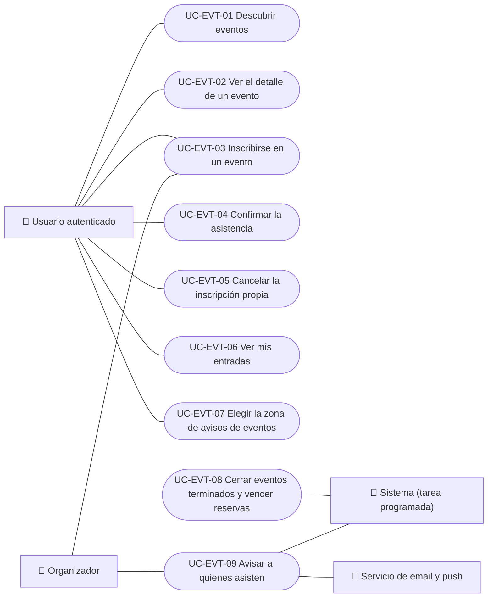

# Casos de uso

Casos de uso de eventos del lado de quien asiste: descubrir y abrir eventos, inscribirse, confirmar o cancelar la inscripción, ver las entradas, elegir la zona de avisos y las tareas automáticas del ciclo de vida y los avisos. El pago está en Pagos y la gestión de eventos por el organizador está en Partners. Cada caso vale para las plataformas indicadas.

| ID | Caso de uso | Plataformas | Actores |
|---|---|---|---|
| `UC-EVT-01` | [Descubrir eventos](uc-evt-01-discover-events.md) | Web, APK | Usuario autenticado |
| `UC-EVT-02` | [Ver el detalle de un evento](uc-evt-02-view-event.md) | Web, APK | Usuario autenticado |
| `UC-EVT-03` | [Inscribirse en un evento](uc-evt-03-register-for-event.md) | Web, APK | Usuario autenticado, Organizador |
| `UC-EVT-04` | [Confirmar la asistencia](uc-evt-04-confirm-attendance.md) | Web, APK | Usuario autenticado |
| `UC-EVT-05` | [Cancelar la inscripción propia](uc-evt-05-cancel-registration.md) | Web, APK | Usuario autenticado |
| `UC-EVT-06` | [Ver mis entradas](uc-evt-06-my-tickets.md) | Web, APK | Usuario autenticado |
| `UC-EVT-07` | [Elegir la zona de avisos de eventos](uc-evt-07-event-area.md) | Web, APK | Usuario autenticado |
| `UC-EVT-08` | [Cerrar eventos terminados y vencer reservas](uc-evt-08-event-lifecycle.md) | Solo backend | Sistema (tarea programada) |
| `UC-EVT-09` | [Avisar a quienes asisten](uc-evt-09-attendee-notices.md) | Solo backend | Sistema (tarea programada), Organizador, Servicio de email y push |

## Diagrama de casos de uso

[Ver diagrama de «Casos de uso · Diagrama de casos de uso» completo](https://images.vinnot.com/docs/diagrams/v1/es/modules-events-use-cases-readme-b9bf65071667.svg)

## Equivalencia con Lucidchart

| ID | IDs en Lucidchart |
|---|---|
| `UC-EVT-01` | [WEB UC-EVT-01](https://lucid.app/lucidchart/9f11a16b-bb5a-42fc-a9e8-0852b17bd241/edit), [APK UC-EVT-01](https://lucid.app/lucidchart/e095dd25-e8ac-41ba-bf5b-396e1055f217/edit) |
| `UC-EVT-02` | [WEB UC-EVT-02](https://lucid.app/lucidchart/9f11a16b-bb5a-42fc-a9e8-0852b17bd241/edit), [APK UC-EVT-02](https://lucid.app/lucidchart/e095dd25-e8ac-41ba-bf5b-396e1055f217/edit) |
| `UC-EVT-03` | [WEB UC-EVT-03](https://lucid.app/lucidchart/9f11a16b-bb5a-42fc-a9e8-0852b17bd241/edit), [APK UC-EVT-03](https://lucid.app/lucidchart/e095dd25-e8ac-41ba-bf5b-396e1055f217/edit) |
| `UC-EVT-04` | [WEB UC-EVT-04](https://lucid.app/lucidchart/9f11a16b-bb5a-42fc-a9e8-0852b17bd241/edit), [APK UC-EVT-04](https://lucid.app/lucidchart/e095dd25-e8ac-41ba-bf5b-396e1055f217/edit) |
| `UC-EVT-05` | [APK UC-EVT-05](https://lucid.app/lucidchart/e095dd25-e8ac-41ba-bf5b-396e1055f217/edit), [WEB UC-EVT-08](https://lucid.app/lucidchart/9f11a16b-bb5a-42fc-a9e8-0852b17bd241/edit) |
| `UC-EVT-06` | [WEB UC-EVT-07](https://lucid.app/lucidchart/9f11a16b-bb5a-42fc-a9e8-0852b17bd241/edit), [APK UC-EVT-07](https://lucid.app/lucidchart/e095dd25-e8ac-41ba-bf5b-396e1055f217/edit) |
| `UC-EVT-07` | [WEB UC-NOTIF-02](https://lucid.app/lucidchart/9f11a16b-bb5a-42fc-a9e8-0852b17bd241/edit), [APK UC-NOTIF-06](https://lucid.app/lucidchart/e095dd25-e8ac-41ba-bf5b-396e1055f217/edit) |
| `UC-EVT-08` | Ninguno |
| `UC-EVT-09` | Ninguno |
