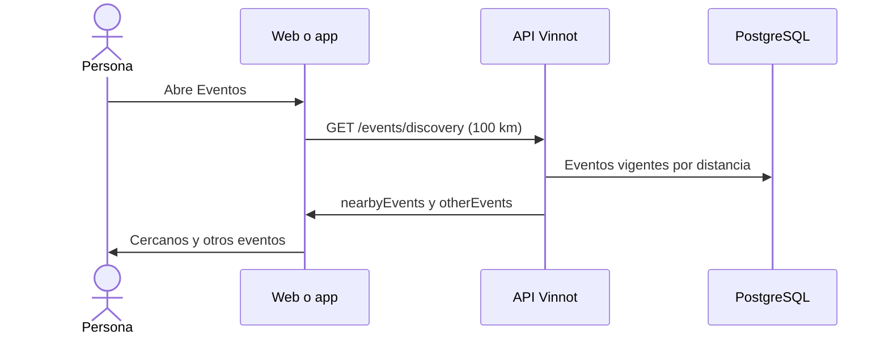

# UC-EVT-01 · Descubrir eventos

| Campo | Valor |
|---|---|
| ID | `UC-EVT-01` |
| Módulo | [Eventos y entradas](../README.md) |
| Plataformas | Web, APK |
| Actores | Usuario autenticado |
| IDs en Lucidchart | [WEB UC-EVT-01](https://lucid.app/lucidchart/9f11a16b-bb5a-42fc-a9e8-0852b17bd241/edit), [APK UC-EVT-01](https://lucid.app/lucidchart/e095dd25-e8ac-41ba-bf5b-396e1055f217/edit) |
| Requisitos | [`RF-WEB-EVT-01`](../requirements.md), [`RF-WEB-EVT-02`](../requirements.md), [`RF-WEB-EVT-03`](../requirements.md), [`RF-WEB-EVT-04`](../requirements.md), [`RF-APK-EVT-01`](../requirements.md), [`RF-APK-EVT-02`](../requirements.md), [`RF-APK-EVT-03`](../requirements.md), [`RF-APK-EVT-04`](../requirements.md) |
| Casos de prueba | [`CP-EVT-01`](../testing.md), [`CP-EVT-02`](../testing.md), [`CP-EVT-03`](../testing.md), [`CP-EVT-04`](../testing.md), [`CP-EVT-05`](../testing.md), [`CP-EVT-06`](../testing.md) |

## Precondiciones

- La persona tiene sesión iniciada.

## Postcondiciones

- La persona ve los eventos vigentes, primero los cercanos si compartió su ubicación.

## Flujo principal

1. La persona abre Eventos.
2. Si compartió su ubicación y no aplicó filtros, el cliente pide `GET /events/discovery` con un radio de 100 km y hasta 50 eventos.
3. La API devuelve los eventos cercanos y, aparte, otros eventos vigentes fuera del radio.
4. El cliente muestra los cercanos y luego los demás, con fecha, lugar, tipo y precio.

## Flujos alternativos

- 2a. Sin ubicación o con filtros de texto, tipo, país o región: el cliente pide `GET /events` paginado con esos filtros.
- 2b. En la app, la persona busca una zona: la app la geocodifica y pide `GET /events/nearby` con radio de 100 km.
- 3a. No hay eventos cercanos: se muestran solo los otros eventos, sin presentarlos como cercanos.
- 3b. Coordenadas, radio o paginación inválidos: la API responde 422.
- 4a. En la app, los eventos con coordenadas también se ven en un mapa, centrado con un zoom cercano (unos 30 km) en la zona buscada, la ubicación de la persona o el primer evento.

## Reglas de negocio

- Solo se listan eventos `PUBLISHED` o `SOLD_OUT` cuyo fin es posterior a la consulta.
- Los borradores, cancelados, postergados y terminados no aparecen en los listados.
- El radio va de 0 a 500 km; 0 equivale a 100 km.
- Las páginas son de 20 eventos por defecto y de hasta 100 en el catálogo.

## Diagrama

[Ver diagrama de «UC-EVT-01 · Descubrir eventos» completo](https://images.vinnot.com/docs/diagrams/v1/es/modules-events-use-cases-uc-evt-01-discover-events-952f405d0277.svg)

Diagrama de componentes en Lucidchart: [WEB UC-EVT-01](https://lucid.app/lucidchart/9f11a16b-bb5a-42fc-a9e8-0852b17bd241/edit), [APK UC-EVT-01](https://lucid.app/lucidchart/e095dd25-e8ac-41ba-bf5b-396e1055f217/edit).

## Código

| Capa | Ubicación |
|---|---|
| Endpoints | `GET /events/discovery`, `GET /events`, `GET /events/nearby`, `GET /events/upcoming` |
| Backend | [`EventController.java`](../../../../../backend/src/main/java/com/vinnot/event/infrastructure/web/controller/EventController.java), [`DiscoverEventsQueryHandler.java`](../../../../../backend/src/main/java/com/vinnot/event/application/query/handler/DiscoverEventsQueryHandler.java), [`SearchEventsQueryHandler.java`](../../../../../backend/src/main/java/com/vinnot/event/application/query/handler/SearchEventsQueryHandler.java), [`GetNearbyEventsQueryHandler.java`](../../../../../backend/src/main/java/com/vinnot/event/application/query/handler/GetNearbyEventsQueryHandler.java), [`EventPersistenceAdapter.java`](../../../../../backend/src/main/java/com/vinnot/event/infrastructure/persistence/adapter/EventPersistenceAdapter.java) |
| Web | [`EventsNearbyPage.tsx`](../../../../../frontend-react/src/presentation/pages/events/EventsNearbyPage.tsx), [`useEventsNearbyViewModel.ts`](../../../../../frontend-react/src/presentation/pages/events/useEventsNearbyViewModel.ts), [`useDiscoverEvents.ts`](../../../../../frontend-react/src/presentation/hooks/queries/event/useDiscoverEvents.ts), [`events.service.ts`](../../../../../frontend-react/src/application/services/events.service.ts), [`events.client.ts`](../../../../../frontend-react/src/infrastructure/api/clients/events.client.ts) |
| App | [`EventsScreen.tsx`](../../../../../frontend-mobile/src/presentation/screens/events/EventsScreen.tsx), [`useEventAreaFilter.ts`](../../../../../frontend-mobile/src/presentation/features/event/useEventAreaFilter.ts), [`eventDiscoveryConfig.ts`](../../../../../frontend-mobile/src/presentation/features/event/eventDiscoveryConfig.ts), [`events.service.ts`](../../../../../frontend-mobile/src/application/services/events.service.ts), [`events.client.ts`](../../../../../frontend-mobile/src/infrastructure/api/clients/events.client.ts) |

## Tests automáticos

- Backend: [`DiscoverEventsQueryHandlerTest.java`](../../../../../backend/src/test/java/com/vinnot/event/application/query/handler/DiscoverEventsQueryHandlerTest.java), [`SearchEventsQueryHandlerTest.java`](../../../../../backend/src/test/java/com/vinnot/event/application/query/handler/SearchEventsQueryHandlerTest.java), [`GetNearbyEventsQueryHandlerTest.java`](../../../../../backend/src/test/java/com/vinnot/event/application/query/handler/GetNearbyEventsQueryHandlerTest.java), [`EventCatalogQueryHandlersTest.java`](../../../../../backend/src/test/java/com/vinnot/event/application/query/handler/EventCatalogQueryHandlersTest.java)
- Web: [`useEventsNearbyViewModel.test.tsx`](../../../../../frontend-react/src/presentation/pages/events/useEventsNearbyViewModel.test.tsx), [`events.service.test.ts`](../../../../../frontend-react/src/application/services/events.service.test.ts), [`eventPagination.test.ts`](../../../../../frontend-react/src/application/services/eventPagination.test.ts)
- App: [`eventsRoute.test.tsx`](../../../../../frontend-mobile/src/presentation/features/event/__tests__/eventsRoute.test.tsx), [`eventCatalogFilter.test.ts`](../../../../../frontend-mobile/src/presentation/features/event/__tests__/eventCatalogFilter.test.ts)
